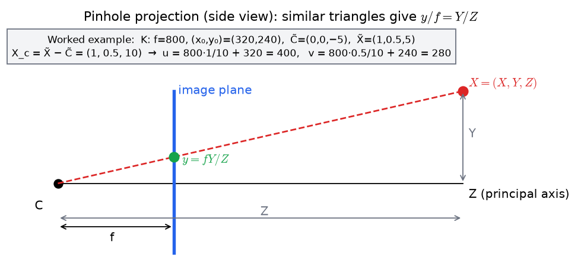
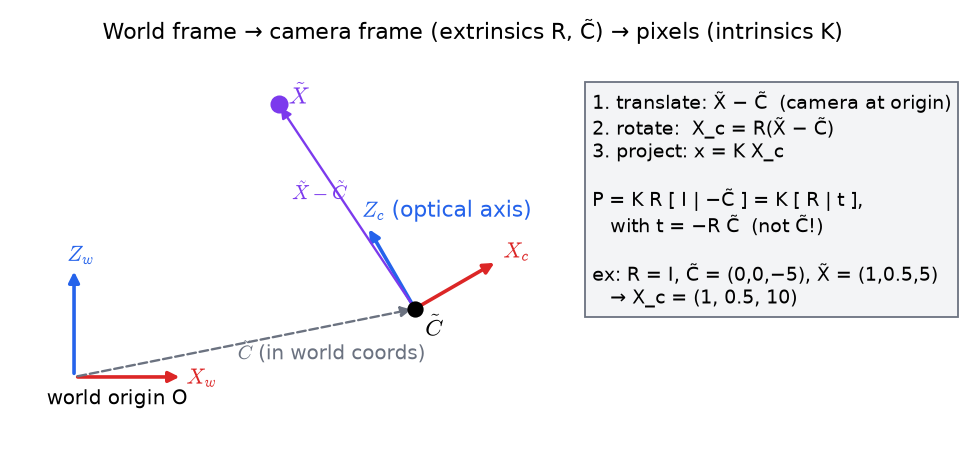
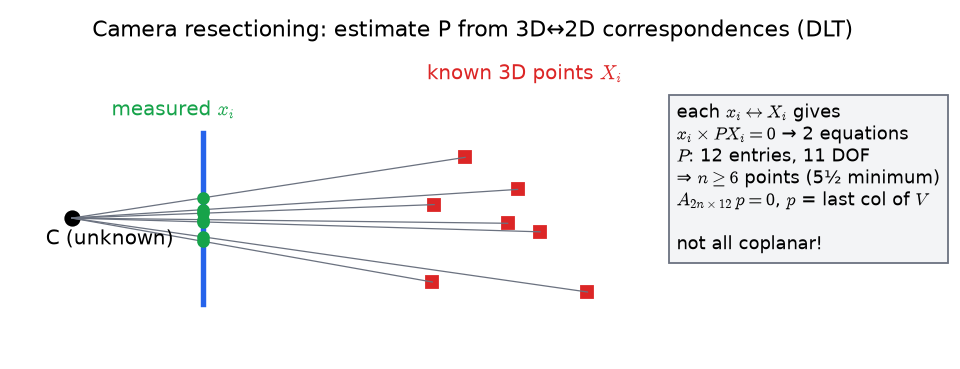
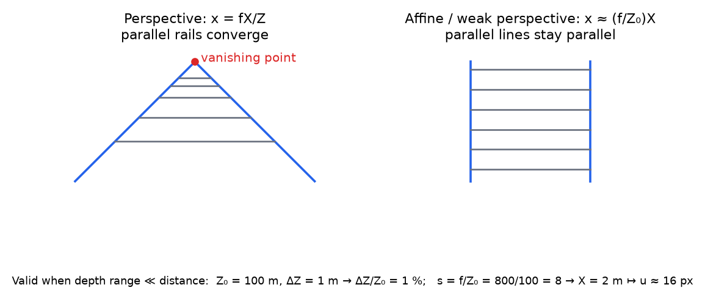
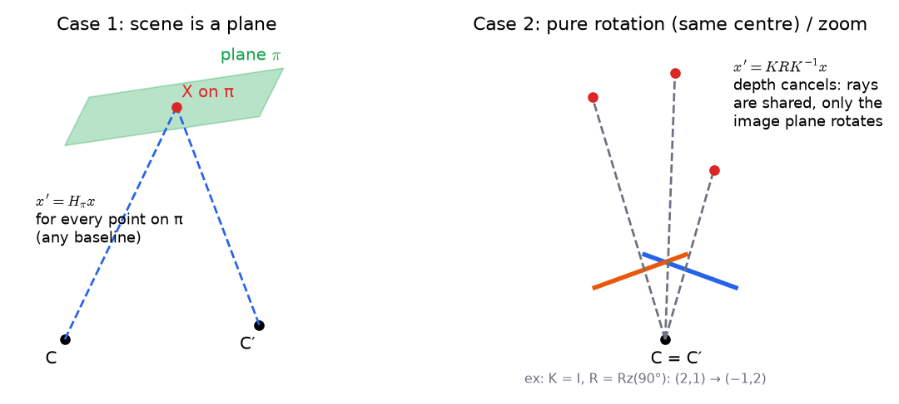
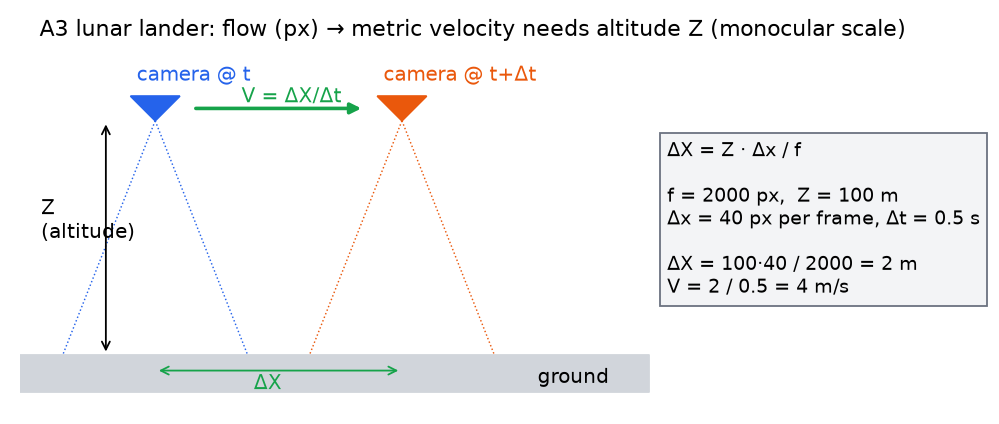

[↑ Index](README.md) · [Next →](02_Session3_Epipolar_Geometry.md)

# Session 2 — The Camera (explained from scratch)

Let's rebuild the entire topic from intuition. The central question of this session is:

**How does a 3D world become a 2D image, and how can we recover the camera's parameters from that image?**

There are five main parts:

1. Pinhole camera model and camera matrix $P$.
2. Understanding the geometry hidden inside $P$.
3. Camera resectioning using DLT.
4. Affine cameras.
5. Homographies between two camera views.

We'll also connect the mathematics to your A3 Lunar Landing assignment.

---

### 2.1 The pinhole camera model

#### 1. Intuition

Imagine a dark room with a tiny hole in one wall.

Light from a 3D object travels through this hole and forms an inverted image on the opposite wall.

A camera approximately behaves this way: every 3D point projects along a ray passing through the camera centre onto the image plane.

We want a mathematical function:

$$
\text{3D point}\longrightarrow\text{2D image point}
$$

#### 2. Deriving the projection equation

Consider a point in camera coordinates:

$$
X_c=
\begin{bmatrix}
X\\Y\\Z
\end{bmatrix}
$$

Using similar triangles:

$$
\frac{x}{f}=\frac{X}{Z}
$$

$$
\frac{y}{f}=\frac{Y}{Z}
$$

Therefore:

$$
x=f\frac{X}{Z},\qquad
y=f\frac{Y}{Z}
$$

This is the pinhole projection equation.

**Why is this important?**

Notice that projection involves division by $Z$. It is nonlinear in ordinary Cartesian coordinates.

Homogeneous coordinates let us represent this projection using matrix multiplication:

$$
\lambda
\begin{bmatrix}
x\\y\\1
\end{bmatrix}
=
\begin{bmatrix}
f&0&0\\
0&f&0\\
0&0&1
\end{bmatrix}
\begin{bmatrix}
X\\Y\\Z
\end{bmatrix}
$$

The third coordinate contains the depth $Z$. Dehomogenisation performs the division.

#### 3. Add the principal point

Real image coordinates do not necessarily have their origin at the optical axis.

Let the principal point be:

$$
(p_x,p_y)
$$

Then:

$$
u=f\frac{X}{Z}+p_x
$$

$$
v=f\frac{Y}{Z}+p_y
$$

We represent this using the intrinsic matrix:

$$
\boxed{
K=
\begin{bmatrix}
f&0&p_x\\
0&f&p_y\\
0&0&1
\end{bmatrix}
}
$$

Thus:

$$
\boxed{x\sim KX_c}
$$

Here, $x=(u,v,1)^T$ is the homogeneous image point.

> **Remember the distinction**
>
> - Camera coordinates describe the 3D point relative to the camera.
> - Pixel coordinates describe where the point appears in the image.
> - $K$ converts camera-coordinate projections into pixel coordinates.

---

### 2.2 Intrinsics and extrinsics

This is probably the most important conceptual distinction in the session.

A camera has two categories of parameters.

**Intrinsics:** properties of the camera itself.

- Focal length.
- Principal point.
- Pixel dimensions.
- Skew (in the general model).

**Extrinsics:** the camera's position and orientation relative to the world.

- Rotation $R$.
- Camera centre $C$.

#### 1. Transform world coordinates into camera coordinates

Suppose a world point is:

$$
\widetilde X=
\begin{bmatrix}
X\\Y\\Z
\end{bmatrix}
$$

The camera centre in world coordinates is:

$$
\widetilde C=
\begin{bmatrix}
C_x\\C_y\\C_z
\end{bmatrix}
$$

First, subtract the camera position:

$$
\widetilde X-\widetilde C
$$

Then rotate into the camera's coordinate system:

$$
\boxed{X_c=R(\widetilde X-\widetilde C)}
$$

Expanding:

$$
X_c=R\widetilde X-R\widetilde C
$$

$$
X_c=R\widetilde X+t
$$

where:

$$
\boxed{t=-R\widetilde C}
$$

This is a very common exam question: why is camera translation $t=-RC$, rather than simply $C$?

Because we are transforming world coordinates into the camera frame, not moving the camera centre into world coordinates.

#### 2. Combine everything

The camera projects the camera-coordinate point through $K$:

$$
x\sim KX_c
$$

Substituting:

$$
x\sim KR(\widetilde X-\widetilde C)
$$

Using homogeneous 3D coordinates:

$$
X=
\begin{bmatrix}
X\\Y\\Z\\1
\end{bmatrix}
$$

we obtain:

$$
\boxed{
x\sim PX
}
$$

where:

> **Extremely important formula**
> $$
> \boxed{P=KR[I\mid-\widetilde C]}
> $$
>
> Alternatively:
>
> $$
> \boxed{P=K[R\mid t]}
> $$
>
> $P$ is a $3\times4$ camera projection matrix.

#### 3. Numerical example

Given:

$$
K=
\begin{bmatrix}
800&0&320\\
0&800&240\\
0&0&1
\end{bmatrix}
$$

$$
R=I,\qquad C=(0,0,-5)
$$

And a world point:

$$
\widetilde X=(1,0.5,5)
$$

First, transform to camera coordinates:

$$
X_c=R(X-C)
$$

$$
X_c=(1,0.5,10)
$$

Now project:

$$
u=800\frac{1}{10}+320=400
$$

$$
v=800\frac{0.5}{10}+240=280
$$

**Answer**

$$
\boxed{x=(400,280)}
$$

The point appears at pixel coordinate (400, 280).

---

### 2.3 Camera models and degrees of freedom

Your notes introduce three progressively more general camera models.

#### A. Basic pinhole camera

$$
K=
\begin{bmatrix}
f&0&p_x\\
0&f&p_y\\
0&0&1
\end{bmatrix}
$$

Intrinsic parameters:

- $f$
- $p_x$
- $p_y$

Thus, 3 intrinsic DOF.

Extrinsics:

- Rotation: 3 DOF.
- Camera position: 3 DOF.

Total:

$$
\boxed{3+6=9}
$$

#### B. CCD camera

Real camera sensors may have non-square pixels.

Let:

$$
\alpha_x=fm_x,\qquad \alpha_y=fm_y
$$

where $m_x,m_y$ represent pixel sampling scales.

Then:

$$
K=
\begin{bmatrix}
\alpha_x&0&x_0\\
0&\alpha_y&y_0\\
0&0&1
\end{bmatrix}
$$

There are 4 intrinsic parameters.

Therefore:

$$
\boxed{4+6=10\text{ DOF}}
$$

#### C. Finite projective camera

Now introduce skew $s$, which allows the image axes to be non-perpendicular.

$$
K=
\begin{bmatrix}
\alpha_x&s&x_0\\
0&\alpha_y&y_0\\
0&0&1
\end{bmatrix}
$$

There are 5 intrinsic parameters.

Therefore:

$$
\boxed{5+6=11\text{ DOF}}
$$

#### Comparison

| Camera model | Intrinsic DOF | Extrinsic DOF | Total |
|---|---:|---:|---:|
| Basic pinhole | 3 | 6 | 9 |
| CCD | 4 | 6 | 10 |
| Finite projective | 5 | 6 | 11 |
| General projective $3\times4$ | — | — | 11 |

**Why does a general projective camera have 11 DOF?**

A $3\times4$ matrix has 12 entries. Since homogeneous projection is unchanged by multiplication of the entire matrix by a nonzero scalar:

$$
\boxed{12-1=11}
$$

This assumes a full-rank, finite projective camera.

---

### 2.4 Understanding the camera matrix $P$

This is where the topic becomes interesting.

We have:

$$
P=[M\mid p_4]
$$

where:

$$
M=KR
$$

So:

$$
P=
\begin{bmatrix}
|&|&|&|\\
p_1&p_2&p_3&p_4\\
|&|&|&|
\end{bmatrix}
$$

You should know what the columns, rows and null space mean geometrically.

#### 1. Camera centre: $PC=0$

The camera centre is the unique 3D point that projects to an undefined image location.

Why?

Every ray passing through the camera centre converges at the same point before projection. The camera centre itself cannot be projected to a finite image point.

Mathematically:

$$
\boxed{PC=0}
$$

Therefore, the camera centre is the right null vector of $P$.

For a finite camera:

$$
P=[M\mid p_4]
$$

$$
M\widetilde C+p_4=0
$$

Hence:

$$
\boxed{\widetilde C=-M^{-1}p_4}
$$

*The homogeneous camera centre is $(\widetilde C^T,1)^T$.*

#### 2. What does $\det(M)=0$ mean?

For a finite camera:

$$
M=KR
$$

Both $K$ and $R$ are invertible, so:

$$
\det(M)\ne0
$$

If:

$$
\boxed{\det(M)=0}
$$

the camera centre lies at infinity.

This describes an affine camera rather than a finite perspective camera.

We'll return to this in Section 2.7.

#### 3. Meaning of the columns

The first three columns correspond to the images of the three world coordinate directions.

| Column | Geometric meaning |
|---|---|
| $p_1$ | Vanishing point of X-axis direction |
| $p_2$ | Vanishing point of Y-axis direction |
| $p_3$ | Vanishing point of Z-axis direction |
| $p_4$ | Image of the world origin |

Why are the first three vanishing points?

A point at infinity in the X direction is:

$$
X_\infty=(1,0,0,0)^T
$$

Its image is:

$$
PX_\infty=p_1
$$

Similarly for the other two coordinate directions.

Remember: the image of a direction is its vanishing point.

#### 4. Meaning of the rows

Each row of $P$ represents a plane in 3D.

Let:

$$
P=
\begin{bmatrix}
P^1\\
P^2\\
P^3
\end{bmatrix}
$$

Then:

- $P^1X=0$: plane mapping to image line $u=0$.
- $P^2X=0$: plane mapping to image line $v=0$.
- $P^3X=0$: principal plane, parallel to the image plane and passing through the camera centre.

Why does the principal plane matter?

For a point on this plane, the third coordinate of its projection is zero. Thus, its projection is at infinity.

#### 5. Principal axis and principal point

Your study guide also includes:

$$
v=\det(M)m^3
$$

where $m^3$ follows the row/cross-product notation of your camera notes.

This gives the principal-axis direction, oriented towards the front of the camera with the appropriate sign convention.

The principal point is the projection of that direction:

$$
x_0=Mm^3
$$

The important intuition: the principal axis is perpendicular to the image plane and passes through its principal point.

#### 6. Recovering $K,R,C$ from $P$

Suppose somebody gives you a camera matrix $P$.

You can recover the camera parameters:

1. Split $P$ into $M$ and $p_4$.
2. Apply RQ decomposition to $M$:

$$
M=KR
$$

3. Calculate the camera centre:

$$
\widetilde C=-M^{-1}p_4
$$

4. Choose signs and normalisation so that $K$ has the required intrinsic-matrix convention and $R$ is a proper rotation.

**Exam trap:** It is RQ decomposition, not ordinary QR decomposition, to obtain upper-triangular $K$ followed by rotation $R$.

---

### 2.5 Camera resectioning — DLT for camera estimation

#### 1. Intuition

So far, we have assumed that we know the camera matrix $P$.

But suppose we are given:

- Several 3D points $X_i$, whose world coordinates are known.
- Their corresponding image points $x_i$.

Can we recover $P$?

Yes. This problem is called **camera resectioning**.

This is essentially the camera version of homography DLT.

#### 2. Derivation

For each correspondence:

$$
x_i\sim PX_i
$$

Write:

$$
x_i=(u_i,v_i,1)^T
$$

Let the rows of $P$ be $P^1,P^2,P^3$.

From the cross-product constraint:

$$
x_i\times PX_i=0
$$

We get two independent equations:

$$
u_iP^3X_i-P^1X_i=0
$$

$$
v_iP^3X_i-P^2X_i=0
$$

Stacking the coefficients:

$$
A_i=
\begin{bmatrix}
0^T&-w_iX_i^T&v_iX_i^T\\
w_iX_i^T&0^T&-u_iX_i^T
\end{bmatrix}
$$

Each correspondence contributes two independent equations.

Since $P$ has 12 entries, but only 11 DOF:

$$
\boxed{n_{\min}=\frac{11}{2}\Rightarrow n\geq6}
$$

We stack the equations:

$$
Ap=0
$$

where $p$ contains the 12 entries of $P$.

Solve using SVD:

$$
A=U\Sigma V^T
$$

$$
\boxed{p=V[:, -1]}
$$

Reshape into $3\times4$.

#### 3. Normalisation

This is another important connection to your A4 DLT.

We normalise both coordinate systems.

| Space | Normalisation |
|---|---|
| 2D image | Centroid to origin, mean distance $\sqrt{2}$ |
| 3D world | Centroid to origin, mean distance $\sqrt{3}$ |

Let the transformations be $T$ and $U$.

Then:

$$
\widetilde x=Tx
$$

$$
\widetilde X=UX
$$

Estimate the normalised camera matrix:

$$
\widetilde x\sim\widetilde P\widetilde X
$$

Substitute:

$$
Tx\sim\widetilde PUX
$$

Therefore:

$$
\boxed{P=T^{-1}\widetilde P U}
$$

Notice the difference from homography denormalisation:

$$
H=T'^{-1}\widetilde H T
$$

Camera resectioning involves transformations in both 2D and 3D coordinate spaces.

#### 4. Why is DLT not the final answer?

DLT minimises an algebraic error:

$$
\|Ap\|^2
$$

But what we actually care about is how accurately the camera projects our 3D points onto the observed image points.

That is the reprojection error:

$$
\boxed{
E(P)=\sum_i\|x_i-\pi(PX_i)\|^2
}
$$

Here, $\pi$ means project and dehomogenise.

The gold-standard approach is:

1. Estimate $P$ using DLT.
2. Use it as an initialisation.
3. Minimise reprojection error using Levenberg–Marquardt.

**Why?** The algebraic error is convenient for solving, but it does not directly measure pixel-coordinate error.

#### 5. Degenerate configurations

Your notes mention two important cases:

- All 3D points lie on a plane.
- The 3D points and camera centre lie on a twisted cubic.

Why are coplanar points problematic?

If every point belongs to a single plane, the observations primarily constrain a plane-to-image homography:

$$
x\sim H X_{\text{plane}}
$$

You cannot generally recover the entire 3D camera geometry from this planar configuration alone.

---

### 2.6 Affine cameras

#### 1. Intuition

A perspective camera makes distant objects appear smaller.

For example, imagine looking at railway tracks. They appear to converge towards a vanishing point.

But suppose the scene is very far away, and its depth variation is tiny compared with its average distance.

Then the perspective effect becomes negligible.

This motivates affine camera models.

#### 2. Perspective vs affine projection

Perspective projection:

$$
u=f\frac{X}{Z}
$$

$$
v=f\frac{Y}{Z}
$$

Affine projection approximates the denominator as nearly constant:

$$
Z\approx Z_0
$$

Therefore:

$$
u\approx\frac{f}{Z_0}X
$$

$$
v\approx\frac{f}{Z_0}Y
$$

This is a linear transformation plus translation.

In camera matrix form, the last row has the form:

$$
(0,0,0,1)
$$

Thus:

$$
P=
\begin{bmatrix}
a_{11}&a_{12}&a_{13}&t_x\\
a_{21}&a_{22}&a_{23}&t_y\\
0&0&0&1
\end{bmatrix}
$$

The left $3\times3$ matrix $M$ is singular:

$$
\boxed{\det(M)=0}
$$

The camera centre is at infinity.

#### 3. Four affine camera types

Memorise this table exactly as in your study guide.

| Model | DOF |
|---|---:|
| Orthographic | 5 |
| Scaled orthographic | 6 |
| Weak perspective | 7 |
| General affine | 8 |

The general affine model has the form:

$$
x\sim
\begin{bmatrix}
A&t\\
0^T&1
\end{bmatrix}X
$$

The $2\times3$ matrix $A$ has six entries, and the image translation has two entries:

$$
6+2=\boxed{8\text{ DOF}}
$$

#### When is the approximation valid?

$$
\boxed{\Delta Z\ll Z_0}
$$

Here:

- $Z_0$ = average scene depth.
- $\Delta Z$ = variation in depth.

The smaller the relative depth variation, the better the affine approximation.

**Exam trap:** An affine camera is not the same as a finite perspective camera with an ordinary last row. Its camera centre is at infinity.

---

### 2.7 When are two images related by a homography?

This is one of the most important conceptual sections.

Suppose we have two camera views of the same scene.

Normally, a single homography cannot explain every point in a general 3D scene.

But there are four special cases where a homography exists.

#### Case 1. All scene points lie on a plane

Suppose the plane is:

$$
Z=0
$$

For camera $i$:

$$
P_i=[p_1^i\quad p_2^i\quad p_3^i\quad p_4^i]
$$

A point on the plane has:

$$
X=(X,Y,0,1)^T
$$

Therefore:

$$
x_i\sim p_1^iX+p_2^iY+p_4^i
$$

Define:

$$
H_i=[p_1^i\quad p_2^i\quad p_4^i]
$$

Then:

$$
x_i\sim H_i
\begin{bmatrix}
X\\Y\\1
\end{bmatrix}
$$

For two images:

$$
x_1\sim H_1X_{\text{plane}}
$$

$$
x_2\sim H_2X_{\text{plane}}
$$

Eliminate the plane coordinates:

$$
X_{\text{plane}}\sim H_2^{-1}x_2
$$

Hence:

$$
\boxed{x_1\sim H_1H_2^{-1}x_2}
$$

#### Case 2. Same camera centre

Suppose the camera rotates but does not translate.

The relative transformation is:

$$
\boxed{H=K_1R_1(R_2)^{-1}K_2^{-1}}
$$

More generally:

$$
H=K_1R_1R_2^TK_2^{-1}
$$

Since all the rays originate from the same camera centre, depth cancels.

This means every scene point can be mapped through a homography, regardless of its depth.

#### Case 3. Zoom only

Suppose the camera pose stays fixed but the intrinsics change.

Then:

$$
x_1\sim K_1X_c
$$

$$
x_2\sim K_2X_c
$$

Eliminating $X_c$:

$$
\boxed{H=K_1K_2^{-1}}
$$

For a simple change in focal length, the effect is essentially a scaling around the principal point.

#### Case 4. Rotation only, same intrinsics

This is the special case that you should remember particularly well.

For two cameras with the same $K$, one rotating relative to the other:

$$
\boxed{H=KRK^{-1}}
$$

Why?

The first camera produces:

$$
x=KX_c
$$

After rotation:

$$
X_c'=RX_c
$$

The second image is:

$$
x'=KRX_c
$$

Substitute:

$$
X_c=K^{-1}x
$$

Therefore:

$$
\boxed{x'=KRK^{-1}x}
$$

This is a homography.

**Why does depth disappear?**

Because there is no translation. Both cameras observe the same 3D ray, only in a different orientation.

#### Summary: the four cases

| Case | Homography |
|---|---|
| Planar scene | $H=H_1H_2^{-1}$ |
| Same camera centre | $H=K_1R_1R_2^{-1}K_2^{-1}$ |
| Zoom only | $H=K_1K_2^{-1}$ |
| Rotation only, same K | $H=KRK^{-1}$ |

**Very important connection to Session 3:** If a pair of images is related by pure rotation, there is no translational parallax. You cannot recover scene depth using that pair.

---

### 2.8 Connection to your A3 — Lunar Landing

This is where camera geometry becomes useful in an actual vision problem.

Imagine a camera mounted on a lunar lander looking down at the ground.

As the lander moves, the ground appears to move in the image.

We want to estimate actual ground velocity from image velocity.

#### Step 1. Start with perspective projection

$$
x=f\frac{X}{Z}
$$

Assume altitude $Z$ is approximately constant over a short interval.

A small ground displacement $\Delta X$ creates an image displacement:

$$
\Delta x\approx f\frac{\Delta X}{Z}
$$

Therefore:

$$
\boxed{\Delta X=\frac{Z\Delta x}{f}}
$$

#### Step 2. Convert displacement into velocity

Divide by the time interval:

$$
V=\frac{\Delta X}{\Delta t}
$$

Therefore:

$$
\boxed{
V=\frac{Z\cdot \text{flow}_{px}}
{f\cdot\Delta t}
}
$$

Remember that $f$ must be expressed in pixels.

#### Step 3. Numerical example

Given:

- Focal length $f=2000$ pixels.
- Altitude $Z=100$ m.
- Image displacement = 40 pixels/frame.
- Frame interval $\Delta t=0.5$ seconds.

Ground displacement:

$$
\Delta X=\frac{100\times40}{2000}
$$

$$
\Delta X=2\text{ m}
$$

Velocity:

$$
V=\frac{2}{0.5}
$$

**Answer**

$$
\boxed{V=4\text{ m/s}}
$$

#### Why can't one camera recover absolute scale?

Suppose a scene is twice as large and twice as far away.

The ratio $X/Z$ remains unchanged.

Therefore, its image remains identical.

This is the monocular scale ambiguity.

Your A3 assignment provides altitude information, which allows metric scale recovery.

---

## Session 2 — Final revision sheet

These are the formulas I would memorise before the exam.

> **1. Pinhole projection**
>
> $$
> u=fX/Z+p_x,\qquad v=fY/Z+p_y
> $$
>
> **2. Intrinsic matrix**
>
> $$
> K=
> \begin{bmatrix}
> \alpha_x&s&x_0\\
> 0&\alpha_y&y_0\\
> 0&0&1
> \end{bmatrix}
> $$
>
> **3. Camera matrix**
>
> $$
> \boxed{P=KR[I\mid-C]}
> $$
>
> $$
> P=K[R\mid t],\quad t=-RC
> $$
>
> **4. Camera centre**
>
> $$
> PC=0,\qquad C=-M^{-1}p_4
> $$
>
> **5. Camera DOF**
>
> | Model | DOF |
> |---|---:|
> | Basic pinhole | 9 |
> | CCD | 10 |
> | Finite projective | 11 |
> | Orthographic | 5 |
> | Scaled orthographic | 6 |
> | Weak perspective | 7 |
> | General affine | 8 |
>
> **6. Resectioning**
>
> $$
> x_i\times PX_i=0
> $$
>
> $$
> AP=0,\qquad n\geq6
> $$
>
> $$
> \boxed{P=T^{-1}\widetilde P U}
> $$
>
> **7. Gold-standard estimation**
>
> $$
> \min_P\sum_i\|x_i-\pi(PX_i)\|^2
> $$
>
> **8. Affine camera condition**
>
> $$
> \det(M)=0
> $$
>
> $$
> \Delta Z\ll Z_0
> $$
>
> **9. Four homography cases**
>
> $$
> H_{\text{plane}}=H_1H_2^{-1}
> $$
>
> $$
> H_{\text{same centre}}=K_1R_1R_2^{-1}K_2^{-1}
> $$
>
> $$
> H_{\text{zoom}}=K_1K_2^{-1}
> $$
>
> $$
> \boxed{H_{\text{rotation}}=KRK^{-1}}
> $$
>
> **10. Lunar lander**
>
> $$
> \boxed{V=\frac{Z\cdot\text{flow}_{px}}{f\Delta t}}
> $$

### Test yourself — 7 exam-style questions

Don't look back at the lesson. Try these now.

#### Practice questions

1. A point is at (2, 3, 10). The camera has f = 500 px and principal point (320, 240). Find its image coordinates.
   *Hint: Use u = fX/Z + px and v = fY/Z + py.*
2. Explain why t = −RC instead of t = C.
   *Hint: Think about transforming world coordinates into the camera frame.*
3. A camera matrix P = [M | p₄] is given. How do you recover its camera centre? What does det(M) = 0 mean?
   *Hint: Use PC = 0.*
4. Why does camera resectioning require at least six 3D–2D correspondences? Why are coplanar points degenerate?
   *Hint: Count independent equations and compare with the unknown DOF.*
5. A camera observes a scene with average depth 100 m and depth variation 1 m. Is an affine camera approximation reasonable? Explain.
   *Hint: Compare ΔZ with Z₀.*
6. A camera rotates by R without translating. Derive H = KRK⁻¹ and explain why depth cancels.
   *Hint: Start with x = KXc, then x′ = KRXc.*
7. For f = 1000 px, altitude = 50 m, image motion = 20 px in 0.25 seconds, calculate ground velocity.
   *Hint: Use the lunar lander equation.*

**My recommendation:** Make sure you can independently derive $P=KR[I|-C]$, camera resectioning denormalisation, and $H=KRK^{-1}$. These connect multiple topics and are especially useful foundations for Session 3 (epipolar geometry).

---

[↑ Index](README.md) · [Next →](02_Session3_Epipolar_Geometry.md)
