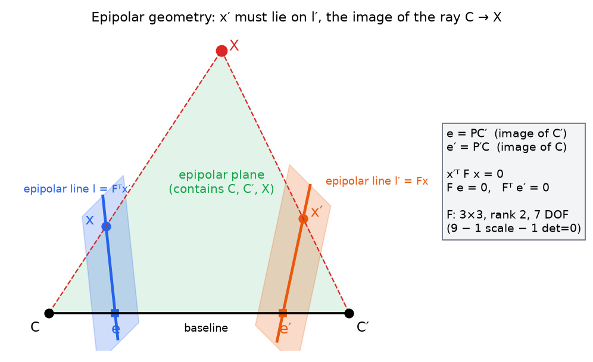
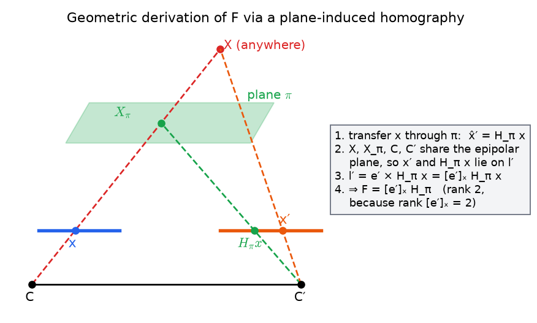
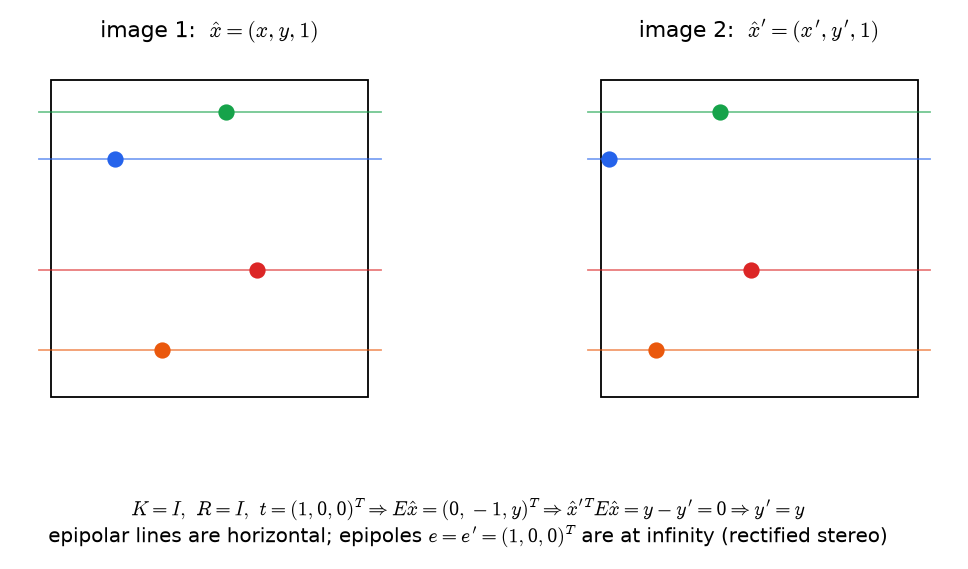
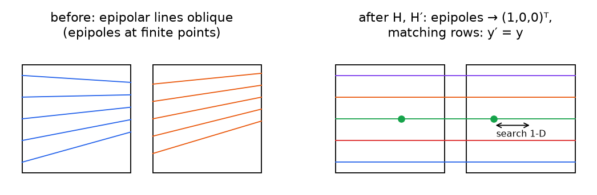
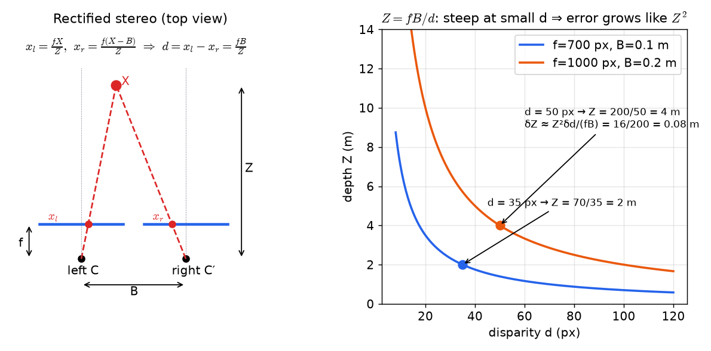
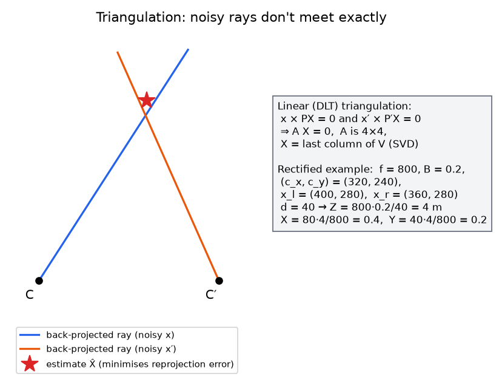
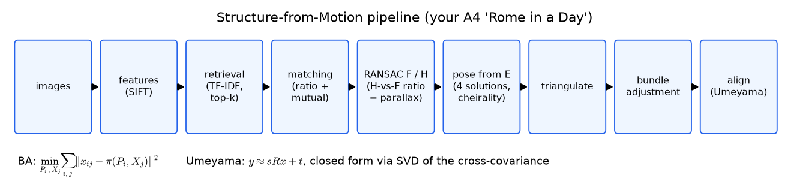

# Recap quiz (Sessions 1–2) and Session 3: Epipolar Geometry

[↑ Index](README.md) · [← Previous](01_Session2_Camera.md) · [Next →](03_Session3_Epipolar_Geometry_Second_Pass.md)

We'll follow your study guide and Hartley & Zisserman's notation. I'll teach Session 3 in the order **geometry → F → estimation → E → stereo → triangulation → SfM**.

Let's begin with the recap. Try answering without looking at your notes.

## Part 1 — Sessions 1–2 rapid recap quiz

**10-minute target · 6 questions**

**Q1. Homogeneous coordinates**

Two parallel lines are

$$
l_1=(1,0,-1)^T,\qquad l_2=(1,0,-2)^T.
$$

Find their intersection in homogeneous coordinates. Is it a finite or ideal point?

**Q2. Transformation hierarchy**

An affine transformation has how many DOF and requires how many point correspondences at minimum? Name two properties it preserves.

**Q3. Hartley normalisation**

You are given a set of image points. Describe the two operations used to normalise them before DLT. What is the target mean distance, and how do you denormalise the estimated homography?

**Q4. RANSAC**

For a homography, suppose:

- Inlier fraction $w=0.5$
- Sample size $s=4$
- Desired success probability $p=0.99$

How many iterations are required?

**Q5. Camera matrix**

Given

$$
P=[M\mid p_4]
$$

how do you calculate the camera centre $C$? What does $\det(M)=0$ indicate?

**Q6. Rotation-only homography**

Write the homography between two views when the camera only rotates. Why does the transformation not depend on scene depth?

These cover the main ideas from your first two sessions.

---

## Part 2 — Session 3: Epipolar geometry

**High priority · 2.5-hour session**

### 3.1 Big picture

Suppose we photograph the same scene using two cameras from different positions.

A point in the first image corresponds to a ray in 3D. That ray projects onto a line in the second image.

**Epipolar geometry tells us where to search for the corresponding point in the second image.**

Instead of searching the entire image (2D), we only need to search along a line (1D).

This is particularly important for stereo vision, depth estimation and Structure from Motion (SfM).

### 3.2 Understand the geometry first

Imagine two cameras:

- First camera centre: $C$
- Second camera centre: $C'$
- 3D scene point: $X$
- Its image coordinates: $x$ and $x'$

**1. Baseline**

The line joining the two camera centres:

$$
CC'
$$

This is called the baseline.

**2. Epipoles**

The image of the *other camera centre* in each image:

$$
\boxed{e=PC'}
$$

$$
\boxed{e'=P'C}
$$

Remember the distinction:

- $e$: epipole in image 1.
- $e'$: epipole in image 2.

**3. Epipolar plane**

The plane containing $C,C'$ and $X$.

**4. Epipolar lines**

The epipolar plane intersects each image plane in a line.

The important consequence is:

$$
\boxed{l'=Fx}
$$

The corresponding point $x'$ must lie on this line:

$$
\boxed{x'^TFx=0}
$$

All epipolar lines in the second image pass through $e'$.

This is the fundamental constraint we want to derive.

---

### 3.3 Deriving the Fundamental Matrix $F$

There are two useful derivations in your notes. Understand both.

#### Derivation 1: Geometric derivation

**Step 1. Choose a plane $\pi$**

Take a plane in 3D that does not pass through either camera centre.

This plane induces a homography between the two images:

$$
x'=H_\pi x
$$

Why?

Because all points on that plane can be mapped from one image to another using a homography.

**Step 2. Identify the epipolar line**

The epipolar line $l'$ passes through:

- The epipole $e'$.
- The corresponding point $x'$.

We know that the line passing through two homogeneous points is their cross product.

Therefore:

$$
l'=e'\times x'
$$

**Step 3. Substitute the homography**

Since

$$
x'=H_\pi x
$$

we get

$$
l'=e'\times H_\pi x
$$

Recall that cross products can be represented by skew-symmetric matrices:

$$
a\times b=[a]_\times b
$$

where

$$
[a]_\times=
\begin{bmatrix}
0&-a_3&a_2\\
a_3&0&-a_1\\
-a_2&a_1&0
\end{bmatrix}
$$

Thus,

$$
l'=[e']_\times H_\pi x
$$

But we also know that $l'=Fx$.

Therefore:

> **Important derivation**
> $$
> \boxed{F=[e']_\times H_\pi}
> $$
> The fundamental matrix maps a point in image 1 to its corresponding epipolar line in image 2.

**Why does $F$ have rank 2?**

Look at the cross-product matrix:

$$
[e']_\times
$$

For any vector $e'$,

$$
[e']_\times e'=e'\times e'=0
$$

So $e'$ lies in its null space.

A nonzero 3D cross-product matrix has rank 2. Since $F$ contains this matrix as a factor, its rank cannot exceed 2.

For a normal two-camera configuration:

$$
\boxed{\operatorname{rank}(F)=2}
$$

#### Derivation 2: Algebraic derivation

This derivation is useful because it works directly with camera matrices.

Start with:

$$
x=PX
$$

The 3D point $X$ is not uniquely determined by one image point. It lies somewhere along the ray corresponding to $x$.

Using the pseudoinverse of $P$:

$$
X(\lambda)=P^+x+\lambda C
$$

Here, $C$ is the camera centre and satisfies $PC=0$.

**Step 1. Project this ray into the second camera.**

$$
x'(\lambda)=P'X(\lambda)
$$

Substitute:

$$
x'(\lambda)=P'P^+x+\lambda P'C
$$

**Step 2. Identify the two points defining the epipolar line.**

The expression gives two important points:

$$
a=P'P^+x
$$

and

$$
e'=P'C
$$

The epipolar line is the line joining these two points.

**Step 3. Write the line using a cross product.**

$$
l'=e'\times a
$$

Substituting $a$:

$$
l'=[e']_\times P'P^+x
$$

Comparing this with $l'=Fx$:

$$
\boxed{F=[e']_\times P'P^+}
$$

Both derivations give the same fundamental relationship.

---

### 3.4 Properties and degrees of freedom of $F$

Memorise these.

| Property | Equation |
|---|---|
| Correspondence constraint | $x'^TFx=0$ |
| Epipolar line in image 2 | $l'=Fx$ |
| Epipolar line in image 1 | $l=F^Tx'$ |
| Right null vector | $Fe=0$ |
| Left null vector | $F^Te'=0$ |
| Rank | 2 |
| Degrees of freedom | 7 |

**Why does $F$ have 7 DOF?**

A $3\times3$ matrix has 9 entries.

However:

1. The matrix is defined only up to an arbitrary scale, leaving 8 DOF.
2. The rank-2 constraint, equivalently $\det(F)=0$, removes another DOF.

Therefore:

$$
\boxed{\operatorname{DOF}(F)=9-1-1=7}
$$

**Exam trap:** Don't confuse 7 DOF with 7 correspondences. The number of DOF and the number of correspondences required by an estimation algorithm are different concepts.

---

### 3.5 Estimating $F$: the 8-point algorithm

Suppose we have point correspondences:

$$
x=(x,y,1)^T
$$

$$
x'=(x',y',1)^T
$$

From the epipolar constraint:

$$
x'^TFx=0
$$

Let

$$
F=
\begin{bmatrix}
f_1&f_2&f_3\\
f_4&f_5&f_6\\
f_7&f_8&f_9
\end{bmatrix}
$$

Expanding the equation:

$$
\begin{aligned}
&x'(f_1x+f_2y+f_3)\\
+{}&y'(f_4x+f_5y+f_6)\\
+{}&f_7x+f_8y+f_9=0
\end{aligned}
$$

Rearrange:

$$
\begin{aligned}
[&x'x,\ x'y,\ x',\\
 &y'x,\ y'y,\ y',\\
 &x,\ y,\ 1]f=0
\end{aligned}
$$

where $f$ is the vector containing all nine entries of $F$.

For $n$ correspondences:

$$
Af=0
$$

with

$$
A\in\mathbb R^{n\times9}
$$

The minimum number of correspondences for the linear 8-point algorithm is:

$$
\boxed{n=8}
$$

Solve using SVD:

$$
A=U\Sigma V^T
$$

Choose the last right singular vector:

$$
f=V[:, -1]
$$

Reshape it into a $3\times3$ matrix.

#### Why must we enforce rank 2?

Because the linear estimate was obtained from noisy point correspondences.

It will generally produce a full-rank matrix:

$$
F=U
\begin{bmatrix}
\sigma_1&0&0\\
0&\sigma_2&0\\
0&0&\sigma_3
\end{bmatrix}
V^T
$$

But a valid fundamental matrix must have:

$$
\det(F)=0
$$

So we set the smallest singular value to zero:

$$
\boxed{
F=U
\begin{bmatrix}
\sigma_1&0&0\\
0&\sigma_2&0\\
0&0&0
\end{bmatrix}
V^T
}
$$

This is the closest rank-2 matrix to the original estimate in Frobenius norm.

It also ensures that a single epipole exists as the appropriate null vector.

#### Normalised 8-point algorithm

This is especially important because you implemented a normalised DLT in A4.

The procedure:

1. Normalise image 1 using $T$.
2. Normalise image 2 using $T'$.
3. Solve for $\widetilde F$.
4. Enforce rank 2.
5. Denormalise.

The Hartley normalisation shifts the centroid to the origin and scales the mean distance to $\sqrt{2}$.

Since

$$
\widetilde x=Tx,\qquad \widetilde x'=T'x'
$$

and

$$
\widetilde x'^T\widetilde F\widetilde x=0
$$

substitution gives

$$
x'^TT'^T\widetilde FTx=0
$$

Therefore:

$$
\boxed{F=T'^T\widetilde F T}
$$

Notice the transpose on $T'$. It is not $T'^{-1}$, unlike homography denormalisation.

#### What about the 7-point algorithm?

For seven correspondences:

$$
A\in\mathbb R^{7\times9}
$$

The null space is generally two-dimensional.

Let its basis matrices be $F_1,F_2$.

Then:

$$
F=\alpha F_1+(1-\alpha)F_2
$$

Enforce the rank-2 condition:

$$
\det(F)=0
$$

This gives a cubic polynomial in $\alpha$.

Consequently, there can be one or three real solutions.

| Algorithm | Minimum correspondences | Solutions |
|---|---:|---|
| 7-point | 7 | 1 or 3 |
| 8-point | 8 | 1 |

---

### 3.6 The Essential Matrix $E$

Now introduce calibration.

This is where $F$ and $E$ differ.

**Fundamental matrix:** works with pixel coordinates and does not require known camera calibration.

**Essential matrix:** works with normalised camera coordinates and assumes known intrinsics.

Normalise the image points:

$$
\hat x=K^{-1}x
$$

$$
\hat x'=K'^{-1}x'
$$

The calibrated camera matrices can be written as:

$$
P=K[I\mid0]
$$

$$
P'=K'[R\mid t]
$$

#### Deriving $E=[t]_\times R$

**Step 1. Consider the ray from camera 1.**

A 3D point lies on the ray:

$$
X=\lambda\hat x
$$

**Step 2. Express it in camera 2 coordinates.**

Using the relative pose:

$$
X'=RX+t
$$

Substitute:

$$
X'=\lambda R\hat x+t
$$

**Step 3. Use the coplanarity condition.**

The vectors

$$
\hat x',\quad R\hat x,\quad t
$$

lie in the same epipolar plane.

Therefore, their scalar triple product must be zero:

$$
\hat x'^T(t\times R\hat x)=0
$$

Represent the cross product using the skew-symmetric matrix:

$$
\hat x'^T[t]_\times R\hat x=0
$$

Comparing with the epipolar constraint:

$$
\hat x'^TE\hat x=0
$$

we obtain:

> **Essential matrix derivation**
> $$
> \boxed{E=[t]_\times R}
> $$
> $$
> \boxed{F=K'^{-T}EK^{-1}}
> $$
> $$
> \boxed{E=K'^TFK}
> $$

#### Degrees of freedom of $E$

Rotation $R$ has 3 DOF.

Translation $t$ has 3 parameters, but its magnitude is not recoverable from two calibrated images. Only its direction is known.

Therefore:

$$
\boxed{\operatorname{DOF}(E)=3+2=5}
$$

#### Singular value property

For a valid essential matrix:

$$
\boxed{\sigma_1=\sigma_2,\qquad \sigma_3=0}
$$

In other words:

$$
E=U
\begin{bmatrix}
\sigma&0&0\\
0&\sigma&0\\
0&0&0
\end{bmatrix}
V^T
$$

This is different from a general fundamental matrix, which only needs rank 2.

**A subtle textbook detail:** Your guide writes the enforced form as $U\operatorname{diag}(1,1,0)V^T$. Because $E$ is defined up to scale, that is a valid normalised form. When calculating the closest essential matrix in Frobenius norm, the first two singular values are usually replaced by their average, $(\sigma_1+\sigma_2)/2$.

---

### 3.7 Worked numerical example: cameras translated sideways

Consider:

$$
P=K[I\mid0],\qquad P'=K[I\mid t]
$$

Let:

$$
K=I,\qquad R=I,\qquad t=
\begin{bmatrix}
1\\0\\0
\end{bmatrix}
$$

**Step 1. Calculate $E$.**

$$
E=[t]_\times R
$$

Since $R=I$:

$$
E=
\begin{bmatrix}
0&0&0\\
0&0&-1\\
0&1&0
\end{bmatrix}
$$

**Step 2. Apply the epipolar constraint.**

$$
\hat x'^TE\hat x=0
$$

For:

$$
\hat x=(x,y,1)^T,\quad
\hat x'=(x',y',1)^T
$$

first calculate:

$$
E\hat x=
\begin{bmatrix}
0\\-1\\y
\end{bmatrix}
$$

Then:

$$
\hat x'^TE\hat x=-y'+y=0
$$

So:

$$
\boxed{y'=y}
$$

**Interpretation:** The epipolar lines are horizontal.

The cameras are translated sideways without rotation, so a point in image 1 can only correspond to a point with the same vertical coordinate in image 2.

The epipoles are:

$$
\boxed{e=e'=(1,0,0)^T}
$$

They lie at infinity along the horizontal direction.

This is exactly the geometry of rectified stereo cameras.

---

### 3.8 Decomposing the Essential Matrix

This is a common conceptual and derivation question.

Perform SVD:

$$
E=U\Sigma V^T
$$

Define:

$$
W=
\begin{bmatrix}
0&-1&0\\
1&0&0\\
0&0&1
\end{bmatrix}
$$

The two possible rotations are:

$$
R=UWV^T
$$

or

$$
R=UW^TV^T
$$

The translation direction has two possibilities:

$$
t=\pm u_3
$$

where $u_3$ is the third column of $U$.

Therefore:

$$
\boxed{2\times2=4\text{ possible }(R,t)\text{ solutions}}
$$

How do we select the correct solution?

**Cheirality check:** triangulate the points for each candidate solution. Keep the solution in which the 3D points are in front of both cameras.

One important limitation:

$$
\boxed{\text{Absolute translation scale cannot be recovered}}
$$

This is why calibrated SfM reconstructions are determined only up to a similarity transformation.

---

### 3.9 F vs E vs H — exam comparison

This table is worth memorising.

| Property | Homography $H$ | Fundamental $F$ | Essential $E$ |
|---|---|---|---|
| Maps | Point → point | Point → line | Point → line |
| Coordinates | Image | Pixels | Normalised |
| Calibration required | No | No | Yes |
| DOF | 8 | 7 | 5 |
| Rank | 3 generally | 2 | 2 |
| Main use | Plane or pure rotation | General two-view geometry | Calibrated two-view geometry |

**Three important traps:**

1. $H$ describes a point-to-point mapping. $F$ describes a point-to-epipolar-line mapping.
2. $E$ is more constrained than $F$, because it incorporates known intrinsics and relative camera pose.
3. Under pure rotation, $t=0$, so $E=0$ and $F=0$. The fundamental matrix is undefined. Use the rotation homography instead:

$$
\boxed{H=KRK^{-1}}
$$

---

### 3.10 Rectification and stereo depth

Rectification applies two image homographies $H$ and $H'$ so that both epipoles move to:

$$
(1,0,0)^T
$$

This puts the epipoles at infinity in the horizontal direction.

Consequently, corresponding points lie on the same horizontal row.

We can now calculate depth using horizontal disparity.

For rectified parallel cameras:

$$
x_l=\frac{fX}{Z}
$$

$$
x_r=\frac{f(X-B)}{Z}
$$

Subtract:

$$
d=x_l-x_r=\frac{fB}{Z}
$$

Therefore:

$$
\boxed{Z=\frac{fB}{d}}
$$

where $B$ is the baseline and $d$ is disparity.

#### Numerical example

Given:

$$
f=700\text{ px},\quad B=0.1\text{ m},\quad d=35\text{ px}
$$

$$
Z=\frac{700(0.1)}{35}
$$

$$
\boxed{Z=2\text{ m}}
$$

**Depth uncertainty**

Differentiate the depth equation:

$$
Z=\frac{fB}{d}
$$

$$
\frac{\partial Z}{\partial d}=-\frac{fB}{d^2}
$$

Since $Z=fB/d$:

$$
\boxed{\delta Z\approx\frac{Z^2}{fB}\delta d}
$$

This gives a very important observation:

- Depth uncertainty increases quadratically with distance.
- Increasing the baseline reduces depth uncertainty.
- More accurate disparity measurement improves depth estimation.

---

### 3.11 Triangulation

So far, we have estimated camera geometry and established correspondence constraints.

Now we need to recover the actual 3D point.

**Triangulation** means estimating the 3D point from its observations in two or more images.

Each image point defines a ray from its camera centre.

In an ideal noiseless situation, the rays intersect at $X$.

With real image measurements, they usually do not intersect exactly.

We therefore solve an approximate system.

#### Linear DLT triangulation

For each camera:

$$
x\times PX=0
$$

Let the rows of $P$ be:

$$
P=
\begin{bmatrix}
p_1^T\\
p_2^T\\
p_3^T
\end{bmatrix}
$$

For image point $x=(u,v,1)^T$, two independent equations are:

$$
(up_3^T-p_1^T)X=0
$$

$$
(vp_3^T-p_2^T)X=0
$$

Repeat for the second camera.

You obtain:

$$
AX=0
$$

where $A$ is $4\times4$.

Use SVD:

$$
A=U\Sigma V^T
$$

Take the last right singular vector:

$$
\boxed{X=V[:, -1]}
$$

Then dehomogenise to obtain the 3D coordinates.

#### Numerical connection to stereo

Suppose we have:

$$
f=700,\quad B=0.1,\quad d=35
$$

We already calculated:

$$
Z=2\text{ m}
$$

Let the principal point be $c_x=320$, and the left image coordinate be $u_l=350$.

Then:

$$
X=\frac{(u_l-c_x)Z}{f}
$$

$$
X=\frac{30(2)}{700}
$$

$$
\boxed{X=0.0857\text{ m}}
$$

So the recovered 3D point has $X=0.0857$ m and $Z=2$ m. The second view supplies another ray constraint, and the DLT method generalises this process to arbitrary camera poses.

**Exam trap:** Triangulation is unreliable when the angle between the rays is small. This happens when the baseline is small relative to scene depth.

---

### 3.12 Structure from Motion (SfM) — connecting A4

Your A4 assignment implemented a simplified SfM pipeline. Let's connect the theoretical geometry to your code.

The goal is to jointly recover:

- Camera positions and orientations.
- 3D positions of scene points.

#### Pipeline

| Stage | What happens | Your A4 implementation |
|---|---|---|
| 1. Feature extraction | Detect local image features | RootSIFT |
| 2. Image retrieval | Find likely overlapping images | `tfidf_matrix`, `top_k_neighbours` |
| 3. Feature matching | Find corresponding descriptors | `match_descriptors` |
| 4. Geometric verification | Reject incorrect matches | RANSAC on $F$ |
| 5. Graph construction | Build image matching graph | `connected_components` |
| 6. Initial geometry | Recover $R,t$, triangulate | `triangulate_points` |
| 7. Add cameras | Estimate new camera pose | PnP / resectioning |
| 8. Optimisation | Jointly refine cameras and points | Bundle adjustment |

#### Why compare homography and fundamental-matrix inliers?

This connects directly to your `homography_ratio` implementation.

A homography can explain:

- A planar scene.
- A camera undergoing pure rotation.

If most of the matches can be explained by a homography, there may not be sufficient parallax for useful 3D reconstruction.

Your assignment uses:

$$
\text{H/F ratio}=
\frac{\text{H inliers}}{\text{F inliers}}
$$

A ratio close to 1 is used as a heuristic for detecting pairs with little useful parallax.

Remember: this is an assignment-level heuristic, not a universal mathematical test. A genuinely planar scene and a pure-rotation sequence can both create this behaviour.

#### Bundle adjustment

Initial camera poses and triangulated points contain errors.

Bundle adjustment simultaneously refines:

- Camera parameters.
- 3D point coordinates.

It minimises total reprojection error:

$$
\boxed{
\min_{\{P_i\},\{X_j\}}
\sum_{i,j}
\left\|
x_{ij}-\pi(P_i,X_j)
\right\|^2
}
$$

Here:

- $x_{ij}$: observed image location of 3D point $j$ in camera $i$.
- $\pi(P_i,X_j)$: predicted image location.
- $P_i$: camera matrix/pose.
- $X_j$: 3D point.

The optimisation is nonlinear and commonly solved using Levenberg–Marquardt.

**Important distinction:**

DLT triangulation minimises an algebraic error.

Bundle adjustment minimises a geometric reprojection error.

Bundle adjustment is therefore a refinement of the reconstruction, rather than simply another linear triangulation operation.

#### Reconstruction ambiguity

For uncalibrated cameras:

$$
\boxed{\text{Reconstruction is defined up to a 3D projective transformation}}
$$

That means a 4×4 projective transformation, with 15 DOF.

For calibrated cameras:

$$
\boxed{\text{Reconstruction is defined up to a similarity transformation}}
$$

This means rotation, translation and scale, with:

$$
3+3+1=7\text{ DOF}
$$

This is why your A4 `umeyama` function estimates scale, rotation and translation to align two reconstructions.

---

## Session 3 — Formula sheet

> **Epipolar geometry**
>
> $$
> l'=Fx,\quad l=F^Tx',\quad x'^TFx=0
> $$
>
> $$
> e=PC',\quad e'=P'C
> $$
>
> $$
> F=[e']_\times H_\pi
> $$
>
> $$
> F=[e']_\times P'P^+
> $$
>
> **Fundamental matrix**
>
> $$
> \operatorname{rank}(F)=2,\quad \operatorname{DOF}=7
> $$
>
> $$
> Fe=0,\quad F^Te'=0
> $$
>
> $$
> F=T'^T\widetilde F T
> $$
>
> **Essential matrix**
>
> $$
> E=[t]_\times R
> $$
>
> $$
> F=K'^{-T}EK^{-1}
> $$
>
> $$
> E=K'^TFK
> $$
>
> $$
> \sigma_1=\sigma_2,\quad \sigma_3=0
> $$
>
> $$
> \operatorname{DOF}(E)=5
> $$
>
> **Stereo depth**
>
> $$
> d=x_l-x_r
> $$
>
> $$
> Z=\frac{fB}{d}
> $$
>
> $$
> \delta Z\approx\frac{Z^2}{fB}\delta d
> $$
>
> **Triangulation**
>
> $$
> (up_3^T-p_1^T)X=0
> $$
>
> $$
> (vp_3^T-p_2^T)X=0
> $$
>
> $$
> AX=0\quad\Longrightarrow\quad X=V[:, -1]
> $$
>
> **Bundle adjustment**
>
> $$
> \min\sum_{i,j}\|x_{ij}-\pi(P_i,X_j)\|^2
> $$

---

### Your turn — answer before seeing solutions

I have deliberately not included the answers to these questions. Let's test whether the derivations have stuck.

#### A. Sessions 1–2 recap

Answer Q1–Q6 from the beginning of this lesson.

#### B. Session 3 check

**Q7. Derivation**

Starting with an induced homography $x'=H_\pi x$, derive:

$$
F=[e']_\times H_\pi
$$

Why does this imply $\operatorname{rank}(F)\leq2$?

**Q8. Numerical and conceptual**

Given:

$$
P=K[I|0],\quad P'=K[I|t]
$$

where $K=I$, $R=I$, and $t=(1,0,0)^T$:

1. Calculate the essential matrix.
2. Derive the relationship between $y$ and $y'$.
3. Where are the epipoles?

**Q9. Estimation**

After estimating $F$ using the 8-point algorithm, its singular values are:

$$
(12,\ 4,\ 0.5)
$$

What operation do you perform to enforce rank 2?

**Q10. Stereo numerical**

Given:

$$
f=800\text{ px},\quad B=0.12\text{ m},\quad d=24\text{ px}
$$

Calculate the depth. Also estimate the depth error for a disparity error of 1 pixel.

**Q11. Conceptual**

Why can a camera pair undergoing pure rotation not be used to recover scene depth? Which matrix describes the image mapping in this case?

---

Reply with your answers numbered 1–11. Partial answers are fine. I'll grade them, correct misconceptions, and then we can move to any weak areas before proceeding.

---

[↑ Index](README.md) · [← Previous](01_Session2_Camera.md) · [Next →](03_Session3_Epipolar_Geometry_Second_Pass.md)
