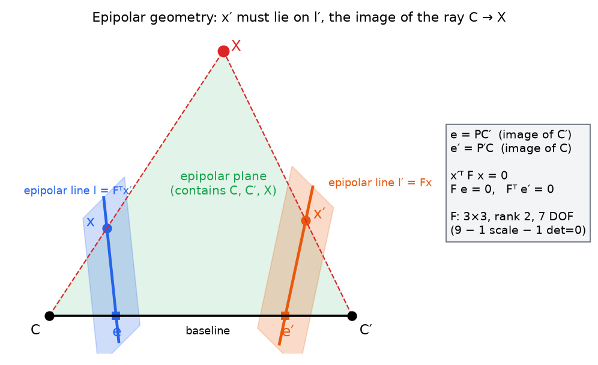
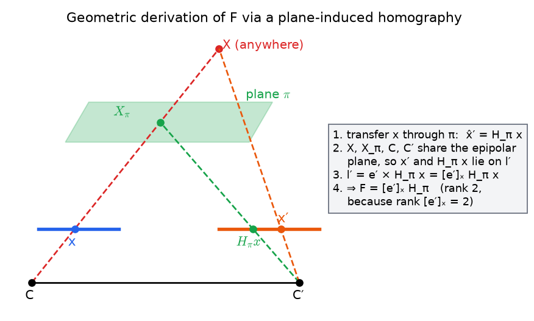
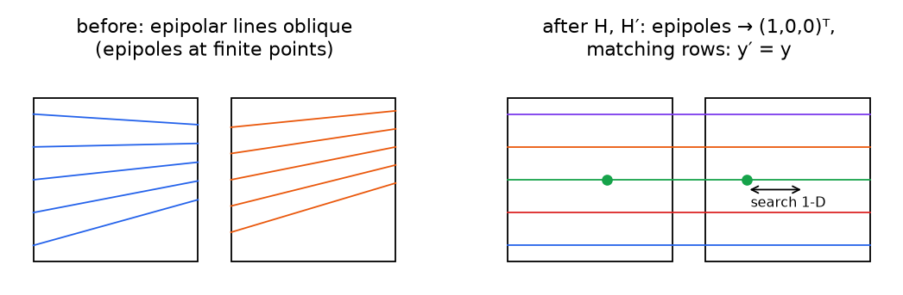
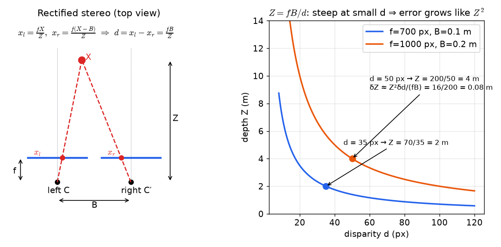
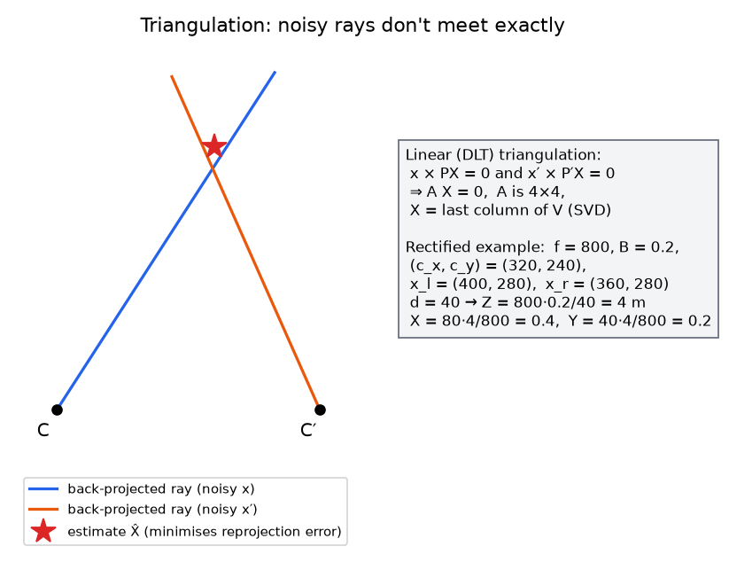
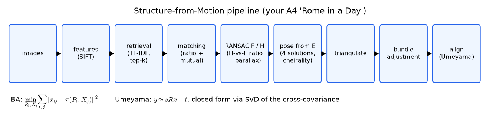

# Session 3 (second pass): Epipolar Geometry, Stereo and SfM

[↑ Index](README.md) · [← Previous](02_Session3_Epipolar_Geometry.md) · [Next →](04_Session4_Optical_Flow.md)

## Session 3 — Epipolar Geometry, Stereo and Structure from Motion

**High-priority exam topic · 2.5 hours**

This session connects your camera geometry knowledge to 3D reconstruction.

We'll follow your study guide's order and use Hartley & Zisserman notation.

### 3.1 The big picture

In Session 2, we learned how one camera projects a 3D point onto a 2D image.

Now consider two cameras observing the same scene.

Our objective is to answer three questions:

1. Given a point in image 1, where should its correspondence lie in image 2?
2. Given corresponding points in two images, can we recover their 3D position?
3. Given several images, can we reconstruct the scene and camera positions?

These lead to **epipolar geometry, triangulation and Structure from Motion (SfM)**.

### 3.2 Understanding the geometry

Imagine two cameras observing a 3D point $X$.

Let:

- $C$: first camera centre.
- $C'$: second camera centre.
- $x$: projection of $X$ in the first image.
- $x'$: projection of $X$ in the second image.

**Baseline:** The line joining the camera centres $CC'$.

**Epipoles:** The images of the opposite camera centres:

$$
\boxed{e=PC',\qquad e'=P'C}
$$

**Epipolar plane:** The plane passing through $C,C'$ and $X$.

**Epipolar lines:** The intersections of this plane with the two image planes.

The key observation:

Given $x$, its corresponding point $x'$ must lie on a particular line in image 2.

Therefore, instead of searching the whole second image, we only search along one line.

> **The fundamental constraint**
>
> $$
> \boxed{x'^TFx=0}
> $$
>
> $$
> \boxed{l'=Fx}
> $$
>
> The fundamental matrix $F$ maps a point in the first image to its epipolar line in the second image.

### 3.3 Derivation of the Fundamental Matrix

There are two derivations in your notes. Both are worth understanding.

#### Method 1: Using an induced homography

**Step 1. Select a 3D plane $\pi$.**

Choose a plane that does not pass through the camera centres.

This plane induces a homography between the images:

$$
x'=H_\pi x
$$

**Step 2. Find the epipolar line.**

The epipolar line passes through $e'$ and $x'$.

The line through two homogeneous points is their cross product:

$$
l'=e'\times x'
$$

**Step 3. Substitute the homography.**

$$
l'=e'\times H_\pi x
$$

Recall:

$$
a\times b=[a]_\times b
$$

Therefore:

$$
l'=[e']_\times H_\pi x
$$

But we already know:

$$
l'=Fx
$$

Comparing:

$$
\boxed{F=[e']_\times H_\pi}
$$

**Why is the rank 2?**

The cross-product matrix is:

$$
[e']_\times=
\begin{bmatrix}
0&-e'_3&e'_2\\
e'_3&0&-e'_1\\
-e'_2&e'_1&0
\end{bmatrix}
$$

It always has a null vector $e'$:

$$
[e']_\times e'=0
$$

Therefore its rank is 2. Consequently:

$$
\boxed{\operatorname{rank}(F)=2}
$$

#### Method 2: Using camera matrices

Recall from Session 2:

$$
x=PX
$$

A point $x$ back-projects to a ray in 3D.

The ray can be expressed as:

$$
X(\lambda)=P^+x+\lambda C
$$

Here $P^+$ is the pseudoinverse, and $PC=0$.

Project the ray into the second camera:

$$
x'(\lambda)=P'P^+x+\lambda P'C
$$

Notice that:

$$
P'C=e'
$$

The epipolar line is the line through $P'P^+x$ and $e'$.

Thus:

$$
l'=e'\times P'P^+x
$$

Hence:

$$
\boxed{F=[e']_\times P'P^+}
$$

---

### 3.4 Properties and DOF of $F$

| Property | Formula |
|---|---|
| Point correspondence | $x'^TFx=0$ |
| Line in image 2 | $l'=Fx$ |
| Line in image 1 | $l=F^Tx'$ |
| First epipole | $Fe=0$ |
| Second epipole | $F^Te'=0$ |
| Rank | 2 |
| DOF | 7 |

Why 7 DOF?

A $3\times3$ matrix has 9 entries.

- Remove one DOF for arbitrary scale.
- Remove one DOF for the rank-2 constraint.

$$
\boxed{9-1-1=7}
$$

**Important:** A fundamental matrix has 7 DOF, but the linear 8-point algorithm needs 8 point correspondences.

DOF is not necessarily the minimum correspondence count for every estimation algorithm.

### 3.5 Estimating the Fundamental Matrix

#### The 8-point algorithm

Given corresponding points:

$$
x=(x,y,1)^T
$$

$$
x'=(x',y',1)^T
$$

Start with:

$$
x'^TFx=0
$$

Let:

$$
F=
\begin{bmatrix}
f_1&f_2&f_3\\
f_4&f_5&f_6\\
f_7&f_8&f_9
\end{bmatrix}
$$

Expanding:

$$
\begin{aligned}
&x'x f_1+x'y f_2+x'f_3\\
+{}&y'x f_4+y'y f_5+y'f_6\\
+{}&xf_7+yf_8+f_9=0
\end{aligned}
$$

Each correspondence gives:

$$
A_i=
[x'x,\ x'y,\ x',\ y'x,\ y'y,\ y',\ x,\ y,\ 1]
$$

Stacking $n$ correspondences:

$$
Af=0
$$

where $A$ is $n\times9$.

Solve by SVD:

$$
A=U\Sigma V^T
$$

$$
f=V[:, -1]
$$

Reshape $f$ into a $3\times3$ matrix.

#### Why enforce rank 2?

Noise means the estimated matrix is generally full-rank.

Suppose its singular values are:

$$
(12,4,0.5)
$$

Perform SVD:

$$
F=U\Sigma V^T
$$

Replace the smallest singular value with zero:

$$
\boxed{
F_{\text{rank 2}}=
U
\begin{bmatrix}
12&0&0\\
0&4&0\\
0&0&0
\end{bmatrix}
V^T
}
$$

This gives the closest rank-2 matrix in Frobenius norm.

#### Hartley normalisation

Just like your A4 homography DLT:

1. Move the centroid of each image's points to the origin.
2. Scale the points so their mean distance from the origin is $\sqrt2$.
3. Estimate $\widetilde F$.
4. Enforce rank 2.
5. Denormalise.

The denormalisation is:

$$
\boxed{F=T'^T\widetilde F T}
$$

Remember this carefully:

- Homography: $H=T'^{-1}\widetilde HT$.
- Fundamental matrix: $F=T'^T\widetilde FT$.

The transpose is important.

#### The 7-point algorithm

With seven correspondences:

$$
A\in\mathbb R^{7\times9}
$$

Its null space is generally two-dimensional.

Suppose the basis matrices are $F_1,F_2$.

Then:

$$
F=\alpha F_1+(1-\alpha)F_2
$$

Enforce:

$$
\det(F)=0
$$

This gives a cubic equation in $\alpha$, producing one or three real solutions.

| Algorithm | Correspondences | Result |
|---|---:|---|
| 7-point | 7 | 1 or 3 solutions |
| 8-point | 8 | 1 solution |

---

### 3.6 Essential Matrix $E$

Now introduce camera calibration.

The fundamental matrix operates on pixel coordinates. The essential matrix operates on normalised camera coordinates.

Given:

$$
\hat x=K^{-1}x
$$

$$
\hat x'=K'^{-1}x'
$$

For the relative camera configuration:

$$
P=K[I\mid0]
$$

$$
P'=K'[R\mid t]
$$

#### Deriving $E=[t]_\times R$

Consider a point on the first camera's ray:

$$
X=\lambda\hat x
$$

In camera 2 coordinates:

$$
X'=RX+t
$$

Therefore:

$$
X'=\lambda R\hat x+t
$$

The three vectors $\hat x',R\hat x,t$ lie in the same epipolar plane.

Their scalar triple product is zero:

$$
\hat x'^T(t\times R\hat x)=0
$$

Represent the cross product using its skew-symmetric matrix:

$$
\hat x'^T[t]_\times R\hat x=0
$$

Comparing with:

$$
\hat x'^TE\hat x=0
$$

we get:

$$
\boxed{E=[t]_\times R}
$$

The relationship to the fundamental matrix is:

$$
\boxed{F=K'^{-T}EK^{-1}}
$$

And:

$$
\boxed{E=K'^TFK}
$$

#### DOF of $E$

Rotation has 3 DOF.

Translation has only 2 observable DOF because its magnitude cannot be recovered from two calibrated images.

Therefore:

$$
\boxed{\operatorname{DOF}(E)=5}
$$

Its singular values must satisfy:

$$
\boxed{\sigma_1=\sigma_2,\quad\sigma_3=0}
$$

This is a stronger constraint than just rank 2.

#### Decomposing $E$

Calculate:

$$
E=U\Sigma V^T
$$

Define:

$$
W=
\begin{bmatrix}
0&-1&0\\
1&0&0\\
0&0&1
\end{bmatrix}
$$

Two possible rotations:

$$
R=UWV^T
$$

$$
R=UW^TV^T
$$

Two possible translation directions:

$$
t=\pm u_3
$$

Thus there are four possible $(R,t)$ solutions.

Use the **cheirality check**: triangulate points and select the solution for which points lie in front of both cameras.

---

### 3.7 Rectification and stereo depth

Rectification transforms both images so that epipoles lie at:

$$
(1,0,0)^T
$$

In other words, the epipoles move to infinity in the horizontal direction.

Corresponding points now lie on the same horizontal row.

This makes matching much easier.

#### Depth calculation

For two parallel cameras:

$$
x_l=\frac{fX}{Z}
$$

$$
x_r=\frac{f(X-B)}{Z}
$$

Subtract:

$$
d=x_l-x_r
$$

$$
d=\frac{fB}{Z}
$$

Therefore:

$$
\boxed{Z=\frac{fB}{d}}
$$

Example:

$$
f=1000\text{ px},\quad B=0.2\text{ m},\quad d=50\text{ px}
$$

$$
Z=\frac{1000(0.2)}{50}
$$

$$
\boxed{Z=4\text{ m}}
$$

Depth uncertainty:

$$
\boxed{\delta Z\approx\frac{Z^2}{fB}\delta d}
$$

Faraway objects have larger depth errors because the uncertainty grows quadratically with distance.

---

### 3.8 Triangulation

Once we know the camera matrices and corresponding image points, we can estimate the 3D point.

Each image point defines a 3D ray from its camera centre.

In perfect conditions, the rays intersect at $X$.

With noisy observations, they generally do not intersect exactly.

#### Linear DLT

Let the camera matrix rows be:

$$
P=
\begin{bmatrix}
p_1^T\\
p_2^T\\
p_3^T
\end{bmatrix}
$$

For a point $(u,v)$, start with:

$$
x\times PX=0
$$

Two independent equations are:

$$
(up_3^T-p_1^T)X=0
$$

$$
(vp_3^T-p_2^T)X=0
$$

Repeat for the second camera.

Stack all four equations:

$$
AX=0
$$

Perform SVD:

$$
A=U\Sigma V^T
$$

Then:

$$
\boxed{X=V[:, -1]}
$$

Finally, dehomogenise.

**Important:** Triangulation becomes inaccurate when the angle between the two viewing rays is small. This is another reason that useful parallax matters.

---

### 3.9 Structure from Motion — your A4

SfM attempts to reconstruct both:

- Camera positions and orientations.
- 3D scene structure.

Your A4 assignment is essentially a simplified SfM pipeline.

| Stage | Theory | Your implementation |
|---|---|---|
| 1 | Feature extraction | RootSIFT |
| 2 | Image retrieval | `tfidf_matrix`, `top_k_neighbours` |
| 3 | Feature matching | `match_descriptors` |
| 4 | Geometric verification | RANSAC on $F$ |
| 5 | Image graph | `connected_components` |
| 6 | Camera pose and triangulation | Essential matrix, `triangulate_points` |
| 7 | Add more cameras | PnP / resectioning |
| 8 | Joint refinement | Bundle adjustment |

#### Why compare H and F inliers?

Your A4 `homography_ratio` uses:

$$
\frac{\text{H inliers}}{\text{F inliers}}
$$

A ratio close to 1 is a warning that a homography explains nearly as many matches as the fundamental matrix.

Possible explanations:

- The scene is mostly planar.
- The camera underwent approximately pure rotation.
- There is little useful parallax.

This matters because without parallax we cannot reliably reconstruct depth.

#### Bundle adjustment

Initial camera poses and triangulated points contain noise.

We jointly optimise cameras and 3D points by minimising reprojection error:

$$
\boxed{
\min_{\{P_i\},\{X_j\}}
\sum_{i,j}
\|x_{ij}-\pi(P_i,X_j)\|^2
}
$$

This is generally solved using Levenberg–Marquardt.

**DLT triangulation vs bundle adjustment:**

- DLT triangulation solves a linear algebraic problem.
- Bundle adjustment optimises actual geometric reprojection error across all observations.

#### Reconstruction ambiguity

| Reconstruction | Remaining ambiguity |
|---|---|
| Uncalibrated | 3D projective transformation (15 DOF) |
| Calibrated | Similarity transformation (7 DOF) |

Your A4 `umeyama` function handles the calibrated similarity alignment:

$$
y_i=sRx_i+t
$$

It estimates scale $s$, rotation $R$ and translation $t$.

---

### Session 3 — Checkpoint

Answer these without looking at the explanations. I'll grade them before moving on to Session 4.

#### Practice questions

1. Derivation: Starting from x′ = Hπx, derive F = [e′]×Hπ. Why is rank(F) = 2?
2. A fundamental matrix has 9 entries. Explain exactly why it has 7 DOF.
3. A linear 8-point algorithm produces singular values (10, 3, 0.2). What do you do, and why?
4. Given K = I, R = I and t = (2, 0, 0)ᵀ, calculate E and derive the relationship between y and y′.
5. f = 800 px, B = 0.15 m and d = 30 px. Calculate depth. What is the approximate depth error for 1 px disparity error?
6. Why does pure camera rotation not allow depth reconstruction? Which homography describes the mapping?
7. What does bundle adjustment minimise? What ambiguity remains in a calibrated SfM reconstruction?

**Next: Session 4 — Optical Flow**, covering brightness constancy, the aperture problem, Horn–Schunck derivation and Lucas–Kanade, with direct connections to your Lunar Landing assignment.

---

[↑ Index](README.md) · [← Previous](02_Session3_Epipolar_Geometry.md) · [Next →](04_Session4_Optical_Flow.md)
