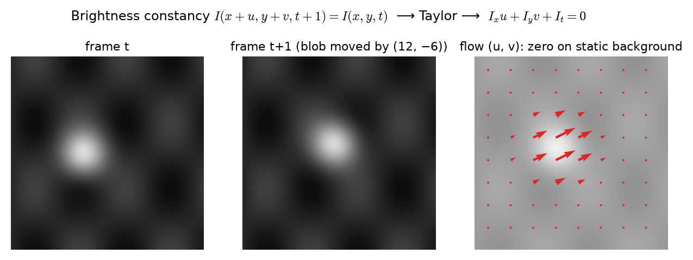
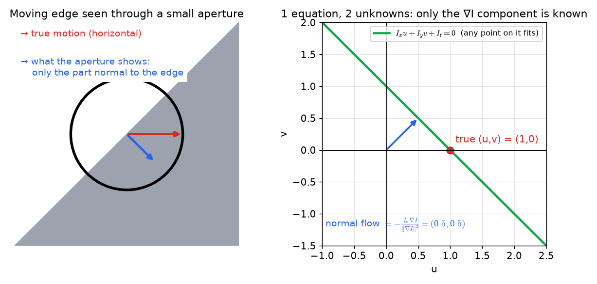
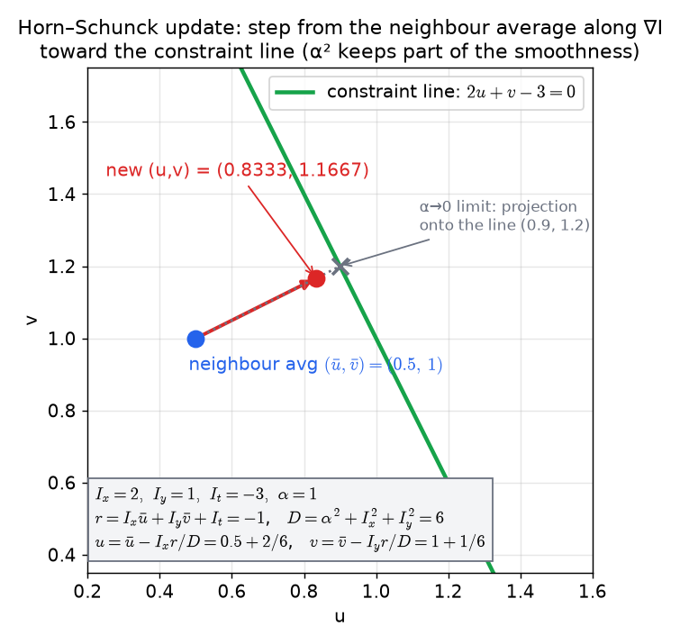
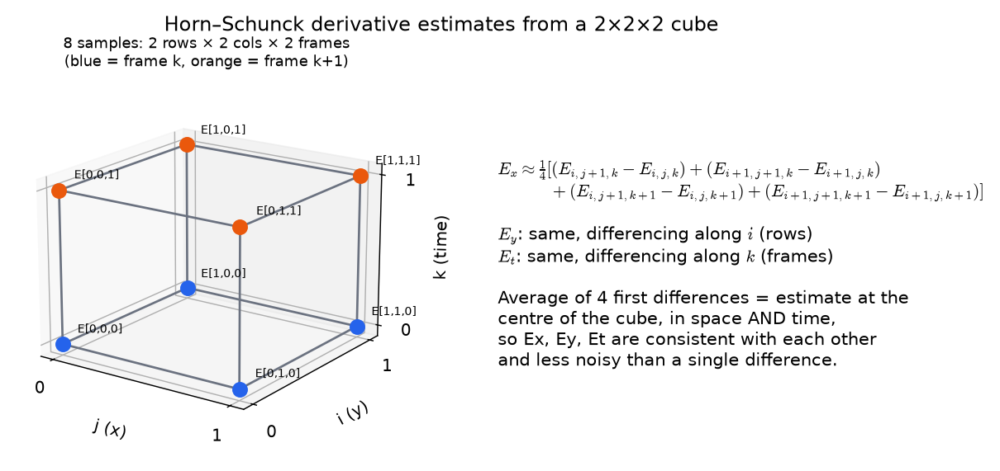
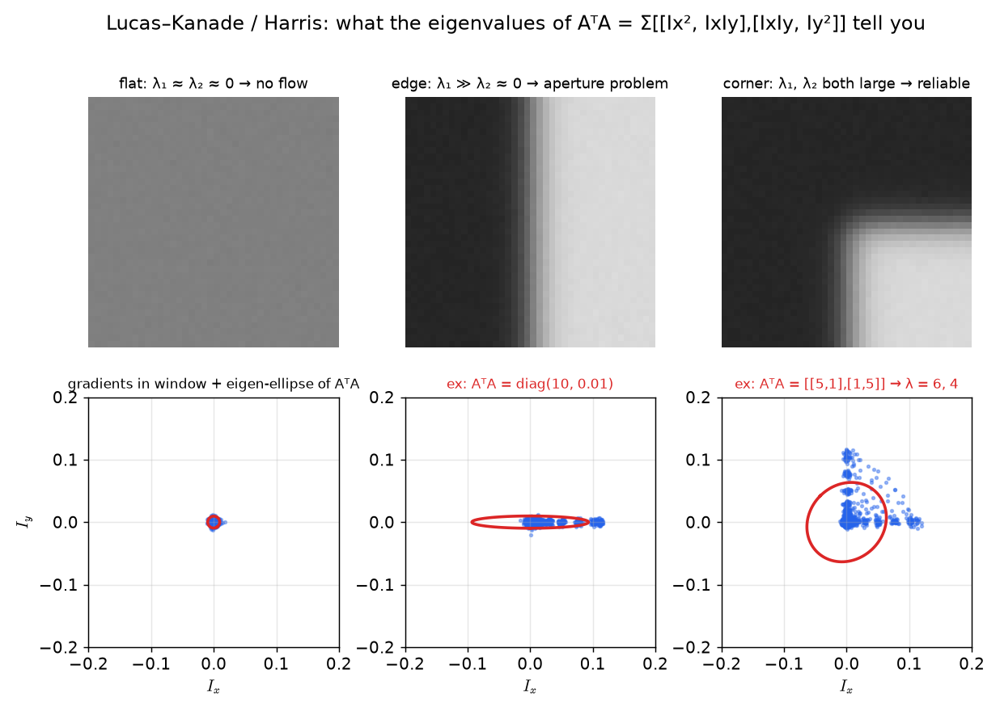
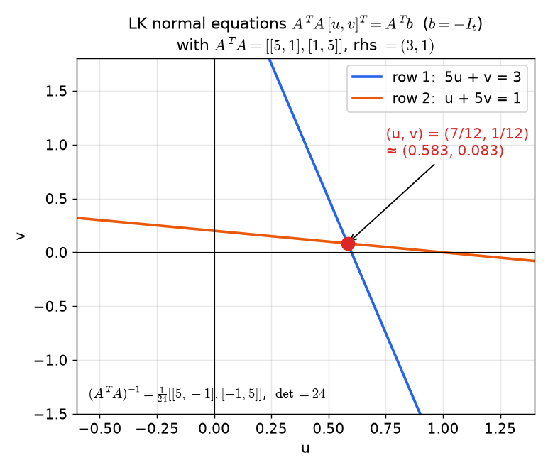
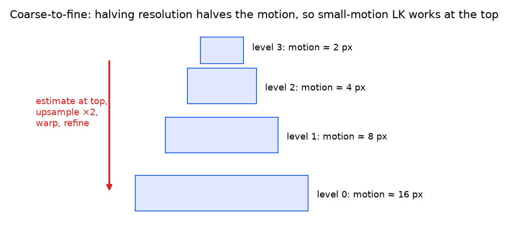
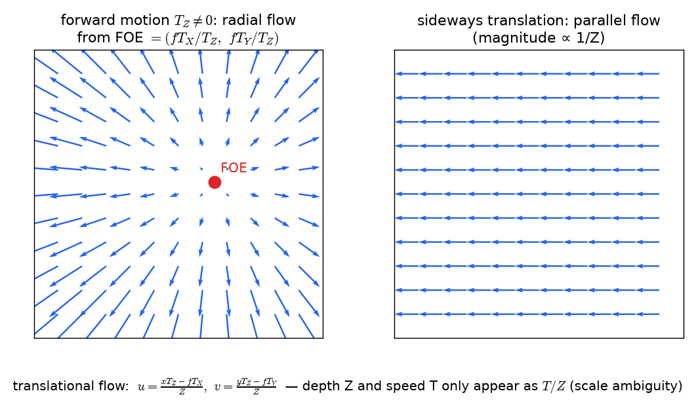

[↑ Index](README.md) · [← Previous](03_Session3_Epipolar_Geometry_Second_Pass.md) · [Next →](05_Session5_CNNs_Transformers_ViT.md)

<b>Contents</b>

- [4.4 Horn–Schunck optical flow](#44-hornschunck-optical-flow)
- [4.5 Lucas–Kanade optical flow](#45-lucaskanade-optical-flow)
- [4.9 Connection to your A3 — Lunar Landing](#49-connection-to-your-a3--lunar-landing)
- [Session 4 — Formula sheet](#session-4--formula-sheet)

We’ll move straight to Session 4 and follow your guide: motion field vs optical flow, brightness constancy and the aperture problem, Horn–Schunck derivation and update, then Lucas–Kanade and its connection to the Harris matrix and A3. I’ll finish with a worked numerical example and questions for you to attempt.

# Session 4 — Optical Flow

**1-hour session · Important: A3 assignment**

The central question:

**Given two consecutive images of a scene, how can we estimate how every visible point moved between them?**

This is the problem of optical flow.

We'll study:

1. Motion field vs optical flow.
2. Brightness constancy and the aperture problem.
3. Horn–Schunck: global, dense optical flow.
4. Lucas–Kanade: local optical flow.
5. Large motion and coarse-to-fine estimation.
6. Connection to your Lunar Landing assignment.

---

### 4.1 Big picture: What is optical flow?

Imagine recording a video of a moving car.

You have two consecutive frames:

- Frame at time $t$.
- Frame at time $t+\Delta t$.

A pixel at location $(x,y)$ appears to move to:

$$
(x+\Delta x,\ y+\Delta y)
$$

Optical flow estimates this apparent displacement.

The flow vector is:

$$
\boxed{
\mathbf{v}=
\begin{bmatrix}
u\\v
\end{bmatrix}
=
\begin{bmatrix}
\Delta x/\Delta t\\
\Delta y/\Delta t
\end{bmatrix}
}
$$

Here:
- $u$: horizontal image velocity.
- $v$: vertical image velocity.

Strictly speaking, some implementations report displacement in pixels per frame rather than velocity per second.

#### Motion field vs optical flow

These sound similar but are different concepts.

| Motion field | Optical flow |
|---|---|
| Projection of actual 3D motion onto the image | Apparent motion of brightness patterns |
| Depends on physical scene and camera motion | Depends on image intensity patterns |
| Geometric quantity | Image-derived estimate |

**Example 1: Rotating uniform sphere**

A sphere rotates physically, so its surface points move.

The motion field is non-zero.

But if the sphere has perfectly uniform brightness and no visible texture, its image does not change.

Optical flow may be zero.

**Example 2: Moving light on a stationary sphere**

The sphere does not physically move.

Its motion field is zero.

But its brightness patterns change, potentially producing non-zero apparent optical flow.

> **Exam takeaway**
>
> $$
> \boxed{\text{Motion field}\neq\text{Optical flow}}
> $$
>
> Optical flow is an estimate from image appearance, not a direct measurement of 3D physical motion.

### 4.2 Brightness constancy assumption

This is the foundation of classical optical flow algorithms.

#### Intuition

Imagine tracking a small textured patch on a moving object.

Although its image coordinates change, we assume that its brightness remains approximately constant over a short period.

If the patch moves from $(x,y)$ to $(x+\Delta x,y+\Delta y)$:

$$
I(x+\Delta x,y+\Delta y,t+\Delta t)
=
I(x,y,t)
$$

This is called **brightness constancy**.

#### Deriving the optical flow equation

Consider intensity as a function of three variables:

$$
I=I(x,y,t)
$$

Taylor-expand the left-hand side around $(x,y,t)$:

$$
\begin{aligned}
I(x+\Delta x,y+\Delta y,t+\Delta t)
\approx{}& I(x,y,t)\\
&+I_x\Delta x\\
&+I_y\Delta y\\
&+I_t\Delta t
\end{aligned}
$$

Using brightness constancy:

$$
I_x\Delta x+I_y\Delta y+I_t\Delta t=0
$$

Divide by $\Delta t$:

$$
I_x\frac{\Delta x}{\Delta t}
+
I_y\frac{\Delta y}{\Delta t}
+
I_t=0
$$

Define:

$$
u=\frac{\Delta x}{\Delta t},
\qquad
v=\frac{\Delta y}{\Delta t}
$$

We obtain:

> **Fundamental optical flow equation**
> $$
> \boxed{I_xu+I_yv+I_t=0}
> $$
>
> This is also called the brightness constancy constraint equation (BCCE).

Here:

- $I_x$: horizontal intensity derivative.
- $I_y$: vertical intensity derivative.
- $I_t$: temporal intensity derivative.
- $u,v$: unknown optical flow.

#### Why is this equation insufficient?

We have:

$$
I_xu+I_yv=-I_t
$$

One equation, but two unknowns.

There are infinitely many possible pairs $(u,v)$ satisfying this equation.

We need an additional assumption.

This brings us to the aperture problem.

---

### 4.3 The aperture problem

Imagine looking at a long straight edge through a small circular hole.

Suppose the edge moves horizontally.

Looking through the small aperture, you can observe movement perpendicular to the edge.

But you cannot determine movement along the edge.

Why?

Because the local image pattern looks identical when the edge slides along itself.

#### Mathematical explanation

The optical flow equation is:

$$
I_xu+I_yv=-I_t
$$

The image gradient is:

$$
\nabla I=
\begin{bmatrix}
I_x\\I_y
\end{bmatrix}
$$

The equation constrains the component of flow along this gradient.

The component perpendicular to the gradient cannot be recovered from this single equation.

The observable component is called **normal flow**:

$$
\boxed{
u_n=\frac{-I_t}{\|\nabla I\|}
}
$$

This is the magnitude of the flow along the gradient direction, assuming a nonzero gradient.

#### Three image structures

| Image region | Gradient | Motion estimation |
|---|---|---|
| Flat region | Both components small | Unreliable |
| Straight edge | Strong in one direction | Only normal motion |
| Corner | Strong in two directions | Both components recoverable with a suitable neighbourhood |

> **Important intuition**
>
> - Flat region: nothing distinctive to track.
> - Edge: you know motion perpendicular to the edge.
> - Corner: you can determine motion in two directions.

This observation will become very important when we study Lucas–Kanade.

---

## 4.4 Horn–Schunck optical flow

**Global / dense method**

#### 1. Intuition

We established that one pixel gives one equation with two unknowns.

How can we solve for both $u$ and $v$?

Horn–Schunck makes a global assumption:

**Neighbouring pixels should generally have similar optical flow.**

In other words, optical flow should vary smoothly across an image.

For example, if a car moves as a rigid object, neighbouring pixels on the car usually have related motion.

We can use neighbouring pixels to fill in motion estimates even in regions with little texture.

#### 2. Construct the energy function

Horn–Schunck combines two objectives.

**A. Data term: brightness constancy**

$$
E_{\text{data}}=
(I_xu+I_yv+I_t)^2
$$

We want this to be small.

**B. Smoothness term**

We want neighbouring flow vectors to be similar.

$$
E_{\text{smooth}}
=
\|\nabla u\|^2+\|\nabla v\|^2
$$

Combine them:

> **Horn–Schunck energy**
> $$
> \boxed{
> E=\iint
> \left[
> (I_xu+I_yv+I_t)^2
> +
> \alpha^2(\|\nabla u\|^2+\|\nabla v\|^2)
> \right]dx\,dy
> }
> $$
>
> $\alpha$ controls the strength of the smoothness regularisation.

**What happens when $\alpha$ changes?**

- Small $\alpha$: brightness constancy dominates; flow may be noisy.
- Large $\alpha$: smoothness dominates; flow becomes smoother but can lose motion boundaries.

#### 3. Deriving the Euler–Lagrange equations

This is a likely derivation question.

Define:

$$
r=I_xu+I_yv+I_t
$$

Then the energy density is:

$$
L=r^2+\alpha^2(u_x^2+u_y^2+v_x^2+v_y^2)
$$

We use the Euler–Lagrange equation for $u$:

$$
\frac{\partial L}{\partial u}
-
\frac{\partial}{\partial x}
\left(\frac{\partial L}{\partial u_x}\right)
-
\frac{\partial}{\partial y}
\left(\frac{\partial L}{\partial u_y}\right)
=0
$$

Calculate the terms.

First:

$$
\frac{\partial L}{\partial u}=2I_xr
$$

Next:

$$
\frac{\partial L}{\partial u_x}=2\alpha^2u_x
$$

$$
\frac{\partial L}{\partial u_y}=2\alpha^2u_y
$$

Substitute:

$$
2I_xr-2\alpha^2u_{xx}-2\alpha^2u_{yy}=0
$$

Divide by 2:

$$
I_xr=\alpha^2(u_{xx}+u_{yy})
$$

Recall that:

$$
\nabla^2u=u_{xx}+u_{yy}
$$

Therefore:

$$
\boxed{
I_x(I_xu+I_yv+I_t)=\alpha^2\nabla^2u
}
$$

Similarly, differentiating with respect to $v$:

$$
\boxed{
I_y(I_xu+I_yv+I_t)=\alpha^2\nabla^2v
}
$$

These are the Horn–Schunck Euler–Lagrange equations.

#### 4. What is the iterative solution?

We cannot directly solve the differential equations conveniently for every pixel.

Instead, discretise the Laplacian.

Approximate:

$$
\nabla^2u\approx\bar u-u
$$

where $\bar u$ is the average flow of neighbouring pixels.

Similarly:

$$
\nabla^2v\approx\bar v-v
$$

Substitute into the Euler–Lagrange equations:

$$
I_x(I_xu+I_yv+I_t)=\alpha^2(\bar u-u)
$$

$$
I_y(I_xu+I_yv+I_t)=\alpha^2(\bar v-v)
$$

Rearranging both equations and solving for $u,v$ gives an iterative update.

> **Horn–Schunck iterative update**
> $$
> \boxed{
> u^{k+1}=
> \bar u^k-
> \frac{I_x(I_x\bar u^k+I_y\bar v^k+I_t)}
> {\alpha^2+I_x^2+I_y^2}
> }
> $$
>
> $$
> \boxed{
> v^{k+1}=
> \bar v^k-
> \frac{I_y(I_x\bar u^k+I_y\bar v^k+I_t)}
> {\alpha^2+I_x^2+I_y^2}
> }
> $$

Here:

- $k$: iteration number.
- $\bar u^k,\bar v^k$: local averages of the previous flow estimates.
- $I_x,I_y,I_t$: image derivatives.
- $\alpha$: smoothness parameter.

**Intuition behind the update:**

Start with an initial flow estimate.

At each pixel:

1. Average the neighbouring flow.
2. Check how much the brightness constancy equation is violated.
3. Correct the averaged flow to reduce that violation.
4. Repeat until the flow estimates stabilise.

#### 5. Worked numerical example

Consider one pixel with:

$$
I_x=2,\quad I_y=1,\quad I_t=-3
$$

Let:

$$
\alpha=1,\quad \bar u=0.5,\quad\bar v=1
$$

First calculate the brightness residual:

$$
r=I_x\bar u+I_y\bar v+I_t
$$

$$
r=2(0.5)+1(1)-3=-1
$$

Denominator:

$$
D=\alpha^2+I_x^2+I_y^2
$$

$$
D=1+4+1=6
$$

Update horizontal flow:

$$
u^{k+1}=0.5-\frac{2(-1)}6
$$

$$
\boxed{u^{k+1}=0.8333}
$$

Update vertical flow:

$$
v^{k+1}=1-\frac{1(-1)}6
$$

$$
\boxed{v^{k+1}=1.1667}
$$

The flow estimate has been corrected from its neighbourhood average using the brightness constancy constraint.

#### 6. What is the $2\times2\times2$ gradient cube?

Your handwritten notes specifically mention this.

To calculate image derivatives, Horn–Schunck uses a small neighbourhood spanning:

- Two horizontal positions.
- Two vertical positions.
- Two consecutive time frames.

Together these form a $2\times2\times2$ cube of eight intensity samples.

We estimate:

$$
I_x,\quad I_y,\quad I_t
$$

using first differences averaged over the cube.

Averaging helps make the derivative estimates less sensitive to individual pixel noise.

Boundary conditions are also needed because pixels at the image boundary have fewer neighbours.

#### 7. Behaviour of Horn–Schunck

| Advantage | Limitation |
|---|---|
| Dense flow for the entire image | Can oversmooth motion boundaries |
| Fills flat regions using neighbours | Assumes spatial smoothness |
| Uses information globally | Sensitive to violations of brightness constancy |

Remember:

**Horn–Schunck is a global, dense method with a smoothness prior.**

---

## 4.5 Lucas–Kanade optical flow

**Local / sparse method**

Now consider another approach.

Horn–Schunck assumes flow is smooth across the image.

Lucas–Kanade makes a different assumption:

**Within a small local window, all pixels have approximately the same flow.**

For instance, take a $3\times3$ pixel window.

There are nine pixels.

Each pixel gives one brightness constancy equation:

$$
I_{xi}u+I_{yi}v=-I_{ti}
$$

Since we assume constant flow across the window, all nine equations share the same $u,v$.

#### 1. Construct the linear system

For nine pixels:

$$
\begin{bmatrix}
I_{x1}&I_{y1}\\
I_{x2}&I_{y2}\\
\vdots&\vdots\\
I_{x9}&I_{y9}
\end{bmatrix}
\begin{bmatrix}
u\\v
\end{bmatrix}
=
-
\begin{bmatrix}
I_{t1}\\I_{t2}\\\vdots\\I_{t9}
\end{bmatrix}
$$

Define:

$$
A=
\begin{bmatrix}
I_{x1}&I_{y1}\\
\vdots&\vdots\\
I_{x9}&I_{y9}
\end{bmatrix}
$$

$$
b=-\begin{bmatrix}
I_{t1}\\\vdots\\I_{t9}
\end{bmatrix}
$$

Then:

$$
A
\begin{bmatrix}
u\\v
\end{bmatrix}
=b
$$

Usually, there are more equations than unknowns, so solve by least squares:

$$
\boxed{
\begin{bmatrix}u\\v\end{bmatrix}
=(A^TA)^{-1}A^Tb
}
$$

This requires $A^TA$ to be invertible and sufficiently well-conditioned.

#### 2. What is $A^TA$?

Expand it:

$$
A^TA=
\begin{bmatrix}
\sum I_x^2&\sum I_xI_y\\
\sum I_xI_y&\sum I_y^2
\end{bmatrix}
$$

> **Important connection to A2**
> $$
> \boxed{A^TA=\text{Harris structure tensor}}
> $$
>
> This is the same matrix used in corner detection.

This is a very important connection between optical flow and your Find Waldo assignment.

#### 3. Why does this matrix tell us whether a point is trackable?

Consider its eigenvalues:

$$
\lambda_1,\lambda_2
$$

They tell us how much image intensity changes along two independent directions.

**Flat region**

$$
\lambda_1\approx0,\quad\lambda_2\approx0
$$

No reliable motion information.
**Edge**

$$
\lambda_1\gg\lambda_2
$$

Motion along the edge is ambiguous.
**Corner**

$$
\lambda_1,\lambda_2\text{ both large}
$$

Motion is constrained in both directions.

This leads to the tracking criterion:

$$
\boxed{\lambda_{\min}(A^TA)\text{ should be large}}
$$

Why the minimum eigenvalue?

Because we need sufficient information in both directions. Even if one eigenvalue is large, a tiny other eigenvalue leaves one direction ambiguous.

This is precisely what you implemented in A3 Task 1 when selecting good points to track.

#### 4. Numerical example: classify a point

Suppose:

$$
A^TA=
\begin{bmatrix}
10&0\\
0&0.01
\end{bmatrix}
$$

Its eigenvalues are:

$$
\lambda_1=10,\qquad\lambda_2=0.01
$$

One eigenvalue is much smaller than the other.

Therefore, this is an edge-like region.

It can constrain motion in one direction, but motion along the edge remains uncertain.

Now consider:

$$
A^TA=
\begin{bmatrix}
5&1\\
1&5
\end{bmatrix}
$$

The eigenvalues are:

$$
\lambda_1=6,\qquad\lambda_2=4
$$

Both are reasonably large.

This is corner-like, and flow can be estimated reliably in both directions.

#### 5. Worked Lucas–Kanade numerical example

Suppose the local window produces:

$$
A^TA=
\begin{bmatrix}
5&1\\
1&5
\end{bmatrix}
$$

and:

$$
A^Tb=
\begin{bmatrix}
3\\1
\end{bmatrix}
$$

We need:

$$
\begin{bmatrix}
5&1\\1&5
\end{bmatrix}
\begin{bmatrix}
u\\v
\end{bmatrix}
=
\begin{bmatrix}
3\\1
\end{bmatrix}
$$

The inverse is:

$$
(A^TA)^{-1}
=
\frac1{24}
\begin{bmatrix}
5&-1\\
-1&5
\end{bmatrix}
$$

Multiply:

$$
\begin{bmatrix}
u\\v
\end{bmatrix}
=
\frac1{24}
\begin{bmatrix}
5&-1\\
-1&5
\end{bmatrix}
\begin{bmatrix}
3\\1
\end{bmatrix}
$$

Therefore:

$$
\boxed{
u=\frac7{12}\approx0.5833
}
$$

$$
\boxed{
v=\frac1{12}\approx0.0833
}
$$

The estimated local flow is:

$$
\boxed{(u,v)=(0.5833,0.0833)}
$$

---

### 4.6 Horn–Schunck vs Lucas–Kanade

This comparison is highly examinable.

| Property | Horn–Schunck | Lucas–Kanade |
|---|---|---|
| Approach | Global | Local |
| Flow | Dense | Usually sparse |
| Assumption | Smooth flow across image | Constant flow in local window |
| Flat regions | Filled from neighbours | Singular/ill-conditioned system |
| Edges | Normal information plus smoothing | Aperture problem |
| Corners | Reliable | Reliable |
| Motion boundaries | Can oversmooth | Preserves local variations better |

**One-line memory trick:**

- Horn–Schunck: neighbouring pixels should move similarly.
- Lucas–Kanade: pixels in a small window should move similarly.

---

### 4.7 Handling large motion

There is an important limitation in both classical methods.

Remember the Taylor approximation:

$$
I(x+\Delta x,y+\Delta y,t+\Delta t)
\approx I+I_x\Delta x+I_y\Delta y+I_t\Delta t
$$

This is a first-order approximation.

It works well when the displacement is small, typically around one pixel or less.

What happens if an object moves 10 pixels between frames?

The linear approximation may fail.

There are three common solutions.

#### 1. Iterative Lucas–Kanade

Instead of estimating the entire motion in one step:

1. Start with an initial flow estimate.
2. Warp the second image towards the first using that estimate.
3. Calculate the remaining displacement.
4. Refine the estimate.
5. Repeat.

This resembles a Newton–Raphson optimisation procedure.

#### 2. Coarse-to-fine image pyramids

Create progressively smaller versions of both images.

For example:

- Level 0: $640\times480$
- Level 1: $320\times240$
- Level 2: $160\times120$
- Level 3: $80\times60$

At the coarsest level, a 16-pixel displacement in the original image becomes only 2 pixels.

Estimate flow there, then propagate and refine it at higher resolutions.

This allows us to handle larger motions.

#### 3. SIFT-guided Lucas–Kanade

This directly connects to your assignments.

SIFT feature matching can provide an initial displacement estimate.

Then Lucas–Kanade refines that estimate locally.

The combination is:

$$
\text{SIFT initialisation}
\longrightarrow
\text{LK refinement}
$$

Your A3 implemented this approach.

---

### 4.8 From 3D motion to optical flow

Your study guide also includes the focus of expansion and time to contact.

#### 1. Focus of expansion (FOE)

Imagine a camera moving forward.

Objects appear to move outwards from a particular point in the image.

This point is called the **focus of expansion**.

The FOE indicates the direction of camera translation in the image.

#### 2. Time to contact

Suppose an object is approaching you.

Its image size increases as the distance decreases.

Let:

- $Z$: current distance to the object.
- $\dot Z=dZ/dt$: rate of change of distance.
- $r$: distance of an image point from the FOE.
- $\dot r=dr/dt$: expansion rate.

The time to contact under constant relative velocity is:

$$
\boxed{\tau=\frac{Z}{-\dot Z}}
$$

Under the usual expansion model:

$$
\frac{\dot r}{r}=-\frac{\dot Z}{Z}
$$

Rearranging:

$$
\boxed{\tau=\frac{r}{\dot r}}
$$

This is useful because you can estimate time to contact from image motion without knowing the absolute distance or velocity separately.

**Lunar lander connection:** As the lander descends, the ground image expands. The expansion rate provides information about time to contact.

---

## 4.9 Connection to your A3 — Lunar Landing

Let's connect everything you learned to your actual implementation.

| A3 task | Concept | Mathematical connection |
|---|---|---|
| Trackable points | Harris structure tensor | $\lambda_{\min}(A^TA)$ |
| One-step LK | Least squares | $(A^TA)^{-1}A^Tb$ |
| Iterative LK | Image warping | Refine displacement |
| SIFT-guided LK | Feature initialisation | Match then refine |
| Metric velocity | Camera projection | $V=Z\cdot flow/(f\Delta t)$ |

The most important connection is:

$$
\boxed{
A^TA=
\begin{bmatrix}
\sum I_x^2&\sum I_xI_y\\
\sum I_xI_y&\sum I_y^2
\end{bmatrix}
}
$$

This is simultaneously:

- The Lucas–Kanade normal-equation matrix.
- The Harris structure tensor.
- The matrix used to determine whether a feature is trackable.

Your A2 and A3 assignments are therefore connected through the same mathematical object.

---

## Session 4 — Formula sheet

> **1. Brightness constancy**
>
> $$
> I(x+u\Delta t,y+v\Delta t,t+\Delta t)=I(x,y,t)
> $$
>
> **2. Optical flow constraint**
>
> $$
> \boxed{I_xu+I_yv+I_t=0}
> $$
>
> **3. Normal flow**
>
> $$
> u_n=-\frac{I_t}{\sqrt{I_x^2+I_y^2}}
> $$
>
> **4. Horn–Schunck energy**
>
> $$
> E=\iint (I_xu+I_yv+I_t)^2
> +\alpha^2(\|\nabla u\|^2+\|\nabla v\|^2)
> \,dx\,dy
> $$
>
> **5. Horn–Schunck Euler–Lagrange**
>
> $$
> I_x(I_xu+I_yv+I_t)=\alpha^2\nabla^2u
> $$
>
> $$
> I_y(I_xu+I_yv+I_t)=\alpha^2\nabla^2v
> $$
>
> **6. Horn–Schunck update**
>
> $$
> u^{k+1}=\bar u^k-
> \frac{I_x(I_x\bar u^k+I_y\bar v^k+I_t)}
> {\alpha^2+I_x^2+I_y^2}
> $$
>
> $$
> v^{k+1}=\bar v^k-
> \frac{I_y(I_x\bar u^k+I_y\bar v^k+I_t)}
> {\alpha^2+I_x^2+I_y^2}
> $$
>
> **7. Lucas–Kanade**
>
> $$
> A
> \begin{bmatrix}u\\v\end{bmatrix}=b
> $$
>
> $$
> \boxed{
> \begin{bmatrix}u\\v\end{bmatrix}
> =(A^TA)^{-1}A^Tb
> }
> $$
>
> **8. Harris structure tensor**
>
> $$
> A^TA=
> \begin{bmatrix}
> \sum I_x^2&\sum I_xI_y\\
> \sum I_xI_y&\sum I_y^2
> \end{bmatrix}
> $$
>
> $$
> \boxed{\lambda_{\min}\text{ large}\Rightarrow
> \text{good trackable point}}
> $$
>
> **9. Time to contact**
>
> $$
> \boxed{\tau=\frac{Z}{-\dot Z}=\frac{r}{\dot r}}
> $$
>
> **10. Metric velocity (A3)**
>
> $$
> \boxed{V=\frac{Z\cdot flow_{px}}{f\Delta t}}
> $$
>

### Session 4 — Check questions

Try these before moving to Session 5. I'll wait for your answers and grade them.

**Q1. Derivation**

Starting from brightness constancy, derive:

$$
I_xu+I_yv+I_t=0
$$

Why does this equation create the aperture problem?

**Q2. Numerical — Lucas–Kanade**

Given:

$$
A^TA=
\begin{bmatrix}
10&0\\
0&0.01
\end{bmatrix}
$$

Classify the image region. Can Lucas–Kanade reliably estimate both flow components? Explain using eigenvalues.

**Q3. Derivation — Horn–Schunck**

Write its energy function and derive the Euler–Lagrange equation for $u$:

$$
I_x(I_xu+I_yv+I_t)=\alpha^2\nabla^2u
$$

What does increasing $\alpha$ do?

**Q4. Numerical — Horn–Schunck**

Given:

$$
I_x=1,\quad I_y=2,\quad I_t=-4
$$

$$
\alpha=1,\quad\bar u=0,\quad\bar v=1
$$

Calculate $u^{k+1}$ and $v^{k+1}$.

**Q5. Conceptual and application**

A feature moves 12 pixels between frames. Why might one-step Lucas–Kanade fail? Name three ways to improve the estimate.

**Q6. A3 connection**

Why does selecting features using the minimum eigenvalue of the Harris matrix improve optical flow tracking?

---

**Next session: Session 5 — Generalisation, CNNs, Transformers and Vision Transformers.**

This will connect your A2 filtering and feature-detection work to deep-learning architectures. We'll cover convolution calculations, parameter counting, receptive fields, attention derivation, and ViT patch embeddings.

---

[↑ Index](README.md) · [← Previous](03_Session3_Epipolar_Geometry_Second_Pass.md) · [Next →](05_Session5_CNNs_Transformers_ViT.md)
