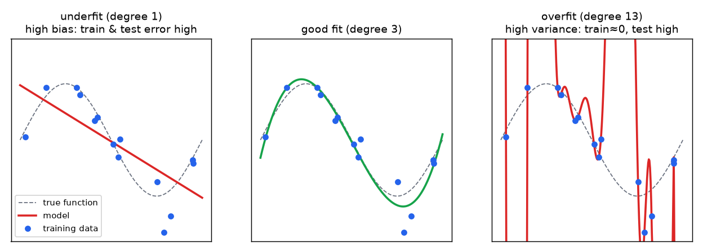
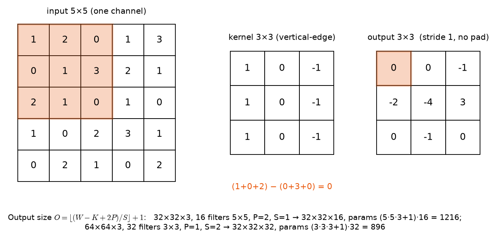
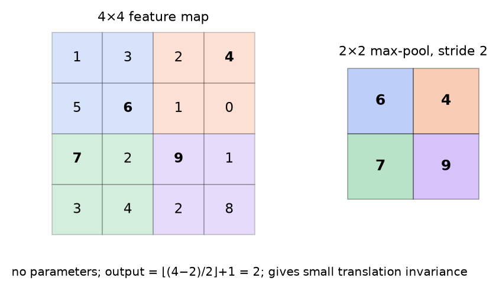
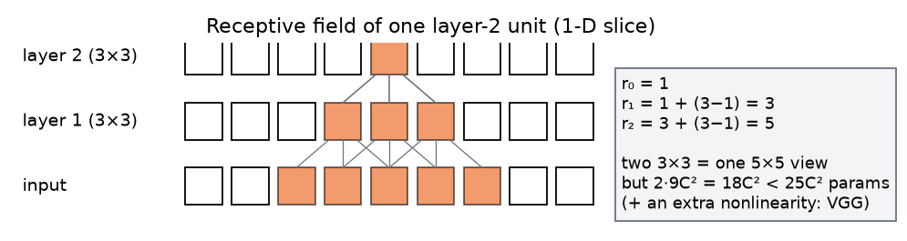
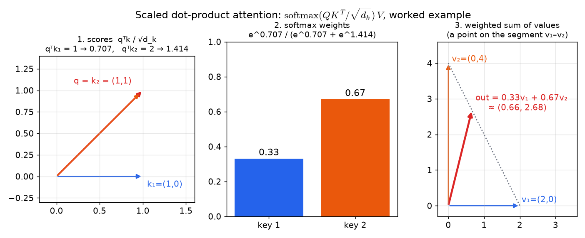
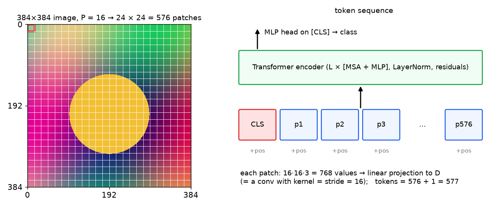

[↑ Index](README.md) · [← Previous](04_Session4_Optical_Flow.md) · [Next →](06_Session6_Representation_Learning_VAE.md)

# Session 5 — Generalisation, CNNs, Transformers and Vision Transformers

**2-hour session · High-priority architectures**

This session moves from classical computer vision (your A2) to deep-learning-based vision.

We'll cover:

1. Learning and generalisation.
2. CNN architecture and convolution.
3. Important CNN architectures.
4. Transformers and self-attention.
5. Vision Transformers (ViT).

The main objective is to understand **why these architectures are designed the way they are**, not just memorise their definitions.

---

## 5.1 Learning and generalisation

### 1. Big picture

Suppose we train a neural network to recognise cats and dogs.

We give it thousands of labelled images and it learns to classify them.

But what happens when we give it an image it has never seen before?

This is the problem of **generalisation**.

A model should not merely memorise its training data. It should learn useful patterns that work on unseen data.

#### Train, validation and test sets

We divide the dataset into three parts.

| Dataset | Purpose |
|---|---|
| Training | Learn model parameters |
| Validation | Choose architecture and hyperparameters |
| Test | Evaluate final generalisation |

An important distinction:

- Training data updates model parameters.
- Validation data helps make modelling decisions.
- Test data estimates performance on unseen data and should not guide repeated model tuning.

### 2. Underfitting vs overfitting

**Underfitting**

The model is too simple to capture the actual patterns.

- High training error.
- High test error.
- Associated with high bias.

**Overfitting**

The model memorises the training examples instead of learning general patterns.

- Low training error.
- High test error.
- Associated with high variance.

| Property | Underfitting | Overfitting |
|---|---|---|
| Model capacity | Often insufficient | Often excessive for available data |
| Training error | High | Low |
| Test error | High | High |
| Main issue | High bias | High variance |

### 3. Regularisation

Regularisation discourages a model from becoming unnecessarily complex or sensitive to individual training examples.

Your guide mentions five techniques:

| Technique | Intuition |
|---|---|
| Weight decay (L2) | Penalise large weights |
| Dropout | Randomly disable neurons during training |
| Data augmentation | Generate variations of training images |
| Early stopping | Stop when validation performance stops improving |
| More data | Expose the model to more variations |

**Example: Data augmentation**

Suppose your dataset contains 1,000 cat images.

We can create additional training examples by:

- Horizontal flipping.
- Random cropping.
- Rotation.
- Colour changes.

The model learns that a cat remains a cat despite these transformations.

### 4. Inductive bias

This is an important concept for understanding CNNs vs Transformers.

An inductive bias is an assumption built into a model that helps it learn from limited data.

For example:

- CNNs assume nearby pixels are related.
- CNNs reuse the same filters across different image locations.
- Transformers use attention to learn relationships between tokens.

These assumptions reduce the amount of data required to learn useful representations.

> **Exam takeaway**
>
> Generalisation is about performance on unseen data.
>
> Inductive bias is about the assumptions that make learning useful and efficient.

---

## 5.2 Convolutional Neural Networks (CNNs)

**Very important**

### 1. Why do we need CNNs?

Imagine processing a $224\times224\times3$ image using a fully connected neural network.

The input contains:

$$
224\times224\times3=150,528
$$

values.

Suppose the first layer has 1,000 neurons.

The number of weights alone is:

$$
150,528\times1,000
$$

$$
=150,528,000
$$

That's approximately 150 million parameters in just one layer!

This is inefficient for images.

Why?

Because images have structure:

- Nearby pixels are related.
- Edges and textures are local patterns.
- Similar features can occur anywhere in an image.

CNNs exploit these properties.

### 2. Intuition: convolution

Imagine placing a small $3\times3$ filter over an image.

At every position:

1. Multiply the filter values with the corresponding image pixels.
2. Sum the products.
3. Store the result in the output feature map.
4. Move the filter to the next position.

A filter can learn to detect patterns such as:

- Horizontal edges.
- Vertical edges.
- Corners.
- Textures.
- More complex shapes in deeper layers.

This connects directly to your A2 filtering and feature-detection assignment.

### 3. Mathematical definition

Let the input image be:

$$
X\in\mathbb R^{H\times W\times C_{\text{in}}}
$$

Let the filter be:

$$
K\in\mathbb R^{k\times k\times C_{\text{in}}}
$$

At a particular output location, the operation is:

$$
Y(i,j)=
\sum_{a,b,c}
K(a,b,c)X(i+a,j+b,c)
$$

This is repeated at all valid output locations.

Technically, most deep-learning implementations perform **cross-correlation**, not mathematical convolution.

Why?

Mathematical convolution flips the kernel, whereas cross-correlation uses it as it is.

For learning CNNs, this distinction usually doesn't change the expressive capability because the filter weights are learned.

### 4. CNN hyperparameters

These are particularly important for numerical questions.

| Parameter | Meaning |
|---|---|
| Kernel size $K$ | Size of the filter |
| Stride $S$ | Number of pixels the filter moves |
| Padding $P$ | Extra pixels added around the input |
| Input channels | Number of input feature maps |
| Output channels | Number of filters |

#### Output dimensions

For a square input and kernel:

$$
\boxed{
O=\left\lfloor\frac{W-K+2P}{S}\right\rfloor+1
}
$$

The same calculation applies independently to height and width.

#### Parameters

For $C_{\text{out}}$ filters:

$$
\boxed{
N_{\text{params}}=
(K^2C_{\text{in}}+1)C_{\text{out}}
}
$$

The additional 1 accounts for the bias of each filter.

#### Numerical example 1

Given:

- Input: $32\times32\times3$.
- Kernel: $5\times5$.
- Number of filters: 16.
- Stride: 1.
- Padding: 2.

Output height:

$$
O=\frac{32-5+4}{1}+1=32
$$

Similarly, output width is 32.

Output channels = number of filters = 16.

Therefore:

$$
\boxed{\text{Output}=32\times32\times16}
$$

Parameters per filter:

$$
5\times5\times3+1=76
$$

Total:

$$
76\times16=\boxed{1216}
$$

**Numerical answer**

$$
32\times32\times16,\qquad 1216\text{ parameters}
$$

#### Numerical example 2: stride

Given:

- Input: $64\times64\times3$.
- Kernel: $3\times3$.
- Filters: 32.
- Stride: 2.
- Padding: 1.

Output:

$$
O=\left\lfloor\frac{64-3+2}{2}\right\rfloor+1
$$

$$
O=32
$$

Hence:

$$
\boxed{32\times32\times32}
$$

Parameters:

$$
(3\times3\times3+1)\times32
$$

$$
\boxed{896}
$$

### 5. Why are CNNs parameter-efficient?

There are two major reasons.

**A. Local connectivity**

A filter only looks at a small neighbourhood rather than the entire image.

**B. Weight sharing**

The same filter is reused at every image location.

For example, an edge-detection filter can detect an edge at the top-left and bottom-right of an image using exactly the same weights.

This is much more efficient than learning separate weights for every location.

#### Translation equivariance vs invariance

An important exam distinction:

**Translation equivariance:** If the input shifts, the feature map shifts correspondingly.

Convolution has this property (away from boundary effects and sampling complications).

**Translation invariance:** The output remains unchanged when the input shifts.

Pooling can introduce some approximate local translation invariance, but does not guarantee complete invariance.

| Property | Convolution | Pooling |
|---|---|---|
| Parameters | Learnable | None |
| Main role | Feature extraction | Downsampling |
| Translation behaviour | Equivariance | Approximate local invariance |

### 6. Pooling

Suppose an input feature map is:

$$
\begin{bmatrix}
1&3&2&4\\
5&6&1&2\\
3&2&8&7\\
1&4&5&6
\end{bmatrix}
$$

Apply $2\times2$ max pooling with stride 2.

Divide it into four regions.

Maximum values:

$$
\begin{bmatrix}
6&4\\
4&8
\end{bmatrix}
$$

Output:

$$
\boxed{
\begin{bmatrix}
6&4\\
4&8
\end{bmatrix}
}
$$

Pooling reduces the spatial dimensions without introducing trainable parameters.

### 7. What is a 1×1 convolution?

This is a frequently misunderstood concept.

A $1\times1$ convolution does not combine neighbouring spatial pixels.

Instead, it combines the channels at each spatial location.

Suppose a feature map has:

$$
H\times W\times64
$$

Applying 32 filters of size $1\times1$ gives:

$$
H\times W\times32
$$

It effectively performs a learned projection of the 64-dimensional channel vector into 32 dimensions at each pixel.

Useful for:

- Reducing channel dimensions.
- Increasing channel dimensions.
- Mixing feature channels.

---

### 5.3 Receptive field

The receptive field is the region of the original input that can affect a particular output neuron.

Imagine a neuron in the final feature map.

It does not necessarily look at just one pixel of the original image.

It may depend on a large region through multiple convolution layers.

For a sequence of convolution layers, the receptive field is:

$$
\boxed{
r=1+\sum_l(k_l-1)\prod_{i<l}s_i
}
$$

where:

- $k_l$: kernel size of layer $l$.
- $s_i$: stride of earlier layers.

An equivalent recursive way to remember it is:

$$
r_l=r_{l-1}+(k_l-1)j_{l-1}
$$

$$
j_l=j_{l-1}s_l
$$

with $r_0=1,j_0=1$.

Here $j_l$ is the spacing, in input pixels, between adjacent features at layer $l$.

#### Numerical example

Consider two convolution layers:

- First: $3\times3$, stride 1.
- Second: $3\times3$, stride 1.

Initially:

$$
r_0=1
$$

After layer 1:

$$
r_1=1+(3-1)=3
$$

After layer 2:

$$
r_2=3+(3-1)=5
$$

Therefore:

$$
\boxed{r=5\times5}
$$

Two stacked $3\times3$ layers have the same receptive field as one $5\times5$ layer.

But there is another advantage.

For equal input/output channels $C$:

One $5\times5$ layer:

$$
25C^2
$$

Two $3\times3$ layers:

$$
2(9C^2)=18C^2
$$

So the two smaller layers use fewer parameters and introduce an extra nonlinear activation.

This is the motivation behind VGG's use of stacked $3\times3$ convolutions.

---

### 5.4 Important CNN architectures

You should know the motivation behind each architecture rather than just its name.

**1. LeNet**

Early CNN architecture for handwritten digit recognition. Uses convolution, subsampling/pooling and fully connected layers.

**2. AlexNet**

Famous for its ImageNet breakthrough in 2012. Important techniques included ReLU, dropout and GPU-based training.

**3. VGG**

Uses repeated small $3\times3$ convolutions. Its design is simple and deep, with progressively larger receptive fields.

**4. ResNet**

Introduces residual/skip connections:

$$
\boxed{y=F(x)+x}
$$

This helps information and gradients flow through very deep networks.

#### Why ResNet?

Suppose we want a deep network to learn an identity mapping.

Without shortcuts, several layers may need to learn that transformation.

With a residual connection:

$$
y=F(x)+x
$$

If the desired mapping is identity, the network only needs to learn:

$$
F(x)=0
$$

The skip connection provides a direct route for information and gradients.

#### Batch Normalisation

BatchNorm normalises intermediate activations using statistics calculated over a mini-batch.

For an activation $x$:

$$
\hat x=\frac{x-\mu_B}{\sqrt{\sigma_B^2+\epsilon}}
$$

Then it applies learnable parameters:

$$
y=\gamma\hat x+\beta
$$

where $\gamma,\beta$ allow the network to learn the appropriate scale and shift.

It helps stabilise and speed up training.

---

## 5.5 Transformers

**Very important derivation**

CNNs primarily use local spatial operations.

Transformers use **attention**, which allows one position to directly interact with other positions.

Originally developed for sequence modelling, transformers can also process images by representing image regions as tokens.

### 1. Intuition: What is attention?

Suppose a sentence is:

"The animal didn't cross the road because it was tired."

To understand "it", the model needs to associate it with "animal".

Attention allows each token to decide which other tokens are relevant to it.

For image processing, a patch can similarly attend to other image patches.

### 2. Query, Key and Value

Every input token is transformed into three representations:

$$
\boxed{Q=XW_Q}
$$

$$
\boxed{K=XW_K}
$$

$$
\boxed{V=XW_V}
$$

Think of them this way:

| Component | Intuition |
|---|---|
| Query (Q) | What information am I looking for? |
| Key (K) | What information do I contain? |
| Value (V) | What information should I provide? |

The query of one token is compared against the keys of all tokens.

This produces attention scores.

### 3. Deriving scaled dot-product attention

Let:

$$
Q\in\mathbb R^{N\times d_k}
$$

$$
K\in\mathbb R^{N\times d_k}
$$

$$
V\in\mathbb R^{N\times d_v}
$$

Here $N$ is the number of tokens.

**Step 1. Calculate similarity**

$$
S=QK^T
$$

The resulting matrix is:

$$
S\in\mathbb R^{N\times N}
$$

Each entry tells us how relevant one token is to another.

**Step 2. Scale the scores**

$$
S'=\frac{QK^T}{\sqrt{d_k}}
$$

**Why divide by $\sqrt{d_k}$?**

Assume the components of query and key vectors are independent, with zero mean and unit variance.

Their dot product is:

$$
q^Tk=\sum_{i=1}^{d_k}q_ik_i
$$

Each product has variance approximately 1.

The variance of the sum is therefore:

$$
\operatorname{Var}(q^Tk)=d_k
$$

Hence, its standard deviation grows as:

$$
\sqrt{d_k}
$$

As $d_k$ becomes large, scores become large and softmax becomes increasingly saturated.

Dividing by $\sqrt{d_k}$ keeps the score scale controlled.

**Step 3. Apply softmax**

$$
A=\operatorname{softmax}\left(\frac{QK^T}{\sqrt{d_k}}\right)
$$

Softmax converts scores into attention weights.

Each row sums to 1.

**Step 4. Combine the values**

$$
O=AV
$$

Therefore:

> **Scaled dot-product attention**
> $$
> \boxed{
> \operatorname{Attention}(Q,K,V)
> =
> \operatorname{softmax}
> \left(
> \frac{QK^T}{\sqrt{d_k}}
> \right)V
> }
> $$

### 4. Numerical attention example

Consider one query:

$$
q=(1,1)
$$

Two keys:

$$
k_1=(1,0),\qquad k_2=(1,1)
$$

And two values:

$$
v_1=(2,0),\qquad v_2=(0,4)
$$

Here:

$$
d_k=2
$$

Calculate similarities:

$$
q^Tk_1=1
$$

$$
q^Tk_2=2
$$

Scale:

$$
s_1=\frac1{\sqrt2}=0.707
$$

$$
s_2=\frac2{\sqrt2}=1.414
$$

Apply softmax:

$$
w_1=\frac{e^{0.707}}{e^{0.707}+e^{1.414}}
\approx0.33
$$

$$
w_2\approx0.67
$$

Weighted combination:

$$
O=0.33(2,0)+0.67(0,4)
$$

Therefore:

$$
\boxed{O\approx(0.66,2.68)}
$$

The output is a weighted combination of information from both tokens.

### 5. Multi-head attention

Why use only one attention operation?

Different relationships may be important simultaneously.

For example, in a sentence:

- One head may learn syntactic relationships.
- Another may learn positional relationships.
- Another may learn semantic relationships.

Multi-head attention creates multiple independent attention heads.

For $h$ heads:

$$
\operatorname{head}_i=
\operatorname{Attention}(Q_i,K_i,V_i)
$$

Concatenate them:

$$
\operatorname{MHA}=
\operatorname{Concat}(\operatorname{head}_1,\ldots,\operatorname{head}_h)W_O
$$

Each head usually has dimension:

$$
d_k=\frac dh
$$

where $d$ is the model embedding dimension.

### 6. Transformer block architecture

A typical pre-normalisation transformer block looks like this:

> **Input $x$**
>
>
>
>
>
>
>
> **Output**
>
> ### Variants of attention
>
> | Type | Meaning |
> |---|---|
> | Self-attention | Q, K and V come from the same sequence |
> | Cross-attention | Q comes from one sequence, K and V from another |
> | Masked/causal attention | Prevents a token from attending to future tokens |
>
> Cross-attention is particularly relevant in text-conditioned diffusion models, which we'll study in Session 8.
>
> ## 7. Transformer complexity
>
> For $N$ tokens and embedding dimension $d$:
>
> Calculating:
>
> $$
> QK^T
> $$
>
> requires approximately:
>
> $$
> O(N^2d)
> $$
>
> The attention matrix contains:
>
> $$
> N\times N
> $$
>
> elements.
>
> Therefore:
>
> - Time complexity: $O(N^2d)$.
> - Attention matrix memory: $O(N^2)$.
>
> This quadratic dependence on token count becomes important for high-resolution images.
>
> ### Parameter counting
>
> For an embedding size $d$:
>
> | Component | Approximate parameters |
> |---|---:|
> | Q projection | $d^2$ |
> | K projection | $d^2$ |
> | V projection | $d^2$ |
> | Output projection | $d^2$ |
> | Attention total | $4d^2$ |
> | MLP (hidden size $4d$) | $8d^2$ |
> | Transformer block total | $12d^2$ |
>
> This ignores biases and normalisation parameters.
>
> ## 8. Why positional encoding?
>
> Here's a subtle but important property.
>
> Self-attention without positional information is permutation-equivariant.
>
> That means if we rearrange the input tokens, their output representations rearrange correspondingly.
>
> The model cannot inherently distinguish:
>
> - Token 1 followed by token 2.
> - Token 2 followed by token 1.
>
> For images, this means it doesn't inherently know where a patch came from.
>
> We introduce positional information:
>
> $$
> X_{\text{input}}=X_{\text{token}}+X_{\text{position}}
> $$
>
> Common choices:
>
> - Sinusoidal positional embeddings.
> - Learned positional embeddings.
>
>
>
> ---
>
> # 5.6 Vision Transformer (ViT)
>
> **Important comparison topic**
>
> ## 1. Big picture
>
> CNNs were originally designed around images.
>
> Transformers were originally designed around sequences.
>
> Vision Transformers apply transformers to images by converting image patches into tokens.
>
> **The key idea: An image can be treated as a sequence of patches.**
>
> 
>
> ## 2. How does ViT work?
>
> ### Step 1. Divide the image into patches
>
> Suppose the image is:
>
> $$
> 224\times224\times3
> $$
>
> Choose patch size:
>
> $$
> P=16
> $$
>
> Number of patches:
>
> $$
> N=\frac{224}{16}\times\frac{224}{16}
> $$
>
> $$
> \boxed{N=196}
> $$
>
> ### Step 2. Flatten each patch
>
> Every patch has dimensions:
>
> $$
> 16\times16\times3
> $$
>
> Flattening gives:
>
> $$
> 16\times16\times3=768
> $$
>
> Each image patch is now a vector of 768 values.
>
> ### Step 3. Linear projection
>
> Project the 768-dimensional patch representation into a model embedding dimension $D$.
>
> $$
> 768\longrightarrow D
> $$
>
> All patches become tokens of dimension $D$.
>
> **Important connection:** This patch projection is equivalent to a convolution with:
>
> $$
> \boxed{\text{Kernel size}=\text{Stride}=P}
> $$
>
> For ViT, that means a $16\times16$ convolution with stride 16.
>
> ### Step 4. Add the CLS token
>
> A learnable classification token is prepended to the patch sequence.
>
> Therefore:
>
> $$
> 196+1=\boxed{197\text{ tokens}}
> $$
>
> The CLS token collects information from the image and is used by the classification head.
>
> ### Step 5. Add positional embeddings
>
> The model needs to know where each patch came from.
>
> Therefore:
>
> $$
> Z_0=[x_{\text{CLS}};x_1;x_2;\ldots;x_N]+E_{\text{pos}}
> $$
>
> ### Step 6. Transformer encoder
>
> The sequence passes through transformer encoder blocks.
>
> Each block uses:
>
> - Layer normalisation.
> - Multi-head self-attention.
> - MLP.
> - Residual connections.
>
> Finally, the CLS representation goes through a classification head.
>
> ## 3. Numerical example
>
> Suppose:
>
> $$
> H=W=384,\qquad P=16
> $$
>
> Number of patches:
>
> $$
> N=\left(\frac{384}{16}\right)^2
> $$
>
> $$
> N=24^2=576
> $$
>
> Adding CLS:
>
> $$
> \boxed{577\text{ tokens}}
> $$
>
> Each patch contains:
>
> $$
> 16\times16\times3=768
> $$
>
> pixel values.
>
> ## 4. CNN vs ViT
>
> This comparison is particularly important.
>
> | Property | CNN | ViT |
> |---|---|---|
> | Basic operation | Convolution | Self-attention |
> | Locality | Built-in | Learned |
> | Weight sharing | Spatial filters | Projection and attention weights |
> | Receptive field | Grows with depth | Global from first attention layer |
> | Inductive bias | Stronger | Weaker |
> | Data requirements | Often works well with smaller datasets | Benefits from large datasets or strong regularisation |
> | Long-range relationships | Built progressively | Direct global attention |
>
> ### Why does ViT require more data?
>
> CNNs already assume that:
>
> - Nearby pixels are related.
> - Local patterns are useful.
> - The same feature can occur at different locations.
>
> Transformers do not automatically have these image-specific assumptions.
>
> They need to learn spatial relationships from data.
>
> This makes ViT more dependent on large datasets or techniques such as augmentation and distillation.
>
> The original ViT work demonstrated strong performance when trained with large-scale data. DeiT explored more data-efficient training, including distillation.
>
>
>
> ---
>
> # Session 5 — Formula sheet
>
> **Generalisation**
>
> - Underfitting = high bias.
> - Overfitting = high variance.
> - Regularisation: weight decay, dropout, augmentation, early stopping.
>
> **CNN**
>
> $$
> O=\left\lfloor\frac{W-K+2P}{S}\right\rfloor+1
> $$
>
> $$
> N_{\text{params}}=(K^2C_{\text{in}}+1)C_{\text{out}}
> $$
>
> $$
> r=1+\sum_l(k_l-1)\prod_{i<l}s_i
> $$
>
> $$
> y=F(x)+x\qquad\text{(ResNet)}
> $$
>
> **Transformer**
>
> $$
> Q=XW_Q,\quad K=XW_K,\quad V=XW_V
> $$
>
> $$
> \boxed{\operatorname{Attention}=
> \operatorname{softmax}(QK^T/\sqrt{d_k})V}
> $$
>
> $$
> \text{Complexity}=O(N^2d)
> $$
>
> $$
> \text{Block parameters}\approx12d^2
> $$
>
> **ViT**
>
> $$
> N=\frac{HW}{P^2}
> $$
>
> $$
> N_{\text{tokens}}=N+1\quad\text{(with CLS)}
> $$
>
> $$
> \text{Patch projection}=
> \text{Conv}(P\times P,\text{stride }P)
> $$
>
> ---
>
> # Session 5 — Checkpoint questions
>
> Try these six questions. I'll grade your answers before proceeding to Session 6.
>
#### Practice questions

1. CNN numerical: A 64×64×3 image passes through a 3×3 convolution with 32 filters, stride 2 and padding 1. Calculate output dimensions and number of parameters.
2. Why do two stacked 3×3 convolutions have advantages over one 5×5 convolution? Calculate their parameter counts assuming equal channel dimensions C.
3. A CNN has convolution layers with kernel sizes 3, 3 and 3, all with stride 1. Calculate the receptive field. What changes if the second layer has stride 2?
4. Derivation: Why do we divide QKᵀ by √dₖ in scaled dot-product attention? What are the computational and memory complexities in terms of N?
5. ViT numerical: An image is 384×384 with patch size 16. Calculate the number of patches, total tokens including CLS, and values per RGB patch.
6. Why does a ViT generally need more training data than a CNN? Explain the role of inductive bias and positional encoding.

>
> **Next: Session 6 — Representation Learning and VAE.**
>
> We'll cover autoencoders, contrastive learning (SimCLR and InfoNCE), generative modelling, the ELBO derivation, KL divergence and the reparameterisation trick. This is where generative models start becoming mathematically interesting.
>

---

[↑ Index](README.md) · [← Previous](04_Session4_Optical_Flow.md) · [Next →](06_Session6_Representation_Learning_VAE.md)
