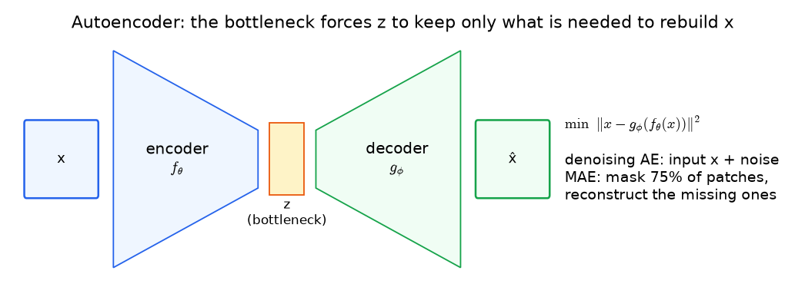
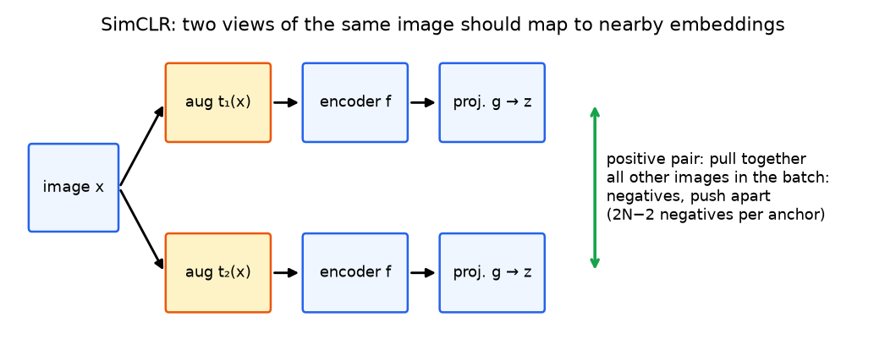
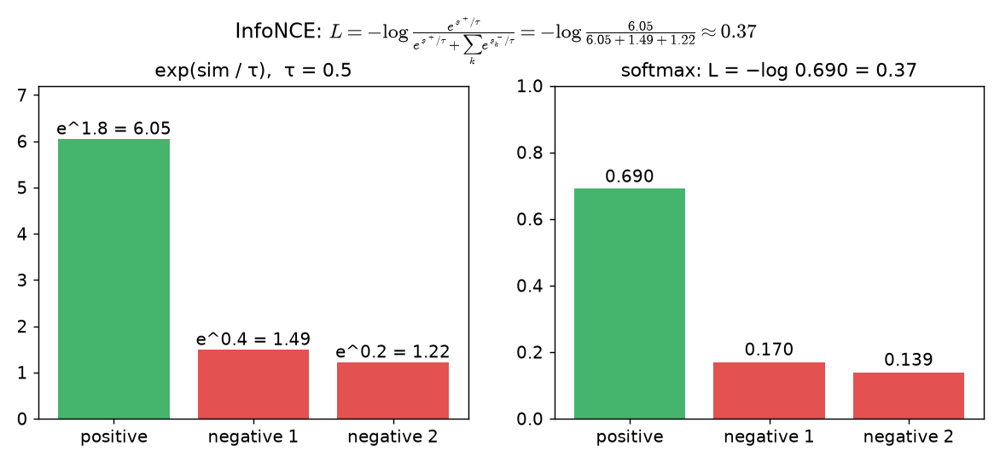
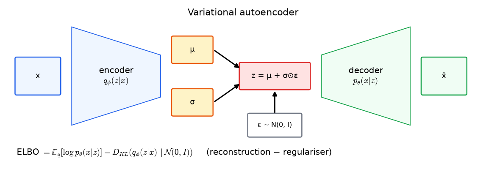
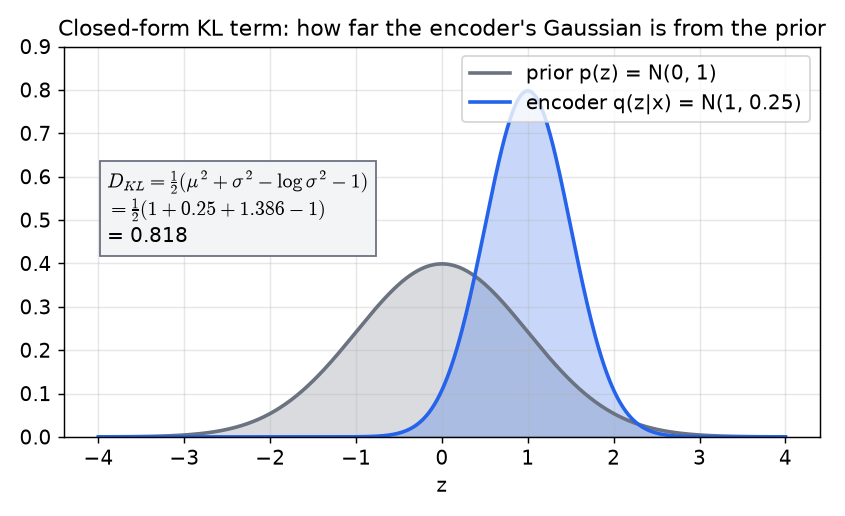
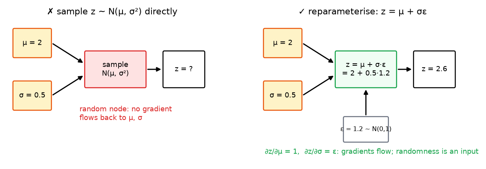

[↑ Index](README.md) · [← Previous](05_Session5_CNNs_Transformers_ViT.md) · [Next →](07_Session7_GANs_Conditional_Models.md)

<b>Contents</b>

- [6.1 Representation Learning](#61-representation-learning)
- [6.3 Contrastive Learning — SimCLR](#63-contrastive-learning--simclr)
- [6.4 Generative Models — The Big Picture](#64-generative-models--the-big-picture)
- [6.5 Variational Autoencoder (VAE)](#65-variational-autoencoder-vae)
- [Session 6 — Formula sheet](#session-6--formula-sheet)
- [Session 6 — Checkpoint questions](#session-6--checkpoint-questions)

# Session 6 — Representation Learning, Generative Models and VAE

**1.25-hour session · Important: ELBO derivation**

This session introduces an important change in how we think about neural networks.

Until now, we mostly discussed models that take an input and predict an output.

Now we'll study models that learn useful representations of data and models that can **generate entirely new data**.

We'll cover:

1. Representation learning.
2. Autoencoders and self-supervised learning.
3. Contrastive learning (SimCLR, InfoNCE).
4. Generative models and maximum likelihood.
5. Variational Autoencoders (VAE).
6. ELBO derivation.
7. Reparameterisation trick and β-VAE.

---

## 6.1 Representation Learning

### 1. Big picture

Suppose you have 100,000 images of animals.

You want a model that understands useful properties of these images:

- Shape.
- Texture.
- Colour.
- Object identity.
- Relationships between objects.

Instead of directly learning to classify every image, we can first learn a compact representation.

This is called **representation learning**.

The model learns:

$$
\boxed{z=f_\theta(x)}
$$

where:

- $x$: original input.
- $f_\theta$: encoder/network.
- $z$: learned representation or embedding.

The objective is to make $z$ contain useful information about $x$.

For example, similar animal images should ideally have similar representations.

### 2. How do we evaluate representations?

Your study guide mentions two methods.

**A. Linear probing**

1. Train an encoder to generate representations.
2. Freeze the encoder parameters.
3. Extract embeddings for your images.
4. Train a simple linear classifier on top.

If the linear classifier performs well, the representation is likely to contain useful information.

Why freeze the encoder?

We want to test the quality of the learned representation, not allow the classifier to improve it by changing the encoder.

**B. k-NN evaluation**

Generate embeddings for all images.

For a new image:

1. Calculate its embedding.
2. Find the nearest embeddings.
3. Predict using the labels of its neighbours.

This tests whether semantically similar examples are close in embedding space.

---

### 6.2 Autoencoders

#### 1. Intuition

Imagine compressing a photograph into a small representation and then reconstructing the photograph from that representation.

An autoencoder does exactly this.

It has two components:

**Encoder:**

$$
z=f_\theta(x)
$$

Compresses the input into a latent representation.

**Decoder:**

$$
\hat x=g_\phi(z)
$$

Reconstructs the original input.

The training objective is reconstruction error:

$$
\boxed{L=\|x-\hat x\|^2}
$$

This forces the latent representation to retain information useful for reconstructing the input.

#### 2. Bottleneck

Why introduce a small latent representation?

Suppose:

- Input image: 784 dimensions.
- Latent representation: 32 dimensions.
- Output: 784 dimensions.

The model must compress the important information into just 32 numbers.

This creates pressure to learn meaningful features rather than simply copying the input.

#### 3. Denoising autoencoders

A normal autoencoder reconstructs $x$ from $x$.

A denoising autoencoder reconstructs a clean image from a corrupted image.

$$
\tilde x=x+\text{noise}
$$

The training objective becomes:

$$
\boxed{L=\|x-g_\phi(f_\theta(\tilde x))\|^2}
$$

For example:

- Input: image with random noise.
- Encoder: learns useful features despite noise.
- Decoder: reconstructs the clean image.

This encourages robust representations.

#### 4. Self-supervised pretext tasks

What if we don't have labels?

We can construct artificial tasks using the image itself.

These are called pretext tasks.

| Task | What the model learns |
|---|---|
| Colourisation | Predict colours from grayscale images |
| Rotation prediction | Understand orientation and image structure |
| Inpainting | Reconstruct missing image regions |
| Masked autoencoder (MAE) | Reconstruct masked image patches |

**Masked Autoencoder (MAE)**

1. Divide the image into patches.
2. Randomly mask approximately 75% of patches.
3. Encode the visible patches.
4. Use a decoder to reconstruct the missing patches.

The model learns useful visual structure without requiring manually supplied class labels.

---

## 6.3 Contrastive Learning — SimCLR

**Important: InfoNCE**

### 1. Big picture

Imagine having two photographs of the same dog:

- First image: original photograph.
- Second image: horizontally flipped, cropped and colour-adjusted photograph.

Although they look different, they represent the same underlying object.

We want a neural network to produce similar embeddings for these two images.

At the same time, images of different objects should have different embeddings.

This is the idea behind **contrastive learning**.

### 2. Positive and negative pairs

Suppose a batch contains images:

$$
x_1,x_2,x_3
$$

Generate two augmentations of $x_1$:

$$
\tilde x_1^{(1)},\quad\tilde x_1^{(2)}
$$

These form a positive pair.

Other image views act as negative examples.

The encoder generates:

$$
z_i=f_\theta(\tilde x_i)
$$

The objective is:

- Positive pair: embeddings should be close.
- Negative pairs: embeddings should be far apart.

### 3. InfoNCE loss

This is the main mathematical expression to remember.

Let $z_i$ be an anchor and $z_j$ its positive representation.

Define similarity as cosine similarity:

$$
\operatorname{sim}(z_i,z_j)
=
\frac{z_i^Tz_j}{\|z_i\|\|z_j\|}
$$

The InfoNCE loss is:

> **InfoNCE**
> $$
> \boxed{
> L_i=-\log
> \frac{\exp(\operatorname{sim}(z_i,z_j)/\tau)}
> {\sum_{k\ne i}\exp(\operatorname{sim}(z_i,z_k)/\tau)}
> }
> $$
>
> - Numerator: similarity with the positive.
> - Denominator: similarity with all candidate views except the anchor itself.
> - $\tau$: temperature parameter.

The denominator includes both the positive and negative candidates.

#### 4. Numerical example

Suppose the similarities are:

- Positive similarity = 0.9.
- Negative 1 similarity = 0.2.
- Negative 2 similarity = 0.1.
- Temperature $\tau=0.5$.

The loss is:

$$
L=-\log
\frac{e^{0.9/0.5}}
{e^{0.9/0.5}+e^{0.2/0.5}+e^{0.1/0.5}}
$$

$$
=-\log\frac{e^{1.8}}{e^{1.8}+e^{0.4}+e^{0.2}}
$$

Approximately:

$$
=-\log\frac{6.05}{6.05+1.49+1.22}
$$

$$
\boxed{L\approx0.37}
$$

> **Correction:** the original chat gave $L\approx0.33$. The arithmetic gives $6.05/8.76=0.690$ and $-\log 0.690\approx0.37$.

A smaller loss means the positive pair has received a relatively high probability compared with the negatives.

#### 5. What does temperature $\tau$ do?

Temperature controls the sharpness of the similarity distribution.

$$
\operatorname{softmax}\left(\frac{\text{similarity}}{\tau}\right)
$$

- Small $\tau$: sharper distribution; greater emphasis on highly similar negatives.
- Large $\tau$: softer distribution; similarity differences matter less.

#### 6. Alignment and uniformity

Your guide mentions two important properties.

**Alignment:** Positive pairs should be close to one another.

**Uniformity:** Representations should be distributed across the embedding space instead of collapsing into one location.

If all embeddings became identical, the model would have learned nothing useful.

#### 7. The role of augmentations

This is a particularly important conceptual question.

The choice of augmentations determines which properties the network learns to ignore.

For example:

- Horizontal flipping encourages some orientation invariance.
- Colour jitter encourages robustness to colour changes.
- Random cropping encourages robustness to changes in visible context.

But there is a catch.

Suppose orientation is important for classifying an image. Excessive rotation augmentation might remove useful information.

**The augmentation strategy defines the invariances the model is encouraged to learn.**

#### 8. Connection to CLIP

CLIP applies a similar contrastive learning idea to image-text pairs.

It has:

- An image encoder.
- A text encoder.
- A shared embedding space.

A matching image-text pair should have high similarity.

An unrelated image-text pair should have low similarity.

---

## 6.4 Generative Models — The Big Picture

Now we move to the main topic.

### 1. What is a generative model?

Suppose you train a model on 100,000 human face images.

After training, you want it to produce a completely new realistic face that was not present in the dataset.

This is what a generative model does.

Instead of learning:

$$
x\longrightarrow y
$$

it learns a distribution over data:

$$
\boxed{p_\theta(x)}
$$

Once it has learned this distribution, we can sample:

$$
x\sim p_\theta(x)
$$

and generate new examples.

### 2. Maximum likelihood estimation

Suppose our training data comes from an unknown distribution:

$$
p_{\text{data}}(x)
$$

We want to learn a model distribution:

$$
p_\theta(x)
$$

Maximum likelihood estimation tries to maximise:

$$
\boxed{
\theta^*=
\arg\max_\theta
\mathbb E_{x\sim p_{\text{data}}}
[\log p_\theta(x)]
}
$$

Intuitively, we want the model to assign high probability to the data we actually observe.

#### Connection to KL divergence

Recall:

$$
D_{KL}(P\|Q)
=
\mathbb E_P
\left[
\log\frac{P(x)}{Q(x)}
\right]
$$

Therefore:

$$
D_{KL}(p_{\text{data}}\|p_\theta)
=
\mathbb E_{\text{data}}[\log p_{\text{data}}(x)]
-
\mathbb E_{\text{data}}[\log p_\theta(x)]
$$

The first term does not depend on $\theta$.

Therefore, minimising KL divergence is equivalent to maximising likelihood:

$$
\boxed{
\max_\theta \mathbb E_{\text{data}}[\log p_\theta(x)]
\iff
\min_\theta D_{KL}(p_{\text{data}}\|p_\theta)
}
$$

This connection is important because it gives a statistical interpretation of generative modelling.

### 3. Different generative model families

Your guide gives the following comparison.

| Model | Likelihood | Sampling | Main characteristic |
|---|---|---|---|
| Autoregressive | Exact | Sequential, slow | Generates one component at a time |
| Normalising flows | Exact | Fast | Uses invertible transformations |
| VAE | Lower bound (ELBO) | Fast | Smooth latent space, can produce blurry samples |
| GAN | No tractable likelihood | Fast | Sharp samples, risk of mode collapse |
| Diffusion | Bound | Many denoising steps | High quality and diversity |

#### What are the differences?

**Autoregressive models**

Factorise the distribution:

$$
p(x)=\prod_i p(x_i\mid x_{<i})
$$

Each element depends on earlier elements.

Example: GPT predicts the next token based on previous tokens.

**Normalising flows**

Transform a simple distribution into a complex one using invertible transformations.

Their density can be evaluated using the change-of-variables formula.

**VAE**

Uses a probabilistic latent variable model and maximises a lower bound on likelihood.

**GAN**

Uses a generator and discriminator in a competitive learning process.

**Diffusion**

Learns to reverse a gradual corruption process, starting from noise and recovering data.

We'll study GAN and diffusion in depth in the next two sessions.

### 4. Generative model evaluation

Two metrics mentioned in your notes:

**FID — Fréchet Inception Distance**

Compares the statistics of real and generated image representations extracted from an Inception network.

$$
\boxed{\text{Lower FID is generally better}}
$$

**Inception Score**

Measures aspects of generated-image class confidence and diversity.

A high score is generally desirable, although it does not reliably capture all aspects of image quality and diversity.

---

## 6.5 Variational Autoencoder (VAE)

**Most important derivation in Session 6**

### 1. Why do we need a VAE?

Recall a normal autoencoder:

$$
x\rightarrow z\rightarrow\hat x
$$

It learns to reconstruct images.

But we want more than reconstruction.

We want a model that can:

1. Learn a meaningful latent space.
2. Sample new latent vectors.
3. Decode them into realistic new images.

A conventional autoencoder does not necessarily organise its latent space into a distribution from which we can reliably sample.

A VAE solves this by introducing probabilistic latent variables.

### 2. The generative story

The VAE assumes that an image $x$ is generated through an unobserved latent variable $z$.

First sample:

$$
\boxed{z\sim p(z)=\mathcal N(0,I)}
$$

Then generate the data:

$$
\boxed{x\sim p_\theta(x\mid z)}
$$

This creates a generative process:

$$
z\longrightarrow x
$$

The decoder represents:

$$
p_\theta(x\mid z)
$$

It tells us the probability of generating image $x$, given latent variable $z$.

### 3. The problem: marginal likelihood is intractable

We want to calculate:

$$
p_\theta(x)
$$

But we don't know which latent variable generated the image.

We must integrate over all possible latent values:

$$
\boxed{
p_\theta(x)=
\int p_\theta(x\mid z)p(z)\,dz
}
$$

This integral is difficult to calculate for a complex neural-network decoder.

For a high-dimensional latent variable, evaluating it directly becomes computationally intractable.

**Our problem:** How can we learn a generative model when the marginal likelihood is difficult to calculate?

### 4. The solution: introduce an encoder

Introduce an approximate posterior distribution:

$$
\boxed{
q_\phi(z\mid x)=
\mathcal N(\mu_\phi(x),\operatorname{diag}\sigma_\phi^2(x))
}
$$

The encoder no longer outputs one fixed latent vector.

Instead, it predicts:

- Mean $\mu$.
- Variance $\sigma^2$.

These parameters define a Gaussian distribution over latent vectors.

For example, suppose the encoder outputs:

$$
\mu=
\begin{bmatrix}
1\\2
\end{bmatrix}
,\qquad
\sigma=
\begin{bmatrix}
0.5\\0.2
\end{bmatrix}
$$

The latent representation is sampled from:

$$
z\sim\mathcal N
\left(
\begin{bmatrix}1\\2\end{bmatrix},
\begin{bmatrix}0.25&0\\0&0.04\end{bmatrix}
\right)
$$

Different samples give slightly different latent vectors.

This is the fundamental difference between an ordinary autoencoder and a VAE.

---

### 6.6 Deriving the ELBO

**Must know step by step**

We want to maximise:

$$
\log p_\theta(x)
$$

But calculating this directly is difficult.

The solution is to introduce $q_\phi(z\mid x)$ and derive a tractable lower bound.

#### Step 1. Start with marginal likelihood

$$
p_\theta(x)=\int p_\theta(x,z)\,dz
$$

Multiply and divide by $q_\phi(z\mid x)$:

$$
p_\theta(x)
=
\int q_\phi(z\mid x)
\frac{p_\theta(x,z)}
{q_\phi(z\mid x)}
\,dz
$$

This is an expectation:

$$
p_\theta(x)=
\mathbb E_{q_\phi(z\mid x)}
\left[
\frac{p_\theta(x,z)}
{q_\phi(z\mid x)}
\right]
$$

#### Step 2. Take logarithms

$$
\log p_\theta(x)=
\log
\mathbb E_q
\left[
\frac{p_\theta(x,z)}{q_\phi(z\mid x)}
\right]
$$

#### Step 3. Apply Jensen's inequality

Because logarithm is a concave function:

$$
\log\mathbb E[Y]\geq\mathbb E[\log Y]
$$

Therefore:

$$
\log p_\theta(x)
\geq
\mathbb E_q
\left[
\log
\frac{p_\theta(x,z)}{q_\phi(z\mid x)}
\right]
$$

Define the right-hand side as the ELBO:

$$
\mathcal L_{\text{ELBO}}
=
\mathbb E_q[
\log p_\theta(x,z)-\log q_\phi(z\mid x)
]
$$

#### Step 4. Factorise the joint distribution

Using the generative model:

$$
p_\theta(x,z)=p_\theta(x\mid z)p(z)
$$

Substitute:

$$
\mathcal L_{\text{ELBO}}
=
\mathbb E_q[
\log p_\theta(x\mid z)
+\log p(z)
-\log q_\phi(z\mid x)
]
$$

Separate the terms:

$$
=
\mathbb E_q[\log p_\theta(x\mid z)]
-
\mathbb E_q
\left[
\log\frac{q_\phi(z\mid x)}{p(z)}
\right]
$$

Recognise the KL divergence:

$$
\boxed{
\mathcal L_{\text{ELBO}}
=
\mathbb E_q[\log p_\theta(x\mid z)]
-
D_{KL}(q_\phi(z\mid x)\|p(z))
}
$$

> **Final ELBO equation — memorise**
> $$
> \boxed{
> \underbrace{\mathcal L_{\text{ELBO}}}_{\text{Lower bound}}
> =
> \underbrace{\mathbb E_q[\log p_\theta(x\mid z)]}_{\text{Reconstruction}}
> -
> \underbrace{D_{KL}(q_\phi(z\mid x)\|p(z))}_{\text{Regularisation}}
> }
> $$
>
> The ELBO is a lower bound on the log-likelihood.

#### Step 5. Understand the two terms

**Reconstruction term**

$$
\mathbb E_q[\log p_\theta(x\mid z)]
$$

This encourages the decoder to reconstruct the original input correctly.

Higher is better.

**KL regularisation term**

$$
D_{KL}(q_\phi(z\mid x)\|p(z))
$$

This encourages the encoder's posterior distribution to stay close to the prior.

Lower is better.

Together, these terms balance reconstruction quality and latent-space regularity.

#### Another way to derive it: the exact identity

Your study guide also gives a useful equality:

$$
\boxed{
\log p_\theta(x)=
\mathbb E_q[\log p_\theta(x\mid z)]
-
D_{KL}(q_\phi(z\mid x)\|p(z))
+
D_{KL}(q_\phi(z\mid x)\|p_\theta(z\mid x))
}
$$

The last term is non-negative.

Therefore:

$$
\log p_\theta(x)\geq\mathcal L_{\text{ELBO}}
$$

This is useful in an exam when asked to explain why the ELBO is a lower bound.

**Important intuition:** Maximising ELBO maximises a tractable lower bound on the likelihood. It also encourages the approximate posterior to approach the true posterior, because the difference between log-likelihood and ELBO is their KL divergence.

---

### 6.7 Closed-form KL divergence for a Gaussian VAE

This is another very likely numerical question.

Recall:

$$
q_\phi(z\mid x)=\mathcal N(\mu,\operatorname{diag}(\sigma^2))
$$

And the prior:

$$
p(z)=\mathcal N(0,I)
$$

The KL divergence is:

$$
\boxed{
D_{KL}(q\|p)=
\frac12\sum_j
\left(
\mu_j^2+\sigma_j^2-\log\sigma_j^2-1
\right)
}
$$

#### Numerical example

Consider one-dimensional latent space:

$$
\mu=1,\quad\sigma^2=0.25
$$

Substitute:

$$
D_{KL}=
\frac12
\left(
1^2+0.25-\log(0.25)-1
\right)
$$

Since:

$$
\log(0.25)\approx-1.3863
$$

We obtain:

$$
D_{KL}
=
\frac12(1+0.25+1.3863-1)
$$

$$
\boxed{D_{KL}\approx0.8181}
$$

This measures how different the encoder's latent distribution is from the standard normal prior.

**Special case:** If $\mu=0$ and $\sigma^2=1$, then:

$$
D_{KL}=0
$$

The posterior matches the prior exactly.

---

### 6.8 Reparameterisation Trick

**Important conceptual question**

We have a problem.

Our encoder outputs $\mu$ and $\sigma$, and we sample:

$$
z\sim\mathcal N(\mu,\sigma^2)
$$

But sampling is a stochastic operation.

How can we propagate gradients through this sampling operation to update the encoder?

The solution is the reparameterisation trick.

#### 1. Basic idea

Instead of directly sampling from:

$$
z\sim\mathcal N(\mu,\sigma^2)
$$

sample independent standard Gaussian noise:

$$
\epsilon\sim\mathcal N(0,1)
$$

Then construct:

$$
\boxed{z=\mu+\sigma\epsilon}
$$

For multiple latent dimensions:

$$
\boxed{z=\mu+\sigma\odot\epsilon}
$$

where $\odot$ means element-wise multiplication.

Now the randomness is isolated in $\epsilon$.

For fixed $\epsilon$, $z$ is a differentiable function of the encoder outputs.

You already know backpropagation, so the key insight is simply that gradients can now flow through $\mu$ and $\sigma$.

#### 2. Numerical example

Suppose:

$$
\mu=2,\quad\sigma=0.5
$$

Sample:

$$
\epsilon=1.2
$$

Then:

$$
z=2+0.5(1.2)
$$

$$
\boxed{z=2.6}
$$

If the same $\mu,\sigma$ are used with another noise sample, we get another latent vector.

This produces stochastic latent representations while retaining differentiability with respect to the encoder parameters.

---

### 6.9 Why are VAE images often blurry?

This is an important conceptual question.

Suppose the decoder predicts a Gaussian distribution:

$$
p_\theta(x\mid z)=
\mathcal N(\hat x,\sigma_x^2I)
$$

The negative log-likelihood is proportional to:

$$
\boxed{L_{\text{recon}}\propto\|x-\hat x\|^2}
$$

This is essentially an MSE reconstruction loss.

Now imagine an input for which multiple outputs are plausible.

For instance, a model is uncertain about the colour of a car.

Possible outputs:

- Red car.
- Blue car.
- Green car.

A pixel-wise MSE objective rewards predicting their average.

The resulting image may have an unrealistic intermediate colour.

This produces blurry-looking outputs.

**Important qualification:** VAEs are not inherently required to be blurry. This is a common limitation of conventional VAE architectures using simple pixel-wise Gaussian likelihoods.

---

### 6.10 β-VAE and latent interpolation

#### β-VAE

A standard VAE objective is:

$$
\mathcal L=
\mathbb E_q[\log p_\theta(x\mid z)]
-
D_{KL}(q\|p)
$$

A β-VAE modifies the KL weight:

$$
\boxed{
\mathcal L_\beta=
\mathbb E_q[\log p_\theta(x\mid z)]
-
\beta D_{KL}(q\|p)
}
$$

What happens when $\beta$ increases?

The model is penalised more strongly when its latent distributions deviate from the prior.

This encourages more structured, potentially disentangled latent representations.

However, excessive regularisation can hurt reconstruction quality or remove useful information.

#### Latent interpolation

A VAE learns a relatively smooth latent space.

Suppose two images have latent representations:

$$
z_1,\quad z_2
$$

Interpolate:

$$
\boxed{
z_\alpha=(1-\alpha)z_1+\alpha z_2
}
$$

where:

$$
0\leq\alpha\leq1
$$

As $\alpha$ changes from 0 to 1, decode the intermediate representations.

This gives a smooth transition between generated samples.

---

## Session 6 — Formula sheet

> **Representation learning**
>
> $$
> z=f_\theta(x)
> $$
>
> Autoencoder:
>
> $$
> \hat x=g_\phi(f_\theta(x))
> $$
>
> **Contrastive learning**
>
> $$
> L_i=-\log
> \frac{\exp(\operatorname{sim}(z_i,z_j)/\tau)}
> {\sum_{k\ne i}\exp(\operatorname{sim}(z_i,z_k)/\tau)}
> $$
>
> **Maximum likelihood**
>
> $$
> \max_\theta\mathbb E_{\text{data}}[\log p_\theta(x)]
> $$
>
> $$
> \iff\min_\theta D_{KL}(p_{\text{data}}\|p_\theta)
> $$
>
> **VAE model**
>
> $$
> p_\theta(x)=\int p_\theta(x\mid z)p(z)\,dz
> $$
>
> $$
> q_\phi(z\mid x)=
> \mathcal N(\mu,\operatorname{diag}\sigma^2)
> $$
>
> **ELBO**
>
> $$
> \boxed{
> \mathcal L_{\text{ELBO}}=
> \mathbb E_q[\log p_\theta(x\mid z)]
> -
> D_{KL}(q_\phi(z\mid x)\|p(z))
> }
> $$
>
> **KL divergence**
>
> $$
> \boxed{
> D_{KL}=
> \frac12\sum_j
> (\mu_j^2+\sigma_j^2-\log\sigma_j^2-1)
> }
> $$
>
> **Reparameterisation**
>
> $$
> \boxed{z=\mu+\sigma\odot\epsilon}
> $$
>
> $$
> \epsilon\sim\mathcal N(0,I)
> $$
>
> **β-VAE**
>
> $$
> \boxed{
> \mathcal L_\beta=
> \mathbb E_q[\log p_\theta(x\mid z)]
> -\beta D_{KL}(q\|p)
> }
> $$

---

## Session 6 — Checkpoint questions

The ELBO is the most important part. Pay particular attention to Q2 and Q3.

#### Practice questions

1. Explain representation learning. What are linear probing and k-NN evaluation? How does a denoising autoencoder work?
2. Write InfoNCE loss. Explain positive pairs, negative pairs, temperature, alignment and uniformity.
3. Derive the ELBO starting from log p(x) = log ∫p(x,z)dz. Show where Jensen's inequality is used and identify the two ELBO terms.
4. A one-dimensional encoder outputs μ = 2 and σ² = 0.25. Calculate KL(q||N(0,1)).
5. Given μ = 1.5, σ = 0.5 and ε = -2, calculate z using the reparameterisation trick. Why is this formulation useful?
6. Why can a conventional Gaussian-likelihood VAE generate blurry images? What does increasing β do in β-VAE?
7. Compare VAE, GAN and diffusion in terms of likelihood, sample quality and sampling speed.

**Next: Session 7 — GANs and Conditional Generative Models.**

We'll derive the optimal discriminator:

$$
D^*(x)=\frac{p_{\text{data}}(x)}
{p_{\text{data}}(x)+p_g(x)}
$$

Then connect the GAN minimax objective to Jensen–Shannon divergence, mode collapse, WGAN, cGAN, pix2pix and CycleGAN. This session is particularly important because GANs are self-study material in your course.

---

[↑ Index](README.md) · [← Previous](05_Session5_CNNs_Transformers_ViT.md) · [Next →](07_Session7_GANs_Conditional_Models.md)
