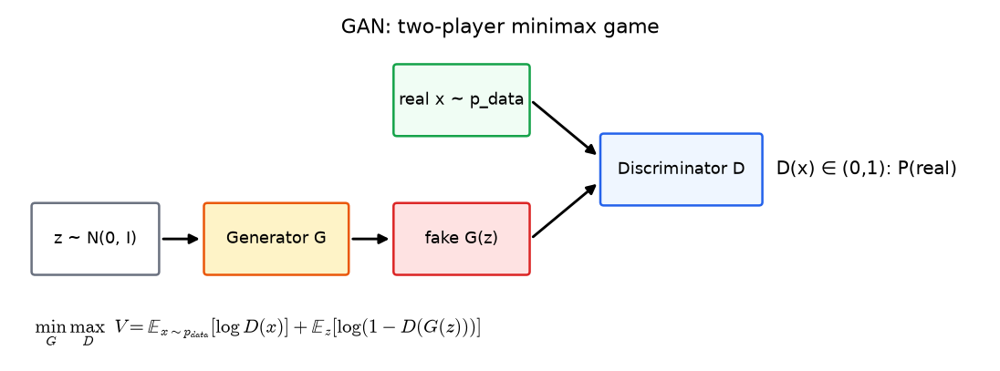
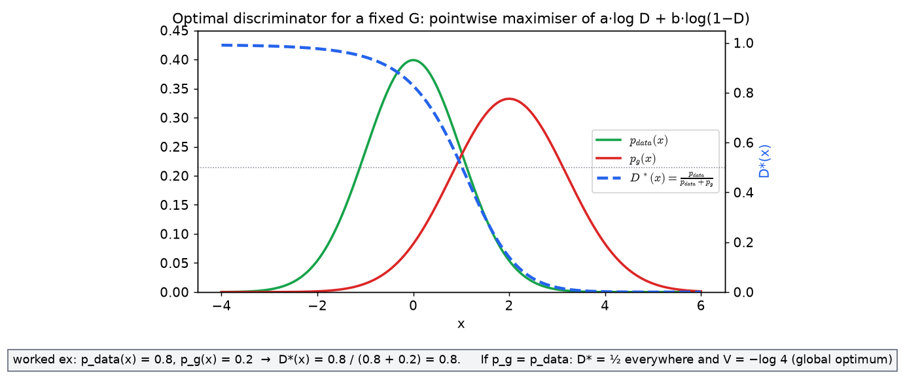
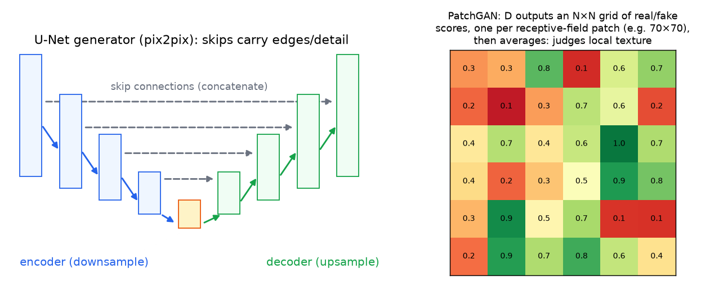
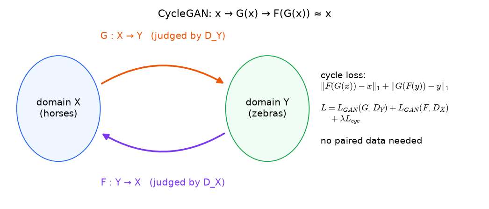

[↑ Index](README.md) · [← Previous](06_Session6_Representation_Learning_VAE.md) · [Next →](08_Session8_Diffusion.md)

<b>Contents</b>

- [7.1 Generative Adversarial Networks (GANs)](#71-generative-adversarial-networks-gans)
- [7.2 Deriving the optimal discriminator](#72-deriving-the-optimal-discriminator)
- [7.3 What does the generator actually minimise?](#73-what-does-the-generator-actually-minimise)
- [7.4 How are GANs trained?](#74-how-are-gans-trained)
- [7.5 Problems with GANs and their solutions](#75-problems-with-gans-and-their-solutions)
- [7.6 Wasserstein GAN (WGAN)](#76-wasserstein-gan-wgan)
- [7.7 Conditional Generative Models](#77-conditional-generative-models)
- [7.8 pix2pix — Paired Image-to-Image Translation](#78-pix2pix--paired-image-to-image-translation)
- [7.9 CycleGAN — Unpaired Image-to-Image Translation](#79-cyclegan--unpaired-image-to-image-translation)
- [7.10 Other conditional generative models](#710-other-conditional-generative-models)
- [Session 7 — Formula sheet](#session-7--formula-sheet)
- [Session 7 — Checkpoint questions](#session-7--checkpoint-questions)

Session 7 is GANs and conditional generative models. I’ll stick to the study guide’s scope, then deepen the key maths: optimal discriminator, the Jensen–Shannon result, non-saturating loss, WGAN, cGAN, pix2pix and CycleGAN.

# Session 7 — GANs and Conditional Generative Models

**1.25-hour session · Self-study: high priority**

This is an important session because GANs introduce a completely different way of training generative models: **two neural networks compete against each other.**

We'll cover:

1. Generative Adversarial Networks (GANs).
2. Minimax objective and optimal discriminator derivation.
3. Jensen–Shannon divergence.
4. GAN training problems and solutions.
5. Conditional GANs.
6. pix2pix.
7. CycleGAN.

Our main reference is Prince's *Understanding Deep Learning*, Chapter 15, following your course guide.

---

## 7.1 Generative Adversarial Networks (GANs)

### 1. Big picture

Imagine you want to generate realistic photographs of human faces.

You have a dataset of real faces.

Instead of directly learning how to generate a face using a reconstruction loss, we create two competing neural networks:

- **Generator (G):** creates fake images.
- **Discriminator (D):** distinguishes real images from generated images.

The generator tries to fool the discriminator.

The discriminator tries not to get fooled.

This competition gradually improves the generator.

### 2. Understand the two networks

#### A. Generator

The generator takes random noise as input:

$$
z\sim p(z)
$$

Usually:

$$
p(z)=\mathcal N(0,I)
$$

It transforms this random vector into an image:

$$
\boxed{x_{\text{fake}}=G(z)}
$$

The generator is trying to produce images that look like samples from the real data distribution.

For example:

$$
z=(0.2,-0.8,1.3,\ldots)
$$

is passed through the generator, producing a synthetic face.

#### B. Discriminator

The discriminator receives an image and outputs a probability:

$$
\boxed{D(x)\in(0,1)}
$$

Interpretation:

- $D(x)\approx1$: image is likely real.
- $D(x)\approx0$: image is likely fake.

It learns to distinguish:

- Real images sampled from $p_{\text{data}}$.
- Fake images generated from $p_g$.

Here:

$$
p_g=\text{distribution of generated images}
$$

The discriminator is essentially a binary classifier.

### 3. The GAN objective

The original GAN objective from Goodfellow et al. is:

> **Fundamental GAN objective**
> $$
> \boxed{
> \min_G\max_D V(D,G)
> }
> $$
>
> $$
> \boxed{
> V(D,G)=
> \mathbb E_{x\sim p_{\text{data}}}[\log D(x)]
> +
> \mathbb E_{z\sim p(z)}[\log(1-D(G(z)))]
> }
> $$

Understand the two terms.

**First term:**

$$
\mathbb E_{x\sim p_{\text{data}}}[\log D(x)]
$$

The discriminator wants real images to receive scores close to 1.

**Second term:**

$$
\mathbb E_{z\sim p(z)}[\log(1-D(G(z)))]
$$

The discriminator wants fake images to receive scores close to 0.

The discriminator maximises both terms.

The generator tries to minimise the overall objective by making fake images harder to distinguish from real images.

#### Who wants what?

| Network | Objective |
|---|---|
| Discriminator | Maximise $V(D,G)$ |
| Generator | Minimise $V(D,G)$ |

Notice the competition:

- If $D$ becomes very good, $G$ struggles.
- If $G$ becomes very good, $D$ struggles.

---

## 7.2 Deriving the optimal discriminator

**Most important derivation in this session**

This is explicitly in your study guide, so understand the derivation rather than just memorising the result.

We want to find the best discriminator for a fixed generator.

In other words, assume $G$ is not changing. What is the optimal $D(x)$?

#### Step 1. Express the objective using distributions

The discriminator objective is:

$$
V(D,G)=
\int p_{\text{data}}(x)\log D(x)\,dx
$$

$$
+\int p_g(x)\log(1-D(x))\,dx
$$

Combine:

$$
V(D,G)=
\int
\left[
p_{\text{data}}(x)\log D(x)
+
p_g(x)\log(1-D(x))
\right]dx
$$

#### Step 2. Maximise pointwise

For a fixed $x$, define:

$$
a=p_{\text{data}}(x)
$$

$$
b=p_g(x)
$$

We need to maximise:

$$
f(D)=a\log D+b\log(1-D)
$$

Remember, $D$ is a scalar between 0 and 1.

Differentiate:

$$
\frac{df}{dD}
=
\frac aD-\frac b{1-D}
$$

At the optimum:

$$
\frac aD-\frac b{1-D}=0
$$

Move terms:

$$
\frac aD=\frac b{1-D}
$$

Cross multiply:

$$
a(1-D)=bD
$$

$$
a-aD=bD
$$

$$
a=D(a+b)
$$

Therefore:

$$
D=\frac a{a+b}
$$

Substitute the original distributions:

> **Optimal discriminator**
> $$
> \boxed{
> D^*(x)=
> \frac{p_{\text{data}}(x)}
> {p_{\text{data}}(x)+p_g(x)}
> }
> $$

We can verify it is a maximum because:

$$
\frac{d^2f}{dD^2}
=
-\frac a{D^2}
-\frac b{(1-D)^2}<0
$$

when $a,b$ are positive.

#### 3. Intuition behind the result

Suppose the probability density of real images at a particular point is:

$$
p_{\text{data}}(x)=0.8
$$

And the generated-image density is:

$$
p_g(x)=0.2
$$

Then:

$$
D^*(x)=\frac{0.8}{0.8+0.2}
$$

$$
\boxed{D^*(x)=0.8}
$$

The discriminator assigns an 80% probability of being real.

Now imagine:

$$
p_{\text{data}}(x)=p_g(x)
$$

Then:

$$
D^*(x)=\frac12
$$

The discriminator cannot distinguish real and generated samples at that point.

This gives us the key idea:

**At an ideal GAN equilibrium, the generator's distribution matches the real data distribution.**

---

## 7.3 What does the generator actually minimise?

This is the next important mathematical step.

We have:

$$
D^*(x)=
\frac{p_{\text{data}}(x)}
{p_{\text{data}}(x)+p_g(x)}
$$

Substitute it into the original GAN objective.

We get:

$$
V(D^*,G)=
\int p_{\text{data}}(x)
\log
\frac{p_{\text{data}}(x)}
{p_{\text{data}}(x)+p_g(x)}
\,dx
$$

$$
+
\int p_g(x)
\log
\frac{p_g(x)}
{p_{\text{data}}(x)+p_g(x)}
\,dx
$$

Now introduce the mixture distribution:

$$
m(x)=\frac{p_{\text{data}}(x)+p_g(x)}2
$$

Recall the definition of Jensen–Shannon divergence:

$$
JSD(P\|Q)=
\frac12D_{KL}(P\|M)
+
\frac12D_{KL}(Q\|M)
$$

where:

$$
M=\frac{P+Q}{2}
$$

Rearranging the substituted GAN objective gives:

$$
\boxed{
V(D^*,G)
=
-\log4+
2JSD(p_{\text{data}}\|p_g)
}
$$

> **Important result**
> $$
> \boxed{
> \min_G V(D^*,G)
> \iff
> \min_G JSD(p_{\text{data}}\|p_g)
> }
> $$
> The generator tries to make its distribution match the real-data distribution.

#### When is the GAN at its optimum?

Since:

$$
JSD(P\|Q)\geq0
$$

The minimum occurs when:

$$
\boxed{p_g=p_{\text{data}}}
$$

At that point:

$$
D^*(x)=\frac12
$$

and:

$$
V(D^*,G)=-\log4
$$

Approximately:

$$
\boxed{-1.386}
$$

**Interpretation:** The discriminator is uncertain because generated and real distributions are identical.

---

## 7.4 How are GANs trained?

In practice, we don't solve for the perfect discriminator analytically on every training iteration.

Instead, we alternate optimisation steps.

A typical training procedure:

1. Sample real images from the dataset.
2. Sample noise vectors $z$.
3. Generate fake images $G(z)$.
4. Train the discriminator to classify real as 1 and fake as 0.
5. Update the generator to make its images fool the discriminator.
6. Repeat.

Your guide describes alternating $k$ discriminator steps with one generator step.

#### Why not always use the original generator loss?

The minimax generator objective is:

$$
\min_G
\mathbb E_z[\log(1-D(G(z)))]
$$

Early in training, the discriminator can be very good.

It gives:

$$
D(G(z))\approx0
$$

Then:

$$
\log(1-D(G(z)))\approx0
$$

More importantly, the gradient passed back to the generator can become very weak.

The generator struggles to improve.

#### Non-saturating generator loss

Instead of minimising:

$$
\log(1-D(G(z)))
$$

we maximise:

$$
\boxed{\mathbb E_z[\log D(G(z))]}
$$

Equivalently, minimise the negative:

$$
\boxed{
L_G=-\mathbb E_z[\log D(G(z))]
}
$$

This gives a stronger learning signal when the discriminator initially rejects fake samples confidently.

**Exam trap:** The minimax and non-saturating objectives have the same desired equilibrium, but their gradients during training behave differently.

---

## 7.5 Problems with GANs and their solutions

There are three main problems in your study guide.

### 1. Mode collapse

Imagine the real dataset contains:

- 100 different types of faces.
- Different hairstyles.
- Different ages.
- Different expressions.

But the generator learns to produce only five types of faces.

These generated images might fool the discriminator, but the generator has failed to represent the diversity of the original distribution.

This is called **mode collapse**.

In probability terms, the generator covers only a small portion of the modes of $p_{\text{data}}$.

The problem is that a generator can discover a limited set of outputs that fool the current discriminator without covering the full data distribution.

### 2. Training instability

GAN training is a two-player optimisation game.

There is no guarantee that both players' objectives decrease monotonically together.

For example:

- The discriminator becomes too powerful.
- The generator stops improving.
- The discriminator becomes too confident.
- The generator's learning signal weakens.

This makes training unstable.

### 3. Vanishing gradients and JSD

Consider the case where real and generated distributions have completely non-overlapping supports.

The Jensen–Shannon divergence becomes:

$$
JSD(p_{\text{data}}\|p_g)=\log2
$$

This is its maximum.

In this setting, the divergence can remain constant as the distributions move closer, so the generator receives an unhelpful learning signal through the original minimax formulation.

This motivates WGAN.

---

## 7.6 Wasserstein GAN (WGAN)

**Important conceptual comparison**

#### 1. Intuition

Imagine two piles of sand:

- Pile A: represents real data.
- Pile B: represents generated data.

How much work is needed to transform one distribution into the other?

This is the intuition behind the Wasserstein distance, also called Earth Mover's Distance.

Instead of comparing distributions using JSD, WGAN uses Wasserstein distance.

#### 2. What changes?

A standard GAN uses a discriminator:

$$
D(x)\in(0,1)
$$

A WGAN uses a **critic**.

The critic outputs an unrestricted real-valued score rather than a probability.

The critic is trained to distinguish the two distributions using a Wasserstein-related objective.

A key requirement is that the critic must be 1-Lipschitz.

Informally, this means its output cannot change arbitrarily quickly with small changes in input.

#### 3. How is the Lipschitz constraint enforced?

Your study guide mentions two methods:

**Weight clipping**

Constrain the critic's weights to a fixed range.

This is simple but can harm the critic's capacity.

**Gradient penalty**

Penalise the critic if its gradient norm deviates from 1 at sampled interpolated points.

A common WGAN-GP objective adds:

$$
\lambda
\mathbb E_{\hat x}
\left[
(\|\nabla_{\hat x}D(\hat x)\|_2-1)^2
\right]
$$

This encourages the required Lipschitz behaviour.

> **GAN vs WGAN**
>
> | Standard GAN | WGAN |
> |---|---|
> | Discriminator | Critic |
> | Probability output | Real-valued score |
> | JSD-based objective at optimal D | Wasserstein distance |
> | Potential vanishing gradients | More useful distance signal in difficult cases |
> | No Lipschitz constraint | 1-Lipschitz critic |

### 4. Other GAN architectures

Your guide includes two additional names.

**DCGAN**

Deep Convolutional GAN provides architectural guidelines:

- Strided convolutions instead of pooling.
- Batch Normalisation.
- ReLU in the generator.
- LeakyReLU in the discriminator.
- Avoid fully connected hidden layers in the convolutional architecture.

**StyleGAN**

Introduces:

- A mapping network.
- Style modulation in the generator.

It gives fine-grained control over different visual characteristics and has been used to produce very high-quality face images.

#### General advantages and disadvantages of GANs

| Advantages | Disadvantages |
|---|---|
| Sharp generated samples | Mode collapse |
| Fast generation after training | Training instability |
| No iterative denoising at inference | No tractable likelihood |
| Powerful image generation | No built-in encoder in the standard GAN setup |

---

## 7.7 Conditional Generative Models

So far, our generator accepts random noise:

$$
x=G(z)
$$

It can generate arbitrary samples, but we have limited control over what it generates.

Suppose you want:

- A photograph of a red car.
- A summer landscape.
- An image corresponding to a sketch.
- A specific class of animal.

We need to condition the generation process.

This introduces **conditional generative models**.

### 1. Why not ordinary regression?

Suppose we are training a model to colourise grayscale images.

One grayscale image could correspond to multiple correct coloured outputs.

A car could be:

- Red.
- Blue.
- Black.

This means the conditional distribution:

$$
p(y\mid x)
$$

is multimodal.

If we use ordinary L2 regression, the model minimises:

$$
L=\|y-\hat y\|^2
$$

The optimal prediction, under squared error, is the conditional mean:

$$
\boxed{\hat y=\mathbb E[y\mid x]}
$$

#### Numerical intuition

Imagine a simplified colour represented by RGB vectors.

Possible outputs:

Red:

$$
y_1=(1,0,0)
$$

Blue:

$$
y_2=(0,0,1)
$$

Their average is:

$$
\hat y=(0.5,0,0.5)
$$

This is purple.

But purple might not be a plausible answer for the particular car.

This is why regression can produce blurry or unrealistic averages when multiple distinct outputs are possible.

A generative model instead learns to sample one plausible output from the conditional distribution.

### 2. Conditional GAN (cGAN)

We provide a condition $y$ to both networks.

Generator:

$$
\boxed{x=G(z,y)}
$$

Discriminator:

$$
\boxed{D(x,y)}
$$

The discriminator judges whether an image is real, taking its condition into account.

For example:

- Condition: cat.
- Real input: actual cat image.
- Fake input: generated cat image.

The discriminator must judge both realism and compatibility with the condition.

The objective becomes:

$$
\begin{aligned}
\min_G\max_D V(G,D)
={}&
\mathbb E_{x,y\sim p_{\text{data}}}[\log D(x,y)]\\
&+\mathbb E_{z,y}[\log(1-D(G(z,y),y))]
\end{aligned}
$$

The condition is supplied to both networks.

---

## 7.8 pix2pix — Paired Image-to-Image Translation

**Important architecture**

### 1. What problem does pix2pix solve?

Suppose you have paired images:

| Input | Target |
|---|---|
| Building edge map | Photograph of building |
| Satellite image | Map |
| Sketch | Coloured image |
| Grayscale photograph | Coloured photograph |

For every input $x$, you have the corresponding desired output $y$.

This is called **paired training data**.

We train a generator:

$$
\hat y=G(x)
$$

The generator should produce an output matching the target while appearing realistic.

### 2. pix2pix objective

Your study guide gives:

$$
\boxed{
G^*=
\arg\min_G\max_D
\left[
L_{\text{cGAN}}(G,D)
+
\lambda\|y-G(x)\|_1
\right]
}
$$

There are two objectives.

**A. Conditional GAN loss**

Encourages realistic outputs that match the input condition.

**B. L1 reconstruction loss**

$$
L_1=\|y-G(x)\|_1
$$

Encourages the generated image to match the actual paired target.

#### Why use both?

Imagine generating a photograph from an edge map.

- L1 loss preserves the overall structure and correspondence to the target.
- GAN loss encourages sharp and realistic textures.

Without GAN loss, L1 predictions can look blurry.

Without L1 loss, the generator may produce realistic images that do not correctly correspond to the input.

> **Remember**
>
> $$
> \boxed{\text{pix2pix}=
> \text{GAN loss}+\lambda\text{L1 loss}}
> $$
>
> L1 provides structural fidelity; GAN provides realism.

### 3. Why U-Net generator?

The generator uses a U-Net architecture.

It has:

- An encoder that gradually downsamples the input.
- A decoder that reconstructs the output.
- Skip connections between corresponding encoder and decoder levels.

Why are skip connections useful?

Downsampling can lose fine spatial details.

But image translation often requires preserving:

- Object boundaries.
- Position.
- Edges.
- Local structure.

Skip connections transfer low-level information directly from the encoder to the decoder.

### 4. What is PatchGAN?

The pix2pix discriminator uses PatchGAN.

A standard discriminator might classify the entire image as real or fake.

PatchGAN instead classifies local $N\times N$ patches.

Why?

Realism is strongly associated with local image details:

- Texture.
- Edges.
- Fine patterns.
- Local consistency.

PatchGAN enforces realism locally.

The overall L1 objective handles large-scale structural correspondence.

**Exam trap:** PatchGAN does not simply classify each pixel independently. It evaluates spatial patches.

---

## 7.9 CycleGAN — Unpaired Image-to-Image Translation

**Very important comparison with pix2pix**

### 1. The problem

Suppose you want to convert horse photographs into zebra photographs.

You have:

- A collection of horse photographs.
- A separate collection of zebra photographs.

But you don't have matching pairs showing the same animal in both domains.

This is called **unpaired data**.

pix2pix requires paired examples.

CycleGAN solves the unpaired translation problem.

### 2. Two generators

Let the two image domains be:

$$
X=\text{horse images}
$$

$$
Y=\text{zebra images}
$$

We introduce two generators:

$$
\boxed{G:X\rightarrow Y}
$$

$$
\boxed{F:Y\rightarrow X}
$$

The first generator translates horses into zebras.

The second translates zebras into horses.

Each generator has an associated discriminator:

- $D_Y$: distinguishes real zebra images from generated zebra images.
- $D_X$: distinguishes real horse images from generated horse images.

### 3. Why are two GAN losses insufficient?

Imagine:

$$
G(\text{horse})=\text{random zebra image}
$$

This generated zebra may look realistic.

But it may have no relationship to the original horse.

The discriminator cannot necessarily detect this because it only checks whether the generated image looks like a zebra.

We need an additional constraint.

### 4. Cycle consistency

The key idea:

If we transform an image from one domain to another and then transform it back, we should approximately recover the original image.

For a horse image $x$:

$$
x\xrightarrow{G}G(x)\xrightarrow{F}F(G(x))
$$

We want:

$$
F(G(x))\approx x
$$

Similarly, for a zebra image $y$:

$$
y\xrightarrow{F}F(y)\xrightarrow{G}G(F(y))
$$

We want:

$$
G(F(y))\approx y
$$

The cycle-consistency loss is:

> **Cycle consistency**
> $$
> \boxed{
> L_{\text{cycle}}=
> \|F(G(x))-x\|_1+
> \|G(F(y))-y\|_1
> }
> $$

This discourages arbitrary mappings that discard the original image's content.

### 5. Complete CycleGAN objective

CycleGAN combines:

1. GAN loss for $X\rightarrow Y$.
2. GAN loss for $Y\rightarrow X$.
3. Cycle-consistency loss.

In simplified form:

$$
\boxed{
L_{\text{total}}
=
L_{\text{GAN}}(G,D_Y)
+
L_{\text{GAN}}(F,D_X)
+
\lambda L_{\text{cycle}}
}
$$

This is the central idea you need for the exam.

Cycle consistency does not mathematically guarantee a unique or semantically correct translation. It is a useful training constraint that encourages content preservation.

### 6. pix2pix vs CycleGAN

| Property | pix2pix | CycleGAN |
|---|---|---|
| Training data | Paired | Unpaired |
| Mapping | Input to target | Two mappings |
| Generators | One | Two |
| Discriminators | One | Two |
| Main additional loss | L1 reconstruction | Cycle consistency |
| Example | Edge map → photograph | Horse → zebra |

---

## 7.10 Other conditional generative models

Your guide briefly lists additional applications.

| Application | Objective |
|---|---|
| Class-conditional generation | Generate a specific class |
| Text-to-image | Generate an image from text |
| Super-resolution | Convert low-resolution images into high-resolution images |
| Inpainting | Fill missing image regions |

One connection worth remembering for Session 8:

Modern text-to-image diffusion models commonly use **cross-attention** to condition image generation on text embeddings.

This connects directly to the transformer attention mechanism from Session 5.

---

## Session 7 — Formula sheet

> **1. GAN objective**
>
> $$
> \min_G\max_D
> \left[
> \mathbb E_{\text{data}}\log D(x)
> +
> \mathbb E_z\log(1-D(G(z)))
> \right]
> $$
>
> **2. Optimal discriminator**
>
> $$
> \boxed{
> D^*(x)=\frac{p_{\text{data}}(x)}
> {p_{\text{data}}(x)+p_g(x)}
> }
> $$
>
> **3. Generator's objective at optimal D**
>
> $$
> \boxed{V(D^*,G)=-\log4+2JSD(p_{\text{data}}\|p_g)}
> $$
>
> **4. Equilibrium**
>
> $$
> p_g=p_{\text{data}},\quad D^*(x)=0.5
> $$
>
> **5. Non-saturating loss**
>
> $$
> \boxed{L_G=-\mathbb E_z[\log D(G(z))]}
> $$
>
> **6. WGAN**
>
> Wasserstein distance + 1-Lipschitz critic.
>
> Gradient penalty:
>
> $$
> \lambda\mathbb E_{\hat x}
> [(\|\nabla_{\hat x}D(\hat x)\|_2-1)^2]
> $$
>
> **7. Conditional GAN**
>
> $$
> G(z,y),\qquad D(x,y)
> $$
>
> **8. pix2pix**
>
> $$
> \boxed{L=L_{\text{cGAN}}+\lambda\|y-G(x)\|_1}
> $$
>
> **9. CycleGAN**
>
> $$
> G:X\rightarrow Y,\qquad F:Y\rightarrow X
> $$
>
> $$
> \boxed{
> L_{\text{cycle}}=
> \|F(G(x))-x\|_1+
> \|G(F(y))-y\|_1
> }
> $$
>
> $$
> L_{\text{total}}=L_{\text{GAN},1}+L_{\text{GAN},2}
> +\lambda L_{\text{cycle}}
> $$

### Exam traps — Session 7

These distinctions are particularly worth revising:

| Common confusion | Correct understanding |
|---|---|
| Generator and discriminator both minimise | D maximises; G minimises |
| $D^*=0.5$ means training failed | It is the ideal equilibrium when distributions match |
| Mode collapse means poor-looking images | Images can look realistic but lack diversity |
| WGAN discriminator outputs probabilities | WGAN uses a real-valued critic |
| pix2pix uses unpaired images | pix2pix requires paired images |
| CycleGAN uses one generator | It uses two generators and two discriminators |
| L1 alone guarantees realistic images | GAN loss encourages realism; L1 encourages correspondence |
| Cycle consistency guarantees perfect translation | It is a constraint, not a guarantee |

---

## Session 7 — Checkpoint questions

The optimal discriminator derivation and pix2pix/CycleGAN comparison are the most important parts.

#### Practice questions

1. Derivation: Starting from f(D)=a log D + b log(1-D), derive the optimal discriminator D*(x). Verify that it is a maximum.
2. What does the generator minimise when the discriminator is optimal? Derive or explain the connection to Jensen–Shannon divergence. What happens at equilibrium?
3. Explain mode collapse. Why can the original minimax generator objective produce weak gradients? Write the non-saturating alternative.
4. Numerical: At a particular x, pdata(x)=0.6 and pg(x)=0.4. Calculate D*(x). What would it be if the two densities were equal?
5. Explain WGAN. What is a critic, why must it be 1-Lipschitz, and name two ways to enforce this constraint.
6. Compare pix2pix and CycleGAN. Explain the role of the L1 loss, PatchGAN, U-Net and cycle-consistency loss.

**Next: Session 8 — Diffusion Models (DDPM).**

This is our final generative-model session. We'll derive:

$$
q(x_t\mid x_{t-1})
$$

$$
\boxed{
q(x_t\mid x_0)=
\mathcal N(\sqrt{\bar\alpha_t}x_0,
(1-\bar\alpha_t)I)
}
$$

Then understand noise prediction, the reverse process, the DDPM sampling algorithm and the role of U-Nets and timestep embeddings.

---

[↑ Index](README.md) · [← Previous](06_Session6_Representation_Learning_VAE.md) · [Next →](08_Session8_Diffusion.md)
