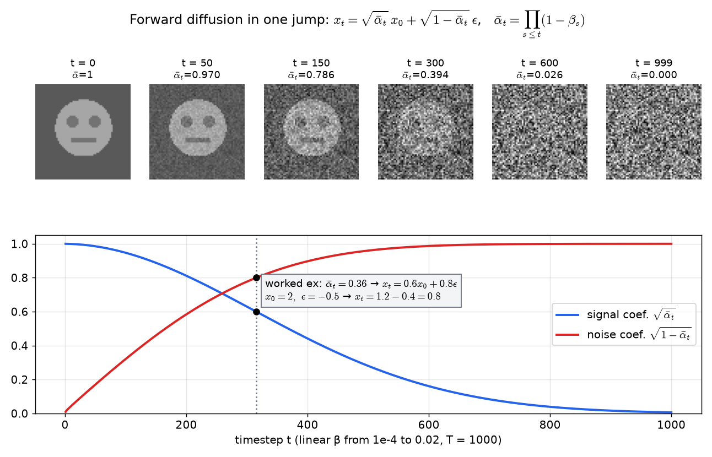
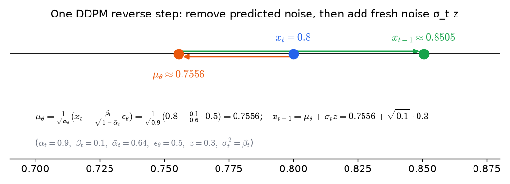
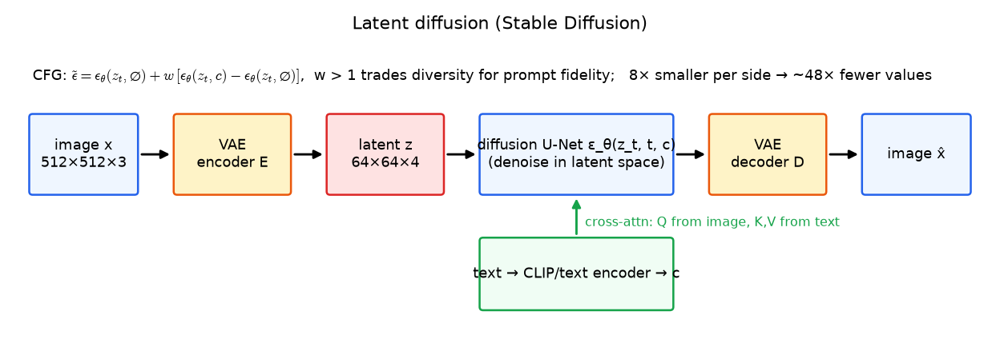

[↑ Index](README.md) · [← Previous](07_Session7_GANs_Conditional_Models.md) · [Next →](09_Revision_Notes_A_Projective_Geometry.md)

<details><summary><b>Contents</b></summary>

- [8.1 Big picture — How does diffusion work?](#81-big-picture--how-does-diffusion-work)
- [8.2 Forward diffusion process](#82-forward-diffusion-process)
- [8.3 Deriving the closed-form forward distribution](#83-deriving-the-closed-form-forward-distribution)
- [8.4 Reverse diffusion process](#84-reverse-diffusion-process)
- [8.5 Deriving the reverse mean](#85-deriving-the-reverse-mean)
- [8.6 Training the diffusion model](#86-training-the-diffusion-model)
- [8.7 DDPM sampling algorithm](#87-ddpm-sampling-algorithm)
- [8.8 The U-Net architecture](#88-the-u-net-architecture)
- [8.9 Score interpretation](#89-score-interpretation)
- [8.10 Speed improvements and conditioning](#810-speed-improvements-and-conditioning)
- [8.11 VAE vs GAN vs Diffusion](#811-vae-vs-gan-vs-diffusion)
- [Session 8 — Formula sheet](#session-8--formula-sheet)
- [Session 8 — Checkpoint questions](#session-8--checkpoint-questions)

</details>

Session 8 is the final generative-model topic: DDPM diffusion. I’ll use your study guide’s notation ($\beta_t,\alpha_t,\bar\alpha_t,\epsilon_\theta$) and work through the forward process, closed-form noising equation, reverse-process derivation, training objective and sampling algorithm.

# Session 8 — Diffusion Models (DDPM)

**1.5-hour session · Final generative-model topic**

This is the final generative-model architecture in your syllabus.

We'll primarily follow **Ho et al., 2020 — Denoising Diffusion Probabilistic Models (DDPM)** and Prince, Chapter 18.

The central idea is surprisingly simple:

**Take a real image, gradually destroy it by adding Gaussian noise, then train a neural network to reverse this process.**

We'll cover:

1. Diffusion intuition.
2. Forward diffusion process.
3. Derivation of $q(x_t\mid x_0)$.
4. Reverse diffusion process.
5. Noise-prediction training objective.
6. DDPM sampling.
7. U-Net architecture and score interpretation.
8. DDIM, latent diffusion and guidance.
9. VAE vs GAN vs diffusion.

---

## 8.1 Big picture — How does diffusion work?

Imagine taking a photograph of a cat.

Initially, it is a perfectly recognisable image.

Now gradually add random Gaussian noise:

- Step 0: Original image.
- Step 100: Slightly noisy image.
- Step 300: Recognisable but heavily corrupted image.
- Step 600: Mostly noise.
- Step 1000: Almost pure Gaussian noise.



This is the **forward process**.

Now imagine reversing this operation.

Start with random Gaussian noise and gradually remove it until an image emerges.

This is the **reverse process**.

The important distinction:

| Process | What happens | Learning? |
|---|---|---|
| Forward | Add Gaussian noise | No |
| Reverse | Remove noise gradually | Yes |

The forward process is fixed and mathematically defined.

The reverse process is learned by a neural network.

---

## 8.2 Forward diffusion process

**Important derivation**

### 1. Start with one diffusion step

Let:

$$
x_0=\text{original image}
$$

We gradually add Gaussian noise.

At timestep $t$, we define:

$$
\boxed{
q(x_t\mid x_{t-1})
=
\mathcal N(
\sqrt{1-\beta_t}x_{t-1},
\beta_t I
)
}
$$

Here:

- $x_{t-1}$: image at the previous timestep.
- $x_t$: noisy image at the current timestep.
- $\beta_t$: variance of the Gaussian noise added at this step.
- $I$: identity covariance matrix.

The $\beta_t$ values are small, usually following an increasing noise schedule.

Let's introduce a simpler notation:

$$
\boxed{\alpha_t=1-\beta_t}
$$

Then:

$$
\boxed{
q(x_t\mid x_{t-1})
=
\mathcal N(\sqrt{\alpha_t}x_{t-1},
(1-\alpha_t)I)
}
$$

#### 2. Reparameterise the distribution

Recall your VAE reparameterisation trick from Session 6.

A Gaussian random variable:

$$
X\sim\mathcal N(\mu,\sigma^2I)
$$

can be generated as:

$$
X=\mu+\sigma\epsilon
$$

where:

$$
\epsilon\sim\mathcal N(0,I)
$$

Apply the same idea:

$$
\boxed{
x_t=
\sqrt{\alpha_t}x_{t-1}
+
\sqrt{\beta_t}\epsilon_t
}
$$

This is the actual operation performed at each forward diffusion step.

**Interpretation:**

- Multiply the previous image by $\sqrt{\alpha_t}$.
- Add random Gaussian noise scaled by $\sqrt{\beta_t}$.

As $t$ increases, information from the original image gradually disappears.

### 3. Introduce cumulative alpha

Doing this 1,000 times would be inefficient during training.

We need a way to jump directly from $x_0$ to any timestep $x_t$.

Define:

$$
\boxed{
\bar\alpha_t=\prod_{s=1}^{t}\alpha_s
}
$$

This is the cumulative product of all alpha values.

For example:

$$
\bar\alpha_3=\alpha_1\alpha_2\alpha_3
$$

Why do we need it?

Because it tells us how much of the original signal survives after $t$ diffusion steps.

Since each $\alpha_t$ is slightly smaller than 1, their product decreases over time.

$$
\bar\alpha_0=1
$$

and generally:

$$
\bar\alpha_t\rightarrow0
$$

towards the final diffusion timestep.

---

## 8.3 Deriving the closed-form forward distribution

**Extremely important exam derivation**

We want to derive:

$$
\boxed{
q(x_t\mid x_0)
=
\mathcal N(
\sqrt{\bar\alpha_t}x_0,
(1-\bar\alpha_t)I
)
}
$$

#### Step 1. Start with the first timestep

$$
x_1=
\sqrt{\alpha_1}x_0+
\sqrt{1-\alpha_1}\epsilon_1
$$

#### Step 2. Go to the second timestep

$$
x_2=
\sqrt{\alpha_2}x_1+
\sqrt{1-\alpha_2}\epsilon_2
$$

Substitute $x_1$:

$$
x_2=
\sqrt{\alpha_2}
\left(
\sqrt{\alpha_1}x_0+
\sqrt{1-\alpha_1}\epsilon_1
\right)
+
\sqrt{1-\alpha_2}\epsilon_2
$$

Expand:

$$
x_2=
\sqrt{\alpha_1\alpha_2}x_0
+
\sqrt{\alpha_2(1-\alpha_1)}\epsilon_1
+
\sqrt{1-\alpha_2}\epsilon_2
$$

Now notice that the last two terms are independent Gaussian random variables.

Their weighted sum is also Gaussian.

The total variance is:

$$
\alpha_2(1-\alpha_1)+(1-\alpha_2)
$$

$$
=\alpha_2-\alpha_1\alpha_2+1-\alpha_2
$$

$$
=1-\alpha_1\alpha_2
$$

Therefore:

$$
x_2=
\sqrt{\alpha_1\alpha_2}x_0+
\sqrt{1-\alpha_1\alpha_2}\epsilon
$$

where $\epsilon\sim\mathcal N(0,I)$.

#### Step 3. Generalise to timestep $t$

Define:

$$
\bar\alpha_t=\alpha_1\alpha_2\cdots\alpha_t
$$

The same argument holds for every timestep.

Therefore:

$$
\boxed{
x_t=
\sqrt{\bar\alpha_t}x_0+
\sqrt{1-\bar\alpha_t}\epsilon
}
$$

where:

$$
\epsilon\sim\mathcal N(0,I)
$$

Equivalently:

> **Final forward-process equation**
> $$
> \boxed{
> q(x_t\mid x_0)=
> \mathcal N(
> \sqrt{\bar\alpha_t}x_0,
> (1-\bar\alpha_t)I
> )
> }
> $$
>
> $$
> \boxed{
> x_t=
> \sqrt{\bar\alpha_t}x_0+
> \sqrt{1-\bar\alpha_t}\epsilon
> }
> $$

**Why is this equation so important?**

Instead of performing $t$ separate noising operations, we can directly construct a noisy image at any timestep.

This makes training much more efficient.

#### 4. Numerical example

Suppose:

$$
\bar\alpha_t=0.36
$$

Then:

$$
\sqrt{\bar\alpha_t}=0.6
$$

and:

$$
\sqrt{1-\bar\alpha_t}=0.8
$$

Thus:

$$
\boxed{x_t=0.6x_0+0.8\epsilon}
$$

Take a single pixel value:

$$
x_0=2,\qquad\epsilon=-0.5
$$

Then:

$$
x_t=0.6(2)+0.8(-0.5)
$$

$$
=1.2-0.4
$$

$$
\boxed{x_t=0.8}
$$

This illustrates the combination of the surviving original signal and Gaussian noise.

#### 5. Signal-to-noise ratio (SNR)

The signal contribution has variance proportional to:

$$
\bar\alpha_t
$$

The noise contribution has variance:

$$
1-\bar\alpha_t
$$

Therefore:

$$
\boxed{
SNR_t=\frac{\bar\alpha_t}{1-\bar\alpha_t}
}
$$

At the beginning:

$$
\bar\alpha_t\approx1
$$

The original image dominates.

At the end:

$$
\bar\alpha_T\approx0
$$

The noise dominates.

Consequently:

$$
\boxed{x_T\sim\mathcal N(0,I)}
$$

approximately.

This is why we can start generation from pure Gaussian noise.

---

## 8.4 Reverse diffusion process

Now we know how to destroy an image.

Our objective is to learn how to reverse that destruction.

### 1. What do we want?

The forward process is:

$$
x_0\rightarrow x_1\rightarrow x_2
\rightarrow\cdots\rightarrow x_T
$$

The reverse process should be:

$$
x_T\rightarrow x_{T-1}\rightarrow\cdots
\rightarrow x_1\rightarrow x_0
$$

We want to learn:

$$
\boxed{p_\theta(x_{t-1}\mid x_t)}
$$

This represents the probability of obtaining the previous, slightly cleaner image given the current noisy image.

Your study guide models it as:

$$
\boxed{
p_\theta(x_{t-1}\mid x_t)
=
\mathcal N(\mu_\theta(x_t,t),\sigma_t^2I)
}
$$

The neural network predicts the mean, and the reverse transition adds Gaussian noise according to the chosen variance.

### 2. Why can the reverse step be Gaussian?

The forward transitions are Gaussian.

When the noise added per step is sufficiently small, the reverse conditional distribution is also well approximated by a Gaussian.

This allows us to learn a sequence of Gaussian denoising transitions.

### 3. What should the neural network predict?

An important design decision:

Instead of directly predicting the previous image $x_{t-1}$, DDPM commonly trains a neural network to predict the Gaussian noise that was added.

Let:

$$
\boxed{\epsilon_\theta(x_t,t)}
$$

denote the predicted noise.

Why predict noise?

We already know that:

$$
x_t=
\sqrt{\bar\alpha_t}x_0+
\sqrt{1-\bar\alpha_t}\epsilon
$$

The neural network is given:

- Noisy image $x_t$.
- Timestep $t$.

It learns to predict:

$$
\epsilon_\theta(x_t,t)\approx\epsilon
$$

Once we know the noise, we can estimate and remove it.

---

## 8.5 Deriving the reverse mean

**Important mathematical formula**

Start with the closed-form forward equation:

$$
x_t=
\sqrt{\bar\alpha_t}x_0+
\sqrt{1-\bar\alpha_t}\epsilon
$$

Rearrange to estimate the original image:

$$
\sqrt{\bar\alpha_t}x_0
=
x_t-\sqrt{1-\bar\alpha_t}\epsilon
$$

Therefore:

$$
\boxed{
x_0=
\frac{x_t-\sqrt{1-\bar\alpha_t}\epsilon}
{\sqrt{\bar\alpha_t}}
}
$$

The exact forward posterior, conditioned on $x_0$, is Gaussian:

$$
q(x_{t-1}\mid x_t,x_0)
=
\mathcal N(\tilde\mu_t,\tilde\beta_t I)
$$

Its mean is:

$$
\tilde\mu_t=
\frac{\sqrt{\bar\alpha_{t-1}}\beta_t}
{1-\bar\alpha_t}x_0
+
\frac{\sqrt{\alpha_t}(1-\bar\alpha_{t-1})}
{1-\bar\alpha_t}x_t
$$

Its variance is:

$$
\tilde\beta_t=
\frac{1-\bar\alpha_{t-1}}
{1-\bar\alpha_t}\beta_t
$$

Substitute our expression for $x_0$ into the posterior mean.

After simplification:

$$
\tilde\mu_t=
\frac1{\sqrt{\alpha_t}}
\left(
x_t-
\frac{\beta_t}{\sqrt{1-\bar\alpha_t}}\epsilon
\right)
$$

But the true noise $\epsilon$ is unknown.

We replace it with the neural network's prediction:

$$
\epsilon_\theta(x_t,t)
$$

Therefore:

> **DDPM reverse mean**
> $$
> \boxed{
> \mu_\theta(x_t,t)=
> \frac1{\sqrt{\alpha_t}}
> \left[
> x_t-
> \frac{\beta_t}{\sqrt{1-\bar\alpha_t}}
> \epsilon_\theta(x_t,t)
> \right]
> }
> $$

This is the formula you must recognise and be able to use.

**Intuition:**

- $x_t$: currently noisy image.
- $\epsilon_\theta$: estimated noise.
- Subtract the estimated noise contribution.
- Scale appropriately by $1/\sqrt{\alpha_t}$.
- Obtain the predicted mean of the previous, cleaner image.

---

## 8.6 Training the diffusion model

**Important objective**

Now comes the practical part.

How do we train a model to predict noise?

The beauty of DDPM is that we already know the noise we added.

We can generate supervised training examples ourselves.

### 1. Training objective

The simplified DDPM objective is:

> **Noise prediction loss**
> $$
> \boxed{
> L=
> \mathbb E_{t,x_0,\epsilon}
> \left[
> \left\|
> \epsilon-
> \epsilon_\theta(
> \sqrt{\bar\alpha_t}x_0+
> \sqrt{1-\bar\alpha_t}\epsilon,
> t)
> \right\|^2
> \right]
> }
> $$

In plain English:

**Give the network a noisy image and ask it to predict the exact noise that was added.**

The loss is simply mean squared error between:

- Actual noise $\epsilon$.
- Predicted noise $\epsilon_\theta$.

This is often called the simplified DDPM or noise-prediction objective. It comes from simplifying the variational training objective.

### 2. Training algorithm

Every training iteration:

**Step 1. Sample a real image**

$$
x_0\sim q_{\text{data}}(x)
$$

**Step 2. Sample a random timestep**

$$
t\sim U\{1,\ldots,T\}
$$

We randomly select how noisy the image should be.

**Step 3. Sample Gaussian noise**

$$
\epsilon\sim\mathcal N(0,I)
$$

**Step 4. Construct the noisy image directly**

$$
x_t=
\sqrt{\bar\alpha_t}x_0+
\sqrt{1-\bar\alpha_t}\epsilon
$$

**Step 5. Predict the noise**

$$
\hat\epsilon=\epsilon_\theta(x_t,t)
$$

**Step 6. Calculate MSE**

$$
L=\|\epsilon-\hat\epsilon\|^2
$$

Update the network parameters using your familiar optimisation procedure.

#### Why is random timestep sampling useful?

We don't need to train a separate network for each noise level.

The same network learns to predict noise at all timesteps.

The timestep $t$ tells the network the current noise level.

#### Why is diffusion training relatively stable?

Compare it with GANs.

GANs require two networks competing against each other.

Diffusion training uses an ordinary regression objective:

$$
\text{Predicted noise vs actual noise}
$$

There is no adversarial min-max game.

This makes the training process substantially more stable.

---

## 8.7 DDPM sampling algorithm

Now suppose training is complete.

We want to generate an image.

Start with pure noise:

$$
\boxed{x_T\sim\mathcal N(0,I)}
$$

Then iteratively denoise.

Your study guide gives the following algorithm:

```python
x_T ~ N(0, I)

for t = T, ..., 1:

    z ~ N(0, I) if t > 1 else 0

    x_(t-1) = (
        1 / sqrt(alpha_t)
        * (
            x_t
            - beta_t / sqrt(1 - alpha_bar_t)
            * epsilon_theta(x_t, t)
        )
        + sigma_t * z
    )

return x_0
```

Where:

$$
\sigma_t^2=\beta_t
$$

as specified by your course guide.

#### Understand each line

**Initialisation**

$$
x_T\sim\mathcal N(0,I)
$$

Start with a random noise image.

**Noise prediction**

$$
\epsilon_\theta(x_t,t)
$$

The network estimates the noise in the current image.

**Calculate reverse mean**

$$
\mu_\theta(x_t,t)
=
\frac1{\sqrt{\alpha_t}}
\left[
x_t-
\frac{\beta_t}{\sqrt{1-\bar\alpha_t}}
\epsilon_\theta(x_t,t)
\right]
$$

**Add reverse noise**

$$
x_{t-1}=\mu_\theta+\sigma_tz
$$

Here:

$$
z\sim\mathcal N(0,I)
$$

The additional randomness makes the reverse sampling stochastic.

At the final step $t=1$, we set:

$$
z=0
$$

so no additional noise is injected into the final sample.

#### Small numerical reverse-step example

Suppose:

$$
\alpha_t=0.9,\quad
\beta_t=0.1,\quad
\bar\alpha_t=0.64
$$

And:

$$
x_t=0.8,\quad
\epsilon_\theta=0.5
$$

First calculate the reverse mean:

$$
\mu_\theta=
\frac1{\sqrt{0.9}}
\left(
0.8-\frac{0.1}{\sqrt{0.36}}(0.5)
\right)
$$

$$
=
\frac1{\sqrt{0.9}}(0.8-0.08333)
$$

$$
\boxed{\mu_\theta\approx0.7556}
$$

Now suppose:

$$
z=0.3,\qquad \sigma_t=\sqrt{0.1}
$$

Then:

$$
x_{t-1}=0.7556+\sqrt{0.1}(0.3)
$$

$$
\boxed{x_{t-1}\approx0.8505}
$$

This is one reverse transition. Repeating it eventually produces a complete image.

*For this example, we use the fixed variance convention $\sigma_t^2=\beta_t$ from your study guide. The exact forward posterior variance is $\tilde\beta_t$, derived earlier; DDPM implementations can use different reverse-variance choices.*



#### Why is sampling slow?

Suppose:

$$
T=1000
$$

We need approximately 1,000 sequential neural-network evaluations for one generated sample.

Why sequential?

Because the next state depends on the output of the previous denoising step.

We cannot simply generate all intermediate states independently.

This is one of the major limitations of traditional DDPM.

---

## 8.8 The U-Net architecture

What network predicts noise?

Your study guide uses a **U-Net with sinusoidal timestep embeddings and attention layers**.

#### Why U-Net?

A U-Net has two main paths.

**Encoder / downsampling path**

- Reduces spatial dimensions.
- Extracts increasingly abstract features.
- Expands the receptive field.

**Decoder / upsampling path**

- Restores spatial dimensions.
- Produces a noise prediction at the original image resolution.

**Skip connections**

Transfer spatial information from encoder layers to corresponding decoder layers.

This is useful because image denoising requires both:

- High-level understanding of image structure.
- Fine-grained pixel-level details.

#### Why provide the timestep?

The same noisy image appearance can have different meanings depending on the timestep.

For example:

- At an early timestep, noise may be weak.
- At a late timestep, noise may dominate the image.

The network therefore needs to know $t$.

We use sinusoidal timestep embeddings, inspired by positional encodings in transformers.

These embeddings are injected into the U-Net's internal layers.

#### Why attention layers?

Convolution mainly captures local patterns.

Attention provides interactions between spatial positions, helping the network model larger-scale relationships.

This connects directly to Session 5.

---

## 8.9 Score interpretation

This is a useful theoretical connection.

In probability theory, the score of a distribution is:

$$
\boxed{
\nabla_x\log p(x)
}
$$

It indicates the direction in which the log probability density increases most rapidly.

In diffusion:

$$
\boxed{
\epsilon_\theta(x_t,t)
\approx
-\sqrt{1-\bar\alpha_t}
\nabla_{x_t}\log q_t(x_t)
}
$$

Rearranging:

$$
\nabla_{x_t}\log q_t(x_t)
\approx
-\frac{\epsilon_\theta(x_t,t)}
{\sqrt{1-\bar\alpha_t}}
$$

So predicting noise is closely related to learning the score of the noisy-data distribution.

**Intuition:**

The score points towards regions of higher probability density.

The reverse diffusion process progressively moves noisy samples towards the data distribution, with stochasticity added along the way.

This gives a useful mental model of diffusion as noisy gradient-based movement towards realistic data.

---

## 8.10 Speed improvements and conditioning

**Conceptual exam questions**

### 1. DDIM — Denoising Diffusion Implicit Models

DDPM may require hundreds or thousands of reverse steps.

DDIM introduces a way of sampling with fewer steps.

For example:

- DDPM: around 1,000 steps.
- DDIM: potentially around 50 steps.

The important distinction is that DDIM can use a deterministic sampling trajectory.

It does not require injecting fresh random noise at every reverse step in the standard deterministic setting.

**Exam takeaway:** DDIM accelerates sampling by skipping many intermediate timesteps and can generate deterministic trajectories.

### 2. Latent Diffusion — Stable Diffusion

Another problem with pixel-space diffusion is computational cost.

A high-resolution image contains a huge number of pixels.

Instead of performing diffusion directly on the image, we can first compress the image into a lower-dimensional latent representation using a trained VAE.



The workflow:

1. Encode image using a VAE.
2. Obtain latent representation $z$.
3. Perform diffusion in latent space.
4. Decode the final latent representation into an image.

Why is this faster?

Because the diffusion network processes a much smaller representation instead of the full-resolution image.

This is the basic idea behind Stable Diffusion.

**Connection to Session 6:** The VAE's encoder and decoder are used to create a compressed space in which diffusion becomes cheaper.

### 3. Classifier guidance

Suppose we want to generate an image of a dog.

We can use an additional classifier trained on noisy images.

The classifier estimates:

$$
p(y\mid x_t)
$$

where $y$ represents the desired class.

Its gradient:

$$
\nabla_{x_t}\log p(y\mid x_t)
$$

provides a direction that encourages the sample to become more compatible with the desired class.

This classifier signal modifies the reverse diffusion process.

The limitation is that we need an additional classifier trained for noisy images across noise levels.

### 4. Classifier-free guidance (CFG)

This avoids needing a separate classifier.

Instead, during diffusion training, we randomly drop the conditioning information.

The network learns two capabilities:

- Conditional prediction:

$$
\epsilon_\theta(x_t,t,c)
$$

- Unconditional prediction:

$$
\epsilon_\theta(x_t,t,\varnothing)
$$

Here $c$ is the condition, such as a text prompt.

At sampling time, combine them:

> **Classifier-free guidance**
> $$
> \boxed{
> \tilde\epsilon=
> (1+w)\epsilon_\theta(x_t,t,c)
> -
> w\epsilon_\theta(x_t,t,\varnothing)
> }
> $$

The conditional prediction tells us how to denoise given the prompt.

The unconditional prediction tells us how to denoise without the prompt.

Their difference represents the additional directional influence of the condition.

#### What does $w$ control?

- Small $w$: weaker condition adherence.
- Large $w$: stronger adherence to the condition.
- Excessively large $w$: potentially reduced diversity and degraded sample quality.

This is the mechanism behind prompt-guidance strength in many text-to-image diffusion systems.

### 5. Text conditioning and cross-attention

Recall Session 5.

A text prompt is first processed by a text encoder to obtain text embeddings.

These embeddings are supplied to the U-Net through **cross-attention**.

Remember:

- Query comes from image features.
- Keys and values come from text embeddings.

The image features can attend to relevant words in the prompt.

For example:

Prompt: "A red car on a snowy mountain."

Different image regions can attend to the words describing their relevant objects and properties.

This connects the transformer architecture to text-conditioned image generation.

---

## 8.11 VAE vs GAN vs Diffusion

This is almost certainly worth preparing as a comparison question because your study guide explicitly highlights it.

| Property | VAE | GAN | Diffusion |
|---|---|---|---|
| Training | Stable, ELBO | Adversarial min-max | Stable noise-prediction MSE |
| Generated images | Can be blurry | Often sharp | Often sharp |
| Mode coverage | Generally good | Can collapse | Generally good |
| Sampling speed | Fast | Fast | Slow |
| Likelihood | Lower bound | No tractable likelihood | Bound |
| Latent space | Low-dimensional learned latent | Noise input, usually low-dimensional | Fixed forward corruption, same dimensionality as data |

#### Understand the fundamental differences

**VAE**

Learns a smooth latent space and reconstructs images from sampled latent variables.

Its main challenge is balancing reconstruction quality and regularisation.

**GAN**

Learns through a competitive generator-discriminator game.

It can produce sharp images, but training can be unstable and may suffer from mode collapse.

**Diffusion**

Learns to predict noise across different timesteps.

Training is stable, and generation can have good diversity and quality, but sampling requires many sequential steps.

> **One-line memory trick**
>
> - VAE: Encode, sample, decode.
> - GAN: Generator fools discriminator.
> - Diffusion: Start with noise, progressively denoise.

---

## Session 8 — Formula sheet

> **1. Forward process**
>
> $$
> q(x_t\mid x_{t-1})=
> \mathcal N(\sqrt{1-\beta_t}x_{t-1},\beta_tI)
> $$
>
> **2. Definitions**
>
> $$
> \alpha_t=1-\beta_t
> $$
>
> $$
> \bar\alpha_t=\prod_{s=1}^t\alpha_s
> $$
>
> **3. Closed-form forward process**
>
> $$
> \boxed{
> q(x_t\mid x_0)=
> \mathcal N(\sqrt{\bar\alpha_t}x_0,
> (1-\bar\alpha_t)I)
> }
> $$
>
> $$
> \boxed{
> x_t=\sqrt{\bar\alpha_t}x_0+
> \sqrt{1-\bar\alpha_t}\epsilon
> }
> $$
>
> **4. Signal-to-noise ratio**
>
> $$
> SNR_t=\frac{\bar\alpha_t}{1-\bar\alpha_t}
> $$
>
> **5. Reverse process**
>
> $$
> p_\theta(x_{t-1}\mid x_t)
> =
> \mathcal N(\mu_\theta,\sigma_t^2I)
> $$
>
> **6. Predicted reverse mean**
>
> $$
> \boxed{
> \mu_\theta=
> \frac1{\sqrt{\alpha_t}}
> \left(
> x_t-
> \frac{\beta_t}{\sqrt{1-\bar\alpha_t}}
> \epsilon_\theta(x_t,t)
> \right)
> }
> $$
>
> **7. Training objective**
>
> $$
> \boxed{
> L=
> \mathbb E_{t,x_0,\epsilon}
> \left[
> \|\epsilon-\epsilon_\theta(
> \sqrt{\bar\alpha_t}x_0+
> \sqrt{1-\bar\alpha_t}\epsilon,t)\|^2
> \right]
> }
> $$
>
> **8. DDPM sampling**
>
> $$
> \boxed{x_{t-1}=\mu_\theta(x_t,t)+\sigma_tz}
> $$
>
> $z\sim\mathcal N(0,I)$ except at the final step, where $z=0$.
>
> **9. Score interpretation**
>
> $$
> \epsilon_\theta\approx
> -\sqrt{1-\bar\alpha_t}\nabla_{x_t}\log q_t(x_t)
> $$
>
> **10. Classifier-free guidance**
>
> $$
> \boxed{
> \tilde\epsilon=
> (1+w)\epsilon_\theta(x_t,t,c)
> -w\epsilon_\theta(x_t,t,\varnothing)
> }
> $$
>

---

## Session 8 — Checkpoint questions

Try these six questions. Pay particular attention to Q1, Q2 and Q3.

#### Practice questions

1. Derivation: Starting with q(x_t|x_{t-1}), derive the closed-form expression x_t = sqrt(alpha_bar_t)x_0 + sqrt(1-alpha_bar_t)epsilon. Explain why the cumulative product is needed.
2. Numerical: Given alpha_bar_t = 0.36, x_0 = 2 and epsilon = -0.5, calculate x_t. Also calculate the SNR.
3. Write the reverse mean mu_theta(x_t,t). Explain why the neural network predicts epsilon rather than directly predicting x_(t-1).
4. Why does DDPM sampling require many sequential network evaluations? Explain DDIM and latent diffusion as two speed improvements.
5. Explain classifier-free guidance. What happens when guidance weight w increases? How does text enter the U-Net?

---

### What's next? Session 9 — Mock Exam

You've now covered the entire technical syllabus from projective geometry to diffusion.

The final session will be a timed-style mock examination based on your study guide.

We'll include:

- Projective geometry and DLT.
- Camera matrices and resectioning.
- Fundamental and essential matrices.
- Stereo, triangulation and SfM.
- Optical flow.
- CNNs, transformers and ViT.
- VAE and ELBO.
- GANs and conditional generation.
- DDPM and classifier-free guidance.

After the mock, we'll prepare your **final 30-minute revision sheet containing the 25 most testable facts and formulas**.

---

[↑ Index](README.md) · [← Previous](07_Session7_GANs_Conditional_Models.md) · [Next →](09_Revision_Notes_A_Projective_Geometry.md)
