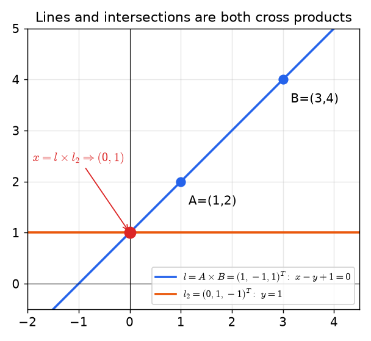
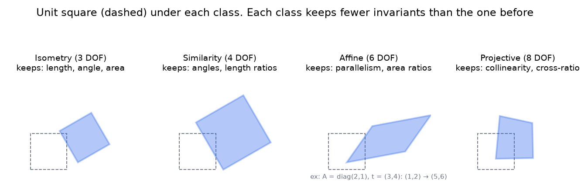
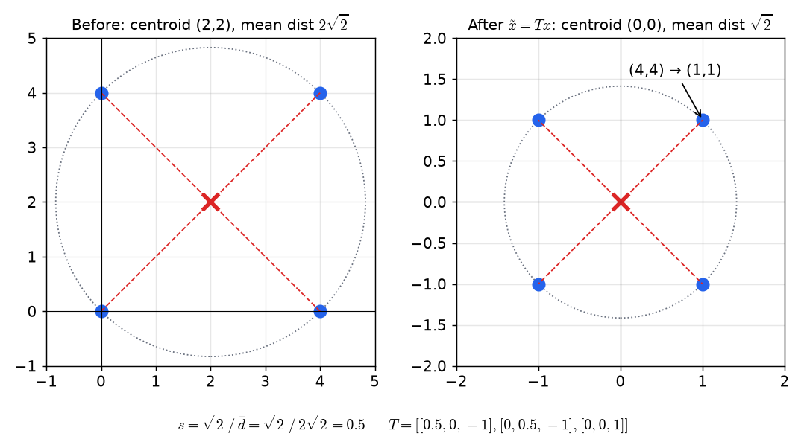
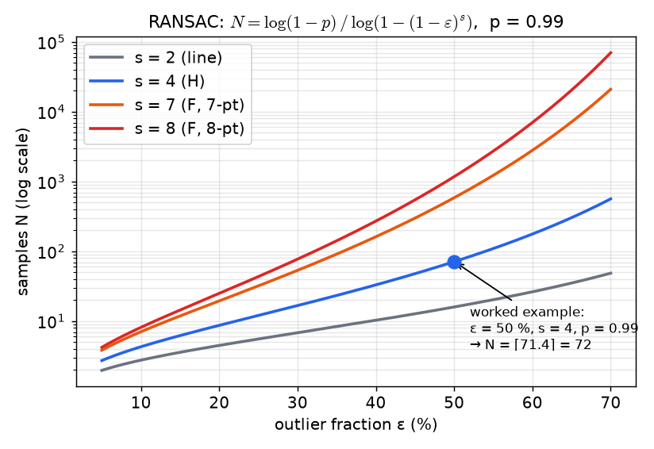

[↑ Index](README.md) · [← Previous](08_Session8_Diffusion.md) · [Next →](10_Revision_Notes_B_Camera.md)

<b>Contents</b>

- [A1. Homogeneous Coordinates and the Projective Plane $P^2$](#a1-homogeneous-coordinates-and-the-projective-plane-p2)
- [A2. The 2D Transformation Hierarchy](#a2-the-2d-transformation-hierarchy)
- [A3. Three-Dimensional Projective Geometry $P^3$](#a3-three-dimensional-projective-geometry-p3)
- [A4. Homography DLT and Hartley Normalisation](#a4-homography-dlt-and-hartley-normalisation)
- [A5. RANSAC](#a5-ransac)

# PART A — PROJECTIVE GEOMETRY

**Topics 1–5 · Hartley & Zisserman notation**

**Notation conventions used throughout**

| Symbol | Meaning | Dimension |
|---|---|---|
| $x=(x,y,w)^T$ | Homogeneous 2D point | $3\times1$ |
| $l=(a,b,c)^T$ | 2D line | $3\times1$ |
| $H$ | 2D homography | $3\times3$ |
| $X=(X,Y,Z,W)^T$ | Homogeneous 3D point | $4\times1$ |
| $\pi=(a,b,c,d)^T$ | 3D plane | $4\times1$ |
| $R(\theta)$ | 2D rotation matrix | $2\times2$ |
| $A$ | Linear part of an affine transformation | $2\times2$ |
| $t$ | 2D translation | $2\times1$ |
| $h$ | Vectorised homography | $9\times1$ |
| $T,T'$ | 2D normalisation transformations | $3\times3$ |

Homogeneous coordinates are written using $\sim$ when equality is only up to a nonzero scale.

---

## A1. Homogeneous Coordinates and the Projective Plane $P^2$

### 1. Key results

- ★★★ A Cartesian point $(x,y)$ is represented by $x_h=(x,y,1)^T$.
- ★★★ Homogeneous coordinates are defined up to nonzero scale: $x_h\sim\lambda x_h,\ \lambda\ne0$.
- ★★★ $P^2=\mathbb R^3\setminus\{0\}$, modulo scale equivalence.
- ★★★ A line $l=(a,b,c)^T$ satisfies $l^Tx=0$.
- ★★★ The line through two points is $l=x_1\times x_2$.
- ★★★ The intersection of two lines is $x=l_1\times l_2$.
- ★★★ A point $x=(x,y,0)^T$ is an ideal point (point at infinity).
- ★★★ All ideal points lie on $l_\infty=(0,0,1)^T$.
- ★★ Parallel Euclidean lines intersect at an ideal point in projective geometry.
- ★★ Point-line duality: points and lines have the same algebraic representation and incidence relation.
- ★★ The horizon is the image of the ground plane's line at infinity.

### 2. Formulas

| Formula | Meaning | Dimensions |
|---|---|---|
| $x_h=(x,y,1)^T$ | Cartesian-to-homogeneous point | $3\times1$ |
| $(X,Y,W)^T\mapsto(X/W,Y/W)$ | Dehomogenisation, $W\ne0$ | Input $3\times1$, output $2\times1$ |
| $x\sim\lambda x$ | Scale equivalence | $x:3\times1,\lambda:1\times1$ |
| $l=(a,b,c)^T$ | Line coefficients | $3\times1$ |
| $l^Tx=0$ | Point lies on line | $l^T:1\times3,\ x:3\times1$ |
| $l=x_1\times x_2$ | Line through two points | All vectors $3\times1$ |
| $x=l_1\times l_2$ | Intersection of two lines | All vectors $3\times1$ |
| $l_\infty=(0,0,1)^T$ | Line at infinity | $3\times1$ |
| $x_\infty=(a,b,0)^T$ | Ideal point | $3\times1$ |

#### Cross-product matrix

For $a=(a_1,a_2,a_3)^T$:

$$
[a]_\times=
\begin{bmatrix}
0&-a_3&a_2\\
a_3&0&-a_1\\
-a_2&a_1&0
\end{bmatrix}
$$

$$
a\times b=[a]_\times b
$$

Dimensions: $[a]_\times$ is $3\times3$, $a,b$ are $3\times1$.

### 3. Derivations

**A. Why is the line through two points their cross product?**

1. Let $x_1,x_2\in\mathbb R^3$ be two homogeneous points.
2. A line $l$ through both must satisfy $l^Tx_1=0$ and $l^Tx_2=0$, because points on a line satisfy its incidence equation.
3. The cross product $x_1\times x_2$ is perpendicular to both $x_1$ and $x_2$, because of the defining property of the cross product.
4. Therefore it satisfies both incidence equations.
5. Hence:

$$
\boxed{l=x_1\times x_2}
$$

**B. Why is the intersection of two lines their cross product?**

1. Let $l_1,l_2$ be two line vectors.
2. Their intersection $x$ must satisfy $l_1^Tx=0$ and $l_2^Tx=0$.
3. The vector $l_1\times l_2$ is perpendicular to both line vectors.
4. Therefore it satisfies both incidence constraints.
5. Hence:

$$
\boxed{x=l_1\times l_2}
$$

**Geometric trick:** The cross product constructs a vector perpendicular to two given vectors. In the point case, that vector represents a line; in the line case, it represents a point.

**C. Ideal points and the line at infinity**

1. Write a finite point as $x=(x,y,1)^T$.
2. Points with third coordinate zero cannot be dehomogenised.
3. Hence $x_\infty=(a,b,0)^T$ represents an ideal point.
4. The line at infinity is $l_\infty=(0,0,1)^T$.
5. Check incidence:

$$
l_\infty^Tx_\infty
=
(0,0,1)
\begin{bmatrix}a\\b\\0\end{bmatrix}=0
$$

Therefore:

$$
\boxed{\text{All ideal points lie on }l_\infty}
$$

**D. Parallel lines meet at an ideal point — numerical example**

Consider:

$$
x=1,\qquad x=2
$$

Their line vectors are:

$$
l_1=(1,0,-1)^T
$$

$$
l_2=(1,0,-2)^T
$$

Calculate:

$$
x_\infty=l_1\times l_2
$$

$$
=
\begin{bmatrix}
0\\
(-1)(1)-(1)(-2)\\
0
\end{bmatrix}
=
\begin{bmatrix}0\\1\\0\end{bmatrix}
$$

Thus:

$$
\boxed{x_\infty=(0,1,0)^T}
$$

It is an ideal point representing the vertical direction shared by the two parallel lines.

### 4. DOF / counting

| Object | DOF | Reason |
|---|---:|---|
| Homogeneous 2D point | 2 | 3 coordinates − 1 scale |
| Homogeneous 2D line | 2 | 3 coefficients − 1 scale |
| Line through two distinct points | Determined | Cross product |
| Intersection of two distinct lines | Determined | Cross product |

[extra] Two coincident points or two coincident lines do not determine a unique cross-product result: their cross product is zero.

### 5. Worked example

Find the line through $A=(1,2)$ and $B=(3,4)$, then find its intersection with $y=1$.

**Step 1. Homogeneous points**

$$
A=(1,2,1)^T,\quad B=(3,4,1)^T
$$

**Step 2. Calculate their cross product**

$$
l=A\times B
$$

$$
=
\begin{bmatrix}
2(1)-1(4)\\
1(3)-1(1)\\
1(4)-2(3)
\end{bmatrix}
=
\begin{bmatrix}-2\\2\\-2\end{bmatrix}
$$

Normalise by dividing by $-2$:

$$
l=(1,-1,1)^T
$$

**Step 3. Write the line equation**

$$
x-y+1=0
$$

**Step 4. Intersect with $y=1$**

The second line is:

$$
l_2=(0,1,-1)^T
$$

$$
x=l\times l_2
$$

$$
=
\begin{bmatrix}
(-1)(-1)-(1)(1)\\
1(0)-1(-1)\\
1(1)-(-1)(0)
\end{bmatrix}
=
\begin{bmatrix}0\\1\\1\end{bmatrix}
$$

$$
\boxed{(x,y)=(0,1)}
$$

### 6. Exam traps

- Do not treat $(x,y,w)$ and $(x/w,y/w)$ as the same representation; one is homogeneous, the other Cartesian.
- Do not dehomogenise an ideal point with $w=0$.
- $l^Tx=0$ is the incidence relation, not $l^Tx=1$.
- $x_1\times x_2$ produces a line; $l_1\times l_2$ produces a point.
- Homogeneous vectors are defined only up to scale.
- Parallel lines do intersect in $P^2$, but their intersection is ideal.

### 7. Likely exam questions

**Q1. Define the projective plane $P^2$.**

Model answer: $P^2$ is $\mathbb R^3\setminus\{0\}$ modulo nonzero scale equivalence. A homogeneous point represents a ray through the origin, and a homogeneous line represents a plane through the origin.

**Q2. Find the line through two homogeneous points.**

Model answer: Take their cross product $l=x_1\times x_2$. It is perpendicular to both point vectors and consequently satisfies both incidence constraints.

**Q3. Why do parallel lines intersect in projective geometry?**

Model answer: Parallel Euclidean lines share a direction. This direction is represented by an ideal point $(a,b,0)^T$, so they intersect at infinity on $l_\infty=(0,0,1)^T$.

**Q4. Explain point-line duality.**

Model answer: Both points and lines are represented by 3-vectors, with incidence given by $l^Tx=0$. The cross product constructs a line from two points or an intersection point from two lines.

---

## A2. The 2D Transformation Hierarchy

### 1. Key results

- ★★★ Isometry has 3 DOF and preserves lengths, angles and area.
- ★★★ Similarity has 4 DOF and preserves angles and ratios of lengths.
- ★★★ Affine transformation has 6 DOF and preserves parallelism.
- ★★★ Projective transformation (homography) has 8 DOF and preserves collinearity, incidence and cross-ratio.
- ★★★ Minimum correspondences: isometry 2, similarity 2, affine 3, projective 4.
- ★★★ Affine decomposition:

$$
A=R(\theta)R(-\phi)DR(\phi)
$$

- ★★★ Projective decomposition:

$$
H=H_SH_AH_P
$$

- ★★★ Affine transformations preserve the line at infinity; projective transformations generally move it.
- ★★★ Points transform as $x'\sim Hx$.
- ★★★ Lines transform as $l'\sim H^{-T}l$.
- ★★★ Projective transformations preserve collinearity.
- ★★ Cross-ratio of four collinear points is projectively invariant.

### 2. Formulas

Define:

$$
R(\theta)=
\begin{bmatrix}
\cos\theta&-\sin\theta\\
\sin\theta&\cos\theta
\end{bmatrix}
$$

Dimensions: $R$ is $2\times2$.

Let:

$$
D=
\begin{bmatrix}
\lambda_1&0\\
0&\lambda_2
\end{bmatrix}
$$

Dimensions: $D$ is $2\times2$.

| Class | Transformation matrix | DOF | Minimum points |
|---|---|---:|---:|
| Isometry | $\begin{bmatrix}\epsilon\cos\theta&-\sin\theta&t_x\\\epsilon\sin\theta&\cos\theta&t_y\\0&0&1\end{bmatrix}$ | 3 | 2 |
| Similarity | $\begin{bmatrix}sR&t\\0^T&1\end{bmatrix}$ | 4 | 2 |
| Affine | $\begin{bmatrix}A&t\\0^T&1\end{bmatrix}$ | 6 | 3 |
| Projective | $H\in\mathbb R^{3\times3}$, up to scale | 8 | 4 |

Here $\epsilon\in\{+1,-1\}$ is a discrete orientation choice.

#### Invariants

| Transformation | Invariants |
|---|---|
| Isometry | Length, angle, area |
| Similarity | Angles, ratios of lengths, ratios of areas |
| Affine | Parallelism, ratios of areas, ratios of lengths along parallel lines, $l_\infty$ |
| Projective | Collinearity, incidence, cross-ratio |

#### Affine decomposition

$$
\boxed{A=R(\theta)R(-\phi)DR(\phi)}
$$

Dimensions: all rotation and scale matrices $2\times2$.

#### Projective decomposition

$$
\boxed{H=H_SH_AH_P}
$$

Using the normalised block representation:

$$
H_S=
\begin{bmatrix}sR&t\\0^T&1\end{bmatrix}
\quad (4\text{ DOF})
$$

$$
H_A=
\begin{bmatrix}K_A&0\\0^T&1\end{bmatrix}
\quad (2\text{ DOF})
$$

$$
H_P=
\begin{bmatrix}I&0\\v^T&1\end{bmatrix}
\quad (2\text{ DOF})
$$

Dimensions:

- $H_S,H_A,H_P,H:\ 3\times3$.
- $K_A:\ 2\times2$, upper triangular, $\det K_A=1$.
- $t,v:\ 2\times1$.

Note: $K_A$ is the affine-decomposition matrix in these notes, **not** the camera intrinsic matrix $K$.

#### Cross-ratio

For four collinear points:

$$
\boxed{
CR=
\frac{|x_1x_2||x_3x_4|}
{|x_1x_3||x_2x_4|}
}
$$

Here $|x_ix_j|$ denotes the distance between two points on the line, using the ordering in the course convention.

For coordinates $0,1,2,3$:

$$
CR=\frac{1\cdot1}{2\cdot2}=\frac14
$$

### 3. Derivations

**A. Isometry DOF**

1. A 2D rigid motion has one rotation parameter $\theta$, because rotation occurs in a plane.
2. It has two translation parameters $t_x,t_y$, because position can change independently along the two coordinate axes.
3. Reflection introduces $\epsilon=\pm1$, which is a discrete choice, not a continuous DOF.

$$
\boxed{DOF=1+2=3}
$$

**B. Similarity DOF**

1. A similarity contains rotation: 1 DOF.
2. Uniform scale contributes 1 DOF.
3. Translation contributes 2 DOF.

$$
\boxed{DOF=1+1+2=4}
$$

**C. Affine DOF**

1. $A\in\mathbb R^{2\times2}$ has four independent entries.
2. $t\in\mathbb R^{2\times1}$ contributes two entries.
3. The last row is fixed to $(0,0,1)$.

$$
\boxed{DOF=4+2=6}
$$

**D. Projective DOF**

1. A homography is a $3\times3$ matrix with 9 entries.
2. Its overall nonzero scale is arbitrary, removing one DOF.

$$
\boxed{DOF=9-1=8}
$$

**E. Why affine transformations preserve parallelism**

1. An affine transformation has:

$$
H_A=
\begin{bmatrix}A&t\\0^T&1\end{bmatrix}
$$

2. An ideal point has the form:

$$
x_\infty=(a,b,0)^T
$$

3. Apply the affine transformation:

$$
H_Ax_\infty=
\begin{bmatrix}A(a,b)^T\\0\end{bmatrix}
$$

4. The third coordinate remains zero.
5. Therefore ideal points remain ideal points; parallel lines, which meet at ideal points, remain parallel.

$$
\boxed{\text{Affine transformations preserve parallelism}}
$$

**F. Why projective transformations may not preserve parallelism**

For a general homography:

$$
H=
\begin{bmatrix}
a&b&t_x\\
c&d&t_y\\
v_1&v_2&h_{33}
\end{bmatrix}
$$

An ideal point $x_\infty=(x,y,0)^T$ maps to:

$$
Hx_\infty=
\begin{bmatrix}
ax+by\\
cx+dy\\
v_1x+v_2y
\end{bmatrix}
$$

The third coordinate is generally nonzero.

Therefore, an ideal point can become a finite point: a vanishing point.

**G. Affine decomposition**

1. A general nonsingular linear part $A$ can be represented using principal directions and a positive diagonal scale matrix.
2. Rotate coordinates by $\phi$ using $R(\phi)$.
3. Apply axis-aligned scaling $D$.
4. Rotate back using $R(-\phi)$.
5. Apply the remaining rotation $R(\theta)$.

$$
\boxed{A=R(\theta)R(-\phi)DR(\phi)}
$$

The decomposition has two rotational parameters and two scaling parameters: 4 linear DOF. Adding translation gives 6.

**H. Projective decomposition and DOF**

1. Separate the similarity component $H_S$, with 4 DOF.
2. Separate the non-uniform affine component $H_A$, with 2 DOF.
3. Separate the projective component $H_P$, which moves the line at infinity, with 2 DOF.
4. Compose them:

$$
\boxed{H=H_SH_AH_P}
$$

$$
4+2+2=\boxed{8\text{ DOF}}
$$

**I. Cross-ratio invariance**

**Trick:** Use the fact that a 1D projective transformation has form $f(x)=(ax+b)/(cx+d)$.

1. The transformed coordinate difference is:

$$
f(x_i)-f(x_j)
=
\frac{(ad-bc)(x_i-x_j)}
{(cx_i+d)(cx_j+d)}
$$

2. Substitute four transformed coordinates into the cross-ratio:

$$
CR'=
\frac{(f(x_2)-f(x_1))(f(x_4)-f(x_3))}
{(f(x_3)-f(x_1))(f(x_4)-f(x_2))}
$$

3. Every factor involving $ad-bc$ and the terms $cx_i+d$ cancels.
4. The result is the original cross-ratio:

$$
\boxed{CR'=CR}
$$

**J. Proof that projective transformations preserve collinearity**

1. Suppose points $x_i$ lie on line $l$:

$$
l^Tx_i=0
$$

2. Apply homography:

$$
x_i'=Hx_i
$$

3. Define the transformed line:

$$
l'=H^{-T}l
$$

4. Check incidence:

$$
\begin{aligned}
l'^Tx_i'
&=(H^{-T}l)^THx_i\\
&=l^TH^{-1}Hx_i\\
&=l^Tx_i\\
&=0
\end{aligned}
$$

Therefore all transformed points lie on the same line:

$$
\boxed{x'=Hx,\qquad l'=H^{-T}l}
$$

### 4. DOF / counting

| Class | Continuous DOF | Independent equations per correspondence | Minimum correspondences | Reason |
|---|---:|---:|---:|---|
| Isometry | 3 | 2 | 2 | Two points give 4 equations |
| Similarity | 4 | 2 | 2 | Two points give 4 equations |
| Affine | 6 | 2 | 3 | Three points give 6 equations |
| Projective | 8 | 2 | 4 | Four points give 8 equations |

[extra] These are minimum counts under generic, non-degenerate configurations. Repeated, coincident or specially arranged points can fail to constrain a transformation uniquely.

### 5. Worked example

Given:

$$
A=
\begin{bmatrix}
2&0\\
0&1
\end{bmatrix}
$$

and:

$$
t=
\begin{bmatrix}3\\4\end{bmatrix}
$$

The affine transformation is:

$$
H=
\begin{bmatrix}
2&0&3\\
0&1&4\\
0&0&1
\end{bmatrix}
$$

Transform:

$$
x=(1,2,1)^T
$$

Calculate:

$$
x'=Hx
$$

$$
=
\begin{bmatrix}
2(1)+0(2)+3\\
0(1)+1(2)+4\\
1
\end{bmatrix}
=
\begin{bmatrix}5\\6\\1\end{bmatrix}
$$

$$
\boxed{x'=(5,6)}
$$

Parallelism is preserved because the bottom row of $H$ is $(0,0,1)$.

### 6. Exam traps

- Isometry's reflection parameter $\epsilon$ is discrete; it does not add a continuous DOF.
- Similarity does not preserve absolute lengths, only length ratios.
- Affine transformations preserve parallelism but generally not angles or lengths.
- Projective transformations preserve cross-ratio, not ordinary distances or angles.
- A homography has 8 DOF, not 9, because its scale is arbitrary.
- The affine decomposition rotates by $\phi$, scales, rotates back by $-\phi$, then applies $\theta$.
- $H=H_SH_AH_P$: matrix multiplication order matters; the rightmost component acts first.
- A point transforms by $H$; a line transforms by $H^{-T}$.
- Do not confuse preserving collinearity with preserving parallelism.

### 7. Likely exam questions

**Q1. Compare affine and projective transformations.**

Model answer: Both preserve collinearity. Affine transformations additionally preserve parallelism and the line at infinity. Projective transformations can map ideal points to finite vanishing points.

**Q2. Prove that a homography preserves collinearity.**

Model answer: If $l^Tx=0$, set $x'=Hx$ and $l'=H^{-T}l$. Then $l'^Tx'=l^TH^{-1}Hx=l^Tx=0$, so transformed points remain collinear.

**Q3. Give the decomposition of an affine transformation.**

Model answer:

$$
A=R(\theta)R(-\phi)DR(\phi)
$$

It represents a rotation into principal directions, non-uniform scaling, rotation back and a final rotation.

**Q4. State the DOF and minimum correspondences for the four 2D transformation classes.**

Model answer: Isometry: 3 DOF, 2 points; similarity: 4 DOF, 2 points; affine: 6 DOF, 3 points; projective: 8 DOF, 4 points.

**Q5. What is cross-ratio and why is it important?**

Model answer: Cross-ratio is a ratio constructed from four collinear points. Unlike distances and angles, it is preserved under projective transformations, making it a projective invariant.

---

## A3. Three-Dimensional Projective Geometry $P^3$

### 1. Key results

- ★★★ A homogeneous 3D point is $X=(X,Y,Z,W)^T$.
- ★★★ A plane is represented by $\pi=(a,b,c,d)^T$.
- ★★★ Point-plane incidence is $\pi^TX=0$.
- ★★★ The plane at infinity is $\pi_\infty=(0,0,0,1)^T$.
- ★★★ 3D Euclidean transformations have 6 DOF.
- ★★★ 3D similarity transformations have 7 DOF.
- ★★★ 3D affine transformations have 12 DOF.
- ★★★ 3D projective transformations have 15 DOF.
- ★★ Projective transformations preserve incidence, intersection and tangency.
- ★★ Affine transformations preserve parallel planes and the plane at infinity.
- ★★ Euclidean transformations preserve volume.

### 2. Formulas

| Formula | Meaning | Dimensions |
|---|---|---|
| $X=(X,Y,Z,1)^T$ | Finite homogeneous 3D point | $4\times1$ |
| $\pi=(a,b,c,d)^T$ | Plane coefficients | $4\times1$ |
| $\pi^TX=0$ | Point lies on plane | $\pi^T:1\times4,\ X:4\times1$ |
| $\pi_\infty=(0,0,0,1)^T$ | Plane at infinity | $4\times1$ |
| $X\sim HX$ | 3D projective transformation | $H:4\times4,\ X:4\times1$ |
| $H_A=\begin{bmatrix}A&t\\0^T&1\end{bmatrix}$ | 3D affine transformation | $A:3\times3,\ t:3\times1,\ H_A:4\times4$ |

### 3. Derivations

**A. Plane at infinity**

1. A finite homogeneous point has $W\ne0$.
2. Dehomogenise using:

$$
(X/W,Y/W,Z/W)
$$

3. An ideal point has $W=0$.
4. A plane containing all ideal points is therefore:

$$
\pi_\infty^TX=0
$$

5. Choosing:

$$
\pi_\infty=(0,0,0,1)^T
$$

gives:

$$
0X+0Y+0Z+W=0
$$

Hence:

$$
\boxed{W=0}
$$

**B. Degrees of freedom**

**Euclidean transformation**

1. Rotation in 3D has 3 DOF.
2. Translation has 3 DOF.

$$
\boxed{DOF=3+3=6}
$$

**Similarity transformation**

1. Euclidean transformation has 6 DOF.
2. Uniform scale adds 1.

$$
\boxed{DOF=6+1=7}
$$

**Affine transformation**

1. A $3\times3$ linear matrix has 9 entries.
2. Translation has 3 entries.

$$
\boxed{DOF=9+3=12}
$$

**Projective transformation**

1. A $4\times4$ matrix contains 16 entries.
2. Overall scale is arbitrary, removing one DOF.

$$
\boxed{DOF=16-1=15}
$$

**C. Why affine maps preserve the plane at infinity**

1. Write an affine transform:

$$
H_A=
\begin{bmatrix}A&t\\0^T&1\end{bmatrix}
$$

2. An ideal point is $X_\infty=(X,Y,Z,0)^T$.
3. Its transformed point is:

$$
H_AX_\infty=
\begin{bmatrix}A(X,Y,Z)^T\\0\end{bmatrix}
$$

4. Its last coordinate remains zero.

Therefore:

$$
\boxed{\pi_\infty\text{ remains fixed under affine transformations}}
$$

### 4. DOF / counting

| Transformation | DOF | Reason |
|---|---:|---|
| Euclidean | 6 | 3 rotation + 3 translation |
| Similarity | 7 | 6 + 1 scale |
| Affine | 12 | 9 linear + 3 translation |
| Projective | 15 | 16 matrix entries − 1 scale |

Minimum correspondences are not specified in your study guide for general 3D transformation estimation; do not confuse this DOF table with the 2D point-correspondence table.

### 5. Worked example

Given a plane:

$$
\pi=(1,2,3,-6)^T
$$

and a point:

$$
X=(1,1,1,1)^T
$$

Check whether the point lies on the plane:

$$
\pi^TX=1+2+3-6
$$

$$
=0
$$

Therefore:

$$
\boxed{X\text{ lies on }\pi}
$$

Check the point at infinity:

$$
X_\infty=(1,2,3,0)^T
$$

$$
\pi_\infty^TX_\infty=0
$$

So it lies on the plane at infinity.

### 6. Exam traps

- A 3D plane has four homogeneous coefficients, not three.
- The plane at infinity is $W=0$, not $Z=0$.
- A 3D projective matrix is $4\times4$, not $3\times3$.
- Projective DOF is 15, because one of the 16 entries is a redundant scale.
- Affine maps preserve parallel planes; projective maps need not.
- Euclidean transformations preserve volume; general similarities preserve volume only up to a uniform scale factor.

### 7. Likely exam questions

**Q1. Represent a plane in homogeneous coordinates.**

Model answer: A plane is $\pi=(a,b,c,d)^T$, and a homogeneous point $X=(X,Y,Z,W)^T$ lies on it if $\pi^TX=0$.

**Q2. What is the plane at infinity?**

Model answer: $\pi_\infty=(0,0,0,1)^T$. Its incidence equation is $W=0$, so it contains all ideal 3D points.

**Q3. Explain the 3D transformation DOF hierarchy.**

Model answer: Euclidean: 6; similarity: 7; affine: 12; projective: 15. These follow from rotation, translation, scale and matrix-entry counting.

---

## A4. Homography DLT and Hartley Normalisation

### 1. Key results

- ★★★ A homography maps $x$ to $x'$ using $x'\sim Hx$.
- ★★★ The homography DLT originates from $x'\times Hx=0$.
- ★★★ Each correspondence supplies 3 equations, but only 2 are independent.
- ★★★ Each correspondence produces a $2\times9$ design matrix $A_i$.
- ★★★ Four generic correspondences are sufficient for an 8-DOF homography.
- ★★★ Estimate $h$ from $Ah=0$ using SVD.
- ★★★ The solution is the right singular vector corresponding to the smallest singular value.
- ★★★ Hartley normalisation translates the centroid to the origin and makes mean distance $\sqrt2$.
- ★★★ Denormalisation:

$$
H=T'^{-1}\widetilde HT
$$

- ★★★ Normalisation improves the conditioning of the DLT system.
- ★★ Your A4 implementation used `np.std`; textbook Hartley normalisation uses mean Euclidean distance $\sqrt2$.

### 2. Formulas

Let:

$$
x_i=(x_i,y_i,w_i)^T
$$

$$
x_i'=(x_i',y_i',w_i')^T
$$

$$
H=
\begin{bmatrix}
h_1^T\\h_2^T\\h_3^T
\end{bmatrix}
$$

where $H$ is $3\times3$, each $h_j^T$ is $1\times3$.

Vectorise by stacking the rows:

$$
h=(h_1^T,h_2^T,h_3^T)^T\in\mathbb R^9
$$

| Formula | Meaning | Dimensions |
|---|---|---|
| $x_i'\times Hx_i=0$ | Homography correspondence constraint | $3\times1$ |
| $A_ih=0$ | Two independent equations per point | $A_i:2\times9,\ h:9\times1$ |
| $Ah=0$ | Stacked DLT system | $A:2n\times9$ |
| $A=U\Sigma V^T$ | SVD | $U:2n\times2n,\ \Sigma:2n\times9,\ V:9\times9$ for $2n\ge9$ |
| $T$ | Source normalisation | $3\times3$ |
| $T'$ | Target normalisation | $3\times3$ |
| $H=T'^{-1}\widetilde HT$ | Denormalisation | All matrices $3\times3$ |

#### Design matrix

$$
\boxed{
A_i=
\begin{bmatrix}
0^T&-w_i'x_i^T&y_i'x_i^T\\
w_i'x_i^T&0^T&-x_i'x_i^T
\end{bmatrix}
}
$$

Here $0^T$ and each coordinate row have dimension $1\times3$.

#### Hartley normalisation

Let the centroid be:

$$
c=
\begin{bmatrix}c_x\\c_y\end{bmatrix}
$$

Let $\bar d$ be the mean Euclidean distance of the points from their centroid.

Choose:

$$
s=\frac{\sqrt2}{\bar d}
$$

Then:

$$
\boxed{
T=
\begin{bmatrix}
s&0&-sc_x\\
0&s&-sc_y\\
0&0&1
\end{bmatrix}
}
$$

Dimensions: $T:3\times3$, $c:2\times1$.

### 3. Derivations

**A. Derive the DLT design matrix $A_i$**

Let:

$$
Hx_i=
\begin{bmatrix}
h_1^Tx_i\\
h_2^Tx_i\\
h_3^Tx_i
\end{bmatrix}
$$

Use:

$$
x_i'\times Hx_i=0
$$

**Cross-product trick:** For vectors $a,b\in\mathbb R^3$, $a\times b=0$ when they are collinear.

Expand:

$$
\begin{bmatrix}
x_i'\\y_i'\\w_i'
\end{bmatrix}
\times
\begin{bmatrix}
h_1^Tx_i\\h_2^Tx_i\\h_3^Tx_i
\end{bmatrix}=0
$$

The three scalar equations are:

$$
y_i'h_3^Tx_i-w_i'h_2^Tx_i=0
$$

$$
w_i'h_1^Tx_i-x_i'h_3^Tx_i=0
$$

$$
x_i'h_2^Tx_i-y_i'h_1^Tx_i=0
$$

Write the first equation in terms of $h$:

$$
[0^T,\,-w_i'x_i^T,\,y_i'x_i^T]h=0
$$

Write the second:

$$
[w_i'x_i^T,\,0^T,\,-x_i'x_i^T]h=0
$$

Stack them:

$$
\boxed{
A_i=
\begin{bmatrix}
0^T&-w_i'x_i^T&y_i'x_i^T\\
w_i'x_i^T&0^T&-x_i'x_i^T
\end{bmatrix}
}
$$

**B. Why are only two rows independent?**

1. The cross product produces three scalar equations.
2. However, every cross product is perpendicular to its first operand:

$$
x_i'^T(x_i'\times Hx_i)=0
$$

3. Thus, the three resulting components satisfy one linear dependency.
4. Only two independent constraints remain.

$$
\boxed{2\text{ independent equations per correspondence}}
$$

**C. SVD solution**

1. Stack $n$ design matrices:

$$
A=
\begin{bmatrix}A_1\\A_2\\\vdots\\A_n\end{bmatrix}
$$

2. Form:

$$
Ah=0
$$

3. For $n>4$, solve the least-squares homogeneous system:

$$
\min_{\|h\|=1}\|Ah\|^2
$$

4. Apply SVD:

$$
A=U\Sigma V^T
$$

5. Choose the right singular vector corresponding to the smallest singular value.

$$
\boxed{h=V[:, -1]}
$$

6. Reshape $h$ into the $3\times3$ homography matrix $H$.

**D. Hartley normalisation**

1. Calculate the centroid of the input points:

$$
c_x=\frac1n\sum_i x_i,\qquad
c_y=\frac1n\sum_i y_i
$$

2. Calculate their mean Euclidean distance:

$$
\bar d=
\frac1n\sum_i
\sqrt{(x_i-c_x)^2+(y_i-c_y)^2}
$$

3. Set:

$$
s=\frac{\sqrt2}{\bar d}
$$

4. Translate and scale the points using:

$$
\widetilde x_i=Tx_i
$$

5. Repeat independently for the target points using $T'$.
6. Estimate $\widetilde H$ from the normalised points.

**E. Denormalisation**

**Trick:** Substitute the normalisation transformations into the normalised homography relation.

1. Source normalisation:

$$
\widetilde x=Tx
$$

2. Target normalisation:

$$
\widetilde x'=T'x'
$$

3. Normalised correspondence:

$$
\widetilde x'=\widetilde H\widetilde x
$$

4. Substitute:

$$
T'x'=\widetilde HTx
$$

5. Multiply by $T'^{-1}$:

$$
x'=T'^{-1}\widetilde HTx
$$

Therefore:

$$
\boxed{H=T'^{-1}\widetilde HT}
$$

**F. Why normalisation improves conditioning**

1. Raw image coordinates may be hundreds or thousands of pixels.
2. The entries in $A$ can consequently vary by many orders of magnitude.
3. This can make $A$ ill-conditioned; small measurement errors can strongly affect the estimated null vector.
4. Normalisation brings points to a similar coordinate scale and centres them near the origin.
5. The resulting DLT solution is usually numerically more stable.

### 4. DOF / counting

| Quantity | Count | Reason |
|---|---:|---|
| Entries of $H$ | 9 | $3\times3$ matrix |
| Scale ambiguity | −1 | Homography defined up to scale |
| Homography DOF | 8 | $9-1=8$ |
| Equations per correspondence | 2 | Cross-product constraints have rank 2 |
| Minimum correspondences | 4 | $2n\ge8$ |

[extra] Four correspondences must be in a non-degenerate geometric configuration; for example, four collinear source points cannot determine a general homography.

### 5. Worked example — Hartley normalisation

Given four source points:

$$
(0,0),\quad(4,0),\quad(0,4),\quad(4,4)
$$

**Step 1. Calculate centroid**

$$
c_x=\frac{0+4+0+4}{4}=2
$$

$$
c_y=\frac{0+0+4+4}{4}=2
$$

$$
c=(2,2)^T
$$

**Step 2. Calculate the distances**

Every point is at distance:

$$
d=\sqrt{(2)^2+(2)^2}
=\sqrt8=2\sqrt2
$$

Therefore:

$$
\bar d=2\sqrt2
$$

**Step 3. Calculate the scale**

$$
s=\frac{\sqrt2}{2\sqrt2}=\frac12
$$

**Step 4. Form the transformation**

$$
\boxed{
T=
\begin{bmatrix}
0.5&0&-1\\
0&0.5&-1\\
0&0&1
\end{bmatrix}
}
$$

**Step 5. Transform a point**

For $(4,4,1)^T$:

$$
\widetilde x=
\begin{bmatrix}
0.5&0&-1\\
0&0.5&-1\\
0&0&1
\end{bmatrix}
\begin{bmatrix}4\\4\\1\end{bmatrix}
=
\begin{bmatrix}1\\1\\1\end{bmatrix}
$$

Its distance from the origin is:

$$
\sqrt{1^2+1^2}=\sqrt2
$$

Thus the normalisation correctly produces mean distance $\sqrt2$.

### 6. Exam traps

- Do not use three independent equations per correspondence; one is dependent.
- The design matrix for one homography correspondence is $2\times9$, not $3\times9$.
- $H$ has 8 DOF, but $h$ contains 9 entries.
- The DLT solution is the **last right singular vector**, not the last column of $U$.
- Homography denormalisation is $T'^{-1}\widetilde HT$.
- The fundamental matrix has a different denormalisation: $T'^T\widetilde FT$.
- Hartley normalisation uses mean Euclidean distance, not coordinate-wise standard deviation.
- Your A4 `homography_dlt` used `np.std`; for textbook/exam Hartley normalisation, write $s=\sqrt2/\bar d$.
- Normalisation improves numerical conditioning; it does not add more correspondences.
- Do not forget to dehomogenise the estimated transformed points when Cartesian coordinates are requested.

### 7. Likely exam questions

**Q1. Derive the DLT equations for a homography.**

Model answer: Start with $x'\times Hx=0$, expand its three components and write two independent linear equations in the nine entries of $H$. Stack them into $Ah=0$.

**Q2. Why does one point correspondence give only two independent constraints?**

Model answer: The cross product $x'\times Hx$ has three components, but it is always perpendicular to $x'$. Therefore its components are linearly dependent, leaving two independent equations.

**Q3. Explain Hartley normalisation and its purpose.**

Model answer: Translate the point centroid to the origin and scale the mean Euclidean distance to $\sqrt2$. This improves the numerical conditioning of the DLT system.

**Q4. Derive homography denormalisation.**

Model answer: With $\widetilde x=Tx$, $\widetilde x'=T'x'$ and $\widetilde x'=\widetilde H\widetilde x$, substitution gives $T'x'=\widetilde HTx$. Hence $H=T'^{-1}\widetilde HT$.

---

## A5. RANSAC

### 1. Key results

- ★★★ RANSAC = Random Sample Consensus; used for robust model estimation in the presence of outliers.
- ★★★ Homography minimal sample size $s=4$.
- ★★★ Fundamental matrix sample size: $s=7$ for the 7-point algorithm or $s=8$ for the 8-point algorithm.
- ★★★ Probability that one sample contains only inliers is $w^s$.
- ★★★ RANSAC iterations:

$$
N=\frac{\log(1-p)}{\log(1-w^s)}
$$

- ★★★ Homography threshold for 2D transfer error:

$$
t_H=\sqrt{5.99}\,\sigma
$$

- ★★★ Fundamental matrix threshold for 1D point-to-line error:

$$
t_F=\sqrt{3.84}\,\sigma
$$

- ★★★ After finding the largest consensus set, re-estimate the model using all its inliers.
- ★★ Adaptive RANSAC reduces the required number of iterations when a larger consensus set is found.
- ★★ Consensus stopping size:

$$
T=(1-\epsilon)n
$$

### 2. Formulas

| Formula | Meaning | Dimensions |
|---|---|---|
| $w=1-\text{outlier fraction}$ | Inlier fraction | Scalar |
| $w^s$ | Probability of an all-inlier sample | Scalar |
| $(1-w^s)^N$ | Probability all $N$ samples fail | Scalar |
| $N=\log(1-p)/\log(1-w^s)$ | Required iterations | Scalar |
| $t_H=\sqrt{5.99}\sigma$ | Homography threshold | Scalar, same units as residual |
| $t_F=\sqrt{3.84}\sigma$ | Fundamental threshold | Scalar, same units as residual |
| $T=(1-\epsilon)n$ | Consensus stopping threshold | Integer count |

Here:

- $w$: inlier ratio.
- $s$: number of points in one minimal sample.
- $N$: number of iterations.
- $p$: desired probability of finding at least one all-inlier sample.
- $\epsilon$: allowed outlier fraction in the target consensus.
- $n$: total number of correspondences.
- $\sigma$: standard deviation of measurement noise.

#### RANSAC iteration reference table

For $p=0.99$:

| Minimal model | $s$ | $w=0.5$ | $w=0.7$ |
|---|---:|---:|---:|
| Homography | 4 | 72 | 17 |
| Fundamental (7-point) | 7 | 588 | 54 |
| Fundamental (8-point) | 8 | 1177 | 78 |

Values are rounded up to whole iterations.

### 3. Derivations

**A. RANSAC algorithm**

1. Randomly select a minimal sample of correspondences.
2. Estimate the model using those correspondences.
3. Calculate the residual for every available correspondence.
4. Mark a correspondence as an inlier if its residual is below threshold $t$.
5. Count the consensus-set size.
6. Repeat the procedure.
7. Retain the model with the largest consensus set.
8. Re-estimate the final model using all inliers.

$$
\boxed{\text{Best RANSAC model}=
\text{model with maximum consensus}}
$$

**B. Homography residual threshold**

1. A homography predicts a 2D image location.
2. The residual is a 2D displacement:

$$
r=(r_x,r_y)^T
$$

3. Assume isotropic Gaussian measurement noise with standard deviation $\sigma$ per coordinate.
4. The squared normalised residual follows a chi-square distribution with 2 degrees of freedom.
5. At 95% confidence:

$$
\chi^2_{2,0.95}=5.99
$$

6. Therefore:

$$
\frac{r_x^2+r_y^2}{\sigma^2}\le5.99
$$

7. With $t=\sqrt{r_x^2+r_y^2}$:

$$
t^2=5.99\sigma^2
$$

$$
\boxed{t_H=\sqrt{5.99}\sigma}
$$

**C. Fundamental matrix residual threshold**

1. The fundamental matrix gives an epipolar line.
2. The residual is the perpendicular distance of the matched point to that line.
3. It is a 1D residual under the course's point-to-line error convention.
4. Its squared normalised residual follows a chi-square distribution with 1 degree of freedom.
5. At 95% confidence:

$$
\chi^2_{1,0.95}=3.84
$$

6. Thus:

$$
\boxed{t_F=\sqrt{3.84}\sigma}
$$

**D. Derive the RANSAC iteration formula**

**Trick:** Calculate the probability that every sampled model fails, then use the complement to obtain the success probability.

1. Let $w$ be the probability that one correspondence is an inlier.
2. A sample containing $s$ points is entirely inliers with probability:

$$
P(\text{good sample})=w^s
$$

3. Probability that one sample contains at least one outlier:

$$
P(\text{failure})=1-w^s
$$

4. Assuming independent random samples, probability that all $N$ samples fail:

$$
P(\text{all fail})=(1-w^s)^N
$$

5. Therefore, probability of at least one successful sample:

$$
p=1-(1-w^s)^N
$$

6. Rearrange:

$$
1-p=(1-w^s)^N
$$

7. Take logarithms:

$$
\log(1-p)=N\log(1-w^s)
$$

8. Solve:

$$
\boxed{
N=\frac{\log(1-p)}{\log(1-w^s)}
}
$$

Round the answer **up** to the next integer.

**E. Adaptive RANSAC**

1. Initially estimate the iteration count using the assumed inlier ratio $w$.
2. When a larger consensus set is discovered, update the estimated inlier ratio.
3. Recalculate:

$$
N_{\text{new}}=
\frac{\log(1-p)}
{\log(1-w_{\text{new}}^s)}
$$

4. Stop when the performed iterations reach the updated requirement.

A better consensus implies a greater probability of sampling an all-inlier set, so fewer iterations are needed.

**F. Consensus-set stopping size**

1. Suppose a maximum outlier fraction $\epsilon$ is acceptable.
2. The minimum acceptable inlier fraction is $1-\epsilon$.
3. For $n$ total correspondences:

$$
\boxed{T=(1-\epsilon)n}
$$

4. Stop when the consensus set reaches the required size, if this is the chosen stopping criterion.

### 4. DOF / counting

| Estimated model | DOF | Minimal RANSAC sample $s$ |
|---|---:|---:|
| 2D line | 2 | 2 points |
| Homography $H$ | 8 | 4 correspondences |
| Fundamental $F$, 7-point | 7 | 7 correspondences |
| Fundamental $F$, 8-point | 7 | 8 correspondences |

**Important:** The number of RANSAC points is determined by the estimation algorithm's minimal sample, not simply the DOF count.

For example, $F$ has 7 DOF, but the 8-point algorithm requires 8 correspondences.

### 5. Worked example

Given:

- 50% outliers.
- Homography estimation.
- Desired confidence $p=0.99$.
- Sample size $s=4$.
- Noise standard deviation $\sigma=0.5$ pixels.

#### Part A. Calculate iterations

**Step 1. Inlier fraction**

$$
w=1-0.5=0.5
$$

**Step 2. Probability of an all-inlier sample**

$$
w^s=(0.5)^4=0.0625
$$

**Step 3. Substitute**

$$
N=
\frac{\log(1-0.99)}
{\log(1-0.0625)}
$$

$$
=
\frac{\log(0.01)}
{\log(0.9375)}
$$

$$
=
\frac{-4.60517}{-0.06454}
$$

$$
N\approx71.36
$$

Round upwards:

$$
\boxed{N=72\text{ iterations}}
$$

#### Part B. Calculate the homography threshold

$$
t_H=\sqrt{5.99}(0.5)
$$

$$
=2.447(0.5)
$$

$$
\boxed{t_H\approx1.224\text{ pixels}}
$$

#### Part C. Calculate the fundamental matrix threshold

$$
t_F=\sqrt{3.84}(0.5)
$$

$$
=1.960(0.5)
$$

$$
\boxed{t_F\approx0.980\text{ pixels}}
$$

#### Part D. Consensus size

Suppose:

$$
n=1000,\qquad\epsilon=0.02
$$

$$
T=(1-0.02)(1000)
$$

$$
\boxed{T=980\text{ inliers}}
$$

### 6. Exam traps

- $w$ is the inlier fraction, not the outlier fraction.
- A smaller inlier fraction requires many more iterations.
- Always round $N$ upwards.
- Use $s=4$ for homography DLT, $s=7$ for the 7-point algorithm or $s=8$ for the 8-point algorithm.
- $5.99$ corresponds to the 95th percentile of $\chi^2$ with 2 DOF.
- $3.84$ corresponds to the 95th percentile of $\chi^2$ with 1 DOF.
- The threshold must use consistent residual and noise units.
- The best model is chosen using consensus size, not just its error on the minimal sample.
- Always re-fit on all inliers after model selection.
- More RANSAC iterations do not automatically improve the result if the residual threshold or correspondence set is inappropriate.
- The iteration formula assumes independent random samples and an estimated inlier ratio.

### 7. Likely exam questions

**Q1. Derive the RANSAC iteration formula.**

Model answer: One sample is all inliers with probability $w^s$. All $N$ samples fail with probability $(1-w^s)^N$. Setting success probability to $p$ gives $N=\log(1-p)/\log(1-w^s)$.

**Q2. Why is the homography threshold $\sqrt{5.99}\sigma$?**

Model answer: Homography transfer error is 2D. Its squared normalised value follows $\chi^2_2$; the 95% threshold is 5.99. Taking the square root gives $t_H=\sqrt{5.99}\sigma$.

**Q3. Why does a fundamental matrix use $\sqrt{3.84}\sigma$?**

Model answer: Under the course's point-to-epipolar-line residual convention, the error is one-dimensional. The 95% chi-square threshold for one DOF is 3.84.

**Q4. Explain adaptive RANSAC.**

Model answer: Whenever a better consensus is found, update the estimated inlier fraction and recompute the required number of iterations. A higher inlier fraction lowers the required iteration count.

**Q5. What happens after RANSAC finds the best model?**

Model answer: Re-estimate the model using every correspondence in its largest consensus set. This uses more information than the original minimal sample and generally improves accuracy.

---

**Part A complete.**

Say **continue** when ready for **Part B — The Camera (Topics 6–10)**.

---

[↑ Index](README.md) · [← Previous](08_Session8_Diffusion.md) · [Next →](10_Revision_Notes_B_Camera.md)
