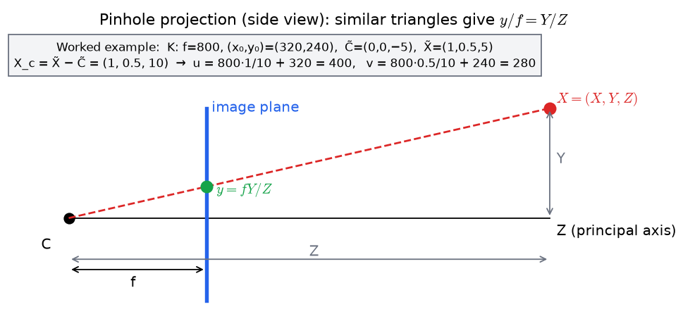
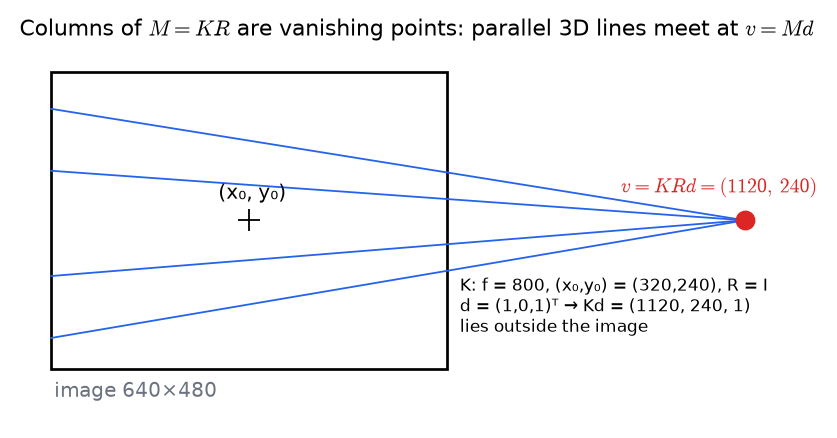
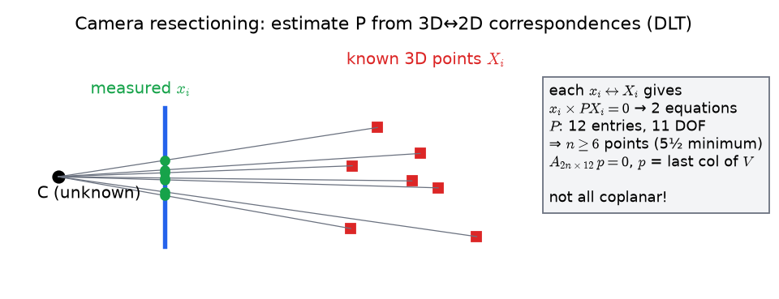
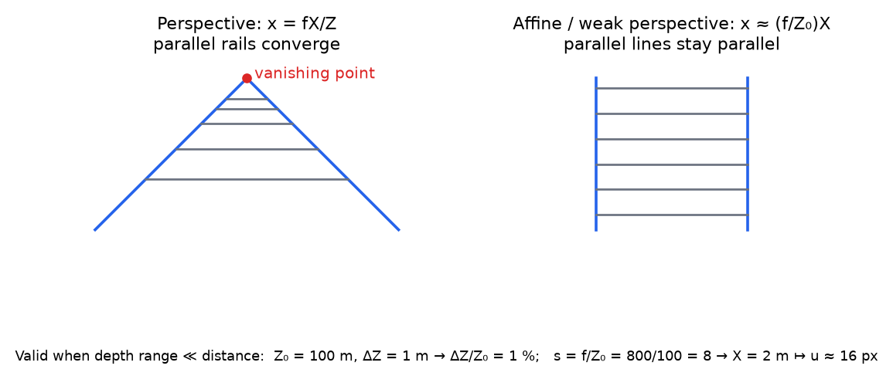
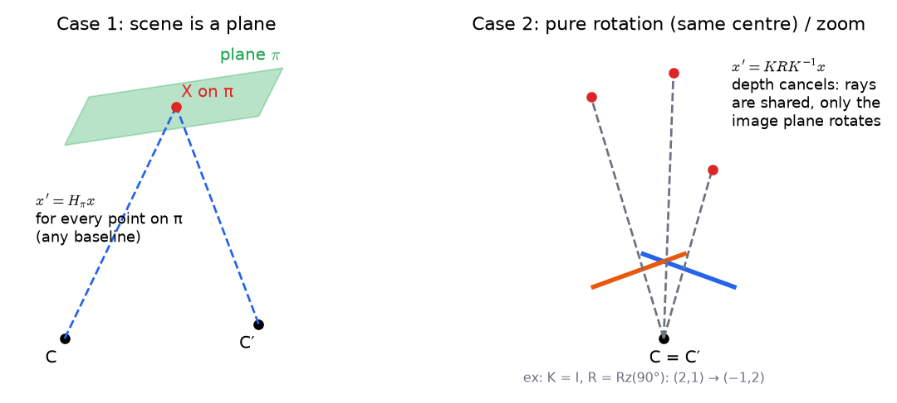

[↑ Index](README.md) · [← Previous](09_Revision_Notes_A_Projective_Geometry.md) · [Next →](11_Revision_Notes_C_Two_View_Geometry.md)

<b>Contents</b>

- [B6. Pinhole Camera, Intrinsics and Extrinsics](#b6-pinhole-camera-intrinsics-and-extrinsics)
- [B7. Anatomy of the Camera Matrix $P$](#b7-anatomy-of-the-camera-matrix-p)
- [B8. Camera Resectioning — DLT for $P$](#b8-camera-resectioning--dlt-for-p)
- [B9. Affine Cameras](#b9-affine-cameras)
- [B10. The Four Homography Cases Between Two Views](#b10-the-four-homography-cases-between-two-views)
- [Part B — Final quick recall](#part-b--final-quick-recall)

Part B next: camera models and projection, interpreting $P$, camera resectioning, affine cameras, and the four homography cases. I’m keeping the study-guide conventions and will flag any extra clarification explicitly.

# PART B — THE CAMERA

**Topics 6–10 · Hartley & Zisserman notation**

**Notation conventions**

| Symbol | Meaning | Dimensions |
|---|---|---|
| $X$ | Homogeneous world point | $4\times1$ |
| $\widetilde X$ | Cartesian world point | $3\times1$ |
| $X_c$ | Camera-coordinate point | $3\times1$ |
| $C$ | Homogeneous camera centre | $4\times1$ |
| $\widetilde C$ | Cartesian camera centre | $3\times1$ |
| $K$ | Intrinsic matrix | $3\times3$ |
| $R$ | Rotation matrix | $3\times3$ |
| $t$ | Translation vector | $3\times1$ |
| $P$ | Camera projection matrix | $3\times4$ |
| $M$ | Left $3\times3$ block of $P$ | $3\times3$ |
| $p_4$ | Last column of $P$ | $3\times1$ |
| $d$ | 3D direction | $3\times1$ |

---

## B6. Pinhole Camera, Intrinsics and Extrinsics

### 1. Key results

- ★★★ Pinhole projection: $x=fX/Z,\ y=fY/Z$.
- ★★★ The intrinsic matrix converts camera-coordinate projections into pixel coordinates.
- ★★★ Principal point $(p_x,p_y)$ accounts for the image-coordinate origin offset.
- ★★★ Extrinsics consist of rotation $R$ and camera centre $\widetilde C$.
- ★★★ World-to-camera transformation:

$$
X_c=R(\widetilde X-\widetilde C)
$$

- ★★★ Camera translation:

$$
t=-R\widetilde C
$$

- ★★★ Camera projection matrix:

$$
P=KR[I\mid-\widetilde C]=K[R\mid t]
$$

- ★★★ CCD model accommodates non-square pixels using $\alpha_x=fm_x,\ \alpha_y=fm_y$.
- ★★★ Finite projective camera includes skew $s$.
- ★★★ DOF: basic pinhole 9, CCD 10, finite projective 11, general projective 11.

### 2. Formulas

#### Basic pinhole model

$$
u=f\frac XZ,\qquad v=f\frac YZ
$$

| Symbol | Meaning | Dimensions |
|---|---|---|
| $X,Y,Z$ | Camera-coordinate components | Scalars |
| $u,v$ | Image coordinates | Scalars |
| $f$ | Focal length | Scalar |

#### Intrinsic matrix

$$
\boxed{
K=
\begin{bmatrix}
f&0&p_x\\
0&f&p_y\\
0&0&1
\end{bmatrix}
}
$$

Dimensions: $K:3\times3$.

#### CCD camera

$$
\alpha_x=fm_x,\qquad\alpha_y=fm_y
$$

$$
K_{\text{CCD}}=
\begin{bmatrix}
\alpha_x&0&x_0\\
0&\alpha_y&y_0\\
0&0&1
\end{bmatrix}
$$

#### Finite projective camera

$$
\boxed{
K=
\begin{bmatrix}
\alpha_x&s&x_0\\
0&\alpha_y&y_0\\
0&0&1
\end{bmatrix}
}
$$

#### Camera pose and projection

$$
X_c=R(\widetilde X-\widetilde C)
$$

$$
t=-R\widetilde C
$$

$$
\boxed{
P=KR[I\mid-\widetilde C]=K[R\mid t]
}
$$

Dimensions:

- $R:3\times3$.
- $\widetilde C,t:3\times1$.
- $[R\mid t]:3\times4$.
- $P:3\times4$.

### 3. Derivations

**A. Pinhole projection**

1. A 3D camera-coordinate point is $X_c=(X,Y,Z)^T$, because coordinates are measured relative to the camera.
2. By similar triangles:

$$
\frac{u}{f}=\frac XZ,\qquad
\frac{v}{f}=\frac YZ
$$

3. Rearrange:

$$
u=fX/Z,\qquad v=fY/Z
$$

$$
\boxed{u=fX/Z,\quad v=fY/Z}
$$

**B. Introduce the principal point**

1. The optical axis need not intersect the top-left pixel coordinate origin.
2. Let its intersection with the image plane be $(p_x,p_y)$.
3. Add the coordinate offsets:

$$
u=fX/Z+p_x
$$

$$
v=fY/Z+p_y
$$

4. Write in homogeneous matrix form:

$$
\boxed{x\sim KX_c}
$$

**C. Derive world-to-camera coordinates**

1. Translate the world point relative to the camera centre:

$$
\widetilde X-\widetilde C
$$

2. Rotate into camera coordinates:

$$
X_c=R(\widetilde X-\widetilde C)
$$

3. Expand:

$$
X_c=R\widetilde X-R\widetilde C
$$

4. Define:

$$
t=-R\widetilde C
$$

5. Hence:

$$
\boxed{X_c=R\widetilde X+t}
$$

**D. Derive the camera matrix**

1. Projection gives:

$$
x\sim KX_c
$$

2. Substitute the world-to-camera transformation:

$$
x\sim KR(\widetilde X-\widetilde C)
$$

3. Introduce homogeneous world coordinates:

$$
X=(\widetilde X^T,1)^T
$$

4. Combine rotation and translation:

$$
x\sim KR[\ I\mid-\widetilde C\ ]X
$$

Therefore:

$$
\boxed{P=KR[I\mid-\widetilde C]=K[R\mid t]}
$$

### 4. DOF / counting

| Model | Intrinsic parameters | Extrinsic parameters | Total DOF |
|---|---:|---:|---:|
| Basic pinhole | 3 | 6 | 9 |
| CCD | 4 | 6 | 10 |
| Finite projective | 5 | 6 | 11 |
| General projective | — | — | 11 |

Reasons:

- Basic pinhole: $f,p_x,p_y$: 3 intrinsic DOF.
- CCD: $\alpha_x,\alpha_y,x_0,y_0$: 4.
- Finite projective: above 4 plus skew $s$: 5.
- Extrinsics: 3 rotation + 3 camera-position parameters = 6.
- General projective: 12 entries in $P$ − 1 arbitrary scale = 11.

### 5. Worked example

Given:

$$
K=
\begin{bmatrix}
800&0&320\\
0&800&240\\
0&0&1
\end{bmatrix}
,\quad R=I
$$

$$
\widetilde C=(0,0,-5)^T
$$

World point:

$$
\widetilde X=(1,0.5,5)^T
$$

**Step 1. Camera coordinates**

$$
X_c=R(\widetilde X-\widetilde C)
$$

$$
=(1,0.5,5)-(0,0,-5)
$$

$$
=(1,0.5,10)
$$

**Step 2. Horizontal projection**

$$
u=800\frac1{10}+320=400
$$

**Step 3. Vertical projection**

$$
v=800\frac{0.5}{10}+240=280
$$

$$
\boxed{x=(400,280)}
$$

### 6. Exam traps

- $C$ and $t$ are not the same: $t=-RC$.
- $C$ describes camera position in world coordinates; $t$ is the translation in the world-to-camera equation.
- $K$ contains intrinsic parameters; $R,t$ contain extrinsics.
- $P$ is $3\times4$, not $3\times3$.
- $P=K[R\mid t]$, not $K[R\mid C]$.
- Pixel coordinates require dehomogenisation.
- CCD accounts for different pixel scales; skew is an additional parameter in the finite projective model.

### 7. Likely exam questions

**Q1. Derive the camera matrix from the pinhole model.**

Model answer: First transform world coordinates using $X_c=R(\widetilde X-\widetilde C)$. Then project using $K$, giving $P=KR[I\mid-\widetilde C]=K[R\mid t]$, with $t=-R\widetilde C$.

**Q2. Distinguish intrinsic and extrinsic parameters.**

Model answer: Intrinsics describe the camera's internal projection properties, including focal length, principal point, pixel scales and skew. Extrinsics describe camera pose through rotation $R$ and position $C$.

**Q3. Why does a CCD model have 10 DOF?**

Model answer: Its intrinsic matrix has four parameters, $\alpha_x,\alpha_y,x_0,y_0$, and camera pose has six parameters. Total $4+6=10$.

**Q4. Why is translation $t=-RC$?**

Model answer: The camera-coordinate position of a world point is $R(\widetilde X-\widetilde C)$. Expanding gives $R\widetilde X-R\widetilde C$, so $t=-R\widetilde C$.

---

## B7. Anatomy of the Camera Matrix $P$

### 1. Key results

- ★★★ Write $P=[M\mid p_4]$, where $M=KR$.
- ★★★ The camera centre is the right null vector:

$$
PC=0
$$

- ★★★ For a finite camera:

$$
\widetilde C=-M^{-1}p_4
$$

- ★★★ First three columns of $P$: vanishing points of world X, Y and Z directions.
- ★★★ Fourth column: image of the world origin.
- ★★★ Rows of $P$ represent 3D planes.
- ★★★ The third row $P^3$ corresponds to the principal plane.
- ★★★ $\det(M)\ne0$: finite camera; $\det(M)=0$: affine camera centre at infinity.
- ★★★ Principal axis in your notes: $v=\det(M)m^3$.
- ★★★ Principal point: $x_0=Mm^3$.
- ★★★ RQ decomposition recovers $M=KR$.
- ★★★ Vanishing point of direction $d$:

$$
v=Md=KRd
$$

- ★★ Direction in camera coordinates is proportional to $K^{-1}v$.

### 2. Formulas

Write:

$$
\boxed{P=[M\mid p_4]}
$$

$$
P=
\begin{bmatrix}
p_1&p_2&p_3&p_4
\end{bmatrix}
$$

Here:

- $P:3\times4$.
- $M:3\times3$.
- Each column $p_i:3\times1$.
- Each row $P^i:1\times4$.

| Formula | Meaning | Dimensions |
|---|---|---|
| $PC=0$ | Camera-centre condition | $P:3\times4,\ C:4\times1$ |
| $\widetilde C=-M^{-1}p_4$ | Finite camera centre | $M:3\times3,\ p_4:3\times1$ |
| $M=KR$ | Intrinsic-extrinsic factorisation | All $3\times3$ |
| $P^iX=0$ | Plane corresponding to image line | $P^i:1\times4,\ X:4\times1$ |
| $v=\det(M)m^3$ | Principal-axis direction, course notation | $m^3:3\times1$ |
| $x_0=Mm^3$ | Principal point | $M:3\times3,\ m^3:3\times1$ |
| $v=KRd$ | Vanishing point of world direction | $d:3\times1,\ v:3\times1$ |
| $d_c\propto K^{-1}v$ | Direction in camera coordinates | $3\times1$ |

For the principal-axis notation, $m^3$ denotes the principal-axis direction in the course's $P$-decomposition convention.

[extra] Under the standard calibrated factorisation $M=KR$, one can express this direction as $m^3=R^Te_3$, where $e_3=(0,0,1)^T$. It follows that $Mm^3=Ke_3$, the principal point.

### 3. Derivations

**A. Camera centre**

1. A camera centre is the 3D point mapped to the zero image vector before dehomogenisation.
2. Therefore:

$$
PC=0
$$

3. This makes $C$ the right null vector of $P$.
4. For a finite camera, write:

$$
P=[M\mid p_4]
$$

5. Write the homogeneous centre:

$$
C=(\widetilde C^T,1)^T
$$

6. Substitute:

$$
M\widetilde C+p_4=0
$$

7. Rearrange:

$$
\boxed{\widetilde C=-M^{-1}p_4}
$$

**B. Why do columns 1–3 represent vanishing points?**

1. Consider the world X-axis direction:

$$
d_X=(1,0,0)^T
$$

2. Its ideal homogeneous point is:

$$
X_\infty=(1,0,0,0)^T
$$

3. Project it:

$$
PX_\infty=p_1
$$

4. Similarly, the Y and Z direction ideal points project to $p_2,p_3$.

$$
\boxed{p_1,p_2,p_3=\text{vanishing points of X,Y,Z axes}}
$$

5. The world origin is $X_O=(0,0,0,1)^T$, and:

$$
PX_O=p_4
$$

Hence:

$$
\boxed{p_4=\text{image of world origin}}
$$

**C. Why are rows of $P$ planes?**

1. Write the three rows as $P^1,P^2,P^3$, each $1\times4$.
2. For a 3D point $X$, the homogeneous image coordinates are:

$$
x=PX
$$

3. If the first image coordinate is zero:

$$
P^1X=0
$$

4. This is the equation of a plane in $P^3$.
5. Similarly, $P^2X=0$ and $P^3X=0$ describe two other planes.
6. The third row plane passes through the camera centre and is parallel to the image plane: the principal plane.

**D. Why is $\det(M)$ the finite/infinite test?**

1. For a finite camera:

$$
M=KR
$$

2. Both $K$ and $R$ are invertible.
3. Hence:

$$
\det(M)=\det(K)\det(R)\ne0
$$

4. If $M$ is singular, the camera centre cannot be recovered by $-M^{-1}p_4$; the centre is at infinity in the affine-camera case.

$$
\boxed{
\det(M)\ne0:\text{ finite camera};\quad
\det(M)=0:\text{ affine camera}
}
$$

**E. Recover $K,R$ by RQ decomposition**

1. Extract $M$, the left $3\times3$ block of $P$.
2. Factor:

$$
M=KR
$$

3. Use RQ decomposition, producing $K$ upper triangular and $R$ orthogonal.
4. Resolve sign ambiguity so that the diagonal entries of $K$ are positive and $R$ is a proper rotation.
5. Extract the camera centre from the null space of $P$.

$$
\boxed{M=KR,\quad \widetilde C=-M^{-1}p_4}
$$

[extra] Normalise $K$ so $K_{33}=1$, and ensure $\det(R)=+1$ by making consistent sign adjustments.

**F. Vanishing point of arbitrary direction**

1. Let $d$ be a 3D world direction.
2. Its ideal homogeneous 3D point is:

$$
X_\infty=(d^T,0)^T
$$

3. Project:

$$
v=PX_\infty
$$

4. Since the last coordinate is zero:

$$
v=Md
$$

5. Use $M=KR$:

$$
\boxed{v=KRd}
$$

6. To recover camera-coordinate direction:

$$
\boxed{d_c\propto K^{-1}v}
$$

### 4. DOF / counting

The camera matrix has:

$$
12-1=\boxed{11\text{ DOF}}
$$

Its camera centre is a null-space calculation, not an additional freely chosen image parameter.

For the finite camera parameterisation:

$$
3\text{ intrinsic}+3\text{ rotation}+3\text{ position}=9
$$

for the basic pinhole model.

A general projective camera has 11 DOF.

### 5. Worked example

Given:

$$
K=
\begin{bmatrix}
800&0&320\\
0&800&240\\
0&0&1
\end{bmatrix}
$$

$$
R=I,\qquad\widetilde C=(0,0,-5)^T
$$

**Step 1. Calculate $p_4$**

$$
p_4=-KR\widetilde C
$$

$$
=-K
\begin{bmatrix}0\\0\\-5\end{bmatrix}
=
\begin{bmatrix}1600\\1200\\5\end{bmatrix}
$$

**Step 2. Calculate $M$**

$$
M=KR=K
$$

**Step 3. Recover camera centre**

$$
\widetilde C=-M^{-1}p_4
$$

Since $M=K$:

$$
K^{-1}p_4=
\begin{bmatrix}0\\0\\5\end{bmatrix}
$$

Thus:

$$
\boxed{\widetilde C=(0,0,-5)^T}
$$

**Step 4. Vanishing point of direction**

Let:

$$
d=(1,0,1)^T
$$

Then:

$$
v=KRd=Kd
$$

$$
=
\begin{bmatrix}
800&0&320\\
0&800&240\\
0&0&1
\end{bmatrix}
\begin{bmatrix}1\\0\\1\end{bmatrix}
=
\begin{bmatrix}1120\\240\\1\end{bmatrix}
$$

$$
\boxed{v=(1120,240)}
$$

### 6. Exam traps

- Camera centre is the right null vector of $P$, not its left null vector.
- The first three columns are vanishing points of world coordinate directions; the fourth is the image of the origin.
- $M=KR$, not $RK$.
- Rows represent 3D planes, columns have the geometric meaning of projected points/directions.
- $P^3$ corresponds to the principal plane; $P^3X=0$.
- Use RQ, not QR, for upper-triangular intrinsics followed by rotation.
- $K^{-1}v$ gives a direction in camera coordinates, up to scale.
- A finite camera has $\det(M)\ne0$.
- The principal point is not generally $(0,0)$; it is determined by the camera calibration.

### 7. Likely exam questions

**Q1. How do you calculate the camera centre from $P$?**

Model answer: Find the right null vector from $PC=0$. For $P=[M\mid p_4]$ with nonsingular $M$, dehomogenise $C$ using $\widetilde C=-M^{-1}p_4$.

**Q2. Explain the geometric interpretation of the columns of $P$.**

Model answer: The first three columns are vanishing points of the world X, Y and Z directions. The fourth column is the image of the world origin.

**Q3. How do you obtain the intrinsic matrix from a known camera matrix?**

Model answer: Extract $M$, then apply RQ decomposition $M=KR$. Choose consistent signs so $K$ is upper triangular and $R$ is a proper rotation.

**Q4. What does $\det(M)=0$ signify?**

Model answer: The camera centre is at infinity, which corresponds to an affine camera rather than a finite perspective camera.

---

## B8. Camera Resectioning — DLT for $P$

### 1. Key results

- ★★★ Resectioning estimates the camera matrix $P$ from known 3D points and corresponding 2D image points.
- ★★★ Constraint:

$$
x_i\times PX_i=0
$$

- ★★★ Each correspondence supplies 2 independent equations.
- ★★★ Each design matrix $A_i$ is $2\times12$.
- ★★★ A projective camera has 11 DOF; minimum correspondences $n\ge6$.
- ★★★ Image Hartley normalisation uses mean distance $\sqrt2$.
- ★★★ 3D Hartley normalisation uses mean distance $\sqrt3$.
- ★★★ Denormalisation:

$$
P=T^{-1}\widetilde P U
$$

- ★★★ DLT minimises algebraic error; gold-standard refinement minimises geometric reprojection error.
- ★★★ Gold standard uses Levenberg–Marquardt.
- ★★ Degenerate cases: coplanar 3D points; points and camera centre lying on a twisted cubic.

### 2. Formulas

Let:

$$
x_i=(x_i,y_i,w_i)^T
$$

$$
X_i=(X_i,Y_i,Z_i,W_i)^T
$$

$$
P=
\begin{bmatrix}
(P^1)^T\\
(P^2)^T\\
(P^3)^T
\end{bmatrix}
$$

Here:

- $x_i:3\times1$.
- $X_i:4\times1$.
- $P:3\times4$.
- $p=\operatorname{vec}(P^T):12\times1$, using row-stacking as in the design matrix below.

#### Design matrix

$$
\boxed{
A_i=
\begin{bmatrix}
0^T&-w_iX_i^T&y_iX_i^T\\
w_iX_i^T&0^T&-x_iX_i^T
\end{bmatrix}
}
$$

Dimensions: $A_i:2\times12$.

#### Stacked DLT

$$
Ap=0
$$

$$
A:2n\times12,\qquad p:12\times1
$$

#### Normalisation

2D image:

$$
T:3\times3,\quad \bar d_{\text{image}}=\sqrt2
$$

3D world:

$$
U:4\times4,\quad \bar d_{\text{world}}=\sqrt3
$$

#### Denormalisation

$$
\boxed{P=T^{-1}\widetilde P U}
$$

#### Gold-standard objective

$$
\boxed{
\min_P\sum_i d(x_i,PX_i)^2
}
$$

where $d$ is the Euclidean image reprojection distance.

### 3. Derivations

**A. Derive the camera DLT design matrix**

Start with:

$$
x_i\times PX_i=0
$$

Write:

$$
PX_i=
\begin{bmatrix}
P^1X_i\\P^2X_i\\P^3X_i
\end{bmatrix}
$$

The first two independent cross-product equations are:

$$
y_i(P^3X_i)-w_i(P^2X_i)=0
$$

$$
w_i(P^1X_i)-x_i(P^3X_i)=0
$$

Rewrite the first equation in terms of camera-matrix entries:

$$
[0^T,\ -w_iX_i^T,\ y_iX_i^T]p=0
$$

Rewrite the second:

$$
[w_iX_i^T,\ 0^T,\ -x_iX_i^T]p=0
$$

Stack them:

$$
\boxed{
A_i=
\begin{bmatrix}
0^T&-w_iX_i^T&y_iX_i^T\\
w_iX_i^T&0^T&-x_iX_i^T
\end{bmatrix}
}
$$

**B. SVD solution**

1. Stack all $n$ correspondence matrices:

$$
A=
\begin{bmatrix}A_1\\A_2\\\vdots\\A_n\end{bmatrix}
$$

2. Obtain:

$$
Ap=0
$$

3. Solve:

$$
\min_{\|p\|=1}\|Ap\|^2
$$

4. Compute SVD:

$$
A=U_A\Sigma V^T
$$

5. Select the right singular vector corresponding to the smallest singular value.

$$
\boxed{p=V[:, -1]}
$$

6. Reshape $p$ into $P$.

**C. Derive the normalisation and denormalisation**

1. Image normalisation:

$$
\widetilde x=Tx
$$

2. 3D normalisation:

$$
\widetilde X=UX
$$

3. The normalised camera relationship is:

$$
\widetilde x=\widetilde P\widetilde X
$$

4. Substitute:

$$
Tx=\widetilde PUX
$$

5. Rearrange:

$$
x=T^{-1}\widetilde PUX
$$

Therefore:

$$
\boxed{P=T^{-1}\widetilde P U}
$$

**D. Why gold-standard estimation is better**

1. DLT minimises $\|Ap\|^2$, an algebraic error.
2. Algebraic error does not directly measure pixel-coordinate displacement.
3. Reproject the estimated 3D points:

$$
\hat x_i=\pi(PX_i)
$$

4. Calculate geometric reprojection error:

$$
E(P)=\sum_i\|x_i-\hat x_i\|^2
$$

5. Refine the parameters using Levenberg–Marquardt.

$$
\boxed{
\min_P\sum_i\|x_i-\pi(PX_i)\|^2
}
$$

**E. Degenerate configurations**

- Coplanar world points only constrain the mapping between the plane and image; they do not give enough information to recover a general camera uniquely.
- A twisted cubic containing the camera centre and the 3D points is another critical configuration for resectioning.

### 4. DOF / counting

| Quantity | Count |
|---|---:|
| Entries of $P$ | 12 |
| Arbitrary scale | −1 |
| Camera DOF | 11 |
| Independent equations per correspondence | 2 |
| Minimum correspondences | $\lceil11/2\rceil=6$ |

Six generic correspondences provide 12 equations for 11 DOF.

### 5. Worked example

Suppose:

- 3D points: 6.
- Corresponding 2D image points: 6.
- Camera matrix unknown.

**Step 1. Build a matrix per correspondence**

$$
A_i:2\times12
$$

**Step 2. Stack all six**

$$
A:12\times12
$$

**Step 3. Find the null vector**

$$
A=U_A\Sigma V^T
$$

$$
p=V[:, -1]
$$

**Step 4. Reshape**

$$
p\rightarrow P\in\mathbb R^{3\times4}
$$

Six correspondences are the minimum generic count, although noise generally motivates using more.

#### 3D normalisation numerical mini-example

Suppose a set of 3D points has mean distance from its centroid:

$$
\bar d=2\sqrt3
$$

Then the normalisation scale is:

$$
s=\frac{\sqrt3}{2\sqrt3}=\frac12
$$

After translation to the centroid and scaling by $1/2$, the mean distance is $\sqrt3$.

### 6. Exam traps

- Resectioning means estimating $P$, not estimating $H$.
- $A_i$ is $2\times12$, not $2\times9$.
- At least six generic 3D–2D correspondences are needed.
- 2D mean distance is $\sqrt2$; 3D mean distance is $\sqrt3$.
- Denormalisation is $P=T^{-1}\widetilde P U$, not $T^{-1}\widetilde P U^{-1}$.
- DLT minimises algebraic error; gold-standard minimises reprojection error.
- A planar configuration is degenerate for unrestricted camera resectioning.
- Use the null-space vector from $V$, not $U$.

### 7. Likely exam questions

**Q1. Derive the camera resectioning DLT system.**

Model answer: Start from $x_i\times PX_i=0$. Expand two independent components to obtain a $2\times12$ matrix $A_i$. Stack all correspondences into $Ap=0$ and solve using SVD.

**Q2. Why are six correspondences required?**

Model answer: A general projective camera has 11 DOF, and each 3D–2D correspondence contributes two independent equations. Thus $2n\ge11$, giving $n\ge6$.

**Q3. State the two normalisation scales.**

Model answer: Hartley normalisation makes the mean image-point distance $\sqrt2$ and the mean 3D-point distance $\sqrt3$, both measured from their respective centroids.

**Q4. What is the gold-standard camera estimation objective?**

Model answer: Minimise total squared reprojection error $\sum_i\|x_i-\pi(PX_i)\|^2$, usually refining a DLT initialisation using Levenberg–Marquardt.

---

## B9. Affine Cameras

### 1. Key results

- ★★★ An affine camera approximates perspective projection when depth variation is small relative to average depth.
- ★★★ Condition:

$$
\Delta Z\ll Z_0
$$

- ★★★ The affine projection has a fixed last row $(0,0,0,1)$ in the course's camera convention.
- ★★★ The left $3\times3$ block $M$ is singular:

$$
\det(M)=0
$$

- ★★★ Parallel world lines remain parallel in the image.
- ★★★ Orthographic camera: 5 DOF.
- ★★★ Scaled orthographic camera: 6 DOF.
- ★★★ Weak perspective camera: 7 DOF.
- ★★★ General affine camera: 8 DOF.
- ★★ Affine cameras have camera centres at infinity.

### 2. Formulas

#### General affine camera

$$
\boxed{
P=
\begin{bmatrix}
a_{11}&a_{12}&a_{13}&t_x\\
a_{21}&a_{22}&a_{23}&t_y\\
0&0&0&1
\end{bmatrix}
}
$$

Dimensions: $P:3\times4$, left block $M:3\times3$, $t_x,t_y$ scalars.

The affine projection effectively has:

$$
u=a_{11}X+a_{12}Y+a_{13}Z+t_x
$$

$$
v=a_{21}X+a_{22}Y+a_{23}Z+t_y
$$

#### DOF table

| Model | DOF |
|---|---:|
| Orthographic | 5 |
| Scaled orthographic | 6 |
| Weak perspective | 7 |
| General affine | 8 |

### 3. Derivations

**A. Perspective to weak-perspective approximation**

1. Start with perspective projection:

$$
u=fX/Z,\qquad v=fY/Z
$$

2. Assume the scene depth is:

$$
Z=Z_0+\delta Z
$$

3. If:

$$
|\delta Z|\ll Z_0
$$

then approximate:

$$
1/Z\approx1/Z_0
$$

4. Substitute:

$$
u\approx(f/Z_0)X
$$

$$
v\approx(f/Z_0)Y
$$

5. The perspective denominator becomes approximately constant.

$$
\boxed{u\approx sX,\quad v\approx sY,\quad s=f/Z_0}
$$

This gives the weak-perspective approximation.

**B. Why affine cameras preserve parallel lines**

1. An affine projection is linear in the 3D spatial coordinates plus translation.
2. Let two parallel lines have direction $d$.
3. Their image directions are both transformed using the same linear projection.
4. Therefore their resulting directions remain parallel, except in degenerate cases where a direction collapses.

$$
\boxed{\text{Parallel lines remain parallel}}
$$

### 4. DOF / counting

| Affine camera | DOF | Notes |
|---|---:|---|
| Orthographic | 5 | Orientation + image translation |
| Scaled orthographic | 6 | Adds a scale parameter |
| Weak perspective | 7 | Course-specific parameterisation |
| General affine | 8 | General $2\times3$ linear mapping + 2D translation |

[extra] The DOF labels depend on the particular parameterisation and any assumed constraints on camera axes and scales. For your exam, memorise the 5/6/7/8 ordering and counts from the course guide.

### 5. Worked example

Suppose a scene has:

$$
Z_0=100\text{ m},\qquad\Delta Z=1\text{ m}
$$

Then:

$$
\frac{\Delta Z}{Z_0}=\frac1{100}=0.01
$$

The depth varies by only 1% of average depth.

An affine/weak-perspective approximation is reasonable.

For $f=800$ pixels:

$$
s=\frac f{Z_0}=\frac{800}{100}=8
$$

For $X=2$ m:

$$
u\approx8(2)=16\text{ pixels}
$$

$$
\boxed{u\approx16\text{ pixels}}
$$

### 6. Exam traps

- Affine camera does not mean the scene itself is planar.
- The affine camera centre is at infinity.
- $\det(M)=0$ distinguishes the affine model from a finite perspective camera.
- Do not confuse weak perspective with orthographic projection.
- Parallelism is preserved, but absolute lengths and angles generally are not.
- The condition is relative depth variation, not simply small absolute depth.
- Use $\Delta Z\ll Z_0$, not $\Delta Z\gg Z_0$.

### 7. Likely exam questions

**Q1. When is an affine camera a good approximation?**

Model answer: When the scene's depth range is much smaller than its average depth, $\Delta Z\ll Z_0$. The perspective denominator can then be treated as approximately constant.

**Q2. Give the DOF of four affine camera models.**

Model answer: Orthographic: 5; scaled orthographic: 6; weak perspective: 7; general affine: 8.

**Q3. Why do parallel lines remain parallel under affine projection?**

Model answer: The last row of the affine transformation preserves ideal points, and the transformation applies the same linear mapping to the direction vectors of parallel lines.

**Q4. What does $\det(M)=0$ mean?**

Model answer: The camera centre is at infinity. This is characteristic of an affine camera.

---

## B10. The Four Homography Cases Between Two Views

### 1. Key results

- ★★★ A single homography relates two views of a general scene if the scene is planar or the camera centres coincide.
- ★★★ Planar scene: $H=H_1H_2^{-1}$, for mapping from view 2 to view 1.
- ★★★ Same camera centre:

$$
H=K_1R_1(K_2R_2)^{-1}
$$

- ★★★ Zoom only:

$$
H=K_1K_2^{-1}
$$

- ★★★ Rotation only, same $K$:

$$
\boxed{H=KRK^{-1}}
$$

- ★★★ Pure rotation has no translational parallax; depth is not needed.
- ★★ For a conjugate rotation, eigenvalues up to scale are:

$$
\{1,e^{i\theta},e^{-i\theta}\}
$$

### 2. Formulas

| Case | Homography | Dimensions |
|---|---|---|
| World plane $Z=0$ | $H=H_1H_2^{-1}$ | Each $3\times3$ |
| Same centre | $H=K_1R_1(K_2R_2)^{-1}$ | All $3\times3$ |
| Zoom only | $H=K_1K_2^{-1}$ | All $3\times3$ |
| Rotation only, same intrinsics | $H=KRK^{-1}$ | All $3\times3$ |

### 3. Derivations

**A. Case 1 — Planar scene**

Assume all world points lie on:

$$
Z=0
$$

1. A world point is:

$$
X=(X,Y,0,1)^T
$$

2. Write a camera matrix:

$$
P_i=[p_1^i\ p_2^i\ p_3^i\ p_4^i]
$$

3. Project:

$$
x_i\sim p_1^iX+p_2^iY+p_4^i
$$

4. Define:

$$
H_i=[p_1^i\ p_2^i\ p_4^i]
$$

5. Therefore:

$$
x_i\sim H_i
\begin{bmatrix}X\\Y\\1\end{bmatrix}
$$

6. For two views:

$$
x_1\sim H_1X_{\text{plane}},\qquad
x_2\sim H_2X_{\text{plane}}
$$

7. Eliminate plane coordinates:

$$
X_{\text{plane}}\sim H_2^{-1}x_2
$$

8. Substitute into the first image equation:

$$
\boxed{x_1\sim H_1H_2^{-1}x_2}
$$

[extra] For a general plane $\pi$, the corresponding induced homography has the form $H\sim K'(R-t n^T/d)K^{-1}$, under the convention $n^TX+d=0$ and compatible camera coordinates. The course's $Z=0$ derivation is the one to use unless asked for the general formula.

**B. Case 2 — Same camera centre**

1. Two cameras share the same optical centre, so there is no relative translation.
2. A ray in the second camera coordinates is transformed into the first camera coordinates by the relative rotation.
3. Projection in view 2:

$$
x_2\sim K_2R_2d
$$

4. Undo the second camera projection:

$$
d\sim R_2^{-1}K_2^{-1}x_2
$$

5. Project in view 1:

$$
x_1\sim K_1R_1d
$$

6. Substitute:

$$
x_1\sim K_1R_1R_2^{-1}K_2^{-1}x_2
$$

Therefore:

$$
\boxed{H=K_1R_1(K_2R_2)^{-1}}
$$

Depth cancels because only ray direction matters when the centre is shared.

**C. Case 3 — Zoom only**

1. Suppose the camera pose is fixed; only the intrinsics change.
2. In the common camera coordinate frame:

$$
x_1\sim K_1X_c
$$

$$
x_2\sim K_2X_c
$$

3. Recover:

$$
X_c\sim K_2^{-1}x_2
$$

4. Substitute:

$$
x_1\sim K_1K_2^{-1}x_2
$$

Therefore:

$$
\boxed{H=K_1K_2^{-1}}
$$

For a simple zoom by factor $k$, the course gives the conjugated scaling:

$$
\boxed{H=K\operatorname{diag}(k,k,1)K^{-1}}
$$

**D. Case 4 — Pure rotation, same intrinsics**

1. First camera:

$$
x\sim KX_c
$$

2. Camera rotates by $R$ but does not translate:

$$
X_c'=RX_c
$$

3. Second image:

$$
x'\sim KRX_c
$$

4. From the first view:

$$
X_c\sim K^{-1}x
$$

5. Substitute:

$$
x'\sim KRK^{-1}x
$$

Therefore:

$$
\boxed{H=KRK^{-1}}
$$

**Why does depth cancel?** Both cameras observe the same ray from the same centre. Rotation changes its direction relative to the camera coordinate frame but does not introduce a baseline-dependent displacement.

**E. Eigenvalues of a conjugate rotation**

1. $H=KRK^{-1}$.
2. Similar matrices have the same eigenvalues.
3. A 3D rotation by angle $\theta$ has eigenvalues $1,e^{i\theta},e^{-i\theta}$.
4. Therefore:

$$
\boxed{\lambda(H)=\{1,e^{i\theta},e^{-i\theta}\}}
$$

up to the arbitrary homography scale.

### 4. DOF / counting

A homography has:

$$
9-1=\boxed{8\text{ DOF}}
$$

Each of the four cases is represented by a $3\times3$ homography, defined up to scale.

The effective number of free parameters in a particular induced homography may be smaller because it is restricted by the underlying scene geometry or camera motion.

### 5. Worked example

Consider a pure rotation with:

$$
K=I
$$

and a $90^\circ$ rotation around the Z-axis:

$$
R=
\begin{bmatrix}
0&-1&0\\
1&0&0\\
0&0&1
\end{bmatrix}
$$

Then:

$$
H=KRK^{-1}=R
$$

Take:

$$
x=(2,1,1)^T
$$

Apply:

$$
x'=Hx
$$

$$
=
\begin{bmatrix}
0&-1&0\\
1&0&0\\
0&0&1
\end{bmatrix}
\begin{bmatrix}
2\\1\\1
\end{bmatrix}
=
\begin{bmatrix}-1\\2\\1\end{bmatrix}
$$

Therefore:

$$
\boxed{x'=(-1,2)}
$$

The original depth is not present in this mapping.

### 6. Exam traps

- A general non-planar scene with camera translation cannot normally be mapped by one homography.
- Planar scene and same-centre camera motion are two different reasons for a homography.
- Same centre means no translation, not necessarily the same orientation.
- Zoom only: $H=K_1K_2^{-1}$.
- Pure rotation: $H=KRK^{-1}$.
- Do not reverse the conjugation to $K^{-1}RK$.
- Homography direction matters: $H_1H_2^{-1}$ maps view 2 to view 1.
- Pure rotation produces no parallax and cannot provide stereo depth.
- The eigenvalues of $KRK^{-1}$ match those of $R$, because the matrices are similar.
- A homography maps points to points; the fundamental matrix maps points to epipolar lines.

### 7. Likely exam questions

**Q1. List the four cases where two views are related by a homography.**

Model answer: (1) All scene points lie on a plane; (2) the cameras share a centre; (3) only zoom/intrinsics change; (4) the camera undergoes pure rotation without translation.

**Q2. Derive the homography for a rotating camera.**

Model answer: Since $x=KX_c$, a rotated camera observes $x'=KRX_c$. Substituting $X_c=K^{-1}x$ gives $H=KRK^{-1}$.

**Q3. Why does pure rotation not provide depth?**

Model answer: The camera centre is unchanged, so all rays retain their common origin. Projection depends only on ray direction; the depth magnitude cancels.

**Q4. Derive the plane-induced homography.**

Model answer: For a world plane $Z=0$, write $x_i\sim H_i(X,Y,1)^T$, where $H_i=[p_1^i\ p_2^i\ p_4^i]$. Eliminating plane coordinates gives $x_1\sim H_1H_2^{-1}x_2$.

**Q5. What are the eigenvalues of a pure-rotation homography?**

Model answer: $H=KRK^{-1}$ is similar to $R$, so it has the same eigenvalues: $1,e^{i\theta},e^{-i\theta}$, up to homography scale.

---

---

## Part B — Final quick recall

> **The 10 formulas to recall before the exam**
>
> $$
> X_c=R(\widetilde X-\widetilde C)
> $$
>
> $$
> t=-R\widetilde C
> $$
>
> $$
> P=K[R\mid t]
> $$
>
> $$
> PC=0
> $$
>
> $$
> \widetilde C=-M^{-1}p_4
> $$
>
> $$
> v=KRd
> $$
>
> $$
> A_i^{\text{resection}}:2\times12
> $$
>
> $$
> n_{\min}=6
> $$
>
> $$
> P=T^{-1}\widetilde P U
> $$
>
> $$
> H=KRK^{-1}
> $$

**Part B complete**

Say **continue** for **Part C — Two-View Geometry (Topics 11–18)**. This is the largest geometry section, covering $F$, $E$, stereo, triangulation and your A4 SfM pipeline.

---

[↑ Index](README.md) · [← Previous](09_Revision_Notes_A_Projective_Geometry.md) · [Next →](11_Revision_Notes_C_Two_View_Geometry.md)
