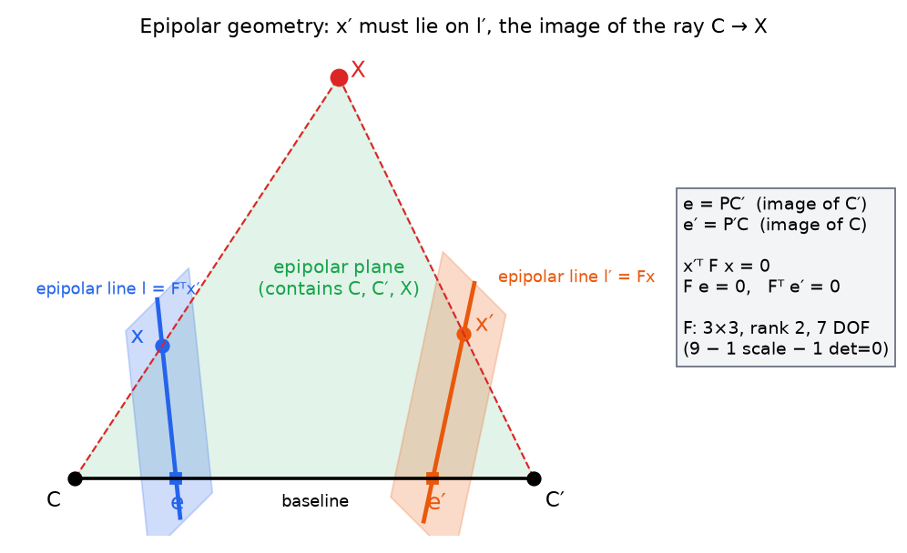
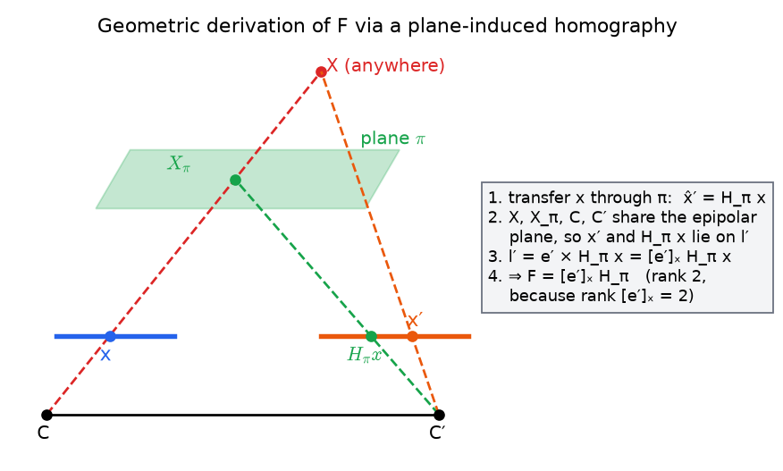
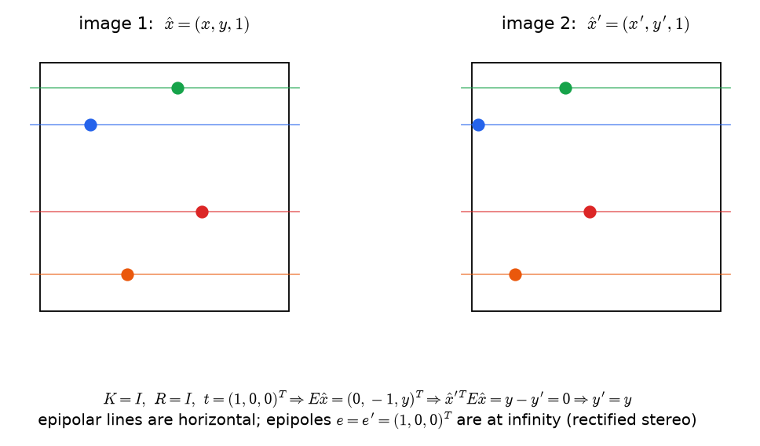
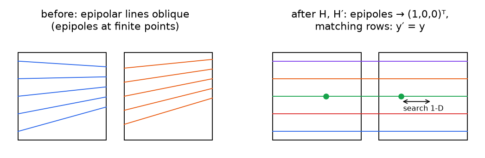
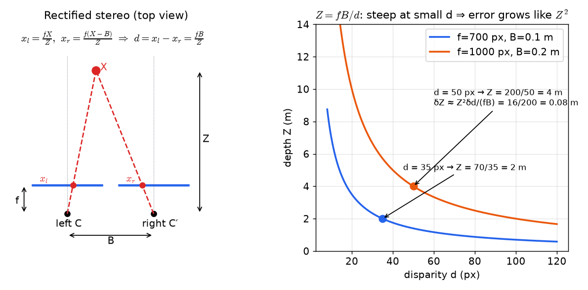
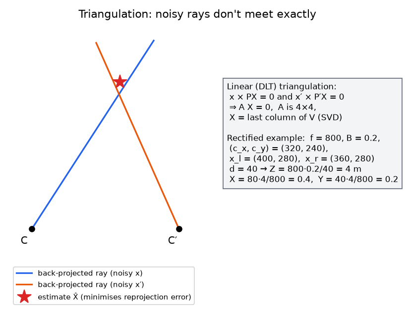
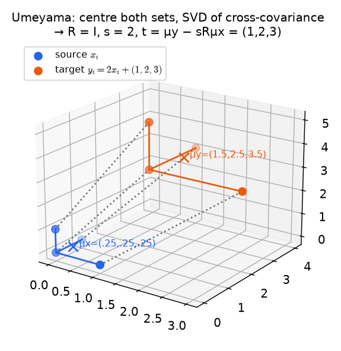

[↑ Index](README.md) · [← Previous](10_Revision_Notes_B_Camera.md) · [Next →](12_Exam2_Solutions.md)

<b>Contents</b>

- [C11. Epipolar Geometry — Definitions](#c11-epipolar-geometry--definitions)
- [C12. Fundamental Matrix $F$](#c12-fundamental-matrix-f)
- [C13. Estimating the Fundamental Matrix](#c13-estimating-the-fundamental-matrix)
- [C14. Essential Matrix $E$](#c14-essential-matrix-e)
- [C15. Comparison: Fundamental Matrix vs Essential Matrix vs Homography](#c15-comparison-fundamental-matrix-vs-essential-matrix-vs-homography)
- [C16. Rectification and Stereo Depth](#c16-rectification-and-stereo-depth)
- [C17. Triangulation](#c17-triangulation)
- [C18. Structure from Motion (SfM), Bundle Adjustment and Umeyama Alignment](#c18-structure-from-motion-sfm-bundle-adjustment-and-umeyama-alignment)
- [Part C — Assignment A4 Connections](#part-c--assignment-a4-connections)
- [Part C — Final recall sheet](#part-c--final-recall-sheet)

# PART C — TWO-VIEW GEOMETRY

**Topics 11–18 · Very high priority**

**Reference:** Hartley & Zisserman, *Multiple View Geometry*, plus your A4 SfM assignment and course study guide.

### Notation conventions

| Symbol | Meaning | Dimensions |
|---|---|---|
| $P,P'$ | First and second camera matrices | $3\times4$ |
| $C,C'$ | Homogeneous camera centres | $4\times1$ |
| $e,e'$ | Epipoles | $3\times1$ |
| $x,x'$ | Homogeneous image points | $3\times1$ |
| $l,l'$ | Epipolar lines | $3\times1$ |
| $F$ | Fundamental matrix | $3\times3$ |
| $E$ | Essential matrix | $3\times3$ |
| $H_\pi$ | Homography induced by plane $\pi$ | $3\times3$ |
| $K,K'$ | Intrinsic matrices | $3\times3$ |
| $R$ | Relative camera rotation | $3\times3$ |
| $t$ | Relative camera translation | $3\times1$ |
| $X$ | Homogeneous 3D point | $4\times1$ |
| $P^1,P^2,P^3$ | Rows of a camera matrix | $1\times4$ |
| $p_1,p_2,p_3,p_4$ | Columns of a camera matrix | $3\times1$ |

Use the calibrated-camera convention:

$$
P=K[I\mid0],\qquad P'=K'[R\mid t]
$$

The first camera defines the reference coordinate system. The second camera's coordinates satisfy $X'=RX+t$.

---

## C11. Epipolar Geometry — Definitions

### 1. Key results

- ★★★ Two cameras have centres $C,C'$, connected by the baseline.
- ★★★ Epipole $e=PC'$: image of the second camera centre in image 1.
- ★★★ Epipole $e'=P'C$: image of the first camera centre in image 2.
- ★★★ The epipolar plane contains $C,C'$ and the 3D point $X$.
- ★★★ The epipolar plane intersects the image planes in corresponding epipolar lines.
- ★★★ Every epipolar line in image 1 passes through $e$; every epipolar line in image 2 passes through $e'$.
- ★★★ The corresponding point $x'$ must lie on $l'=Fx$.
- ★★★ Epipolar geometry reduces stereo matching from a 2D search to a 1D search.
- ★★ The baseline direction projects to the epipoles.

### 2. Formulas

| Formula | Meaning | Dimensions |
|---|---|---|
| $e=PC'$ | First-image epipole | $P:3\times4,\ C':4\times1$ |
| $e'=P'C$ | Second-image epipole | $P':3\times4,\ C:4\times1$ |
| $l'=Fx$ | Epipolar line in image 2 | $F:3\times3,\ x:3\times1$ |
| $l=F^Tx'$ | Epipolar line in image 1 | $F^T:3\times3$ |
| $x'^TFx=0$ | Epipolar constraint | Scalar |
| $PC=0$ | First camera centre | $P:3\times4,\ C:4\times1$ |
| $P'C=e'$ | Second-camera projection of first centre | $3\times1$ |

### 3. Derivations

**A. Why does an epipolar plane exist?**

1. Consider two camera centres $C,C'$ and a 3D point $X$.
2. Three points define a plane, assuming a non-degenerate configuration.
3. This plane is called the epipolar plane.
4. Its intersections with the two image planes produce the epipolar lines.

$$
\boxed{\text{Epipolar plane}=(C,C',X)}
$$

**B. Why does stereo matching become 1D?**

1. A point $x$ in image 1 back-projects to a ray through $C$.
2. This ray and the baseline determine the epipolar plane.
3. The epipolar plane intersects image 2 at a line $l'$.
4. The corresponding image point $x'$ must lie on $l'$.

$$
\boxed{x'\in l'}
$$

Hence, instead of searching over the full 2D second image, search along a single line.

**C. Why do all epipolar lines pass through the epipole?**

1. Every epipolar plane contains both camera centres.
2. The second camera centre $C'$ projects to $e$ in image 1.
3. Therefore every epipolar line in image 1 passes through $e$.
4. Similarly, every line in image 2 passes through $e'$.

### 4. DOF / counting

Epipolar geometry itself describes the relationship between two views; its fundamental matrix has 7 DOF, derived in Topic C12.

No minimum number of correspondences is needed merely to define an epipolar plane for a known 3D point and two known cameras.

### 5. Worked example

Consider two rectified cameras with horizontal baseline.

Let:

$$
C=(0,0,0)^T,\qquad C'=(B,0,0)^T
$$

A point $X$ lies above the baseline.

The epipolar plane contains the horizontal baseline and $X$.

For this configuration, the epipoles are at infinity in the horizontal direction:

$$
e=e'=(1,0,0)^T
$$

Therefore all corresponding epipolar lines are horizontal.

A match with left-image coordinate:

$$
x_l=(400,280)
$$

must be searched for in the second image along:

$$
\boxed{y_r=280}
$$

Only the horizontal coordinate needs to be estimated.

### 6. Exam traps

- $e=PC'$, not $PC$.
- $e'=P'C$, not $P'C'$.
- Epipoles are projections of the opposite camera centres.
- Epipolar planes contain the baseline and the scene point.
- Epipolar lines are intersections of the epipolar plane with image planes.
- The epipole is not generally the principal point.
- Rectified images have horizontal epipolar lines, but general stereo images do not.

### 7. Likely exam questions

**Q1. Define the baseline and epipoles.**

Model answer: The baseline joins the two camera centres. The epipoles are $e=PC'$ and $e'=P'C$, the projections of the opposite camera centres into each image.

**Q2. What is an epipolar plane?**

Model answer: It is the plane containing both camera centres and a 3D scene point. Its intersections with the two image planes give corresponding epipolar lines.

**Q3. Why does epipolar geometry reduce matching complexity?**

Model answer: A point in the first image determines an epipolar line in the second image. The corresponding point must lie on that line, reducing a 2D search to 1D.

---

## C12. Fundamental Matrix $F$

### 1. Key results

- ★★★ Fundamental matrix maps an image point to its epipolar line.
- ★★★ Correspondence constraint:

$$
x'^TFx=0
$$

- ★★★ Geometric derivation:

$$
F=[e']_\times H_\pi
$$

- ★★★ Algebraic derivation:

$$
F=[e']_\times P'P^+
$$

- ★★★ Calibrated relationship:

$$
F=K'^{-T}[t]_\times RK^{-1}
$$

- ★★★ $F$ has rank 2.
- ★★★ $Fe=0$, $F^Te'=0$.
- ★★★ $F^T$ is the fundamental matrix for the reverse ordered camera pair.
- ★★★ $F$ has 7 DOF.
- ★★★ Under pure rotation, $t=0$, so $F=0$ and is undefined as a useful fundamental matrix.
- ★★ The fundamental matrix is defined up to arbitrary nonzero scale.

### 2. Formulas

#### Cross-product matrix

For $a=(a_1,a_2,a_3)^T$:

$$
\boxed{
[a]_\times=
\begin{bmatrix}
0&-a_3&a_2\\
a_3&0&-a_1\\
-a_2&a_1&0
\end{bmatrix}
}
$$

Dimensions: $[a]_\times:3\times3$.

#### Fundamental matrix

| Formula | Meaning | Dimensions |
|---|---|---|
| $l'=Fx$ | Epipolar line in view 2 | $3\times3\cdot3\times1$ |
| $l=F^Tx'$ | Epipolar line in view 1 | $3\times1$ |
| $x'^TFx=0$ | Correspondence constraint | Scalar |
| $F=[e']_\times H_\pi$ | Geometric derivation | All matrices $3\times3$ |
| $F=[e']_\times P'P^+$ | Algebraic derivation | $P':3\times4,\ P^+:4\times3$ |
| $F=K'^{-T}[t]_\times RK^{-1}$ | Calibrated formula | All matrices $3\times3$ |
| $Fe=0$ | Right null-vector condition | $3\times1$ |
| $F^Te'=0$ | Left null-vector condition | $3\times1$ |

### 3. Derivations

#### A. Geometric derivation of $F=[e']_\times H_\pi$

**Trick:** The line through two homogeneous points $a,b$ is $a\times b=[a]_\times b$.

1. Choose a 3D plane $\pi$ that does not pass through the camera centres.
2. It induces a homography between images:

$$
x'=H_\pi x
$$

3. The epipolar line $l'$ passes through the epipole $e'$ and point $x'$:

$$
l'=e'\times x'
$$

4. Replace the cross product with the skew-symmetric matrix:

$$
l'=[e']_\times x'
$$

5. Substitute the induced homography:

$$
l'=[e']_\times H_\pi x
$$

6. But by definition:

$$
l'=Fx
$$

Therefore:

$$
\boxed{F=[e']_\times H_\pi}
$$

#### B. Algebraic derivation of $F=[e']_\times P'P^+$

1. A point $x$ back-projects to a 3D ray:

$$
X(\lambda)=P^+x+\lambda C
$$

Dimensions: $P^+:4\times3,\ x:3\times1,\ C:4\times1$.

2. Project this ray into the second camera:

$$
x'(\lambda)=P'P^+x+\lambda P'C
$$

3. Recognise the second-camera epipole:

$$
e'=P'C
$$

4. The epipolar line joins points $P'P^+x$ and $e'$:

$$
l'=e'\times P'P^+x
$$

5. Use the cross-product matrix:

$$
l'=[e']_\times P'P^+x
$$

6. Compare with $l'=Fx$:

$$
\boxed{F=[e']_\times P'P^+}
$$

#### C. Derive $F=K'^{-T}[t]_\times RK^{-1}$

1. Use calibrated camera matrices:

$$
P=K[I\mid0]
$$

$$
P'=K'[R\mid t]
$$

2. Normalise image points:

$$
\hat x=K^{-1}x,\quad
\hat x'=K'^{-1}x'
$$

3. In camera 2 coordinates, the scene point is:

$$
X'=RX+t
$$

4. Coplanarity of the vectors $\hat x',Rx,t$ gives:

$$
\hat x'^T[t]_\times R\hat x=0
$$

5. Substitute the normalised coordinates:

$$
x'^TK'^{-T}[t]_\times RK^{-1}x=0
$$

6. Compare with $x'^TFx=0$.

$$
\boxed{F=K'^{-T}[t]_\times RK^{-1}}
$$

#### D. Proof that $F$ has rank 2

1. The fundamental matrix has geometric form:

$$
F=[e']_\times H_\pi
$$

2. A nonzero cross-product matrix has rank 2, because:

$$
[e']_\times e'=0
$$

3. The product cannot have rank greater than either factor:

$$
\operatorname{rank}(F)\le2
$$

4. In a non-degenerate two-view configuration, $H_\pi$ is nonsingular and $e'\ne0$.

Therefore:

$$
\boxed{\operatorname{rank}(F)=2}
$$

#### E. Epipolar properties

Starting with:

$$
l'=Fx
$$

The corresponding point satisfies:

$$
x'^Tl'=0
$$

Thus:

$$
\boxed{x'^TFx=0}
$$

The epipole lies on every epipolar line:

$$
\boxed{Fe=0,\qquad F^Te'=0}
$$

Since $F$ is rank 2:

$$
\boxed{\det(F)=0}
$$

#### F. Why does pure rotation make $F$ undefined?

1. Essential matrix:

$$
E=[t]_\times R
$$

2. Under pure rotation, there is no translation:

$$
t=0
$$

3. Hence:

$$
E=0
$$

4. Consequently:

$$
F=K'^{-T}EK^{-1}=0
$$

There is no meaningful rank-2 fundamental matrix; use the rotation-induced homography instead.

### 4. DOF / counting

A general $3\times3$ matrix has:

$$
9\text{ entries}
$$

Remove arbitrary scale:

$$
9-1=8
$$

Enforce determinant zero, one independent scalar constraint:

$$
8-1=\boxed{7\text{ DOF}}
$$

The $F$ matrix can be estimated using:
- 7-point algorithm: 7 correspondences.
- 8-point algorithm: 8 correspondences.

These are algorithm-specific minimum sample sizes.

### 5. Worked example — Horizontal baseline

Given:

$$
K=K'=I,\quad R=I,\quad t=(1,0,0)^T
$$

Calculate:

$$
[t]_\times=
\begin{bmatrix}
0&0&0\\
0&0&-1\\
0&1&0
\end{bmatrix}
$$

Therefore:

$$
F=E=[t]_\times R
$$

$$
\boxed{
F=
\begin{bmatrix}
0&0&0\\
0&0&-1\\
0&1&0
\end{bmatrix}
}
$$

For:

$$
x=(x,y,1)^T,\quad x'=(x',y',1)^T
$$

Calculate:

$$
Fx=
\begin{bmatrix}
0\\-1\\y
\end{bmatrix}
$$

Thus the epipolar line is:

$$
l'=(0,-1,y)^T
$$

Its incidence equation is:

$$
-y'+y=0
$$

Hence:

$$
\boxed{y'=y}
$$

The epipolar lines are horizontal.

### 6. Exam traps

- $F$ is point-to-line, not point-to-point.
- The right null vector is $e$, while the left null vector is $e'$.
- $F$ is rank 2, not full rank.
- Seven DOF does not automatically mean the 8-point algorithm needs seven matches.
- The geometric derivation uses a plane-induced homography, not an arbitrary homography unrelated to the scene.
- $P^+$ is $4\times3$.
- The fundamental matrix is not defined for pure rotation.
- $F^T$ reverses the ordered image pair.
- $F$ is only defined up to scale, so raw matrix entries are not unique.

### 7. Likely exam questions

**Q1. Derive $F=[e']_\times H_\pi$.**

Model answer: A plane induces $x'=H_\pi x$. The epipolar line passes through $e'$ and $x'$, so $l'=e'\times x'=[e']_\times H_\pi x$. Comparing with $l'=Fx$ yields the result.

**Q2. State five properties of $F$.**

Model answer: $x'^TFx=0$, $l'=Fx$, $l=F^Tx'$, $Fe=0$, $F^Te'=0$, and rank $F=2$. It has 7 DOF.

**Q3. Why is $F$ rank 2?**

Model answer: $F=[e']_\times H_\pi$, and $[e']_\times$ has a one-dimensional null space and rank 2. For a non-degenerate configuration, the product also has rank 2.

**Q4. What happens to $F$ under pure rotation?**

Model answer: Translation $t=0$, hence $E=[t]_\times R=0$ and $F=0$. A homography $H=KRK^{-1}$ describes the image mapping instead.

---

## C13. Estimating the Fundamental Matrix

### 1. Key results

- ★★★ Each correspondence contributes one equation $x'^TFx=0$.
- ★★★ Linear row for $x=(x,y,1)^T,\ x'=(x',y',1)^T$:

$$
[x'x,x'y,x',y'x,y'y,y',x,y,1]
$$

- ★★★ The 8-point algorithm solves $Af=0$ using SVD.
- ★★★ Enforce rank 2 by replacing the smallest singular value with zero.
- ★★★ Normalised 8-point algorithm applies Hartley normalisation separately to both images.
- ★★★ Fundamental-matrix denormalisation:

$$
F=T'^T\widetilde F T
$$

- ★★★ 7-point algorithm produces a two-dimensional null space and a cubic determinant equation.
- ★★★ The 7-point algorithm gives one or three real solutions.
- ★★★ Automatic estimation: SIFT → ratio test → RANSAC $F$ → refit on inliers.
- ★★ Sampson distance gives a first-order approximation to geometric epipolar error.
- ★★ Guided matching can search along epipolar lines.

### 2. Formulas

| Formula | Meaning | Dimensions |
|---|---|---|
| $x'^TFx=0$ | Epipolar constraint | Scalar |
| $Af=0$ | Linear estimation system | $A:n\times9,\ f:9\times1$ |
| $A=U\Sigma V^T$ | SVD | $A:n\times9$ |
| $F=U\operatorname{diag}(\sigma_1,\sigma_2,0)V^T$ | Rank-2 enforcement | $U,V:3\times3$ after $F$ SVD |
| $\widetilde x=Tx$ | First-image normalisation | $T:3\times3$ |
| $\widetilde x'=T'x'$ | Second-image normalisation | $T':3\times3$ |
| $F=T'^T\widetilde FT$ | Denormalisation | All $3\times3$ |
| $F=\alpha F_1+(1-\alpha)F_2$ | 7-point family | $F,F_1,F_2:3\times3$ |

[extra] Sampson distance squared:

$$
d_S^2=
\frac{(x'^TFx)^2}
{(Fx)_1^2+(Fx)_2^2+(F^Tx')_1^2+(F^Tx')_2^2}
$$

All image points and lines are $3\times1$.

### 3. Derivations

**A. Derive the linear row**

Let:

$$
F=
\begin{bmatrix}
f_1&f_2&f_3\\
f_4&f_5&f_6\\
f_7&f_8&f_9
\end{bmatrix}
$$

1. Start with:

$$
x'^TFx=0
$$

2. Calculate:

$$
Fx=
\begin{bmatrix}
f_1x+f_2y+f_3\\
f_4x+f_5y+f_6\\
f_7x+f_8y+f_9
\end{bmatrix}
$$

3. Multiply by $x'^T=(x',y',1)$:

$$
\begin{aligned}
0={}&x'(f_1x+f_2y+f_3)\\
&+y'(f_4x+f_5y+f_6)\\
&+(f_7x+f_8y+f_9)
\end{aligned}
$$

4. Collect the $f_i$ coefficients.

$$
\boxed{
[x'x,x'y,x',y'x,y'y,y',x,y,1]f=0
}
$$

**B. 8-point algorithm**

1. Obtain at least 8 point correspondences.
2. Construct one row per correspondence.
3. Stack rows to obtain:

$$
A\in\mathbb R^{n\times9},\quad n\ge8
$$

4. Solve:

$$
Af=0
$$

5. Use SVD:

$$
A=U_A\Sigma_AV_A^T
$$

6. Take the last right singular vector:

$$
\boxed{f=V_A[:, -1]}
$$

7. Reshape it into $F\in\mathbb R^{3\times3}$.

**C. Rank-2 enforcement**

1. Perform SVD of the estimated fundamental matrix:

$$
\widetilde F=U\operatorname{diag}(\sigma_1,\sigma_2,\sigma_3)V^T
$$

2. Noise normally makes $\sigma_3\ne0$.
3. Set $\sigma_3=0$.
4. Reconstruct:

$$
\boxed{
F=U\operatorname{diag}(\sigma_1,\sigma_2,0)V^T
}
$$

This is the closest rank-2 matrix in Frobenius norm.

**D. Derive normalised $F$ denormalisation**

**Trick:** Substitute coordinate normalisation into the epipolar equation and compare it with the original equation.

1. Normalise:

$$
\widetilde x=Tx,\qquad\widetilde x'=T'x'
$$

2. Normalised epipolar constraint:

$$
\widetilde x'^T\widetilde F\widetilde x=0
$$

3. Substitute:

$$
(T'x')^T\widetilde F(Tx)=0
$$

4. Transpose the first factor:

$$
x'^TT'^T\widetilde FTx=0
$$

5. Compare with:

$$
x'^TFx=0
$$

Therefore:

$$
\boxed{F=T'^T\widetilde FT}
$$

**E. 7-point algorithm**

1. Use seven correspondences:

$$
A\in\mathbb R^{7\times9}
$$

2. Its null space is generally two-dimensional.
3. Let the null-space basis be $f_1,f_2$, reshaped as $F_1,F_2$.
4. Every null-space matrix can be expressed as:

$$
F(\alpha)=\alpha F_1+(1-\alpha)F_2
$$

5. Enforce the determinant constraint:

$$
\det(F(\alpha))=0
$$

6. Because determinant is cubic in the matrix entries and the matrix entries are linear in $\alpha$, this gives a cubic polynomial.

$$
\boxed{\det(\alpha F_1+(1-\alpha)F_2)=0}
$$

7. Solve the polynomial; retain one or three real solutions.

**F. Automatic estimation**

1. Detect RootSIFT/SIFT features in both images.
2. Match using the descriptor ratio test.
3. Reject non-mutual matches if using a mutual check.
4. Run RANSAC with 7- or 8-point samples.
5. Use point-to-line error or Sampson distance.
6. Re-estimate $F$ using all inliers.
7. Optionally perform guided matching along epipolar lines.

### 4. DOF / counting

| Algorithm | Correspondences | Equations | Null-space dimension | Result |
|---|---:|---:|---:|---|
| 8-point | 8 | $8\times9$ | 1 | One linear solution, then rank 2 |
| 7-point | 7 | $7\times9$ | 2 | Cubic; 1 or 3 real solutions |

The fundamental matrix itself has 7 DOF.

The 8-point algorithm uses an additional correspondence for its linear formulation and estimates a least-squares solution before rank-2 enforcement.

### 5. Worked example

Suppose the estimated $F$ has SVD:

$$
F=U
\begin{bmatrix}
10&0&0\\
0&4&0\\
0&0&0.2
\end{bmatrix}V^T
$$

The singular values are:

$$
\sigma_1=10,\quad\sigma_2=4,\quad\sigma_3=0.2
$$

Set the third singular value to zero:

$$
F_{\text{new}}=
U
\begin{bmatrix}
10&0&0\\
0&4&0\\
0&0&0
\end{bmatrix}
V^T
$$

The new determinant is:

$$
\det(F_{\text{new}})=10\cdot4\cdot0=0
$$

Therefore:

$$
\boxed{\operatorname{rank}(F_{\text{new}})=2}
$$

### 6. Exam traps

- One correspondence gives one equation for $F$, unlike a homography correspondence which provides two independent DLT equations.
- The 8-point matrix is $n\times9$.
- Rank-2 enforcement is performed on $F$, not on the design matrix $A$.
- Use the smallest singular value of $F$, not the largest.
- $F=T'^T\widetilde FT$, not $T'^{-1}\widetilde FT$.
- The transpose appears because the normalised epipolar constraint has $x'^TT'^T$.
- The 7-point algorithm gives a two-dimensional null space, not one-dimensional.
- Determinant constraint in the 7-point algorithm produces a cubic.
- RANSAC should refit the matrix using the consensus set.
- The threshold in your guide is $t^2=3.84\sigma^2$ for the 1D point-to-line residual.

### 7. Likely exam questions

**Q1. Derive the row in the 8-point algorithm.**

Model answer: Expand $x'^TFx=0$ into the nine matrix entries of $F$. The coefficient row is $[x'x,x'y,x',y'x,y'y,y',x,y,1]$.

**Q2. Why enforce rank 2 after 8-point estimation?**

Model answer: Noise generally produces a full-rank matrix. Set the smallest singular value to zero in its SVD, giving the closest rank-2 matrix and enforcing the existence of epipoles.

**Q3. Derive the fundamental-matrix denormalisation.**

Model answer: Substitute $\widetilde x=Tx$, $\widetilde x'=T'x'$ into $\widetilde x'^T\widetilde F\widetilde x=0$. This gives $x'^TT'^T\widetilde FTx=0$, hence $F=T'^T\widetilde FT$.

**Q4. Explain the 7-point algorithm.**

Model answer: Seven correspondences produce a $7\times9$ system with a 2D null space spanned by $F_1,F_2$. Express $F=\alpha F_1+(1-\alpha)F_2$, then enforce $\det F=0$, giving a cubic.

---

## C14. Essential Matrix $E$

### 1. Key results

- ★★★ Essential matrix is the calibrated form of the fundamental matrix.
- ★★★ Normalised coordinates:

$$
\hat x=K^{-1}x,\quad\hat x'=K'^{-1}x'
$$

- ★★★ Essential matrix:

$$
E=[t]_\times R
$$

- ★★★ Epipolar condition:

$$
\hat x'^TE\hat x=0
$$

- ★★★ Relationship:

$$
E=K'^TFK
$$

- ★★★ Essential matrix has 5 DOF.
- ★★★ Its singular values are $(\sigma,\sigma,0)$.
- ★★★ Decomposition produces four candidate $(R,t)$ solutions.
- ★★★ Cheirality selects the physically valid solution.
- ★★★ Translation magnitude/absolute scene scale cannot be recovered from two calibrated views alone.
- ★★ Essential matrix is defined up to an arbitrary nonzero scale.

### 2. Formulas

| Formula | Meaning | Dimensions |
|---|---|---|
| $\hat x=K^{-1}x$ | Normalised first-image point | All $3\times1$ |
| $\hat x'=K'^{-1}x'$ | Normalised second-image point | All $3\times1$ |
| $E=[t]_\times R$ | Essential matrix | All $3\times3$, $t:3\times1$ |
| $\hat x'^TE\hat x=0$ | Essential constraint | Scalar |
| $E=K'^TFK$ | Convert $F$ to $E$ | All $3\times3$ |
| $E=U\Sigma V^T$ | SVD of $E$ | $3\times3$ matrices |
| $W$ | Rotation-decomposition matrix | $3\times3$ |
| $t=\pm u_3$ | Translation direction | $3\times1$ |

#### Matrix $W$

$$
\boxed{
W=
\begin{bmatrix}
0&-1&0\\
1&0&0\\
0&0&1
\end{bmatrix}
}
$$

### 3. Derivations

#### A. Deriving $E=[t]_\times R$

**Trick:** Three vectors are coplanar if their scalar triple product is zero.

1. Use first-camera normalised coordinates:

$$
X=\lambda\hat x
$$

2. Transform to the second-camera coordinate system:

$$
X'=RX+t
$$

3. Substitute:

$$
X'=\lambda R\hat x+t
$$

4. The vectors $\hat x'$, $R\hat x$ and $t$ lie in the epipolar plane.
5. Their scalar triple product is zero:

$$
\hat x'^T(t\times R\hat x)=0
$$

6. Represent the cross product using a skew-symmetric matrix:

$$
\hat x'^T[t]_\times R\hat x=0
$$

7. Compare with:

$$
\hat x'^TE\hat x=0
$$

Therefore:

$$
\boxed{E=[t]_\times R}
$$

#### B. Derive $E=K'^TFK$

1. Fundamental-matrix constraint:

$$
x'^TFx=0
$$

2. Substitute normalised image coordinates:

$$
x=K\hat x,\quad x'=K'\hat x'
$$

3. Then:

$$
(K'\hat x')^TF(K\hat x)=0
$$

4. Expand:

$$
\hat x'^TK'^TFK\hat x=0
$$

5. Compare with the essential constraint.

$$
\boxed{E=K'^TFK}
$$

#### C. DOF and singular values

1. Rotation $R$ has 3 DOF.
2. Translation $t$ has three components.
3. The magnitude of translation is not observable from two calibrated images, leaving 2 DOF for its direction.
4. Total:

$$
\boxed{3+2=5\text{ DOF}}
$$

5. Since $[t]_\times$ is rank 2 and has two equal nonzero singular values, the essential matrix has:

$$
\boxed{\sigma(E)=(\sigma,\sigma,0)}
$$

[extra] The equal nonzero singular values follow from the geometry of the skew-symmetric translation matrix and multiplication by rotation, which is orthogonal.

**Essential-matrix enforcement**

For a noisy estimate:

$$
E=U\operatorname{diag}(\sigma_1,\sigma_2,\sigma_3)V^T
$$

[extra] The closest essential matrix in Frobenius norm uses:

$$
\boxed{
E_{\text{new}}=
U
\operatorname{diag}
\left(
\frac{\sigma_1+\sigma_2}{2},
\frac{\sigma_1+\sigma_2}{2},
0
\right)V^T
}
$$

Your guide writes the scale-normalised version:

$$
\boxed{E=U\operatorname{diag}(1,1,0)V^T}
$$

Both impose the required singular-value structure, up to overall scale; the averaged version is the closest-matrix projection.

#### D. Decomposing $E$ into four solutions

1. Compute SVD:

$$
E=U\Sigma V^T
$$

2. Define:

$$
W=
\begin{bmatrix}
0&-1&0\\
1&0&0\\
0&0&1
\end{bmatrix}
$$

3. Two rotations are:

$$
R_1=UWV^T
$$

$$
R_2=UW^TV^T
$$

4. Translation direction:

$$
t=\pm u_3
$$

where $u_3$ is the third column of $U$.

5. Combine both rotation choices and both translation signs.

$$
\boxed{2\times2=4\text{ candidate poses}}
$$

[extra] Correct SVD signs if necessary so each rotation has determinant $+1$, as a physical rotation must.

#### E. Cheirality and unknown scale

1. Triangulate points using each of the four candidates.
2. Check whether the reconstructed 3D points have positive depth in both cameras.
3. Reject candidates with points behind either camera.
4. Retain the pose satisfying the cheirality condition for the reconstructed scene.

$$
\boxed{\text{Choose the pose with points in front of both cameras}}
$$

Translation is only known up to magnitude:

$$
\boxed{t\sim\lambda t}
$$

Therefore absolute metric scale cannot be recovered without additional information.

### 4. DOF / counting

| Object | DOF | Estimation note |
|---|---:|---|
| Rotation $R$ | 3 | Orthogonal matrix with determinant +1 |
| Translation direction | 2 | Unit direction in 3D |
| Essential matrix $E$ | 5 | $3+2$ |
| Fundamental matrix $F$ | 7 | General rank-2 matrix up to scale |
| Essential decomposition | 4 poses | Two rotations × two translation signs |

[extra] The calibrated five-point algorithm can estimate $E$ from five generic correspondences; it is not the 8-point algorithm applied without modification.

### 5. Worked example — Pure sideways translation

Given:

$$
R=I,\qquad t=(1,0,0)^T
$$

Compute:

$$
[t]_\times=
\begin{bmatrix}
0&0&0\\
0&0&-1\\
0&1&0
\end{bmatrix}
$$

Therefore:

$$
E=[t]_\times R
$$

$$
\boxed{
E=
\begin{bmatrix}
0&0&0\\
0&0&-1\\
0&1&0
\end{bmatrix}
}
$$

For:

$$
\hat x=(x,y,1)^T,\quad
\hat x'=(x',y',1)^T
$$

Calculate:

$$
E\hat x=
\begin{bmatrix}0\\-1\\y\end{bmatrix}
$$

Then:

$$
\hat x'^TE\hat x=-y'+y
$$

Set to zero:

$$
-y'+y=0
$$

$$
\boxed{y=y'}
$$

The epipolar lines are horizontal.

### 6. Exam traps

- $E$ operates on calibrated, normalised image coordinates.
- $F$ operates directly on pixel coordinates.
- $E=K'^TFK$, not $K^{-1}FK'^{-1}$.
- $E=[t]_\times R$, not $R[t]_\times$.
- $E$ has 5 DOF, while $F$ has 7.
- Essential singular values are $(\sigma,\sigma,0)$, not arbitrary rank-2 values.
- Four pose solutions exist before cheirality checking.
- $t$ is determined only up to scale.
- Cheirality means positive depth in both cameras, not simply choosing the first SVD solution.
- Do not confuse the direction of $t$ with the camera centre $C$; for $P'=K'[R\mid t]$, the second camera centre is $-R^Tt$ in the first camera's coordinate system.

### 7. Likely exam questions

**Q1. Derive the essential matrix.**

Model answer: In camera 2 coordinates, $X'=R(\lambda\hat x)+t$. The vectors $\hat x',R\hat x,t$ are coplanar, so their scalar triple product is zero. This gives $E=[t]_\times R$.

**Q2. Why does $E$ have 5 DOF?**

Model answer: $R$ has 3 DOF and translation direction has 2 DOF because its magnitude is unknown. Therefore $E$ has $3+2=5$ DOF.

**Q3. How do you decompose $E$?**

Model answer: Compute $E=U\Sigma V^T$. The rotations are $UWV^T$ and $UW^TV^T$, while translation is $\pm u_3$. This gives four candidates.

**Q4. What is the cheirality check?**

Model answer: Triangulate points using each candidate pose and retain the solution for which the reconstructed points are in front of both cameras.

**Q5. What information is missing from two-view calibrated reconstruction?**

Model answer: Absolute translation magnitude and thus absolute scene scale. The relative camera translation is known only up to a nonzero scale.

---

---

## C15. Comparison: Fundamental Matrix vs Essential Matrix vs Homography

### 1. Key results

- ★★★ $H$ maps image points to image points.
- ★★★ $F$ maps image points to epipolar lines in pixel coordinates.
- ★★★ $E$ maps normalised image points to epipolar lines.
- ★★★ $H$ generally has rank 3 and 8 DOF.
- ★★★ $F$ has rank 2 and 7 DOF.
- ★★★ $E$ has rank 2, singular values $(\sigma,\sigma,0)$, and 5 DOF.
- ★★★ $F$ does not require known intrinsics; $E$ requires calibration.
- ★★★ A planar scene or pure rotation can be described by $H$.
- ★★★ A general non-planar scene with translational motion requires $F$ or $E$.
- ★★ Pure rotation: use $H=KRK^{-1}$, not $F$ or $E$.

### 2. Formulas

| Property | Homography $H$ | Fundamental $F$ | Essential $E$ |
|---|---|---|---|
| Mapping | $x'\sim Hx$ | $l'=Fx$ | $\hat l'=E\hat x$ |
| Correspondence | $x'\sim Hx$ | $x'^TFx=0$ | $\hat x'^TE\hat x=0$ |
| Dimensions | $3\times3$ | $3\times3$ | $3\times3$ |
| Rank | Generally 3 | 2 | 2 |
| DOF | 8 | 7 | 5 |
| Coordinates | Image | Pixel | Normalised camera |
| Calibration | Not required | Not required | Required |
| Main use | Plane / shared centre | General two-view geometry | Calibrated two-view geometry |
| Singular values | No equal-value constraint | $(\sigma_1,\sigma_2,0)$ | $(\sigma,\sigma,0)$ |
| Typical estimation | 4-point DLT | 7- or 8-point | 5-point algorithm [extra] |

Relationships:

$$
\boxed{E=K'^TFK}
$$

$$
\boxed{F=K'^{-T}EK^{-1}}
$$

$$
\boxed{H=KRK^{-1}\quad\text{(pure rotation, same K)}}
$$

### 3. Derivations

**A. Why does $H$ map points to points?**

1. A planar scene induces a mapping between corresponding plane points.
2. Camera projection of a plane can be represented by a $3\times3$ matrix.
3. Therefore:

$$
\boxed{x'\sim Hx}
$$

**B. Why does $F$ map points to lines?**

1. A point $x$ defines an epipolar plane.
2. That plane intersects the second image in a line.
3. The line is:

$$
\boxed{l'=Fx}
$$

4. The corresponding point must satisfy:

$$
x'^TFx=0
$$

**C. Why does $E$ require calibration?**

1. Pixel coordinates contain camera-intrinsic effects.
2. Remove those effects:

$$
\hat x=K^{-1}x
$$

3. Apply the relative pose constraint:

$$
\hat x'^TE\hat x=0
$$

4. The essential matrix therefore describes relative camera pose in normalised coordinates.

$$
\boxed{E=K'^TFK}
$$

### 4. DOF / counting

| Matrix | DOF calculation | DOF | Minimum algorithm correspondences |
|---|---|---:|---:|
| $H$ | $9-1$ scale | 8 | 4 |
| $F$ | $9-1$ scale $-1$ rank constraint | 7 | 7 or 8 |
| $E$ | $3$ rotation $+2$ translation direction | 5 | 5 [extra] |

The five-point essential matrix algorithm is an additional standard result; your guide does not explicitly require its derivation.

### 5. Worked example

Suppose:

$$
K=K'=I,\quad R=I,\quad t=(1,0,0)^T
$$

Then:

$$
E=[t]_\times R
$$

$$
F=E
$$

But:

$$
H=KRK^{-1}=I
$$

Here the camera has translation but no rotation.

- $F$ and $E$ are nonzero and describe the epipolar geometry.
- $H=I$ is not a valid general mapping for the entire non-planar scene.
- The corresponding image points have equal vertical coordinates in the rectified configuration.

### 6. Exam traps

- $H,F,E$ are all $3\times3$, but their meanings differ.
- $H$: point-to-point.
- $F,E$: point-to-line.
- $E$ uses calibrated coordinates, while $F$ uses pixel coordinates.
- $E$ is more constrained than $F$.
- Both $F$ and $E$ have rank 2, but only $E$ has two equal nonzero singular values.
- A homography can explain a planar scene even with translation.
- Pure rotation does not produce a useful $F$ or $E$.
- A homography is not sufficient for an arbitrary non-planar scene with parallax.

### 7. Likely exam questions

**Q1. Compare $H,F,E$.**

Model answer: $H$ maps points to points and has 8 DOF. $F$ maps points to epipolar lines in pixel coordinates and has 7 DOF. $E$ maps normalised points to epipolar lines, requires calibration and has 5 DOF.

**Q2. State the relationship between $F$ and $E$.**

Model answer:

$$
E=K'^TFK,\qquad F=K'^{-T}EK^{-1}
$$

**Q3. When should a homography be used instead of a fundamental matrix?**

Model answer: Use a homography for a planar scene or when both views have the same camera centre. Use $F$ for general two-view geometry with translational parallax.

---

## C16. Rectification and Stereo Depth

### 1. Key results

- ★★★ Rectification applies homographies to both images to move both epipoles to infinity along the horizontal direction.
- ★★★ Rectified epipolar lines are horizontal.
- ★★★ Corresponding points have the same vertical coordinate.
- ★★★ Disparity:

$$
d=x_l-x_r
$$

- ★★★ Stereo depth:

$$
\boxed{Z=\frac{fB}{d}}
$$

- ★★★ Depth uncertainty:

$$
\boxed{\delta Z\approx\frac{Z^2}{fB}\delta d}
$$

- ★★★ Larger baseline improves depth accuracy.
- ★★★ Depth uncertainty increases quadratically with distance.
- ★★ Rectification converts correspondence search into a horizontal 1D search.

### 2. Formulas

| Formula | Meaning | Dimensions |
|---|---|---|
| $x_l^r\sim H_lx_l$ | Rectified left point | Homographies and points $3\times3,\ 3\times1$ |
| $x_r^r\sim H_rx_r$ | Rectified right point | Same |
| $y_l^r=y_r^r$ | Rectified correspondence condition | Scalars |
| $d=x_l-x_r$ | Horizontal disparity | Scalar, pixels |
| $Z=fB/d$ | Depth | $f,d$: pixels; $B,Z$: length |
| $\delta Z\approx Z^2\delta d/(fB)$ | First-order depth error | Length |

Here:

- $f$: focal length in pixels.
- $B$: baseline length.
- $d$: disparity in pixels.
- $Z$: depth.

### 3. Derivations

**A. Rectification**

1. Apply a homography $H_l$ to the left image.
2. Apply a homography $H_r$ to the right image.
3. Choose these transformations so both epipoles become:

$$
e_l^r=e_r^r=(1,0,0)^T
$$

4. Since the epipoles lie at infinity along the horizontal direction, epipolar lines become horizontal.

$$
\boxed{y_l^r=y_r^r}
$$

**B. Derive the stereo depth equation**

Assume parallel cameras with a horizontal baseline $B$.

Use:

$$
x_l=\frac{fX}{Z}
$$

The second camera is displaced by $B$:

$$
x_r=\frac{f(X-B)}{Z}
$$

Subtract:

$$
d=x_l-x_r
$$

$$
d=\frac{fX}{Z}-\frac{f(X-B)}{Z}
$$

Expand:

$$
d=\frac{fX-fX+fB}{Z}
$$

Therefore:

$$
d=\frac{fB}{Z}
$$

Rearrange:

$$
\boxed{Z=\frac{fB}{d}}
$$

**C. Derive depth uncertainty**

Start with:

$$
Z=\frac{fB}{d}
$$

Differentiate with respect to disparity:

$$
\frac{\partial Z}{\partial d}
=-\frac{fB}{d^2}
$$

For a small disparity error:

$$
|\delta Z|
\approx
\left|\frac{\partial Z}{\partial d}\right||\delta d|
$$

Thus:

$$
|\delta Z|\approx
\frac{fB}{d^2}|\delta d|
$$

Since:

$$
d=\frac{fB}{Z}
$$

we substitute:

$$
\frac{fB}{d^2}=\frac{Z^2}{fB}
$$

Therefore:

$$
\boxed{
|\delta Z|\approx\frac{Z^2}{fB}|\delta d|
}
$$

### 4. DOF / counting

Rectification uses two image homographies, each $3\times3$, defined up to scale.

Each unconstrained homography has 8 DOF.

In practice, rectifying transformations are chosen subject to constraints that align the epipolar lines; their effective parameterisation depends on the rectification method.

Stereo depth is determined once:
- Intrinsics are known.
- Baseline is known.
- Corresponding points are matched.
- Their disparity is nonzero.

### 5. Worked example

Given:

$$
f=1000\text{ px}
$$

$$
B=0.2\text{ m}
$$

$$
d=50\text{ px}
$$

**Step 1. Depth**

$$
Z=\frac{fB}{d}
$$

$$
=\frac{1000(0.2)}{50}
$$

$$
=\frac{200}{50}
$$

$$
\boxed{Z=4\text{ m}}
$$

**Step 2. Error for 1-pixel disparity error**

$$
\delta Z\approx
\frac{Z^2}{fB}\delta d
$$

$$
=\frac{4^2}{1000(0.2)}(1)
$$

$$
=\frac{16}{200}
$$

$$
\boxed{\delta Z=0.08\text{ m}}
$$

The depth estimate is approximately 4 m with a first-order uncertainty of 8 cm for a one-pixel disparity error.

### 6. Exam traps

- Disparity is horizontal coordinate difference after rectification.
- $d=x_l-x_r$ in the guide's convention.
- Use focal length in pixels, not metres.
- Baseline must use the same length unit as the requested depth.
- Larger disparity corresponds to smaller depth.
- Larger baseline reduces depth uncertainty.
- Depth error grows as $Z^2$.
- Rectification does not directly calculate depth; it simplifies correspondence matching.
- Do not confuse rectification homographies with the physical camera pose.

### 7. Likely exam questions

**Q1. What is stereo rectification?**

Model answer: Apply image homographies that move both epipoles to infinity along the horizontal direction. Corresponding epipolar lines then become horizontal, so matches have equal vertical coordinates.

**Q2. Derive $Z=fB/d$.**

Model answer: For parallel cameras, $x_l=fX/Z$ and $x_r=f(X-B)/Z$. Subtraction gives $d=fB/Z$, hence $Z=fB/d$.

**Q3. Derive disparity-induced depth error.**

Model answer: Differentiate $Z=fB/d$: $\partial Z/\partial d=-fB/d^2$. Using $d=fB/Z$, its absolute first-order error becomes $\delta Z\approx Z^2\delta d/(fB)$.

**Q4. How does baseline affect depth accuracy?**

Model answer: Increasing $B$ decreases disparity-induced depth uncertainty, since $\delta Z\propto1/B$. A very small baseline creates poorly conditioned depth estimates.

---

## C17. Triangulation

### 1. Key results

- ★★★ Triangulation estimates a 3D point from corresponding image observations and known camera matrices.
- ★★★ Each image observation defines a 3D ray from the camera centre.
- ★★★ Under noise, back-projected rays generally do not intersect exactly.
- ★★★ Linear triangulation starts from:

$$
x\times PX=0
$$

- ★★★ Each view gives two independent DLT rows.
- ★★★ Two views produce a $4\times4$ homogeneous system.
- ★★★ The 3D solution is the last right singular vector, then dehomogenised.
- ★★★ Midpoint method uses the midpoint of the closest points on two rays.
- ★★★ Optimal triangulation minimises reprojection error.
- ★★★ Small baseline or small ray-intersection angle gives poor depth accuracy.

### 2. Formulas

Let the camera matrix be:

$$
P=
\begin{bmatrix}
p_1^T\\
p_2^T\\
p_3^T
\end{bmatrix}
$$

where each row is $1\times4$.

| Formula | Meaning | Dimensions |
|---|---|---|
| $x\times PX=0$ | Image-to-3D correspondence constraint | $x:3\times1,\ P:3\times4,\ X:4\times1$ |
| $(up_3^T-p_1^T)X=0$ | First DLT equation | Row $1\times4$ |
| $(vp_3^T-p_2^T)X=0$ | Second DLT equation | Row $1\times4$ |
| $AX=0$ | Combined two-view system | $A:4\times4,\ X:4\times1$ |
| $X=V[:, -1]$ | SVD homogeneous solution | $4\times1$ |
| $\min_X\sum_i\Vert x_i-\pi(P_iX)\Vert ^2$ | Optimal reprojection triangulation | Scalar objective |

### 3. Derivations

**A. Derive the DLT triangulation rows**

1. Start with:

$$
x\times PX=0
$$

2. Let:

$$
x=(u,v,1)^T
$$

3. Write:

$$
PX=
\begin{bmatrix}
p_1^TX\\p_2^TX\\p_3^TX
\end{bmatrix}
$$

4. Expanding the cross product gives three equations, of which two are independent:

$$
up_3^TX-p_1^TX=0
$$

$$
vp_3^TX-p_2^TX=0
$$

5. Rearrange:

$$
\boxed{(up_3^T-p_1^T)X=0}
$$

$$
\boxed{(vp_3^T-p_2^T)X=0}
$$

**B. Construct the two-view system**

1. First camera gives two rows.
2. Second camera gives two more rows.
3. Stack all four rows:

$$
\boxed{AX=0}
$$

where $A$ is $4\times4$.

4. Compute:

$$
A=U\Sigma V^T
$$

5. Find the right singular vector corresponding to the smallest singular value.

$$
\boxed{X=V[:, -1]}
$$

6. Dehomogenise:

$$
(X,Y,Z,W)^T
\mapsto
(X/W,Y/W,Z/W)
$$

**C. Midpoint method**

1. Back-project the observed point from each camera into a 3D ray.
2. Write the two rays:

$$
X_1(\lambda)=C_1+\lambda d_1
$$

$$
X_2(\mu)=C_2+\mu d_2
$$

3. In noisy data, the two rays usually do not intersect.
4. Find the closest pair of points, one on each ray.
5. Return their midpoint.

$$
\boxed{
X_{\text{mid}}=\frac{X_1^*+X_2^*}{2}
}
$$

**D. Optimal triangulation**

1. Start with an initial triangulated estimate.
2. Project the estimated 3D point into each camera.
3. Compare predicted image coordinates with observations.
4. Minimise total squared reprojection error.

$$
\boxed{
X^*=
\arg\min_X
\sum_i\|x_i-\pi(P_iX)\|^2
}
$$

This is a nonlinear optimisation problem.

**E. Why does a small baseline cause bad triangulation?**

1. Each image observation defines a ray.
2. A small baseline produces rays with a small intersection angle for distant points.
3. Small image-coordinate errors then produce large changes in the estimated 3D intersection.
4. Depth becomes poorly constrained.

$$
\boxed{\text{Small triangulation angle}\Rightarrow\text{large depth uncertainty}}
$$

### 4. DOF / counting

A finite 3D point has 3 Cartesian DOF.

Each image correspondence contributes two independent equations.

Two views give:

$$
2+2=4\text{ equations}
$$

Thus, a generic pair of views is sufficient for triangulation when the camera matrices are known and the rays are not degenerate.

This is not the same as estimating a camera matrix: the cameras are assumed known here.

### 5. Worked example

Use rectified parallel cameras:

$$
f=800\text{ px},\quad B=0.2\text{ m}
$$

Principal point:

$$
(c_x,c_y)=(320,240)
$$

Observed left point:

$$
x_l=(400,280)
$$

Observed right point:

$$
x_r=(360,280)
$$

**Step 1. Calculate disparity**

$$
d=400-360=40\text{ px}
$$

**Step 2. Calculate depth**

$$
Z=\frac{800(0.2)}{40}
$$

$$
\boxed{Z=4\text{ m}}
$$

**Step 3. Calculate X**

$$
X=\frac{(u_l-c_x)Z}{f}
$$

$$
=\frac{(400-320)(4)}{800}
$$

$$
=\frac{320}{800}
$$

$$
\boxed{X=0.4\text{ m}}
$$

**Step 4. Calculate Y**

$$
Y=\frac{(v_l-c_y)Z}{f}
$$

$$
=\frac{(280-240)(4)}{800}
$$

$$
=\frac{160}{800}
$$

$$
\boxed{Y=0.2\text{ m}}
$$

The estimated point is:

$$
\boxed{X_{\text{3D}}=(0.4,0.2,4)^T}
$$

Check the right image coordinate:

$$
u_r=320+\frac{800(0.4-0.2)}4
$$

$$
=320+40=360
$$

The observation is consistent.

### 6. Exam traps

- Triangulation assumes camera matrices and image correspondences are available.
- It is different from camera resectioning.
- Each camera contributes two independent linear equations.
- The triangulation matrix is $4\times4$ for two views.
- Use the last right singular vector.
- Dehomogenise the final point.
- Midpoint triangulation is not the same as optimal reprojection triangulation.
- Small baseline creates small triangulation angles and weak depth accuracy.
- The camera centre and ray direction must use the same coordinate frame.

### 7. Likely exam questions

**Q1. Derive the linear triangulation equations.**

Model answer: Starting from $x\times PX=0$, with $x=(u,v,1)^T$, retain two equations: $(up_3^T-p_1^T)X=0$ and $(vp_3^T-p_2^T)X=0$. Stack both cameras' equations into a $4\times4$ system.

**Q2. How is the DLT triangulation solution obtained?**

Model answer: Construct $AX=0$, compute SVD $A=U\Sigma V^T$, take the last right singular vector, and dehomogenise.

**Q3. Compare midpoint and optimal triangulation.**

Model answer: Midpoint triangulation takes the midpoint of the shortest segment between the two back-projected rays. Optimal triangulation minimises reprojection error over the reconstructed point.

**Q4. Why is a small baseline problematic?**

Model answer: The viewing rays meet at a small angle. Image noise produces a large uncertainty in their estimated intersection, particularly in depth.

---

---

## C18. Structure from Motion (SfM), Bundle Adjustment and Umeyama Alignment

### 1. Key results

- ★★★ Structure from Motion jointly estimates camera poses and 3D scene structure from multiple images.
- ★★★ A4 pipeline: image retrieval → feature matching → geometric verification → camera pose estimation → triangulation → bundle adjustment.
- ★★★ RootSIFT features are matched using a ratio test and mutual check.
- ★★★ RANSAC on $F$ verifies geometrically consistent image matches.
- ★★★ Query expansion discovers additional related image pairs.
- ★★★ Connected components identify separate image reconstruction groups.
- ★★★ $H/F$ inlier ratio near 1 indicates little useful parallax (planar scene or pure rotation).
- ★★★ Essential matrix decomposition gives relative camera pose, followed by triangulation.
- ★★★ PnP/resectioning adds further cameras.
- ★★★ Bundle adjustment minimises total reprojection error.
- ★★★ Uncalibrated reconstruction is ambiguous up to a 3D projective transformation (15 DOF).
- ★★★ Calibrated reconstruction is ambiguous up to a similarity transformation (7 DOF).
- ★★★ Umeyama alignment estimates scale, rotation and translation.
- ★★ Bundle adjustment is commonly solved using Levenberg–Marquardt.

### 2. Formulas

#### Bundle adjustment

$$
\boxed{
\min_{\{P_i\},\{X_j\}}
\sum_{i,j}
\|x_{ij}-\pi(P_iX_j)\|^2
}
$$

Dimensions:

- $P_i:3\times4$.
- $X_j:4\times1$.
- $P_iX_j:3\times1$.
- $\pi(P_iX_j):2\times1$.
- $x_{ij}:2\times1$.

Here $i$ indexes cameras and $j$ indexes 3D points.

#### Similarity alignment

$$
\boxed{y_i=sRx_i+t}
$$

| Symbol | Meaning | Dimensions |
|---|---|---|
| $x_i$ | Source 3D point | $3\times1$ |
| $y_i$ | Target 3D point | $3\times1$ |
| $R$ | Alignment rotation | $3\times3$ |
| $s$ | Uniform scale | Scalar |
| $t$ | Translation | $3\times1$ |

Objective:

$$
\min_{s,R,t}\sum_i\|y_i-(sRx_i+t)\|^2
$$

#### Umeyama formulas

Centroids:

$$
\mu_x=\frac1n\sum_i x_i,\qquad
\mu_y=\frac1n\sum_i y_i
$$

Covariance:

$$
\boxed{
\Sigma=
\frac1n\sum_i
(y_i-\mu_y)(x_i-\mu_x)^T
}
$$

$$
\Sigma=UDV^T
$$

Reflection correction:

$$
\boxed{
S=\operatorname{diag}(1,1,\det(UV^T))
}
$$

Rotation:

$$
\boxed{R=USV^T}
$$

Scale:

$$
\boxed{s=\frac{\operatorname{tr}(DS)}{\sigma_x^2}}
$$

Translation:

$$
\boxed{t=\mu_y-sR\mu_x}
$$

Here:

- $\Sigma,U,D,V,S,R:3\times3$.
- $\mu_x,\mu_y,t:3\times1$.
- $\sigma_x^2$: scalar source variance, defined as $\frac1n\sum_i\|x_i-\mu_x\|^2$.
- $s$: scalar.

### 3. Derivations

#### A. SfM pipeline

**Step 1. Camera calibration**

- Load images.
- Obtain $K$ from EXIF metadata or estimate focal length.
- Your guide gives the heuristic $f\approx1.2\times$ the longer image dimension.

**Step 2. Feature extraction**

- Extract RootSIFT features.
- Convert descriptors into visual words.

**Step 3. Image retrieval**

- Calculate tf-idf representations.
- Retrieve top-$k$ similar images.
- Reduce the number of image pairs that need matching.

**Step 4. Feature matching**

- Use descriptor ratio test.
- Apply mutual consistency check.

**Step 5. Geometric verification**

- Estimate $F$ using RANSAC.
- Keep geometrically consistent image pairs.
- Course guide uses at least 20 inliers.

**Step 6. Image graph**

- Perform query expansion (friends of friends).
- Build the image matching graph.
- Find connected components.

**Step 7. Initial camera reconstruction**

1. Select image pairs with sufficient parallax.
2. Estimate:

$$
E=K'^TFK
$$

3. Decompose $E$ into $R,t$.
4. Apply cheirality.
5. Triangulate 3D points.

**Step 8. Add cameras**

Use camera resectioning/PnP to estimate additional camera poses using known 3D–2D correspondences.

Triangulate additional points.

**Step 9. Bundle adjustment**

Jointly refine all camera and 3D point parameters.

#### B. Derivation of bundle adjustment objective

1. Suppose there are $m$ cameras and $n$ 3D points.
2. Camera $i$ observes point $j$ at image location $x_{ij}$.
3. The predicted location is:

$$
\hat x_{ij}=\pi(P_iX_j)
$$

4. The residual is:

$$
r_{ij}=x_{ij}-\hat x_{ij}
$$

5. Sum squared residuals over all observations:

$$
\boxed{
E=\sum_{i,j}\|x_{ij}-\pi(P_iX_j)\|^2
}
$$

6. Optimise camera parameters and 3D point coordinates simultaneously, usually with Levenberg–Marquardt.

#### C. Derivation of reconstruction ambiguity

**Uncalibrated reconstruction**

1. Camera matrices and 3D points are estimated without fixed Euclidean calibration.
2. A projective transformation $H_{3D}$ can be applied to the entire reconstruction:

$$
X_j'=H_{3D}X_j
$$

3. Transform the cameras correspondingly:

$$
P_i'=P_iH_{3D}^{-1}
$$

4. The image projections remain unchanged:

$$
P_i'X_j'=P_iH_{3D}^{-1}H_{3D}X_j=P_iX_j
$$

Therefore:

$$
\boxed{\text{Uncalibrated reconstruction is defined up to a 3D projective transformation}}
$$

There are 15 DOF in this transformation.

**Calibrated reconstruction**

With known camera intrinsics, the remaining gauge freedom is a similarity transformation:

$$
\boxed{X'=sRX+t}
$$

Its DOF are:

$$
1+3+3=\boxed{7}
$$

#### D. Derivation/steps of Umeyama alignment

**Objective:**

$$
\min_{s,R,t}
\sum_i\|y_i-(sRx_i+t)\|^2
$$

**Step 1. Calculate centroids**

$$
\mu_x=\frac1n\sum_i x_i
$$

$$
\mu_y=\frac1n\sum_i y_i
$$

Reason: Remove the translation component by centring both point sets.

**Step 2. Calculate covariance**

$$
\Sigma=
\frac1n\sum_i(y_i-\mu_y)(x_i-\mu_x)^T
$$

Reason: Capture the relationship between the centred point configurations.

**Step 3. Compute SVD**

$$
\Sigma=UDV^T
$$

Reason: Obtain the corresponding principal directions.

**Step 4. Correct for reflections**

$$
S=\operatorname{diag}(1,1,\det(UV^T))
$$

Reason: Ensure the solution represents a proper rotation rather than an unintended reflection.

**Step 5. Estimate rotation**

$$
\boxed{R=USV^T}
$$

**Step 6. Estimate scale**

$$
\boxed{s=\frac{\operatorname{tr}(DS)}{\sigma_x^2}}
$$

Reason: Match the variance of the centred point sets.

**Step 7. Estimate translation**

$$
\boxed{t=\mu_y-sR\mu_x}
$$

Reason: Restore the target centroid after scaling and rotation.

### 4. DOF / counting

| Reconstruction | Ambiguity | DOF |
|---|---|---:|
| Uncalibrated | 3D projective transformation | 15 |
| Calibrated | Similarity transformation | 7 |
| Similarity alignment | Scale + rotation + translation | 7 |

The similarity ambiguity consists of:

- Scale: 1.
- Rotation: 3.
- Translation: 3.

### 5. Worked example — Umeyama alignment

Suppose we have four 3D points and their corresponding target points.

The target set is generated using:

$$
y_i=2x_i+
\begin{bmatrix}1\\2\\3\end{bmatrix}
$$

The source points are:

$$
x_1=(0,0,0)^T
$$

$$
x_2=(1,0,0)^T
$$

$$
x_3=(0,1,0)^T
$$

$$
x_4=(0,0,1)^T
$$

Target points:

$$
y_1=(1,2,3)^T
$$

$$
y_2=(3,2,3)^T
$$

$$
y_3=(1,4,3)^T
$$

$$
y_4=(1,2,5)^T
$$

**Step 1. Source centroid**

$$
\mu_x=
\frac14
\begin{bmatrix}
1\\1\\1
\end{bmatrix}
=
\begin{bmatrix}
0.25\\0.25\\0.25
\end{bmatrix}
$$

**Step 2. Target centroid**

$$
\mu_y=
\frac14
\begin{bmatrix}
6\\10\\14
\end{bmatrix}
=
\begin{bmatrix}
1.5\\2.5\\3.5
\end{bmatrix}
$$

**Step 3. Covariance**

Since the target points follow:

$$
y_i-\mu_y=2(x_i-\mu_x)
$$

we obtain:

$$
\Sigma=2\Sigma_x
$$

It is symmetric positive semidefinite, so $U=V$ can be chosen, and:

$$
S=I
$$

**Step 4. Rotation**

$$
R=UV^T=I
$$

**Step 5. Scale**

The source variance is:

$$
\sigma_x^2=0.5625
$$

The trace of the covariance is:

$$
\operatorname{tr}(D)=1.125
$$

Therefore:

$$
s=\frac{1.125}{0.5625}=2
$$

**Step 6. Translation**

$$
t=\mu_y-sR\mu_x
$$

$$
=
\begin{bmatrix}1.5\\2.5\\3.5\end{bmatrix}
-
2
\begin{bmatrix}0.25\\0.25\\0.25\end{bmatrix}
$$

$$
=\begin{bmatrix}1\\2\\3\end{bmatrix}
$$

Final result:

$$
\boxed{
s=2,\quad R=I,\quad t=(1,2,3)^T
}
$$

The recovered alignment exactly matches the transformation used to create the target points.

### 6. Exam traps

- SfM estimates camera poses and scene structure together.
- Image retrieval is not geometric verification; retrieval finds candidates, while RANSAC validates matches.
- Feature matching alone does not prove that points correspond to the same 3D location.
- Use $F$ for uncalibrated geometric verification and $E$ when intrinsics are known.
- A low $H/F$ inlier ratio suggests useful parallax; a ratio near 1 suggests a planar or rotation-dominated pair.
- Bundle adjustment optimises both cameras and 3D points.
- Bundle adjustment minimises reprojection error, not the DLT algebraic error.
- Uncalibrated ambiguity is projective (15 DOF); calibrated ambiguity is similarity (7 DOF).
- Umeyama must correct for reflections.
- Do not interchange the covariance orientation: this solution uses $(y-\mu_y)(x-\mu_x)^T$.
- The Umeyama scale formula uses the source variance $\sigma_x^2$.

### 7. Likely exam questions

**Q1. Explain the complete SfM pipeline.**

Model answer: Extract RootSIFT features, retrieve image pairs using tf-idf, match descriptors, verify matches with RANSAC on $F$, construct the image graph, recover pose from $E$, triangulate points, add cameras using PnP and refine using bundle adjustment.

**Q2. What does bundle adjustment minimise?**

Model answer: The sum of squared reprojection errors across all observed camera-point pairs:

$$
\sum_{i,j}\|x_{ij}-\pi(P_iX_j)\|^2
$$

It jointly optimises camera parameters and 3D points.

**Q3. Explain the ambiguity in calibrated and uncalibrated SfM.**

Model answer: Uncalibrated reconstruction is determined up to a 4×4 projective transformation (15 DOF). Calibrated reconstruction is determined up to a similarity transformation (7 DOF).

**Q4. What is the purpose of Umeyama alignment?**

Model answer: It aligns two 3D point clouds by estimating the optimal uniform scale, rotation and translation using their centroids and cross-covariance SVD.

**Q5. Why does A4 compare homography and fundamental-matrix inliers?**

Model answer: A homography can explain planar or rotation-dominated views. If its inlier count is close to the fundamental matrix's inlier count, the pair may have insufficient parallax for reliable 3D reconstruction.

---

## Part C — Assignment A4 Connections

This table is important because several exam questions can connect theoretical methods to implementation.

| A4 function | Concept | What to remember |
|---|---|---|
| `tfidf_matrix` | Visual-word representation | Image retrieval |
| `top_k_neighbours` | Candidate image retrieval | Select likely overlapping images |
| `match_descriptors` | Feature correspondence | Ratio test + mutual check |
| `query_expansion` | Retrieval refinement | Friends of friends |
| `connected_components` | Image graph | Identify reconstruction groups |
| `homography_dlt` | Normalised homography estimation | SVD + denormalisation |
| `homography_ratio` | Parallax heuristic | Compare H and F inlier counts |
| `triangulate_points` | 3D point reconstruction | Linear DLT |
| `umeyama` | Similarity alignment | Scale, rotation and translation |

**Your implementation-specific exam reminder:**

Your `homography_dlt` uses `np.std` for normalisation, whereas textbook Hartley normalisation uses:

$$
\boxed{
s=\frac{\sqrt2}{\text{mean Euclidean distance from centroid}}
}
$$

In a theoretical question, write the Hartley rule.

---

## Part C — Final recall sheet

> **Fundamental matrix**
>
> $$
> l'=Fx,\quad l=F^Tx'
> $$
>
> $$
> x'^TFx=0
> $$
>
> $$
> F=[e']_\times H_\pi
> $$
>
> $$
> F=[e']_\times P'P^+
> $$
>
> $$
> F=K'^{-T}[t]_\times RK^{-1}
> $$
>
> $$
> Fe=0,\quad F^Te'=0
> $$
>
> $$
> DOF(F)=7,\quad\operatorname{rank}(F)=2
> $$
>
> **8-point / 7-point**
>
> $$
> Af=0,\quad f=V[:, -1]
> $$
>
> $$
> F=T'^T\widetilde FT
> $$
>
> **Essential matrix**
>
> $$
> E=[t]_\times R
> $$
>
> $$
> E=K'^TFK
> $$
>
> $$
> DOF(E)=5,\quad\sigma(E)=(\sigma,\sigma,0)
> $$
>
> $$
> R=UWV^T\text{ or }UW^TV^T,\quad t=\pm u_3
> $$
>
> **Stereo**
>
> $$
> Z=\frac{fB}{d}
> $$
>
> $$
> \delta Z\approx\frac{Z^2}{fB}\delta d
> $$
>
> **Triangulation**
>
> $$
> AX=0,\quad A:4\times4
> $$
>
> $$
> X=V[:, -1]
> $$
>
> **Bundle adjustment**
>
> $$
> \min\sum_{i,j}\|x_{ij}-\pi(P_iX_j)\|^2
> $$
>
> **Umeyama**
>
> $$
> R=USV^T
> $$
>
> $$
> s=\frac{\operatorname{tr}(DS)}{\sigma_x^2}
> $$
>
> $$
> t=\mu_y-sR\mu_x
> $$

**Part C complete — Topics 11–18**

Say **continue** for **Part D — Motion (Topics 19–21)**, covering brightness constancy, aperture problem, complete Horn–Schunck derivation, Lucas–Kanade, and your A3 implementation.

---

[↑ Index](README.md) · [← Previous](10_Revision_Notes_B_Camera.md) · [Next →](12_Exam2_Solutions.md)
