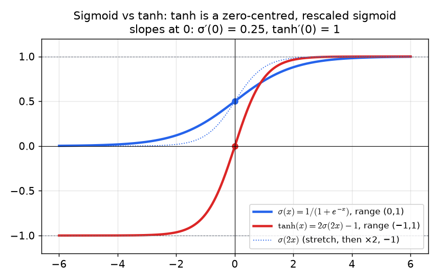
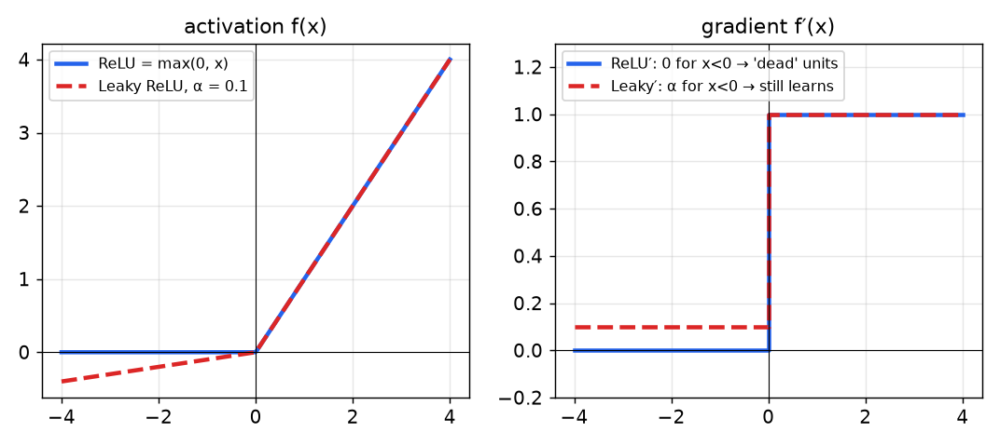
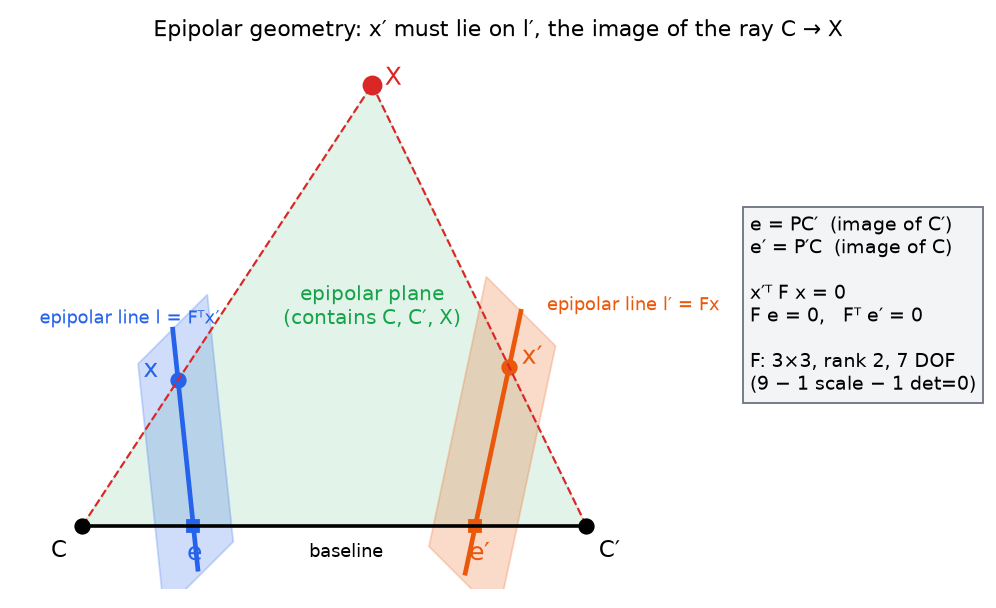
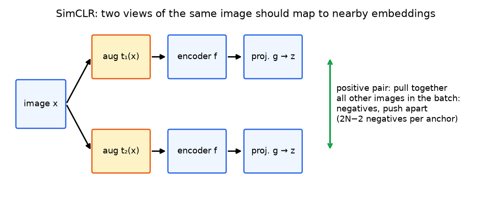

# Examination 2: Worked Solutions

[↑ Index](README.md) · [← Previous](11_Revision_Notes_C_Two_View_Geometry.md)

I’ll solve all six in an exam-ready format. For Q1, I’ll state the layer dimensions explicitly, since the parameter count depends on the image size, channel count, and hidden/output dimensions.

Below are exam-ready answers for all six questions. I have included the key equations, derivations, and explanations needed for a 5-mark answer.

---

### Q1. Calculate the number of trainable parameters in a fully connected layer, a convolutional layer, and a self-attention layer.

Let the input image have dimensions:

$$
H\times W\times C
$$

where $H,W$ are image height and width, and $C$ is the number of channels.

#### (a) Fully connected layer

Flatten the input image into a vector:

$$
N_{\text{in}}=HWC
$$

Suppose the layer has $N_{\text{out}}$ output neurons.

Each output neuron has $N_{\text{in}}$ weights and one bias.

Therefore:

$$
\boxed{P_{\text{FC}}=N_{\text{in}}N_{\text{out}}+N_{\text{out}}}
$$

If the output has the same dimensions as the input, then $N_{\text{out}}=HWC$:

$$
\boxed{P_{\text{FC}}=(HWC)^2+HWC}
$$

#### (b) Convolutional layer

Suppose the convolution uses:

- Kernel size $k_h\times k_w$
- $C_{\text{in}}$ input channels
- $C_{\text{out}}$ output channels

Each output channel has a kernel connected to every input channel.

Number of weights:

$$
k_hk_wC_{\text{in}}C_{\text{out}}
$$

Number of biases:

$$
C_{\text{out}}
$$

Thus:

$$
\boxed{P_{\text{Conv}}=k_hk_wC_{\text{in}}C_{\text{out}}+C_{\text{out}}}
$$

**Important:** The same convolutional filter is reused at every spatial location. Therefore, the number of parameters does not depend on image height or width.

#### (c) Self-attention layer

Consider an image represented as $N$ tokens, each having an embedding dimension $d$.

$$
X\in\mathbb{R}^{N\times d}
$$

The self-attention layer learns four projection matrices:

$$
W_Q,W_K,W_V,W_O\in\mathbb{R}^{d\times d}
$$

These generate queries, keys and values, followed by an output projection.

Number of weights:

$$
4d^2
$$

With one bias vector of dimension $d$ for each projection:

$$
\boxed{P_{\text{Attention}}=4d^2+4d}
$$

This is the standard multi-head attention parameter count when the total embedding dimension remains $d$.

The attention operation is:

$$
Q=XW_Q,\quad K=XW_K,\quad V=XW_V
$$

$$
\boxed{\operatorname{Attention}(Q,K,V)
=\operatorname{softmax}\left(\frac{QK^T}{\sqrt{d_k}}\right)V}
$$

#### Comparison

| Layer | Trainable parameters |
|---|---:|
| Fully connected | $N_{\text{in}}N_{\text{out}}+N_{\text{out}}$ |
| Convolutional | $k_hk_wC_{\text{in}}C_{\text{out}}+C_{\text{out}}$ |
| Self-attention | $4d^2+4d$ |

**Exam point:** Self-attention's parameter count does not depend on the number of tokens $N$, but its attention computation and memory generally scale quadratically with $N$.

The question does not specify the image dimensions, kernel size, number of output channels, or embedding dimension. Therefore, a unique numerical answer is not possible; the expressions above are the general calculation.

---

### Q2(a). Deduce the relation between tanh and Sigmoid activation functions and sketch both functions.

#### Step 1: Write the definitions

Sigmoid:

$$
\sigma(x)=\frac{1}{1+e^{-x}}
$$

Hyperbolic tangent:

$$
\tanh(x)=\frac{e^x-e^{-x}}{e^x+e^{-x}}
$$

#### Step 2: Derive their relationship

Starting with:

$$
2\sigma(2x)-1
$$

Substituting the sigmoid definition:

$$
=\frac{2}{1+e^{-2x}}-1
$$

$$
=\frac{2-(1+e^{-2x})}{1+e^{-2x}}
$$

$$
=\frac{1-e^{-2x}}{1+e^{-2x}}
$$

Multiplying numerator and denominator by $e^x$:

$$
=\frac{e^x-e^{-x}}{e^x+e^{-x}}
$$

Therefore:

$$
\boxed{\tanh(x)=2\sigma(2x)-1}
$$

#### Step 3: Compare the functions

| Property | Sigmoid | Tanh |
|---|---|---|
| Range | $(0,1)$ | $(-1,1)$ |
| At $x=0$ | $0.5$ | $0$ |
| Zero-centred | No | Yes |
| Derivative | $\sigma(x)(1-\sigma(x))$ | $1-\tanh^2(x)$ |

**Conclusion:** Tanh is a scaled and shifted sigmoid function. It is zero-centred, which can be beneficial for optimization.

---

### Q2(b). What is the advantage of using Leaky ReLU instead of ReLU?

#### ReLU

$$
f(x)=\max(0,x)
$$

$$
f(x)=
\begin{cases}
x & x>0\\
0 & x\leq 0
\end{cases}
$$

Its derivative is:

$$
f'(x)=
\begin{cases}
1 & x>0\\
0 & x<0
\end{cases}
$$

For negative inputs, the gradient is zero.

This can cause the **dying ReLU problem**: neurons may become inactive and stop learning because they receive zero gradients.

#### Leaky ReLU

Leaky ReLU allows a small negative slope:

$$
\boxed{
f(x)=
\begin{cases}
x & x\geq 0\\
\alpha x & x<0
\end{cases}
}
$$

where $0<\alpha\ll1$, for example $\alpha=0.01$.

Its derivative is:

$$
f'(x)=
\begin{cases}
1 & x>0\\
\alpha & x<0
\end{cases}
$$

#### Advantages

1. **Avoids dying ReLU:** Negative inputs have a non-zero gradient.
2. **Allows learning for negative inputs:** Neurons can still update their weights.
3. **Reduces inactive neurons:** More neurons can contribute to learning.
4. **Computationally efficient:** It is still a simple piecewise-linear function.

**Conclusion:** Leaky ReLU addresses the zero-gradient problem of standard ReLU for negative inputs by allowing a small gradient $\alpha$.

---

### Q3. Derive the relation between the Fundamental Matrix and Essential Matrix. Calculate their degrees of freedom.

#### Step 1: Epipolar constraint

For corresponding image points $x$ and $x'$:

$$
\boxed{x'^TFx=0}
$$

Here, $F$ is the Fundamental Matrix.

It relates points in two uncalibrated image coordinate systems.

#### Step 2: Convert image coordinates into normalized camera coordinates

Let the intrinsic calibration matrices of the two cameras be $K$ and $K'$.

Normalized image coordinates are:

$$
\hat{x}=K^{-1}x
$$

$$
\hat{x}'=K'^{-1}x'
$$

#### Step 3: Write the epipolar constraint in normalized coordinates

For calibrated cameras, the Essential Matrix $E$ gives:

$$
\hat{x}'^TE\hat{x}=0
$$

The Essential Matrix is defined by:

$$
\boxed{E=[t]_\times R}
$$

where:

- $R$ is the relative rotation matrix.
- $t$ is the relative translation vector.
- $[t]_\times$ is the skew-symmetric matrix:

$$
[t]_\times=
\begin{bmatrix}
0&-t_z&t_y\\
t_z&0&-t_x\\
-t_y&t_x&0
\end{bmatrix}
$$

#### Step 4: Substitute normalized coordinates

$$
(K'^{-1}x')^TE(K^{-1}x)=0
$$

Using the transpose property:

$$
x'^TK'^{-T}EK^{-1}x=0
$$

Comparing with:

$$
x'^TFx=0
$$

we obtain:

$$
\boxed{F=K'^{-T}EK^{-1}}
$$

Equivalently:

$$
\boxed{E=K'^TFK}
$$

This is the required relationship.

#### Degrees of freedom

**Fundamental Matrix:**

- A $3\times3$ matrix has 9 entries.
- Scale is arbitrary, so subtract 1.
- Rank must be 2, imposing $\det(F)=0$, so subtract 1 more.

$$
\boxed{DOF(F)=9-1-1=7}
$$

**Essential Matrix:**

$$
E=[t]_\times R
$$

- Rotation $R$: 3 DOF.
- Translation direction: 2 DOF.
- Translation magnitude is not observable from two-view calibrated geometry alone.

$$
\boxed{DOF(E)=3+2=5}
$$

#### Final comparison

| Property | Fundamental Matrix $F$ | Essential Matrix $E$ |
|---|---|---|
| Camera calibration | Not required | Required |
| Relates | Pixel coordinates | Normalized coordinates |
| Equation | $x'^TFx=0$ | $\hat{x}'^TE\hat{x}=0$ |
| Rank | 2 | 2 |
| DOF | **7** | **5** |
| Relation | \multicolumn{2}{c}{$F=K'^{-T}EK^{-1}$} |

---

### Q4. Explain how an encoder-decoder network can be used in a self-supervised learning framework for spatial and channel imputation of images.

#### Basic idea

Imputation means predicting missing data from the available data.

In self-supervised learning, we deliberately hide some parts of an image. The network learns to reconstruct those missing parts using the remaining information.

No manually annotated labels are required because the original image provides the reconstruction target.

#### Common architecture

> **Original image**
> *Complete image used as reconstruction target*
>
> **Masking / corruption**
> *Hide spatial regions or image channels*
>
> **Encoder**
> *Extract features from available information*
>
> **Decoder**
> *Predict the missing information*
>
> **Reconstructed image**
> *Compare predictions against original image*

#### (a) Spatial imputation

Spatial imputation means hiding particular spatial locations or regions of an image.

For example, mask a rectangular patch or randomly selected pixels.

**Steps:**

1. Take an original image $I$.
2. Create a spatial mask $M_s$ that hides selected pixels or patches.
3. Give the corrupted image to the encoder.
4. The encoder extracts features from the visible regions.
5. The decoder predicts the missing pixels.
6. Compare the reconstructed image with the original image, focusing on the masked locations.

A typical loss is:

$$
\boxed{
L_{\text{spatial}}=
\frac{\sum M_s\odot(\hat I-I)^2}
{\sum M_s}
}
$$

Here $M_s=1$ at missing pixels and zero elsewhere.

**Example:** Predicting the contents of a missing region in an image using surrounding pixels and contextual information.

#### (b) Channel imputation

Channel imputation means hiding one or more entire image channels.

For an RGB image:

$$
I\in\mathbb{R}^{H\times W\times3}
$$

We may hide the entire red channel while providing the green and blue channels.

**Steps:**

1. Take an image with multiple channels.
2. Mask one or more entire channels.
3. Pass the remaining channels to the encoder.
4. The decoder predicts the missing channel values.
5. Compare the predicted channels against their original values.

A typical channel reconstruction loss is:

$$
\boxed{
L_{\text{channel}}=
\frac{\sum M_c\odot(\hat I-I)^2}
{\sum M_c}
}
$$

Here $M_c$ selects the missing channels across all spatial locations.

**Example:** Predicting the red channel of an RGB image using the green and blue channels.

#### Difference

| Spatial imputation | Channel imputation |
|---|---|
| Hides spatial locations or patches | Hides entire channels |
| Uses surrounding spatial context | Uses information from other channels |
| Learns spatial relationships | Learns inter-channel relationships |
| Example: image inpainting | Example: reconstructing a missing RGB or spectral band |

**Conclusion:** Both approaches use artificially created missing data and the original image as a supervision signal. The encoder learns useful representations, while the decoder learns to reconstruct the missing information.

---

### Q5. Explain the contrastive learning framework using the associated objective function and hypothesis space of an example application.

#### Basic idea

Contrastive learning is a self-supervised learning technique in which the model learns representations by comparing similar and dissimilar examples.

The objective is:

- Bring representations of similar examples closer.
- Push representations of dissimilar examples farther apart.

#### Example: Learning image representations

Suppose we have an image of a dog.

We create two different augmented versions of the same image:

- Random crop and resize.
- Colour transformation or horizontal flip.

These are called a **positive pair**.

An image of a different object is treated as a negative example.

#### Step 1: Generate augmented views

For an image $x_i$, generate two transformations:

$$
x_i^{(1)}=t_1(x_i)
$$

$$
x_i^{(2)}=t_2(x_i)
$$

Both images represent the same underlying object or scene.

#### Step 2: Generate embeddings

Pass both views through an encoder $f_\theta$:

$$
h_i^{(1)}=f_\theta(x_i^{(1)})
$$

$$
h_i^{(2)}=f_\theta(x_i^{(2)})
$$

A projection head $g_\phi$ maps these representations into the contrastive embedding space:

$$
z_i^{(1)}=g_\phi(h_i^{(1)})
$$

$$
z_i^{(2)}=g_\phi(h_i^{(2)})
$$

Usually, the embeddings are normalized before computing similarity.

#### Step 3: Define the objective function

Use cosine similarity:

$$
\operatorname{sim}(z_i,z_j)
=
\frac{z_i^Tz_j}{\|z_i\|\|z_j\|}
$$

The InfoNCE contrastive loss for an anchor $i$, with positive example $j$, is:

$$
\boxed{
L_i=
-\log
\frac{
\exp(\operatorname{sim}(z_i,z_j)/\tau)
}{
\sum_{k\ne i}\exp(\operatorname{sim}(z_i,z_k)/\tau)
}
}
$$

where:

- $j$ is the positive sample.
- Other samples $k$ in the batch are negatives.
- $\tau$ is the temperature parameter.

The loss is minimized by increasing similarity between positive pairs and reducing similarity with negative pairs.

#### Step 4: Hypothesis space

The hypothesis space is the set of all possible representation functions that the encoder and projection network can learn.

Formally:

$$
\boxed{
\mathcal{H}
=
\{g_\phi\circ f_\theta:
\theta\in\Theta,\ \phi\in\Phi\}
}
$$

Each hypothesis maps an input image into an embedding vector:

$$
h:X\rightarrow\mathbb{R}^d
$$

The training objective selects a representation from this hypothesis space that makes augmented views of the same image similar while separating different examples.

The desired property is **invariance to the selected augmentations**. For example, the representation of a dog should remain similar after a crop or colour change.

#### Step 5: Downstream application

After contrastive pretraining:

1. Keep the trained encoder.
2. Remove or discard the projection head if appropriate.
3. Use the encoder embeddings for image classification, retrieval, clustering, or other tasks.
4. Train a classifier using labelled data, or fine-tune the encoder.

**Conclusion:** Contrastive learning learns useful representations without manual labels by constructing positive and negative pairs and minimizing a contrastive objective such as InfoNCE.

---

### Q6. What are the steps involved in optical flow estimation using (a) Horn–Schunck and (b) Lucas–Kanade methods?

Optical flow estimates the apparent movement of image brightness patterns between consecutive frames.

Let:

$$
u=\text{horizontal flow},\qquad
v=\text{vertical flow}
$$

#### Brightness constancy assumption

Assume the brightness of a moving point remains constant between consecutive frames:

$$
I(x+u\Delta t,y+v\Delta t,t+\Delta t)
=I(x,y,t)
$$

Using first-order Taylor expansion:

$$
I_xu+I_yv+I_t=0
$$

This is the optical flow constraint equation.

It contains two unknowns $u,v$, so one pixel alone cannot uniquely determine the flow. Both methods address this ambiguity differently.

#### (a) Horn–Schunck method

**Global dense optical flow**

Horn–Schunck assumes that optical flow varies smoothly across the image.

**Step 1: Compute image derivatives**

Given two consecutive frames, calculate:

$$
I_x,\quad I_y,\quad I_t
$$

These represent horizontal, vertical and temporal intensity changes.

**Step 2: Define the energy function**

Minimize two terms:

1. Brightness constancy error.
2. Smoothness of the flow field.

$$
\boxed{
E=
\iint
\left[
(I_xu+I_yv+I_t)^2
+
\alpha^2
\left(
|\nabla u|^2+|\nabla v|^2
\right)
\right]dx\,dy
}
$$

Here $\alpha$ controls the smoothness strength.

**Step 3: Initialize the flow**

Initialize:

$$
u=0,\qquad v=0
$$

**Step 4: Calculate neighbourhood averages**

For each iteration, calculate the local averages:

$$
\bar u,\quad \bar v
$$

These averages enforce smoothness between neighbouring pixels.

**Step 5: Iteratively update the flow**

The Horn–Schunck update equations are:

$$
\boxed{
u^{k+1}=
\bar u^k-
\frac{
I_x(I_x\bar u^k+I_y\bar v^k+I_t)
}{
\alpha^2+I_x^2+I_y^2
}
}
$$

$$
\boxed{
v^{k+1}=
\bar v^k-
\frac{
I_y(I_x\bar u^k+I_y\bar v^k+I_t)
}{
\alpha^2+I_x^2+I_y^2
}
}
$$

**Step 6: Repeat until convergence**

The result is a dense flow field, estimating motion at almost every pixel.

**Important:** Large $\alpha$ produces smoother flow but may blur motion boundaries. Small $\alpha$ allows more local variation but may produce noisy estimates.

#### (b) Lucas–Kanade method

**Local optical flow**

Lucas–Kanade assumes that flow is approximately constant within a small neighbourhood.

**Step 1: Compute image derivatives**

Calculate:

$$
I_x,\quad I_y,\quad I_t
$$

for pixels within a local window.

**Step 2: Assume constant flow in the window**

For every pixel $i$ in the window:

$$
I_{xi}u+I_{yi}v=-I_{ti}
$$

For a $3\times3$ window, there are nine equations and two unknowns.

**Step 3: Construct the matrix equation**

$$
A
\begin{bmatrix}
u\\v
\end{bmatrix}
=b
$$

where:

$$
A=
\begin{bmatrix}
I_{x1}&I_{y1}\\
I_{x2}&I_{y2}\\
\vdots&\vdots\\
I_{x9}&I_{y9}
\end{bmatrix}_{9\times2}
$$

and:

$$
b=
-\begin{bmatrix}
I_{t1}\\I_{t2}\\\vdots\\I_{t9}
\end{bmatrix}_{9\times1}
$$

**Step 4: Solve using least squares**

Since there are more equations than unknowns, solve:

$$
\boxed{
\begin{bmatrix}u\\v\end{bmatrix}
=(A^TA)^{-1}A^Tb
}
$$

This gives the best-fitting local flow estimate in the least-squares sense, provided $A^TA$ is invertible.

**Step 5: Check whether the point is trackable**

The matrix:

$$
A^TA=
\begin{bmatrix}
\sum I_x^2&\sum I_xI_y\\
\sum I_xI_y&\sum I_y^2
\end{bmatrix}
$$

is called the structure tensor or second-moment matrix.

Its eigenvalues indicate whether motion can be reliably estimated:

| Image region | Eigenvalues | Interpretation |
|---|---|---|
| Flat region | Both small | Not trackable |
| Edge | One large, one small | Aperture problem |
| Corner | Both large | Good tracking point |

Therefore, Lucas–Kanade generally works best at corners or other textured points where the minimum eigenvalue is sufficiently large.

**Step 6: Handle large motion**

For large displacements, the brightness-constancy linearization may fail.

Common solutions include iterative Lucas–Kanade, image pyramids and feature-based initialization (such as SIFT-guided tracking).

#### Horn–Schunck vs Lucas–Kanade

| Property | Horn–Schunck | Lucas–Kanade |
|---|---|---|
| Assumption | Globally smooth flow | Locally constant flow |
| Estimation | Global optimization | Local least squares |
| Output | Dense flow | Usually sparse/local flow |
| Smoothness | Explicit regularization | Local-window assumption |
| Main limitation | Oversmoothing boundaries | Fails in poorly textured regions |

**Conclusion:** Horn–Schunck uses a global smoothness constraint to estimate dense optical flow, whereas Lucas–Kanade estimates motion locally by solving an overdetermined system of equations using least squares.

---

### Last-minute formula revision

These are the equations I would prioritize memorizing from this paper.

| Topic | Must-remember equation |
|---|---|
| FC parameters | $N_{\text{in}}N_{\text{out}}+N_{\text{out}}$ |
| Conv parameters | $k_hk_wC_{\text{in}}C_{\text{out}}+C_{\text{out}}$ |
| Attention parameters | $4d^2+4d$ |
| Tanh-sigmoid relation | $\tanh x=2\sigma(2x)-1$ |
| Leaky ReLU | $f(x)=\max(\alpha x,x)$ |
| Fundamental matrix | $F=K'^{-T}EK^{-1}$ |
| Essential matrix | $E=[t]_\times R$ |
| DOF of $F$ | 7 |
| DOF of $E$ | 5 |
| Contrastive loss | InfoNCE |
| Optical flow | $I_xu+I_yv+I_t=0$ |
| Horn–Schunck | Global smoothness minimization |
| Lucas–Kanade | $(A^TA)^{-1}A^Tb$ |

**A useful exam strategy:** For derivation questions, write the starting assumption, show the intermediate algebra, and put a box around the final result. For algorithm questions, write the assumption first, then the ordered steps and the final equation.

---

[↑ Index](README.md) · [← Previous](11_Revision_Notes_C_Two_View_Geometry.md)
